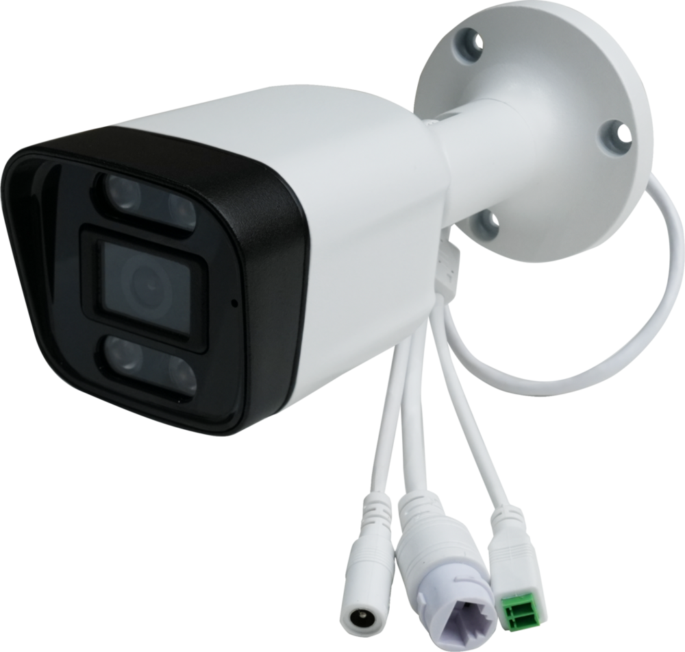
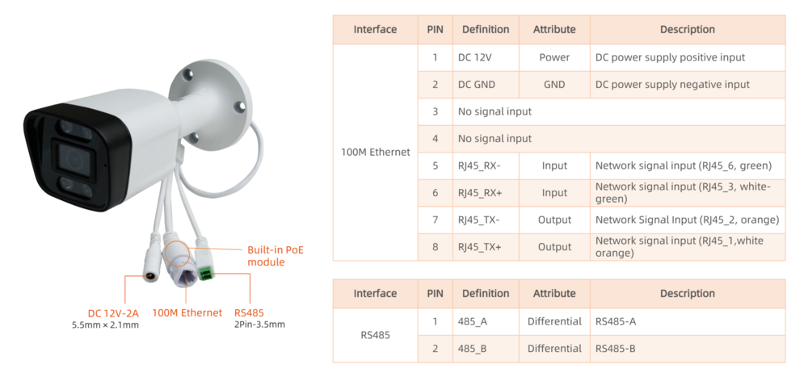
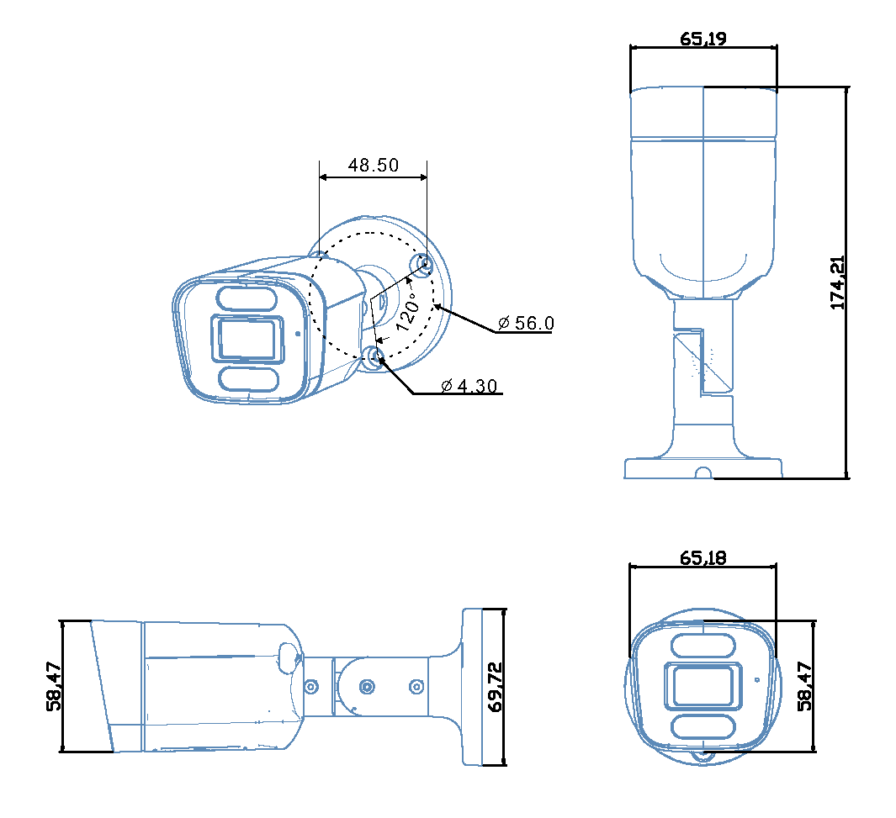

# Introduction

[Specification](https://download.t-firefly.com/Spec/Cameras/CQ38W-3576_CQ38W-3576J_CQ38W-3576M_Specification_EN.pdf) | [Purchase](https://www.firefly.store/products/ct36b-ai-smart-camera?variant=42693966757972) | [Downloads](https://community.t-firefly.com/en/doc/download/342)

**CQ38W-3576** Powered by the RK3576 octa-core AI processor and 6 TOPS NPU, it efficiently supports intelligent applications such as facial and gesture recognition. For imaging, it features a built-in 16MP ISP, supports 4K@120fps decoding and 4K@60fps encoding, and is paired with a 5MP/3MP HD camera to accurately capture details even in low-light environments. The device adopts an IP67 waterproof aluminum alloy housing and supports PoE, requiring only a single network cable for both power and data transmission. Easy to deploy, it is suitable for various scenarios including access control gates and smart security.

## Interface Description

**CQ38W-3576** interfaces include:

The details are shown below:

## Structure and Dimensions

## Resources and Support

* [[Technical Forum]](https://forum.t-firefly.com/): A communication platform with more than 100,000 enterprise customers and users

### Contact

* Email: sales@t-firefly.com
* Mobile: (+86) 186 8811 7175
* Landline: 0760-89881218
* Address: Room 2101, Hongyu Building, No. 57 Zhongshan 4th Road, East District, Zhongshan City, Guangdong Province