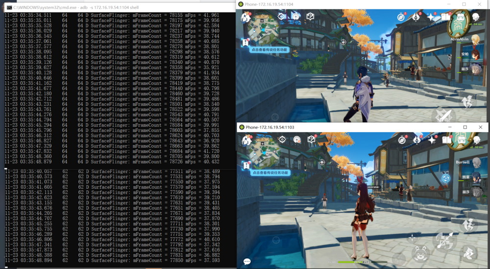

# Technical Case

<CodeBlockTabs defaultValue="fastdeploy">
  <CodeBlockTabsList>
    <CodeBlockTabsTrigger value="fastdeploy">PaddlePaddle FastDeploy</CodeBlockTabsTrigger>
    <CodeBlockTabsTrigger value="aic">Android in Container</CodeBlockTabsTrigger>
  </CodeBlockTabsList>
  <CodeBlockTab value="fastdeploy">
## PaddlePaddle FastDeploy

### Introduce
FastDeploy is an Easy-to-use and High Performance AI model deployment toolkit for Cloud, Mobile and Edge with out-of-the-box and unified experience, end-to-end optimization for over 150+ Text, Vision, Speech and Cross-modal AI models. Including image classification, object detection, image segmentation, face detection, face recognition, keypoint detection, matting, OCR, NLP, TTS and other tasks to meet developers' industrial deployment needs for multi-scenario, multi-hardware and multi-platform.

Currently FastDeploy initially supports rknpu2, it can run some AI models on RK3588. Other models are still being adapted. For detailed support list and progress please visit [github](https://github.com/PaddlePaddle/FastDeploy)

### On RK3588

#### Compilation and Installation
Notice: This manual is based on RK3588 Firefly Ubuntu20.04 v1.0.4a firmware and compiling with python 3.8. Firmware comes with rknpu2 v1.4.0 so here we will skip rknpu2 installation part. If you need C++ compilation or rknpu2 installaion please read Official Document:
https://github.com/PaddlePaddle/FastDeploy/blob/develop/docs/cn/build_and_install/rknpu2.md

##### Prepare
```bash
sudo apt update
sudo apt install -y python3 python3-dev python3-pip gcc python3-opencv python3-numpy
```
Here we offering a pre-build python whl for fast deploy: [Google Drive](https://drive.google.com/drive/folders/110zBB51npTFMFKl81wVrFsj2WZXa4GAL?usp=sharing).

If you decide to use this pre-build package then you can skip the building part (Preparation above is still needed). This pre-build package is based on FastDeploy v1.0.0 (commit id c4bb83ee)

<font color="red">Notice: This project is updated very frequently, the pre-build whl here may be outdated, only for quickly understand and test. For develop and deploy please build from the latest source:</font>
##### Building on RK3588
```bash
sudo apt update
sudo apt install -y gcc cmake

git clone https://github.com/PaddlePaddle/FastDeploy.git

cd FastDeploy/python

export ENABLE_ORT_BACKEND=ON
export ENABLE_RKNPU2_BACKEND=ON
export ENABLE_VISION=ON
export RKNN2_TARGET_SOC=RK3588
python3 setup.py build
python3 setup.py bdist_wheel
```
If your RK3588 has insufficient RAM, OOM error may occur, you can add `-j N` after `python3 setup.py build` to control jobs.

##### Installation on RK3588
You can find whl under FastDeploy/python/dist after building, or use pre-build package above. Use pip3 to install:
```bash
pip3 install fastdeploy_python-*-linux_aarch64.whl
```

#### Inference
Here are 3 tuned demos: [Google Drive](https://drive.google.com/drive/folders/110zBB51npTFMFKl81wVrFsj2WZXa4GAL?usp=sharing)

<font color="red">Notice: This project is updated very frequently, demos here may be outdated, only for quickly understand and test. For develop and deploy please get latest models from official github mentioned at the beginning of this article.</font>

decompress and run:
* Picodet object detection
```
cd demos/vision/detection/paddledetection/rknpu2/python

python3 infer.py --model_file ./picodet_s_416_coco_lcnet/picodet_s_416_coco_lcnet_rk3588.rknn \
                 --config_file ./picodet_s_416_coco_lcnet/infer_cfg.yml \
                 --image 000000014439.jpg
```

* Scrfd face detection
```
cd demos/vision/facedet/scrfd/rknpu2/python

python3 infer.py --model_file ./scrfd_500m_bnkps_shape640x640_rk3588.rknn \
                 --image test_lite_face_detector_3.jpg
```

* PaddleSeg portrait segmentaion
```
cd demos/vision/segmentation/paddleseg/rknpu2/python

python3 infer.py --model_file ./Portrait_PP_HumanSegV2_Lite_256x144_infer/Portrait_PP_HumanSegV2_Lite_256x144_infer_rk3588.rknn \
                 --config_file ./Portrait_PP_HumanSegV2_Lite_256x144_infer/deploy.yaml \
                 --image images/portrait_heng.jpg
```

### On PC

In the previous chapter, only the running environment was deployed on RK3588. Demo was converted and adjusted in advance on the PC. This means that further development such as model transformations, parameter adjustments, etc., will need to be done on the PC, so FastDeploy will also need to be installed on the x86_64 Linux PC.

#### Compilation and Installation
Needs: Ubuntu18 or above, python 3.6 or 3.8

##### Install rknn-toolkit2

Use conda or virtualenv to create a virtual environment for installation, for usage of conda or virtualenv please google it.

First go download the rknn_toolkit2 whl: [github](https://github.com/rockchip-linux/rknn-toolkit2/tree/master/packages)
```bash
sudo apt install -y libxslt1-dev zlib1g zlib1g-dev libglib2.0-0 libsm6 libgl1-mesa-glx libprotobuf-dev gcc g++

# Create virtual env
conda create -n rknn2 python=3.6
conda activate rknn2

# rknn_toolkit2 needs numpy 1.16.6
pip3 install numpy==1.16.6

# Install rknn_toolkit2
pip3 install rknn_toolkit2-1.4.0-*cp36*-linux_x86_64.whl
```

##### Build and Install FastDeploy
```bash
pip3 install wheel
sudo apt install -y cmake

git clone https://github.com/PaddlePaddle/FastDeploy.git
cd FastDeploy/python
export ENABLE_ORT_BACKEND=ON
export ENABLE_PADDLE_BACKEND=ON
export ENABLE_OPENVINO_BACKEND=ON
export ENABLE_VISION=ON
export ENABLE_TEXT=ON
# OPENCV_DIRECTORY is optional, it will download pre-build OpenCV if this option is empty
export OPENCV_DIRECTORY=/usr/lib/x86_64-linux-gnu/cmake/opencv4

python setup.py build
python setup.py bdist_wheel

pip3 install dist/fastdeploy_python-*-linux_x86_64.whl
pip3 install paddlepaddle
```

#### Examples and Tutorial
Many examples are under FastDeploy/examples, and tutorial can be found in README.md in every directory level.

</CodeBlockTab>
  <CodeBlockTab value="aic">
## Android in Container

AIC (Android in Container) means runing Android inside a container on Linux. RK3576 Linux can use docker to run Android and support running multiple Androids at the same time.

Cluster-Server with AIC can increase the amount of Androids, really helpful in cloud-mobile and cloud-gaming.

Here are some firmwares for testing: [Download](https://drive.google.com/drive/folders/1JvVj2VTJFpsZORyuEbG8oFtXP1ELOOJq?usp=sharing)

### Usage

Notice:

1. The host OS is Ubuntu Minimal without desktop, so using debug serial, ssh, adb shell etc. to interact.
2. Interaction with Android is through network adb and screen mirroring application like scrcpy, not by mouse/keyboard.
3. Operation AIC requires the following knowledge: basic Linux commands, docker commands, adb commands.

#### Create Containers

Firmwares come with an docker image, only need to create containers. Use script under /root/docker_sh/ to create:
```bash
./docker_sh/run_android.sh rk3588:firefly <id> <ipv4_address>

# example
./docker_sh/run_android.sh rk3588:firefly 0 192.168.100.1
```
`id` is a number you give to containers for easy management, id will be a part of the container name.

`ipv4_address` is the ip you give to containers, **it needs to be on the same subnet as the host and not in conflict with other devices or containers**.

If you need more Androids, just run it again, and remember to change the id and ip.

#### Connect to Containers

In the same local network, use any PC with adb to connect.
```bash
# <ip> is the target container's ip
adb connect <ip>

# After connection
# Start scrcpy
scrcpy -s <ip>
```
We skipped the tutorial of installing adb and scrcpy, please google it if you need.

#### Manage Containers

Use common docker commands to manage containers.
```bash
# Check all containers
root@firefly:~# docker ps -a
CONTAINER ID   IMAGE            COMMAND                  CREATED      STATUS                    PORTS     NAMES
cad5a331dea9   rk3588:firefly   "/init androidboot.h…"   6 days ago   Exited (137) 6 days ago             android_1
37f60c3b6b80   rk3588:firefly   "/init androidboot.h…"   6 days ago   Up 13 seconds                       android_0

# Start/Stop containers
docker start/stop <NAMES>

# Connect to Android shell(run exit to return)
docker exec -it <NAMES> sh

# Delete containers
docker rm <NAMES>
```
If the subnet of host changed, then you need to re-config the macvlan and change containers' ip.

Modify the parameters according to the actual situation.
```bash
docker network rm macvlan
docker network create -d macvlan --subnet=<SUBNET> --gateway=<GATEWAY> -o macvlan_mode=bridge -o parent=<PARENT> macvlan
```
Google for tutorial of changing docker container ip if you don't know.

### Performance

Run this cmd as root to enable performance mode to get better experience:
```bash
# It is normal to get an "Invalid argument", ignore it
root@firefly:~# echo performance | tee $(find /sys/devices -name *governor)
performance
tee: /sys/devices/system/cpu/cpuidle/current_governor: Invalid argument
```

Enter Android terminal or use adb shell to run this cmd can print the game fps:
```bash
# Notice: This cmd prints fps only when the game is running
setprop debug.sf.fps 1;logcat -s SurfaceFlinger
```

One RK3576 using AIC running two Genshin Impact with highest graphic setting at the same time can reach 35+ fps:
<center>


</center>

</CodeBlockTab>
</CodeBlockTabs>