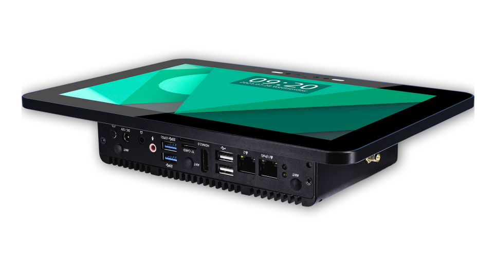
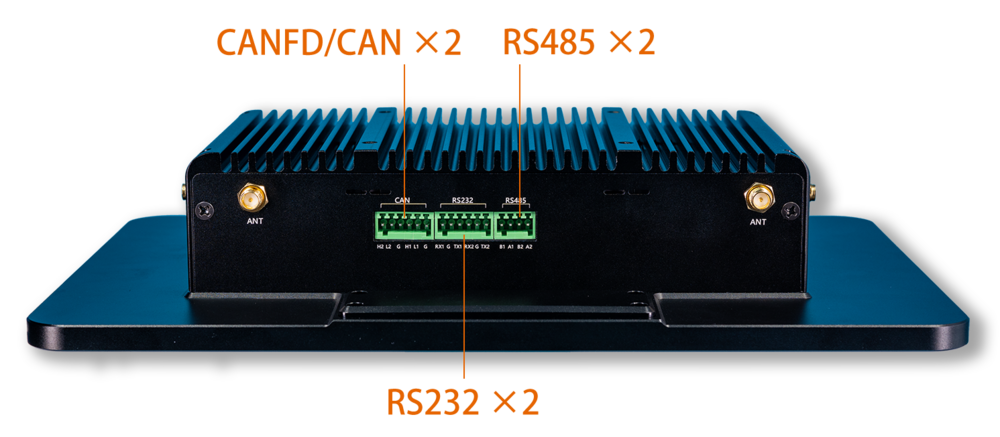
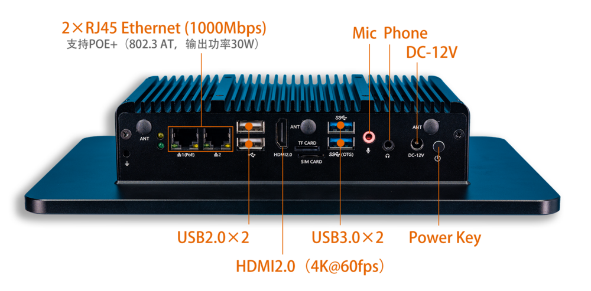
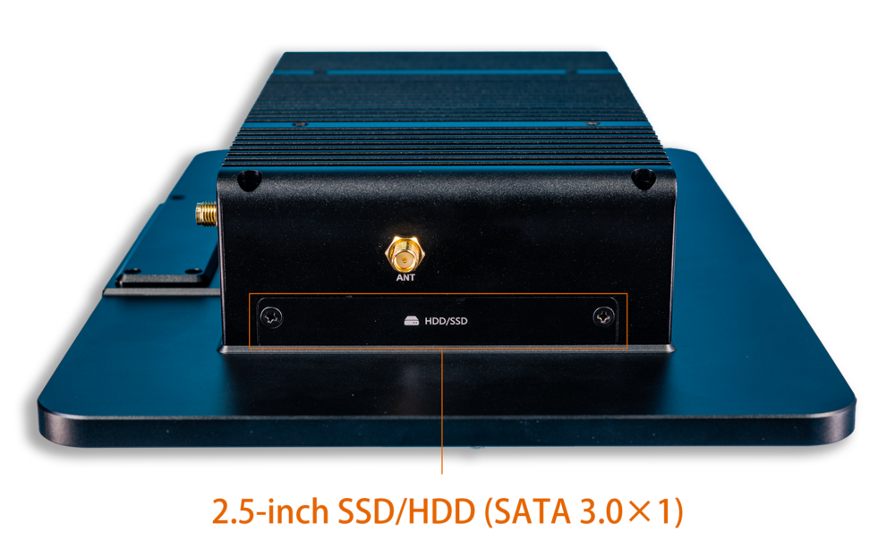
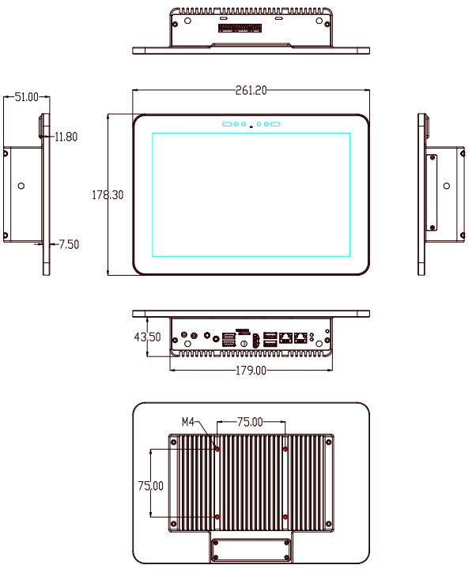

# Introduction

[Specification](https://download.t-firefly.com/Spec/Tablets/IPC-M10R800-A3568J_Specification_EN.pdf) | [Purchase](https://www.t-firefly.com/products/ipc-m10r800-a3568j-ai-industrial-tablet-pc?theme=pc) | [Downloads](https://community.t-firefly.com/en/doc/download/124)

IPC-M10R800-A3568J Industry Panel Computer, Based on AIO-3568J high-performance
open source platform and adopts capacitive 10-point touch screen, full-view HD display and
industrial-grade enclosure, dustproof, anti-jamming and capable of long-term stable operation. Moreover,
it supports 4K hardware acceleration, dual-screen identical display/dual-screen differential display and
has rich interface for easy connection of various industrial equipment.
It is equipped with ARM Cortex-A55 architecture, quad-core 64-bit high-performance processor,
frequency up to 2.0GHz, integrates GPU, support RKNN NPU AI,supports H.265 HEVC and VP9, H.264
encoding, 4K HDR, and has the maximum support of 4K hardware decoding.

## Interface Description

The IPC-M10R800-A3568J provides rich interfaces, mainly including:

- 12V DC power interface
- HDMI output (up to 4K@60fps)
- USB3.0 interface
- USB2.0 interface
- Gigabit Ethernet (RJ45)
- Industrial serial ports (RS232 / RS485)
- SATA interface
- TF card slot
- SIM card slot (optional 4G module)
- 3.5mm earphone jack (doubles as Recovery)
- 10.1-inch MIPI display (built-in, 10-point capacitive touch)

The interfaces of the IPC-M10R800-A3568J are shown in the figures below:

## Structure and Dimensions

## Resources and Support

- [Technical Forum](http://bbs.t-firefly.com/forum.php?mod=forumdisplay&fid=100): A communication platform with more than 100,000 enterprise customers and users

### Contact

- Email: sales@t-firefly.com
- Mobile: (+86) 186 8811 7175
- Landline: 0760-89881218
- Address: Room 2101, Hongyu Building, No. 57 Zhongshan 4th Road, East District, Zhongshan City, Guangdong Province
