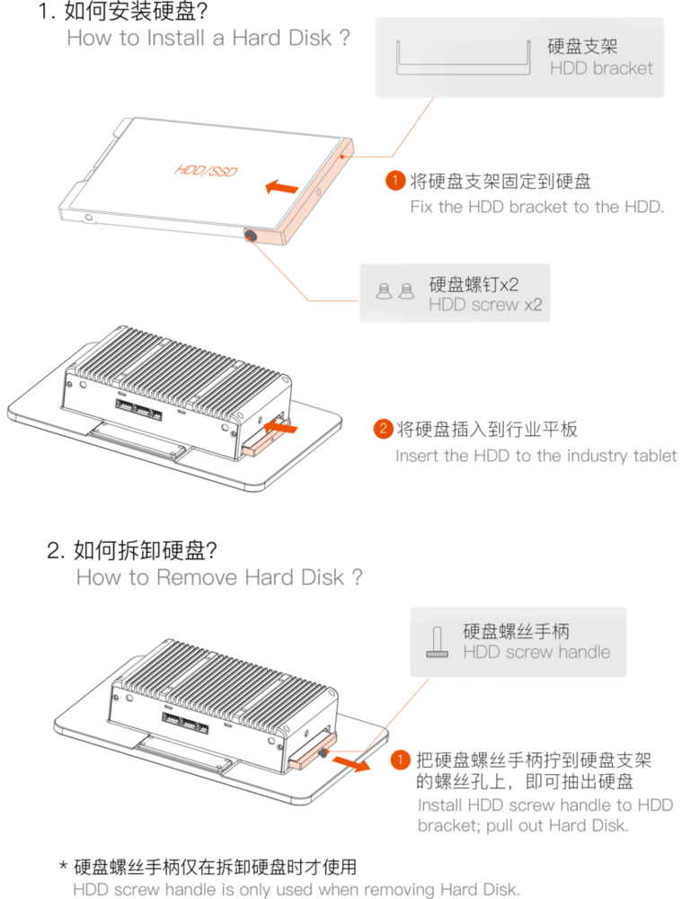

# Hardware Function Usage

## Debug Serial [step]

The IPC-M10R800-A3568J does not expose a debug serial port on the enclosure. You need to open the enclosure and connect a USB to TTL serial module to the debug serial port on the mainboard (AIO-3568J) for debugging.

For the connection and usage of the debug serial port, see: [Debug Serial](../hardware_usage/debug.md).

## Display Interface [step]

The IPC-M10R800-A3568J comes with a 10.1-inch MIPI display as standard, which is connected to the MIPI interface of the mainboard (AIO-3568J) at the factory. On Android, the display settings can be adjusted in `Settings -> Display`.

In addition, the AIO-3568J provides 1 HDMI 2.0 output interface, supporting up to 4K output. Whether it is exposed on the enclosure depends on the actual configuration of the product.

Get the edid, supported modes and connection status of HDMI:

```bash
busybox hexdump /sys/class/drm/card0-HDMI-A-1/edid
cat /sys/class/drm/card0-HDMI-A-1/modes
cat /sys/class/drm/card0-HDMI-A-1/status
```

Generally, if the HDMI display fails, first run the commands above to check whether the connection status, edid and resolution are correct.

## Ethernet [step]

The IPC-M10R800-A3568J provides an RJ45 Gigabit Ethernet port on the enclosure, corresponding to the Ethernet device in the system (such as `eth0`, depending on the actual system), consistent with the Ethernet solution of the AIO-3568J mainboard.

After the port is connected to the network, you can check the IP address via the debug serial port or adb:

```bash
ifconfig eth0
```

Connectivity test:

```bash
ping -I eth0 -c 10 www.baidu.com
```

When testing, please modify the target domain name/IP according to the actual network environment. On Linux, you can use `ip addr` or `ifconfig` to check the port status and IP address.

## USB Interfaces [step]

The IPC-M10R800-A3568J provides USB interfaces on the enclosure for USB flash drives, USB keyboards/mice and other devices (the number and specification of the interfaces depend on the actual configuration of the product). After a device is inserted, you can check whether it is recognized with `lsusb`:

```bash
lsusb
```

In addition, the USB OTG interface on the enclosure can be used to connect to a host for adb debugging or firmware upgrade (the interface form depends on the actual configuration of the product).

## UART (RS232 / RS485) [step]

The AIO-3568J provides RS232 and RS485 interfaces (terminal blocks). See the interface figures of the mainboard for the signal definitions. The exposed form on the enclosure depends on the actual configuration of the product. The serial device nodes depend on the actual system and can be listed with `ls /dev/ttyS*`.

### Send/Receive Verification

Take RS485 as an example. Connect the host and the computer with a USB to RS485 adapter (the adapter node on the host depends on the actual device, e.g. `/dev/ttyUSB0`; the RS485 node on the computer depends on the actual system, `/dev/ttyS1` is used as an example below).

The computer sends, the host receives:

```bash
# Run on the host terminal first
cat /dev/ttyUSB0
# Run on the debug serial terminal of the computer
echo "firefly RS485 test..." > /dev/ttyS1
```

The host terminal will receive the string `firefly RS485 test...`.

The host sends, the computer receives:

```bash
# Run on the debug serial terminal of the computer first
busybox stty -echo -F /dev/ttyS1       # disable echo
cat /dev/ttyS1
# Run on the host terminal
echo "firefly RS485 test..." > /dev/ttyUSB0
```

The debug serial terminal of the computer will receive the string `firefly RS485 test...`. The RS232 can be verified in the same way, just replace the node with the corresponding RS232 device node.

## SATA Drive Installation [step]

The IPC-M10R800-A3568J provides 1 SATA 3.0 interface inside the chassis, supporting 2.5-inch SSD/HDD. The installation is shown below:

<center>


</center>