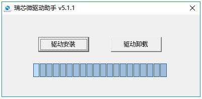
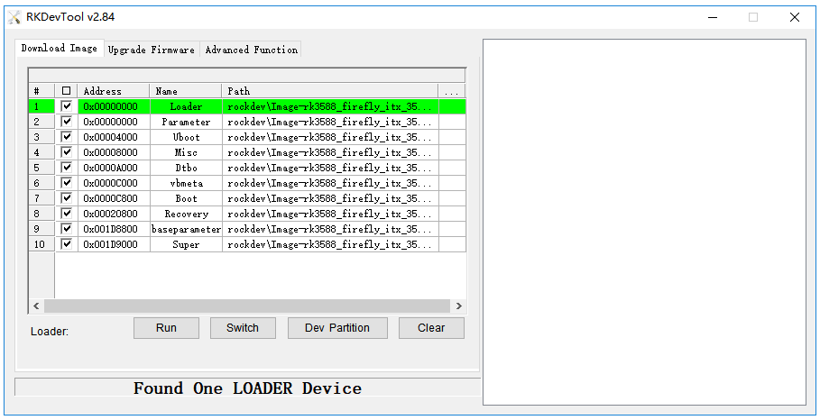
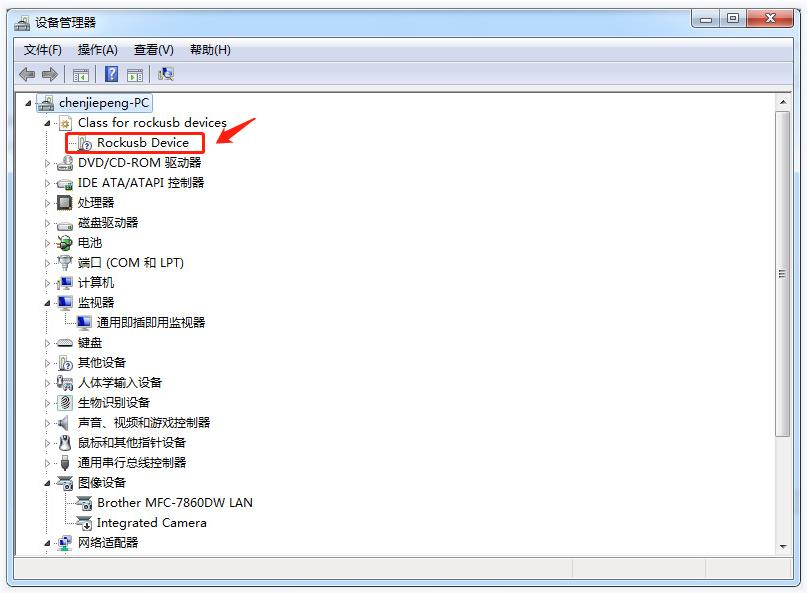
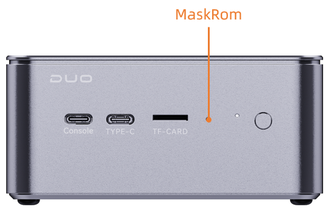
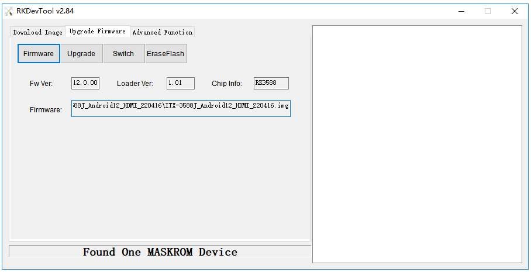
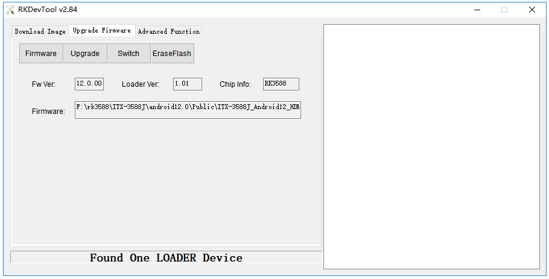

# USB Firmware Upgrade

## Introduction

This article describes how to upgrade the firmware file on the host to the flash memory of the AIBOX DUO through the Type-C Cable. When upgrading, you need to choose the appropriate upgrade mode according to the host operating system and firmware type.

## Preparatory Tools [step]

* AIBOX DUO
* [Firmware](https://community.t-firefly.com/en/doc/download/440)
* Host computer
* A good Type-C Cable

## Prepare Firmware [step]

The firmware can be obtained by compiling the SDK, or you can download the public firmware (unified firmware) from the [Resource download](https://community.t-firefly.com/en/doc/download/440). There are two types of firmware files:

* A single unified firmware

    The unified firmware is a single file packaged and merged from all files such as the partition table, bootloader, uboot, kernel, system, and so on. The firmware officially released by Firefly adopts the unified firmware format. Upgrading the unified firmware will update the data and partition table of all partitions on the board and erase all data on the board.

* Multiple partition images

    These are independent files for each function, such as the partition table, bootloader, kernel, etc., generated during the development stage. Independent partition images can update only the specified partition while keeping other partitions intact, which is convenient for debugging during development.

<Callout title="Note" type="info">With the unified firmware unpack/pack tool, you can unpack a unified firmware into multiple partition images, or merge multiple partition images into a single unified firmware.</Callout>

## Install the Flashing Tool [step]

<CodeBlockTabs defaultValue="Windows">
  <CodeBlockTabsList>
    <CodeBlockTabsTrigger value="Windows">Windows</CodeBlockTabsTrigger>
    <CodeBlockTabsTrigger value="Linux">Linux</CodeBlockTabsTrigger>
  </CodeBlockTabsList>

  <CodeBlockTab value="Windows">
    ### Windows

    * Install the RK USB driver

    Download [Release_DriverAssistant.zip](https://community.t-firefly.com/en/doc/download/440), extract it, and run DriverInstall.exe inside. To make all devices use the updated driver, first select `Uninstall Driver`, and then select `Install Driver`.

    <center>

    
    </center>

    * Run RKDevTool.exe of AndroidTool

    <Callout title="Notice" type="warn">
      To avoid flashing issues caused by the tool version, it is recommended to use the tool bundled inside the public firmware package for flashing.
    </Callout>

    <center>

    
    </center>
  </CodeBlockTab>

  <CodeBlockTab value="Linux">
    ### Linux

    No device driver needs to be installed on Linux.

    * [Linux_Upgrade_Tool](https://community.t-firefly.com/en/doc/download/440)

    Download [Linux_Upgrade_Tool](https://community.t-firefly.com/en/doc/download/440) and install it into the system as follows for easy invocation:

    ```
    unzip Linux_Upgrade_Tool_xxxx.zip
    cd Linux_UpgradeTool_xxxx
    sudo mv upgrade_tool /usr/local/bin
    sudo chown root:root /usr/local/bin/upgrade_tool
    sudo chmod a+x /usr/local/bin/upgrade_tool
    ```

    * [Linux_adb_fastboot](https://community.t-firefly.com/en/doc/download/440)

    Download [Linux_adb_fastboot](https://community.t-firefly.com/en/doc/download/440) and install it into the system as follows for easy invocation:

    ```
    sudo mv adb /usr/local/bin
    sudo chown root:root /usr/local/bin/adb
    sudo chmod a+x /usr/local/bin/adb
    ```
    ```
    sudo mv fastboot /usr/local/bin
    sudo chown root:root /usr/local/bin/fastboot
    sudo chmod a+x /usr/local/bin/fastboot
    ```
  </CodeBlockTab>
</CodeBlockTabs>

## Enter Upgrade Mode [step]

There are usually two modes for upgrading firmware: Loader mode and MaskRom mode. Before flashing the firmware, we need to connect the device and put the board into an upgradable mode.

<CodeBlockTabs defaultValue="loader">
  <CodeBlockTabsList>
    <CodeBlockTabsTrigger value="loader">Loader mode</CodeBlockTabsTrigger>
    <CodeBlockTabsTrigger value="maskrom">MaskRom mode</CodeBlockTabsTrigger>
  </CodeBlockTabsList>

  <CodeBlockTab value="loader">
    ### Loader mode

    The AIBOX DUO chassis has no Recovery button, so there is no hardware way to enter Loader mode. Please use the software method.

    #### Enter Loader mode by software

    After the Type-C Cable is connected, run the following command on the board via the debug serial terminal or adb shell:

    ```shell
    reboot loader
    ```

    #### Check Loader mode

    To determine whether the board has entered Loader mode, you can check with the tools.

    **Windows**

    The AndroidTool shows the message `Found One LOADER Device`:

    <center>

    
    </center>

    If the tool still does not show LOADER after entering Loader mode, check whether the Windows host prompts that new hardware is found and the driver is configured. Open Device Manager and you will see the new device `Rockusb Device`, as shown below. If not, go back to the previous step and [install the driver](upgrade_firmware.md#windows-cao-zuo-xi-tong) again.

    <center>

    
    </center>

    **Linux**

    After running upgrade_tool, you can see a `Loader` prompt among the connected devices:

    ```shell
    firefly@T-chip:~/severdir/down_firmware$ sudo upgrade_tool
    List of rockusb connected
    DevNo=1 Vid=0x2207,Pid=0x330c,LocationID=106    Loader
    Found 1 rockusb,Select input DevNo,Rescan press <R>,Quit press <Q>:q
    ```
  </CodeBlockTab>

  <CodeBlockTab value="maskrom">
    ### MaskRom mode

    `MaskRom` mode is the last line of defense for a bricked device. Forcing entry into `MaskRom` involves hardware operations and carries certain risks, so only try `MaskRom` mode when the device cannot enter `Loader` mode.

    <Callout title="Notice" type="warn">Read carefully and operate with caution!</Callout>

    Press and hold the MaskRom button on the AIBOX DUO chassis and keep it held, then connect the power:

    <center>

    
    </center>

    At this point, the device enters MaskRom mode.

    <center>

    
    </center>
  </CodeBlockTab>
</CodeBlockTabs>

## Flash the Firmware [step]

<CodeBlockTabs defaultValue="Windows">
  <CodeBlockTabsList>
    <CodeBlockTabsTrigger value="Windows">Windows</CodeBlockTabsTrigger>
    <CodeBlockTabsTrigger value="Linux">Linux</CodeBlockTabsTrigger>
  </CodeBlockTabsList>

  <CodeBlockTab value="Windows">
    ### Windows

    #### Flash the unified firmware update.img

    The steps to flash the unified firmware update.img are as follows:

    1. Switch to the `Upgrade Firmware` tab.
    2. Click the `Firmware` button to open the firmware file to be upgraded. The tool will show detailed firmware information.
    3. Click the `Upgrade` button to start the upgrade.
    4. If the upgrade fails, you can try clicking the `EraseFlash` button first to erase the Flash, and then upgrade again.

    <center>

    
    </center>
  </CodeBlockTab>

  <CodeBlockTab value="Linux">
    ### Linux

    #### Flash the unified firmware update.img

    ```
    sudo upgrade_tool uf update.img
    ```

    <Callout title="Notice" type="warn">
      If the upgrade fails, you can try erasing first and then upgrading again.
    </Callout>

    ```
    # The ef parameter for erasing the flash requires a loader file or the corresponding update.img
    sudo upgrade_tool ef update.img   # update.img: the firmware you want to flash
    # Flash again
    sudo upgrade_tool uf update.img
    ```
  </CodeBlockTab>
</CodeBlockTabs>