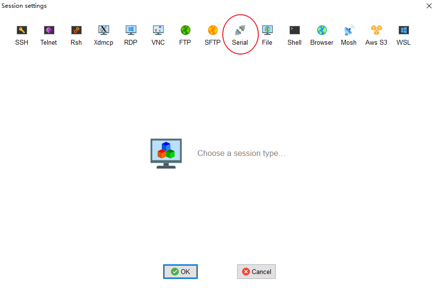

# Hardware Function Usage

## Login [step]

There are two ways to log in to the AIBOX DUO: one is terminal login through the Console (debug serial), and the other is login through HDMI.

### Console Login (Debug Serial)

Connect the AIBOX DUO to the computer with a Type-C data cable. The login account is `root`, and no `root` password is set by default. Serial port parameters:

* Baud rate: 1500000
* Data bits: 8
* Stop bits: 1
* Parity check: None
* Flow control: None

<center>


</center>

#### Serial Debugging on Windows

The system will prompt that new hardware is found and complete the initialization. Then you can find the corresponding COM port in Device Manager:

<center>


</center>

On Windows, putty or SecureCRT is generally used. Here we recommend the free version of MobaXterm, which is a powerful terminal software. Other serial port software is used in a similar way.

1. Select `Serial` as the `session` type.
2. Set the `Serial port` to the COM port found in Device Manager.
3. Set `Speed (bsp)` to `1500000`.
4. Click the `OK` button.

<center>


</center>

<center>


</center>

#### Serial Debugging on Ubuntu

Install minicom:

```
sudo apt-get install minicom
```

Use `minicom -s` to open the configuration interface, enter `Serial port setup`, and set the serial port parameters to `1500000 8N1`:

* `E - Bps/Par/Bits`: `1500000 8N1`
* `F - Hardware Flow Control`: `No`
* `G - Software Flow Control`: `No`

<Callout title="Note" type="warn">Both `Hardware Flow Control` and `Software Flow Control` must be set to No, otherwise input may become impossible.</Callout>

After the configuration is completed, select `Save setup as dfl` to save it as the default configuration. After exiting, minicom will connect to the debug serial port at 1500000-8-N-1. Log in with the `root` account (no password is set by default).

### HDMI Login

When logging in via the display, the system automatically logs in as the user `firefly`, and the password is also `firefly`. It then enters the Debian 13 desktop. The desktop is considered normal if it is displayed correctly without any artifacts, as shown below:

<center>


</center>

## Watchdog [step]

### Introduction

The watchdog is actually a timer. Once started, it begins counting. The system or software needs to communicate with the watchdog within the specified time (commonly known as "feeding the watchdog") to reset the count, repeatedly, to confirm that the system and software are running normally. If the watchdog is not fed within the specified time, it times out, which means the system or application is stuck in a loop or frozen; the watchdog then issues a reset signal to reset the main controller and recover from the freeze.

### Usage

The external watchdog device name of the AIBOX DUO is `/dev/wdt_crl`. Usage:

```shell
# Write different fields to enable the watchdog and set the timeout.
# The numbers 0, 1, 2, and 3 represent 0.64s, 2.56s, 10.24s, and 40.96s, respectively.
# The letter 'e' enables the watchdog, while the letter 'd' disables it.

# Enable with a 10.24-second timer; write to it once every 10.24 seconds.
# You can also write different numbers at any time to change the timeout.
echo e >/dev/wdt_crl # Enable
echo 2 >/dev/wdt_crl # Set the timeout to 10.24 seconds
```

## RTC [step]

AIBOX DUO has an external RTC powered by a capacitor on the baseboard, which keeps the RTC running for a short period after power loss. In the kernel, it is represented as `rtc0`.

Linux provides three user-space interfaces for interacting with the RTC. The paths are (the device number is subject to the actual system):

* SYSFS interface: /sys/class/rtc/rtc0/
* PROCFS interface: /proc/driver/rtc
* IOCTL interface: /dev/rtc0

Synchronize the latest system time to the RTC:

```
hwclock -w
```

### SYSFS interface

You can directly use `cat` and `echo` to operate the interfaces under /sys/class/rtc/rtc0/.

For example, to view the current RTC date and time:

```
root@firefly:/# cat /sys/class/rtc/rtc0/date
2026-11-20
root@firefly:/# cat /sys/class/rtc/rtc0/time
02:55:48
```

### PROCFS interface

To print RTC-related information:

```
root@firefly:/# cat /proc/driver/rtc
rtc_time        : 02:56:25
rtc_date        : 2026-11-20
alrm_time       : 02:52:00
alrm_date       : 2026-11-21
alarm_IRQ       : no
alrm_pending    : no
update IRQ enabled      : no
periodic IRQ enabled    : no
periodic IRQ frequency  : 1
max user IRQ frequency  : 64
24hr            : yes
root@firefly:/#
```

### IOCTL interface

You can use `ioctl` to control `/dev/rtc0`.

For detailed usage instructions, refer to `kernel-jammy-src/Documentation/admin-guide/rtc.rst`.

### FAQs

#### Q: Does the time persist after power loss?

A: No. The RTC is powered by a capacitor on the external baseboard and can only keep running for a short period after power loss. After a long power-off, the time will be lost; please resynchronize the system time after boot (`hwclock -w` or network time synchronization).

## Debug Interface [step]

### Preparation

The debug serial port of the AIBOX DUO uses an onboard TTL serial solution — the TTL chip is already on board, so no external USB-to-TTL debug board is required. Prepare a Type-C data cable and connect the Console port of the AIBOX DUO to your computer to start debugging.

### Debugging

The serial port parameters are `1500000-8-N-1` (baud rate 1500000, 8 data bits, 1 stop bit, no parity, no flow control). For the configuration of serial tools and terminal login, see the [Login → Console Login (Debug Serial)](#console-login-debug-serial) section above.

## Type-C Interface [step]

The Type-C interface of the AIBOX DUO is a full-function interface, supporting USB 3.0 data transfer, DP audio/video output, ADB debugging, and firmware flashing. The usage of each function is demonstrated below:

<center>


</center>

### USB 3.0 Data Transfer

Connect the Type-C interface to the computer with an OTG cable, and connect a USB drive to the USB 3.0 interface. You can list the USB drive with `lsblk`, and use the fio tool to test its read/write speed. Steps:

```
root@firefly:/# lsblk
NAME         MAJ:MIN RM   SIZE RO TYPE MOUNTPOINTS
sda            8:0    1 115.5G  0 disk
root@firefly:/# mkdir -p /mnt/user-disk
root@firefly:/# sudo mount /dev/sda /mnt/user-disk/
root@firefly:/# cd /mnt/user-disk/
root@firefly:/# sudo fio --name=write --filename=testfile --rw=write --bs=1M --size=1G --direct=1     # Write test
root@firefly:/# sudo fio --name=read --filename=testfile --rw=read --bs=1M --size=1G --direct=1       # Read test
```

### DP Audio and Video Output

Connect a DP display to the Type-C interface, and check whether the display device and the DP sound card are enumerated. Play a video via command or mouse click, and verify that the display outputs video and the sound card works properly. Steps for playing the video from the serial terminal:

```
root@firefly:/# cd /home/firefly
root@firefly:/home/firefly# ls /sys/class/drm
card0  card0-DP-1  card0-HDMI-A-1  card0-Writeback-1  card1  renderD128  renderD129  version
root@firefly:/home/firefly# aplay -l
**** List of PLAYBACK Hardware Devices ****
card 0: rockchiphdmi0 [rockchip-hdmi0], device 0: rockchip-hdmi0 i2s-hifi-0 [rockchip-hdmi0 i2s-hifi-0]
  Subdevices: 1/1
  Subdevice #0: subdevice #0
card 1: rockchipdp0 [rockchip-dp0], device 0: rockchip-dp0 spdif-hifi-0 [rockchip-dp0 spdif-hifi-0]
  Subdevices: 1/1
  Subdevice #0: subdevice #0
root@firefly:/home/firefly#
root@firefly:/home/firefly# sudo -u firefly XDG_RUNTIME_DIR=/run/user/1000 gst-play-1.0 4K_H264_bird.mp4
```

The DP display shows as follows:

<center>


</center>

### ADB Debugging

Connect the Type-C interface to the computer. If the `adb devices` command in the computer terminal detects an adb device, you can continue with the following test steps:

```
# 1. Check whether the adb device exists
lhj@lhj-TChip:~$ adb devices
List of devices attached
b38d4440e15767c9	device
lhj@lhj-TChip:~$
# 2. Push the local adb_test.txt file to the board
lhj@lhj-TChip:~$ adb push adb_test.txt /home/firefly
adb_test.txt: 1 file pushed, 0 skipped.
lhj@lhj-TChip:~$
# 3. Delete the local adb_test.txt file
lhj@lhj-TChip:~$ rm adb_test.txt
lhj@lhj-TChip:~$
# 4. Pull the board-side adb_test.txt back to the local machine
lhj@lhj-TChip:~$ adb pull /home/firefly/adb_test.txt ./
/home/firefly/adb_test.txt: 1 file pulled, 0 skipped.
lhj@lhj-TChip:~$
# 5. Check the pulled adb_test.txt file locally
lhj@lhj-TChip:~$ ls adb_test.txt
adb_test.txt
lhj@lhj-TChip:~$
# 6. Enter the board system via adb
lhj@lhj-TChip:~$ adb shell
root@firefly:/# cd /home/firefly/
root@firefly:/home/firefly# ls
4K_H264_bird.mp4  Desktop    Downloads	Pictures  Templates
adb_test.txt	  Documents  Music	Public	  Videos
lhj@lhj-TChip:~$
# 7. Exit the board system
root@firefly:/home/firefly# exit
logout
lhj@lhj-TChip:~$
```

### Firmware Flashing

Connect the AIBOX DUO to the computer with a Type-C data cable, and flash the complete firmware or partition images with the flashing tool. For detailed steps, see [USB Firmware Upgrade](../getting_started/firmware_upgrade/upgrade_firmware.md).

## TF-CARD [step]

The AIBOX DUO provides 1 TF card slot, which can be used for SD card firmware upgrade. For detailed steps, see [SD Card Firmware Upgrade](../getting_started/firmware_upgrade/upgrade_firmware_sd.md). You can also insert a TF card as extended storage. After insertion, the system recognizes and mounts it automatically, which you can check with `lsblk` or `df -h`:

```
root@firefly:/# lsblk
NAME         MAJ:MIN RM   SIZE RO TYPE MOUNTPOINTS
mmcblk1      179:96   0  28.9G  0 disk
└─mmcblk1p1  179:97   0  28.8G  0 part
root@firefly:/#
root@firefly:/# mkdir -p /mnt/user-disk
root@firefly:/# sudo mount /dev/mmcblk1p1 /mnt/user-disk/
root@firefly:/# cd /mnt/user-disk/
root@firefly:/# sudo fio --name=write --filename=testfile --rw=write --bs=1M --size=1G --direct=1     # Write test
root@firefly:/# sudo fio --name=read --filename=testfile --rw=read --bs=1M --size=1G --direct=1       # Read test
```

<center>


</center>

## HDMI Interface [step]

The AIBOX DUO provides 1 HDMI output interface. Connect a display with an HDMI cable, and the display outputs after boot; the desktop logs in automatically as the `firefly` user (password also `firefly`). See [Login → HDMI Login](#hdmi-login) above.

<center>


</center>

## Type-A (USB3.0) Interface [step]

The AIBOX DUO provides 2 USB 3.0 Type-A interfaces for USB drives, mobile hard disks, USB keyboards/mice, etc., and is backward compatible with USB 2.0 devices. After insertion, the system recognizes them automatically, which you can check with `lsblk` or `df -h`. For storage devices connected to the USB interfaces, you can also enter the mount directory and run read/write tests with the fio tool — see the [USB 3.0 Data Transfer section under the Type-C interface](#usb-30-data-transfer).

<center>


</center>

## Ethernet Interface [step]

The AIBOX DUO has 2 onboard RJ45 gigabit ports (1000Mbps). After connecting a network cable, the system obtains an IP address automatically via DHCP by default. You can use `ifconfig` or `ip addr` to view the network interfaces and IP addresses.

<center>


</center>

The two ports support different network segments for multi-network access. Being able to ping devices in the LAN means LAN communication works; with a switch connecting the network, network connection and testing can be carried out. Steps:

```
# 1. Query the local IP address
root@firefly:/# ifconfig
eth1: flags=4163<UP,BROADCAST,RUNNING,MULTICAST>  mtu 1500
        inet 172.16.11.125  netmask 255.255.0.0  broadcast 172.16.255.255
        inet6 fe80::ae73:2f09:ade3:b163  prefixlen 64  scopeid 0x20<link>
        ether e6:03:f8:b2:fe:44  txqueuelen 1000  (Ethernet)
        RX packets 3660842  bytes 514432339 (490.6 MiB)
        RX errors 0  dropped 35681  overruns 0  frame 0
        TX packets 20942  bytes 1486330 (1.4 MiB)
        TX errors 0  dropped 0 overruns 0  carrier 0  collisions 0
        device interrupt 67
root@firefly:/#
# 2. Ping a device in the LAN to test connectivity
root@firefly:/# ping 172.16.10.222
PING 172.16.10.222 (172.16.10.222) 56(84) bytes of data.
64 bytes from 172.16.10.222: icmp_seq=1 ttl=64 time=0.319 ms
64 bytes from 172.16.10.222: icmp_seq=2 ttl=64 time=0.187 ms
root@firefly:/#
# 3. Ping baidu.com to test the network connection
root@firefly:/# ping www.baidu.com
PING www.a.shifen.com (103.235.47.188) 56(84) bytes of data.
64 bytes from 103.235.47.188: icmp_seq=1 ttl=47 time=270 ms
64 bytes from 103.235.47.188: icmp_seq=2 ttl=47 time=279 ms
# 4. Transfer files in the LAN via scp
root@firefly:/home/firefly# scp gamc_test.txt lhj@172.16.10.222:/home/lhj
The authenticity of host '172.16.10.222 (172.16.10.222)' can't be established.
ED25519 key fingerprint is SHA256:/RlnTm7K/AQQTx2QHyktaYQCHP2LLXXHe27bjpHxSSE.
This key is not known by any other names.
Are you sure you want to continue connecting (yes/no/[fingerprint])? yes       # Enter yes when prompted
Warning: Permanently added '172.16.10.222' (ED25519) to the list of known hosts.
lhj@172.16.10.222's password:
gamc_test.txt                                                                            100%    0     0.0KB/s   00:00
root@firefly:/home/firefly#
```