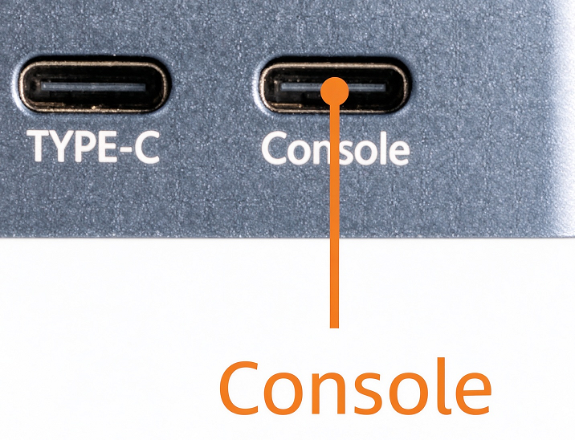
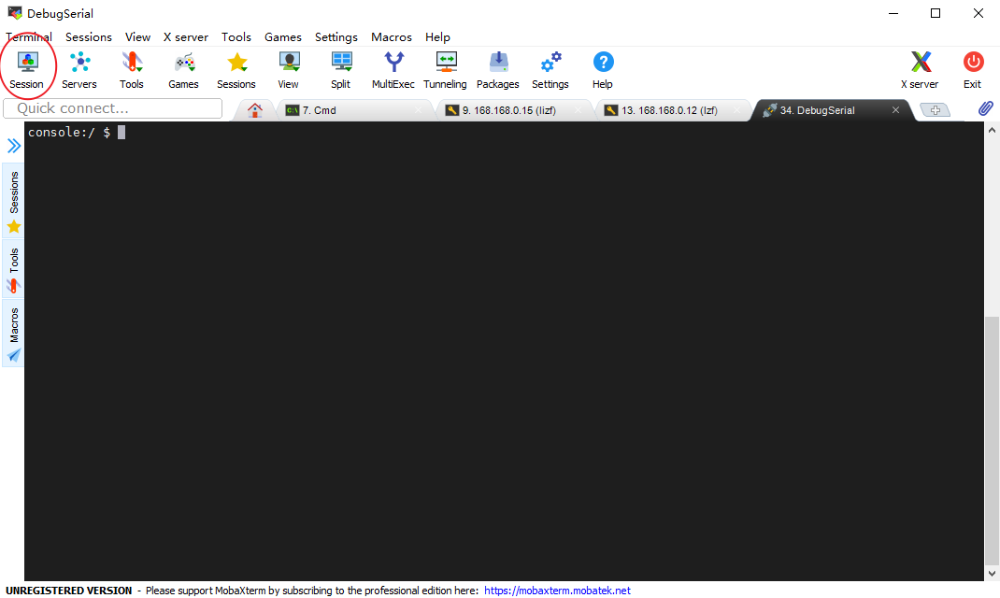

# Hardware Function Usage

## Login [step]

There are two ways to log in to the AIBOX DUO: one is terminal login through the Console (debug serial), and the other is login through HDMI.

### Console Login (Debug Serial)

Connect the AIBOX DUO to the computer with a Type-C data cable. The login account is `root`, and no `root` password is set by default. Serial port parameters:

* Baud rate: 1500000
* Data bits: 8
* Stop bits: 1
* Parity check: None
* Flow control: None

<center>


</center>

#### Serial Debugging on Windows

The system will prompt that new hardware is found and complete the initialization. Then you can find the corresponding COM port in Device Manager:

<center>


</center>

On Windows, putty or SecureCRT is generally used. Here we recommend the free version of MobaXterm, which is a powerful terminal software. Other serial port software is used in a similar way.

1. Select `Serial` as the `session` type.
2. Set the `Serial port` to the COM port found in Device Manager.
3. Set `Speed (bsp)` to `1500000`.
4. Click the `OK` button.

<center>


</center>

<center>


</center>

#### Serial Debugging on Ubuntu

Install minicom:

```
sudo apt-get install minicom
```

Use `minicom -s` to open the configuration interface, enter `Serial port setup`, and set the serial port parameters to `1500000 8N1`:

* `E - Bps/Par/Bits`: `1500000 8N1`
* `F - Hardware Flow Control`: `No`
* `G - Software Flow Control`: `No`

<Callout title="Note" type="warn">Both `Hardware Flow Control` and `Software Flow Control` must be set to No, otherwise input may become impossible.</Callout>

After the configuration is completed, select `Save setup as dfl` to save it as the default configuration. After exiting, minicom will connect to the debug serial port at 1500000-8-N-1. Log in with the `root` account (no password is set by default).

### HDMI Login

When logging in via HDMI, the system automatically logs in as the user `firefly`, and the password is also `firefly`.

## AI Coprocessors [step]

AIBOX DUO carries two onboard RK1828 AI coprocessors working alongside the RK3588 host: the host handles system scheduling and general-purpose computing, while the two RK1828 units act as dedicated AI computing acceleration units focused on high-performance neural network inference. They support local deployment of large models such as Qwen3.5-9B and google/gemma-4-12B-it, with concurrent execution of AI tasks such as multi-channel video recognition and target detection/tracking.

The system provides the `rknn-smi` (System Management Interface) tool for RK1828 device information collection, function configuration, and log management. Common commands:

```shell
sudo rknn-smi -v                      # query software version
sudo rknn-smi info -l                 # query hardware version
sudo rknn-smi info -w                 # status monitoring
sudo rknn-smi set -t work_mode -s 2   # set performance mode
```

For details, refer to `docs/Tools/Rockchip_User_Guide_RKNN-SMI_Tool_CN.pdf` in the RK182X SDK. For model deployment and the development workflow, see [AI Coprocessor Development](ai_rk182x.md).

## Watchdog [step]

### Introduction

The watchdog is actually a timer. Once started, it begins counting. The system or software needs to communicate with the watchdog within the specified time (commonly known as "feeding the watchdog") to reset the count, repeatedly, to confirm that the system and software are running normally. If the watchdog is not fed within the specified time, it times out, which means the system or application is stuck in a loop or frozen; the watchdog then issues a reset signal to reset the main controller and recover from the freeze.

### Usage

The external watchdog device name of the AIBOX DUO is `/dev/wdt_crl`. Usage:

```shell
# Write different fields to enable the watchdog and set the timeout.
# The numbers 0, 1, 2, and 3 represent 0.64s, 2.56s, 10.24s, and 40.96s, respectively.
# The letter 'e' enables the watchdog, while the letter 'd' disables it.

# Enable with a 10.24-second timer; write to it once every 10.24 seconds.
# You can also write different numbers at any time to change the timeout.
echo e >/dev/wdt_crl # Enable
echo 2 >/dev/wdt_crl # Set the timeout to 10.24 seconds
```

## RTC [step]

AIBOX DUO has an external RTC powered by a capacitor on the baseboard, which keeps the RTC running for a short period after power loss. In the kernel, it is represented as `rtc0`.

Linux provides three user-space interfaces for interacting with the RTC. The paths are (the device number is subject to the actual system):

* SYSFS interface: /sys/class/rtc/rtc0/
* PROCFS interface: /proc/driver/rtc
* IOCTL interface: /dev/rtc0

Synchronize the latest system time to the RTC:

```
hwclock -w
```

### SYSFS interface

You can directly use `cat` and `echo` to operate the interfaces under /sys/class/rtc/rtc0/.

For example, to view the current RTC date and time:

```
# cat /sys/class/rtc/rtc0/date
2024-07-10
# cat /sys/class/rtc/rtc0/time
02:36:30
```

### PROCFS interface

To print RTC-related information:

```
# cat /proc/driver/rtc
rtc_time        : 02:37:00
rtc_date        : 2024-07-10
alrm_time       : 00:00:00
alrm_date       : 1970-01-01
alarm_IRQ       : no
alrm_pending    : no
update IRQ enabled      : no
periodic IRQ enabled    : no
periodic IRQ frequency  : 1
max user IRQ frequency  : 64
24hr            : yes
```

### IOCTL interface

You can use `ioctl` to control `/dev/rtc0`.

For detailed usage instructions, refer to `kernel-jammy-src/Documentation/admin-guide/rtc.rst`.

### FAQs

#### Q: Does the time persist after power loss?

A: No. The RTC is powered by a capacitor on the external baseboard and can only keep running for a short period after power loss. After a long power-off, the time will be lost; please resynchronize the system time after boot (`hwclock -w` or network time synchronization).