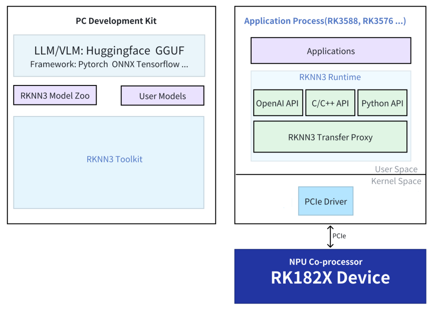

# RK1820/RK1828 Platform

This page describes the RKNN3 software stack and the rknn-smi management tool on the RK1820/RK1828 platform.

## Architecture

The main SoC connects to the coprocessor via the high-speed PCIe interface:

- RK3588/RK3576 SoC (Host): As the core of the system, responsible for task scheduling, resource allocation, and overall control.
- RK1820/RK1828 Coprocessor (Device): As an AI computing acceleration unit, focuses on high-performance neural network inference tasks.
- PCIe: Realizes low-latency, high-bandwidth data exchange between the main SoC and the coprocessor.

## Using RK1820/RK1828

Refer to the [RK1828 AI Computing Module](/en/docs/products/accessories/RK182x/started)

## RKNN3 SDK

### SDK Directory

The `rknn` directory in the RK182X SDK:

```
rknn/
├── rknn3-model-zoo
├── rknn3-runtime
├── rknn3-toolkit
└── rknn-gstreamer-plugins
```

### SDK Block Diagram

<center>


</center>

### RKNN3 Model Zoo

Provide deployment examples of classic models on the RK1820/RK1828 platform. For more details, refer to [GitHub](https://github.com/airockchip/rknn3-model-zoo).

### RKNN3 Runtime

The RKNN3 C API is the C language interface for the RKNN3 Runtime. Developers use C/C++ to develop applications and deploy model inference through the RKNN3 C API.

### RKNN3 Toolkit

RKNN3 Toolkit is a development kit that provides users with model transformation, inference, and performance evaluation on the PC platform.

**RKNN3 Toolkit** is incompatible with [RKNN-Toolkit](https://github.com/airockchip/rknn-toolkit) and [RKNN-Toolkit2](https://github.com/airockchip/rknn-toolkit2). For more details, refer to [GitHub](https://github.com/airockchip/rknn3-toolkit).

## rknn-smi

rknn-smi (System Management Interface) is used for collecting RK1820/RK1828 device information, configuring functions, and managing logs.

| Function | Command |
| :--- | :--- |
| Software version | `sudo rknn-smi -v` |
| Hardware version | `sudo rknn-smi info -l` |
| Status | `sudo rknn-smi info -w` |
| Performance mode | `sudo rknn-smi set -t work_mode -s 2` |
| Power consumption (not supported on hardware) | `sudo rknn-smi info -t power` |

For detailed usage, see `docs/Tools/Rockchip_User_Guide_RKNN-SMI_Tool_EN.pdf` in the RK182X SDK.

### FAQ

**Intermittent "Failed to initialize rknnsmi" error**

Add an appropriate delay to `/lib/systemd/system/rknn3.service`:

```
[Unit]
Description=rknn3 runtime service
DefaultDependencies=no
After=local-fs.target

[Service]
Type=forking
ExecStartPre=/bin/sleep 3 # delay 3 seconds
ExecStart=/bin/rknn3_startup start
ExecStop=/bin/rknn3_startup stop

[Install]
WantedBy=sysinit.target
```