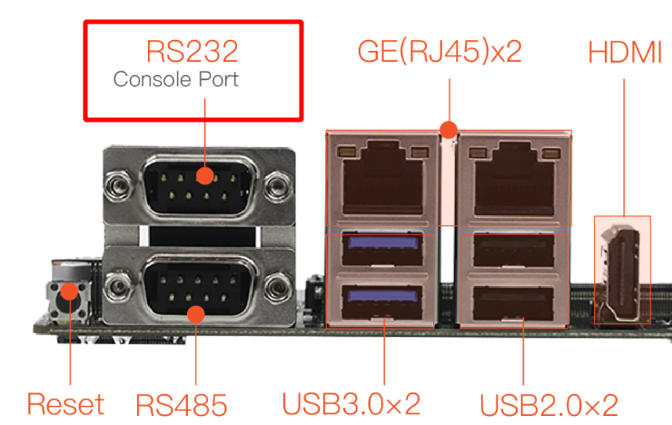
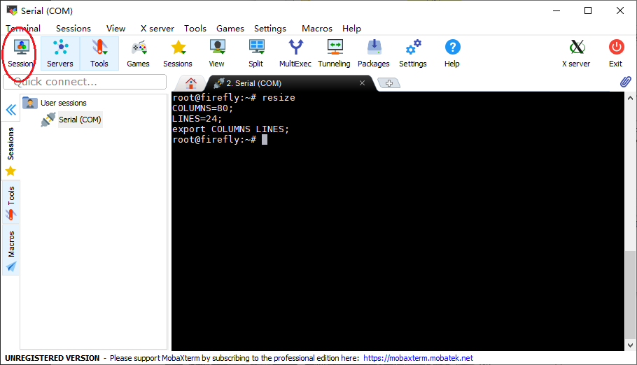
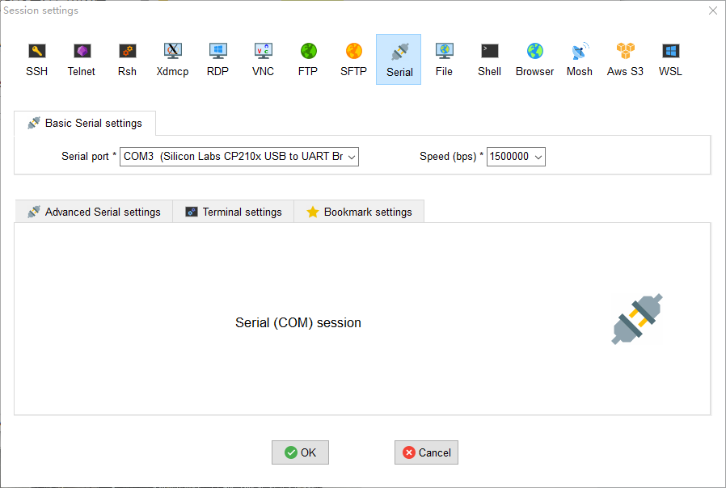
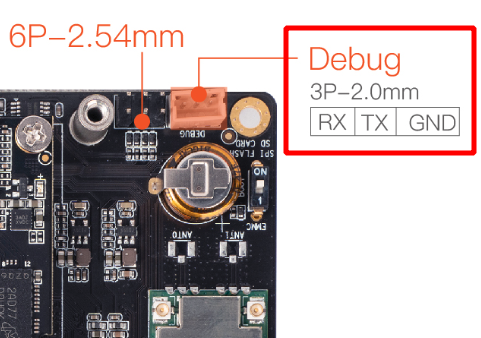
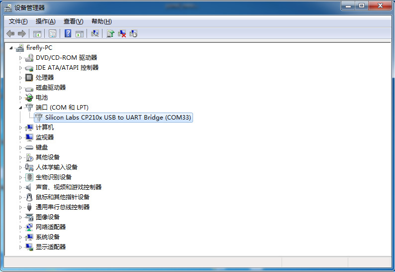

# Debug Usage

AIBOX-1684 provides one debug serial port with two connection methods, corresponding to the same debug serial port: via the RS232 serial port (RS232 level) or via the DEBUG port (TTL level):
| Debug Interface | Level | Connection | Windows Tool | Linux Tool | Serial Parameters |
| :---: | :---: | :---: | :---: | :---: | :---: |
| RS232 serial port | RS232 level | RS232-to-USB cable | MobaXterm (recommended)/PuTTY/SecureCRT | minicom/picocom/kermit | 115200 8N1, no flow control || DEBUG port | TTL level | USB-to-TTL serial adapter | Same as above (driver required) | Same as above (driver-free) | 115200 |

USB-to-serial adapter is the abbreviation of USB-to-serial TTL adapter.

<CodeBlockTabs defaultValue="rs232">
<CodeBlockTabsList>
<CodeBlockTabsTrigger value="rs232">RS232</CodeBlockTabsTrigger>
<CodeBlockTabsTrigger value="ttl">TTL</CodeBlockTabsTrigger>
</CodeBlockTabsList>
<CodeBlockTab value="rs232">

You can use an RS232 to USB adapter to connect AIBOX-1684 to a PC for serial port debugging:

### Serial Parameter Configuration

AIBOX-1684 uses the following serial port parameters:

* Baud rate: 115200
* Data bits: 8
* Stop bit: 1
* Parity: none
* Flow Control: None

### Using Serial Port Debugging

<CodeBlockTabs defaultValue="windows">
<CodeBlockTabsList>
<CodeBlockTabsTrigger value="windows">Windows</CodeBlockTabsTrigger>
<CodeBlockTabsTrigger value="linux">Linux</CodeBlockTabsTrigger>
</CodeBlockTabsList>
<CodeBlockTab value="windows">

On Windows, PuTTY or SecureCRT are commonly used. We recommend the free MobaXterm terminal software:

1. Download the free version of MobaXterm from the [official website](https://mobaxterm.mobatek.net/).
2. Select `Serial` as the session.
3. Change the Serial port to the COM port found in Device Manager.
4. Set `Speed (bsp)` to `115200`.
5. Click the `OK` button.

</CodeBlockTab>
<CodeBlockTab value="linux">

On Linux there are several options: minicom, picocom and kermit. The following uses minicom as an example:

1. Install minicom: `sudo apt-get install minicom`.
2. After connecting the serial cable, check the serial device file (`/dev/ttyUSB0` in the example below): `ls /dev/ttyUSB*`.
3. Run `sudo minicom`, press `Ctrl-A Z` then `O` to open `Serial port setup`.
4. Set `Serial Device` to `/dev/ttyUSB0` and `Bps/Par/Bits` to `115200 8N1`.
5. Set both `Hardware Flow Control` and `Software Flow Control` to `No`.
6. Select `Save setup as dfl` to save it as the default configuration.

<Callout title="Note" type="warn">The `Hardware Flow Control` and `Software Flow Control` of minicom must both be set to No, otherwise it may result in failure to input.</Callout>

</CodeBlockTab>
</CodeBlockTabs>

</CodeBlockTab>
<CodeBlockTab value="ttl">

If you want to develop U-Boot or kernel, you need to use the DEBUG port for debugging. The operation is the same as that of RS232 debugging, but you need to pay attention to the adapter and its driver.

### Optional Adapter

There are many USB-to-serial adapters on the online store, which are divided into the following types according to the chip:

| Serial port | Maximum baud rate | Recommended or not | Evaluation | Purchase link |
| :--------: | :-------: |:-------: | :-------: | :-------: |
| [CP2104](https://www.firefly.store/products/usb-to-uart-module-cp2104) | 2Mbps | Recommended | Support high baud rate communication, good stability Durable | [Click to buy](https://www.firefly.store/products/usb-to-uart-module-cp2104) |
| CH340 | 2Mbps | Not recommended | In actual use, it is found that the actual baud rate of many CH340s on the market cannot reach 1.5 Mbps | |
| PL2303 | 1.2Mbps | Not recommended | The maximum baud rate cannot reach 1.5Mbps | |

Generally speaking, adapters using CH340 chips have relatively stable performance and are more expensive.

<Callout title="Note" type="info">The default baud rate for AIBOX-1684 is 115200.</Callout>

### Hardware Connection

USB to Serial adapter with four pins:

* 3.3V power supply (NC), no connection required
* GND, the ground wire of the serial port, connect to the GND pin of the serial port of the development board
* TXD, the output line of the serial port, connected to the TX pin of the serial port of the development board
* RXD, the input line of the serial port, connect to the RX pin of the serial port of the development board

<Callout title="Note" type="warn">If you encounter the problem that TX and RX cannot be input and output when using other serial adapters, you can try to reverse the connection of TX and RX.</Callout>

AIBOX-1684 DEBUG port:

### Install Driver

Download the driver and install:

* [CH340](https://www.wch.cn/downloads/CH341SER_EXE.html)
* [PL2303](https://www.prolific.com.tw/en/portfolio-item/pl2303gl/)
* [CP210X](https://www.silabs.com/software-and-tools/usb-to-uart-bridge-vcp-drivers)

After inserting the adapter, the system will prompt to discover new hardware and initialize it, and then you can find the corresponding COM port in the device manager:

</CodeBlockTab>
</CodeBlockTabs>
