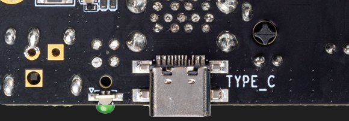
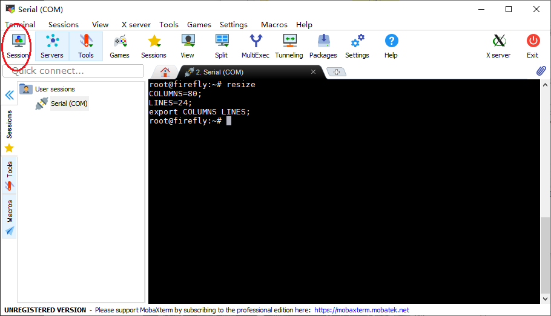
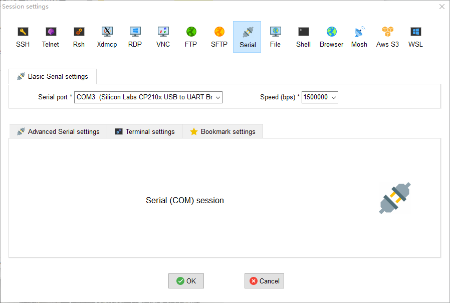
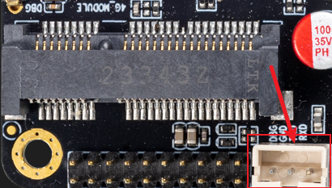
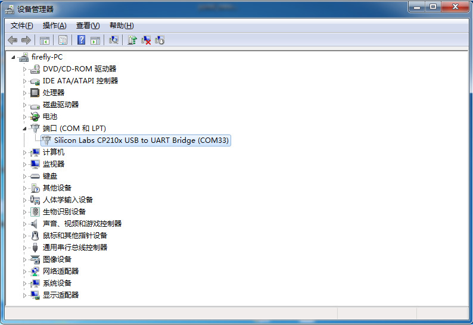

# Debug Usage

AIBOX-1688 provides one serial port with two connection methods, corresponding to the same debug serial port: via the Type-C serial port or via the DEBUG port (TTL level):

| Debug Interface | Level | Connection | Windows Tool | Linux Tool | Serial Parameters |
| :---: | :---: | :---: | :---: | :---: | :---: |
| Type-C serial port | Direct USB | Type-C data cable | MobaXterm (recommended)/PuTTY/SecureCRT | minicom/picocom/kermit | 115200 8N1, no flow control |
| DEBUG port | TTL level | USB-to-TTL serial adapter | Same as above (driver required) | Same as above (driver-free) | 115200 |

<CodeBlockTabs defaultValue="typec">
<CodeBlockTabsList>
<CodeBlockTabsTrigger value="typec">Type-C</CodeBlockTabsTrigger>
<CodeBlockTabsTrigger value="ttl">TTL</CodeBlockTabsTrigger>
</CodeBlockTabsList>
<CodeBlockTab value="typec">

The AIO-1688JD4 can be connected to a PC using a Type-C cable for serial port debugging:

### Serial Port Parameter Configuration

The AIBOX-1688 uses the following serial port parameters:

* Baud rate: 115200
* Data bits: 8
* Stop bits: 1
* Parity: None
* Flow control: None

### Using Serial Port Debugging

<CodeBlockTabs defaultValue="windows">
<CodeBlockTabsList>
<CodeBlockTabsTrigger value="windows">Windows</CodeBlockTabsTrigger>
<CodeBlockTabsTrigger value="linux">Linux</CodeBlockTabsTrigger>
</CodeBlockTabsList>
<CodeBlockTab value="windows">

On Windows, PuTTY or SecureCRT are commonly used. We recommend the free MobaXterm terminal software:

1. Download the free version of MobaXterm from the [official website](https://mobaxterm.mobatek.net/).
2. Select `Serial` as the session.
3. Change the Serial port to the COM port found in Device Manager.
4. Set `Speed (bsp)` to `115200`.
5. Click the `OK` button.

</CodeBlockTab>
<CodeBlockTab value="linux">

On Linux there are several options: minicom, picocom and kermit. The following uses minicom as an example:

1. Install minicom: `sudo apt-get install minicom`.
2. After connecting the serial cable, check the serial device file (`/dev/ttyUSB0` in the example below): `ls /dev/ttyUSB*`.
3. Run `sudo minicom`, press `Ctrl-A Z` then `O` to open `Serial port setup`.
4. Set `Serial Device` to `/dev/ttyUSB0` and `Bps/Par/Bits` to `115200 8N1`.
5. Set both `Hardware Flow Control` and `Software Flow Control` to `No`.
6. Select `Save setup as dfl` to save it as the default configuration.

<Callout title="Note" type="warn">The `Hardware Flow Control` and `Software Flow Control` of minicom must both be set to No, otherwise it may result in failure to input.</Callout>

</CodeBlockTab>
</CodeBlockTabs>

</CodeBlockTab>
<CodeBlockTab value="ttl">

If you want to perform U-Boot or kernel development, you need to use the DEBUG port for debugging. The operation is consistent with Type-C debugging, but attention should be paid to the adapter and its driver issues.

### Choosing an Adapter

There are many USB to serial port adapters available online, categorized by chip type as follows:

|                                                  Serial port                                                 | Maximum baud rate |   Recommended?  |                                                     Review                                                     |                                                      Purchase link                                                      |
| :----------------------------------------------------------------------------------------------------------: | :---------------: | :-------------: | :------------------------------------------------------------------------------------------------------------: | :---------------------------------------------------------------------------------------------------------------------: |
| [CP2104](https://item.taobao.com/item.htm?spm=a1z10.5-c.w4002-12605442688.14.aa5e1e8srwECg\&id=546045713700) |       2Mbps       |  Recommendation |                      Supports high baud rate communication, good stability and durability                      | [Click to purchase](https://item.taobao.com/item.htm?spm=a1z10.5-c.w4002-12605442688.14.aa5e1e8srwECg\&id=546045713700) |
|                                                     CH340                                                    |       2Mbps       | Not recommended | In actual use, it has been found that many CH340 adapters on the market do not achieve a baud rate of 1.5 Mbps |                                                                                                                         |
|                                                    PL2303                                                    |      1.2Mbps      | Not recommended |                                    Maximum baud rate does not reach 1.5 Mbps                                   |                                                                                                                         |

Generally speaking, adapters using the CH340 chip have relatively stable performance, but are a bit more expensive.

<Callout title="Note" type="info">The default baud rate for AIBOX-1688 is 115200.</Callout>

### Hardware Connection

USB to Serial Adapter, with four pins.

* 3.3V Power (NC), no connection needed
* GND, the ground line of the serial port, connect to the GND pin of the development board
* TXD, the output line of the serial port, connect to the TX pin of the serial port of the development board
* RXD, the input line of the serial port, connect to the RX pin of the serial port of the development board

<Callout title="Note" type="warn">If you encounter the problem that TX and RX cannot be input and output when using other serial adapters, you can try to swap the TX and RX connections.</Callout>

AIO-1688JD4 DEBUG port:

### Driver Installation

Windows systems need to install the adapter driver (Linux does not):

Download the driver and install it.

* [CH340](https://www.wch.cn/downloads/CH341SER_EXE.html)
* [PL2303](https://www.prolific.com.tw/en/portfolio-item/pl2303gl/)
* [CP210X](https://www.silabs.com/software-and-tools/usb-to-uart-bridge-vcp-drivers)

After plugging in the adapter, the system will prompt that new hardware is found and initialised, after which you can find the corresponding COM port in Device Manager:

</CodeBlockTab>
</CodeBlockTabs>