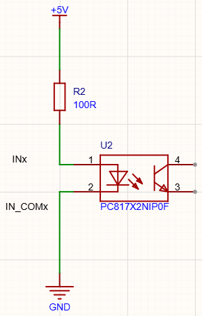
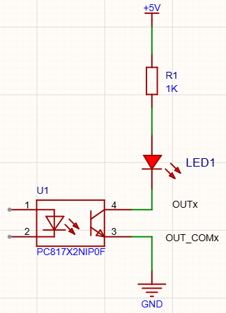
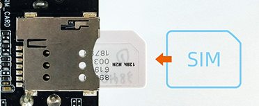

# Hardware Function Usage
## Debug Serial Port

The AIBOX-9075 uses an on-board USB serial solution (the serial-to-USB chip is CH342). You can debug the device by connecting the Type-C debug port of the device with a USB cable directly, no external USB to TTL serial module is required.

After the driver is installed on Windows, two serial devices "USB-Enhanced-SERIAL-A CH342" and "USB-Enhanced-SERIAL-B CH342" will appear in the device manager: SERIAL-A is the debug serial port of the main system (Linux), and SERIAL-B is the debug serial port of the subsystem (RTOS). Serial port parameters: baudrate 115200, 8 data bits, 1 stop bit, no parity check.

For the connection method and Windows driver installation, please refer to: [Debug Console](debug.md).

## Display Interface

The AIBOX-9075 provides 1 HDMI 2.0 display output interface. The device runs Ubuntu 24.04 (Wayland + Gnome desktop) by default, and the desktop will be displayed after connecting a monitor.

## Ethernet

The AIBOX-9075 provides 2 x 2.5G RJ45 Ethernet ports, corresponding to the `eth0` and `eth1` devices in the system (subject to the actual system). After the Ethernet port is connected to the network, you can log in to the device through the debug serial port or SSH to check the IP address and test the connectivity:

```
ifconfig eth0
ping -I eth0 -c 10 www.baidu.com
```

## USB Interface

The AIBOX-9075 provides 2 x USB3.0 ports for USB keyboard, mouse, USB flash drive, etc.

## RS485

The AIBOX-9075 provides 2 RS485 ports: RS485_1 corresponds to `/dev/ttyHS1` in the system, and RS485_2 corresponds to `/dev/ttyHS3`. RS485 transmission needs an additional GPIO to control the direction (RS485_1 uses GPIO No.695, RS485_2 uses GPIO No.693). For the transmission test, please refer to [Serial Tutorial](usage_serial.md).

## CAN-FD

The AIBOX-9075 provides 2 CAN-FD interfaces (optocoupler isolated) for communication with CAN bus devices.
When wiring, connect CAN_H to CAN_H and CAN_L to CAN_L.
On Ubuntu, run `apt update && apt install can-utils` first to install the test tools. The communication test commands are as follows:

``` 
# Close the can0 device
ip link set can0 down
# Set the bitrate to 250Kbps
ip link set can0 type can bitrate 250000
# Open the can0 device
ip link set can0 up
# Run candump on the receiving end, blocking and waiting for frames
candump can0
# Run cansend on the sending end to send a frame
cansend can0 123#1122334455667788
``` 

For more details about CAN utilities, see https://manpages.debian.org/testing/can-utils/index.html.

## GMSL2

The AIBOX-9075 provides 2 x GMSL2 4Pin Mini FAKRA interfaces for connecting GMSL2 cameras and other devices.
eg: ZYG2-ISX031-E05A-H120, four cameras connected to the same port

```
export XDG_RUNTIME_DIR=/run/user/1000
export WAYLAND_DISPLAY=wayland-0

# open 0
gst-launch-1.0 -e qtiqmmfsrc camera=0 ! \
video/x-raw,format=NV12,width=1920,height=1536,framerate=30/1 ! \
videoconvert ! waylandsink sync=true 

# open 1
gst-launch-1.0 -e qtiqmmfsrc camera=1 ! \
video/x-raw,format=NV12,width=1920,height=1536,framerate=30/1 ! \
videoconvert ! waylandsink sync=true 

# open 2
gst-launch-1.0 -e qtiqmmfsrc camera=2 ! \
video/x-raw,format=NV12,width=1920,height=1536,framerate=30/1 ! \
videoconvert ! waylandsink sync=true 

# open 3
gst-launch-1.0 -e qtiqmmfsrc camera=3 ! \
video/x-raw,format=NV12,width=1920,height=1536,framerate=30/1 ! \
videoconvert ! waylandsink sync=true 
```

## IO

The AIBOX-9075 provides 6 IO input channels (IO in) and 6 IO output channels (IO out).

### IN 
#### Hardware

INx, where x is the 1, 2, 3, 4, 5, 6 of IO-IN; IN_COMx, where x is the C1, C2, C3, C4, C5, C6 of IO-IN.
INx can be driven by an external power supply with a current limiting resistor, or by an external GPIO driver. Pay attention to the magnitude of the current.

#### Software
|Name|GPIO Number|
|---|---|
|IO_IN 1| 675|
|IO_IN 2| 682|
|IO_IN 3| 680|
|IO_IN 4| 681|
|IO_IN 5| 690|
|IO_IN 6| 688|

For example, to operate `IO_IN` (GPIO number is 675), run as root user:

```
echo 675 > /sys/class/gpio/export
cd /sys/class/gpio/gpio675
echo in > direction
cat value
```

### OUT
#### Hardware 

OUTx, where x is the 1, 2, 3, 4, 5, 6 of IO-OUT; OUT_COMx, where x is the C1, C2, C3, C4, C5, C6 of IO-OUT.

#### Software
|Name|GPIO Number|
|---|---|
|IO_OUT 1| 686|
|IO_OUT 2| 692|
|IO_OUT 3| 694|
|IO_OUT 4| 696|
|IO_OUT 5| 678|
|IO_OUT 6| 679|

For example, to operate `IO_OUT` (GPIO number is 686), run as root user:

```
echo 686 > /sys/class/gpio/export
cd /sys/class/gpio/gpio686
echo out > direction
echo 0 > value
echo 1 > value
```


## SIM Card

The SIM card slot of the AIBOX-9075 is used together with a wireless module to provide mobile network connectivity. **The wireless module is optional**, and the SIM card function is available only after the module has been installed inside the chassis. The SIM card insertion direction is shown in the figure below. Please power off the device before inserting or removing the SIM card.

<center>


</center>

## RTC

The AIBOX-9075 supports the RTC (Real Time Clock). For reading, writing and synchronizing the time, please refer to [RTC Tutorial](usage_rtc.md).

## Video

The default video framework of the AIBOX-9075 is Gstreamer. For the codec capabilities and playback/encoding commands, please refer to [Video Tutorial](usage_video.md).

## NPU (AI)

The IQ-9075 delivers a peak computing power of 200 TOPS and supports private deployment of edge-side large models. For AI development, please refer to [AidLux](usage_aidlux.md).
