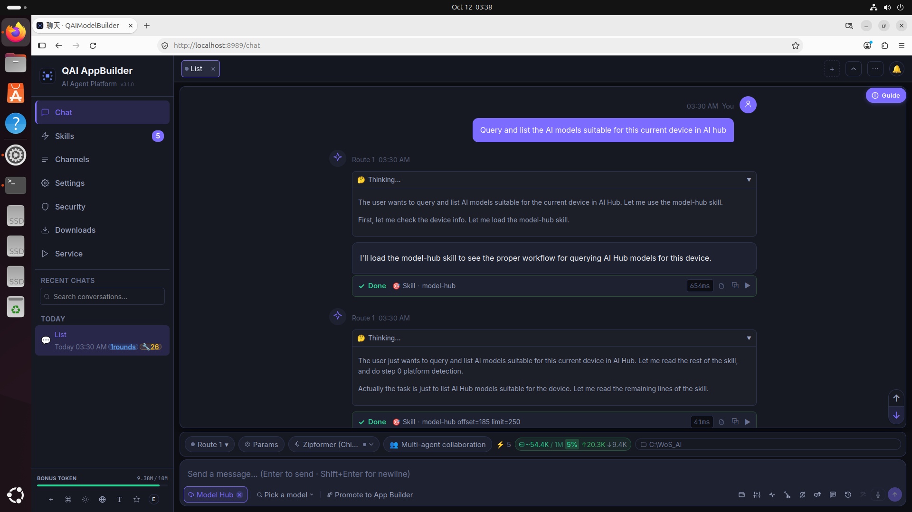
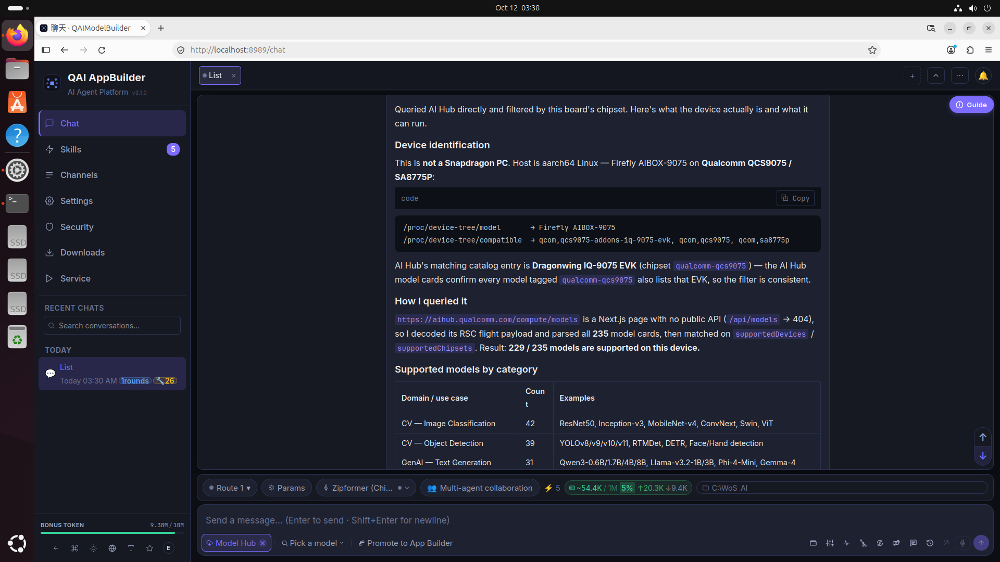
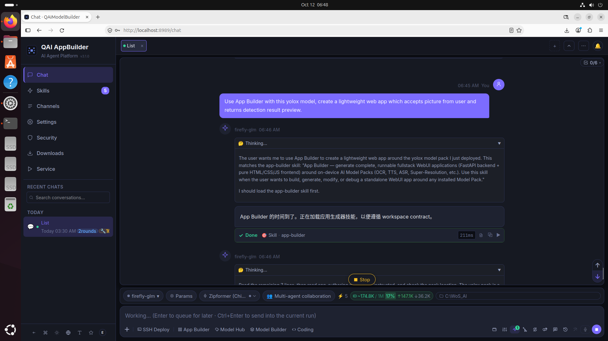
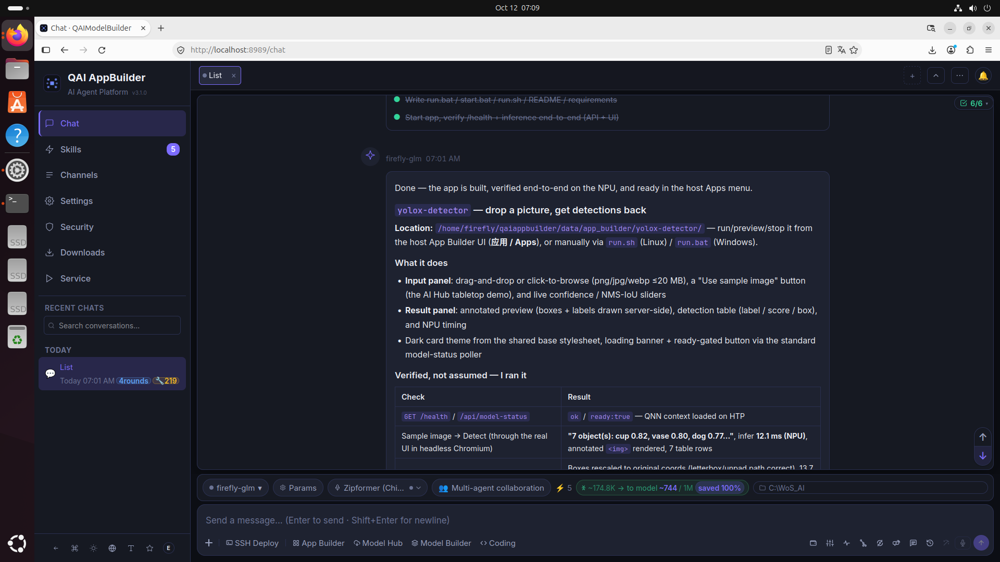
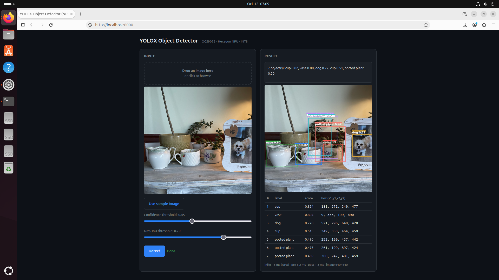
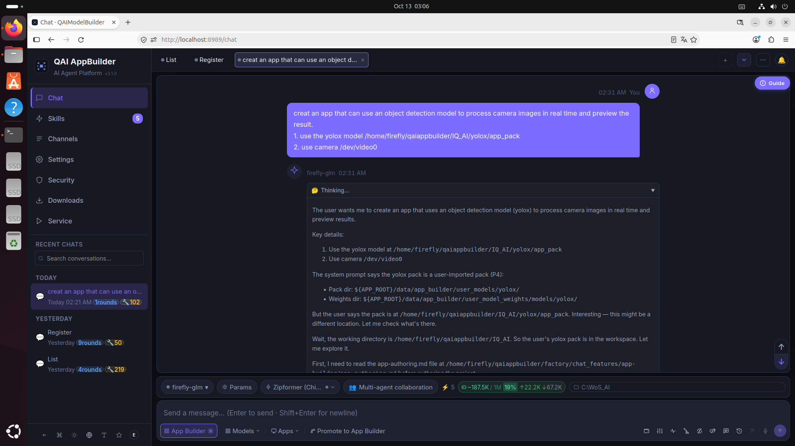
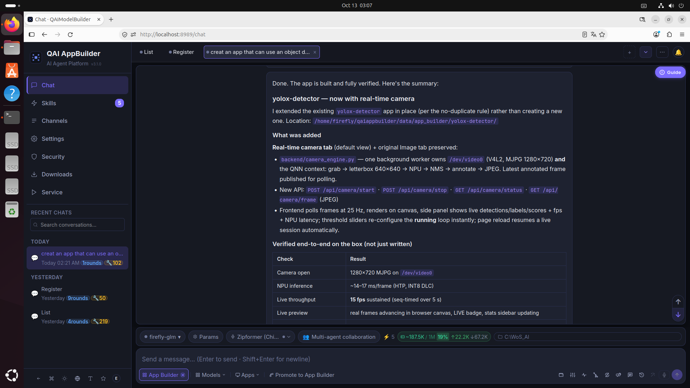
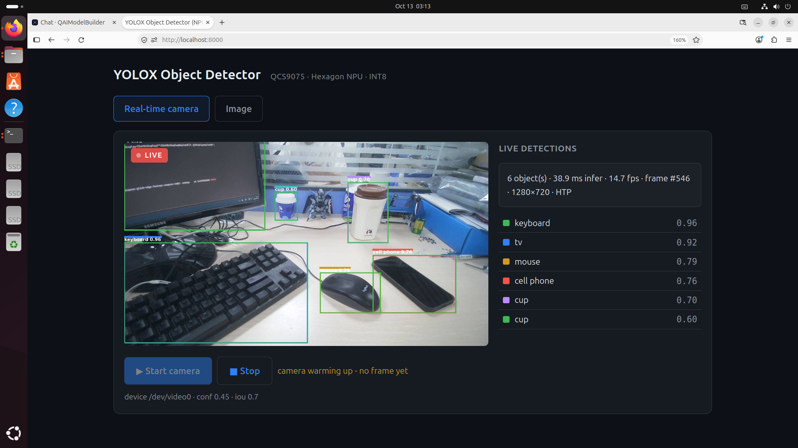

# QAI AppBuilder

## Introduction

QAI AppBuilder is an AI agent running on Qualcomm devices. It helps deploy various AI applications on the device. After connecting a large language model, users can direct the agent with natural language to develop, configure, and deploy applications, making rapid AI application delivery much easier.

Using QAI AppBuilder requires registering and signing in with a Qualcomm account. This is the required account for using the tool. A newly registered Qualcomm account receives 10M free tokens for trying the LLM service.

Users can also connect other LLM providers and choose a suitable cloud model for their needs.

To use the AI Hub features in QAI AppBuilder, users must additionally register an AI Hub account and obtain an API key.

### Functional modules

According to the official project documentation, QAI AppBuilder mainly includes the following modules. Available models and entry points may vary by release and QCOM device.

| Module | Capabilities |
| --- | --- |
| **App Builder** | Runs packaged Model Packs on the device. Users can provide images, audio, or text, select a model, adjust parameters, and run inference, making it suitable for quickly building edge AI applications for vision, speech, and other tasks. |
| **Model Builder** | Uses natural-language guidance to convert, quantize, run, and validate models, converting PyTorch or ONNX models into QNN formats for Qualcomm NPU use. It is intended mainly for smaller and medium-sized models (the official documentation recommends about 2 GB or less) and is not intended for converting LLMs. |
| **AI Hub (model catalog and download center)** | Browses and downloads models and resources optimized for Qualcomm NPU, with capabilities such as resumable downloads and integrity checks to reduce manual model preparation. |
| **Multi-agent streaming chat** | Provides real-time streaming conversations, Markdown and code highlighting, and a discussion mode in which multiple agents collaborate on a topic and converge on an implementation plan. |
| **LLM Agent Pipeline** | After a cloud LLM is connected, it can use tools such as `appbuilder_run` and `appbuilder_batch_run` to orchestrate multiple Model Packs on the device for compound tasks, such as filtering images, running detection, and processing the results. |
| **Skill extension system** | Extends agent capabilities with built-in or user-defined Skills. Skills support hot reload and automatic injection of their instructions into conversations. |
| **Device service and model runtime management** | Manages the local NPU inference service, including service start, stop, status, model loading, and runtime log inspection. |

### Core highlights

- **Natural-language-driven development**: Users do not need to master the complete Qualcomm AI toolchain first. They can describe a goal and let the agent assist with model selection, parameter configuration, application generation, and deployment verification.
- **Self-contained Model Packs**: A Model Pack can include a model manifest, runner script, parameter Schema, and optional Skill, making it easier to copy, manage, and extend applications.
- **Local NPU inference and privacy**: Inference runs locally on the QCOM device, so input data is not uploaded for local inference. When a cloud LLM is used, it primarily processes text or result summaries that the user explicitly sends.
- **Multi-precision model variants**: The same model can provide FP16, INT8, W8A16, and other precision variants, allowing users to balance accuracy, speed, memory, and model size.
- **Sticky Worker acceleration**: After the first run loads and warms up a model, later runs can reuse the loaded context and avoid repeated initialization overhead.
- **History, comparison, and benchmarking**: Each run can be saved for history review, side-by-side comparison, batch execution, and latency statistics such as p50, p90, and p99.
- **Automatic orchestration of multiple models**: After a cloud LLM is connected, users can describe a complex task in one sentence and let the agent decompose it and chain multiple local models together.
- **Controlled permissions**: File access, command execution, and external path access can go through an approval flow. API keys and other sensitive information should be stored through the application's secure configuration instead of being written in plain text in documentation or scripts.

> Project and download: [Open the project page](https://github.com/qualcomm/qai-appbuilder/tree/main)  
> Qualcomm AI Hub: [Open AI Hub](https://aihub.qualcomm.com/)

## Install QAI AppBuilder

The following steps apply to QCOM devices running Ubuntu.

> **Network note:** Users in mainland China must configure a system network proxy that can access the required services before using QAI AppBuilder.

### 1. Install nvm

Install nvm according to the [official nvm project](https://github.com/nvm-sh/nvm). For example:

```bash
curl -o- https://raw.githubusercontent.com/nvm-sh/nvm/v0.40.3/install.sh | bash
```

Reopen the terminal after installation and verify that the `nvm` command is available.

### 2. Install Node.js 22 and pnpm

```bash
nvm install 22
npm install -g pnpm
```

### 3. Install system dependencies

```bash
sudo apt install cmake build-essential python3.12-dev python3.12-venv
```

### 4. Install QAI AppBuilder

Copy `qaiappbuilder.zip` to the device, extract it, and run the `setup.sh` included in the archive:

```bash
unzip qaiappbuilder.zip
cd qaiappbuilder
chmod +x setup.sh start.sh
./setup.sh
```

If the extracted directory has a different name, enter the directory that contains `setup.sh` before running the commands.

## Start and use QAI AppBuilder

After installation, run:

```bash
./start.sh
```

When the service starts, open [http://localhost:8989](http://localhost:8989) in a browser to start chatting. On first use, follow the page instructions to sign in with a Qualcomm account. If you need to use AI Hub features, register an AI Hub account and configure its API key; you can also add another compatible LLM provider in Settings.

Describe your goal in natural language and the QAI AppBuilder agent can assist with model selection, application development, and deployment. For detailed features and version information, see the [QAI AppBuilder project documentation](https://github.com/qualcomm/qai-appbuilder/blob/main/tools/qaiappbuilder/README.zh-CN.md).

## Usage examples

The following progressive workflow shows how to use QAI AppBuilder to develop AI applications: first ask the agent to select a suitable model, then build an image detection application, and finally build a real-time camera detection application based on the model and application results from the previous steps.

### 1. Find a suitable model

First describe the device and task requirements to the agent in natural language and ask it to recommend a suitable model. The first image shows the query process, and the second shows the model selection and work summary returned by the agent.

<center>

</center>

<center>

</center>

### 2. Build an image detection application

After selecting the model, ask the agent to generate an application based on the model and the image detection requirements. Inspect the agent request and work summary first, then view the final application preview.

<center>

</center>

<center>

</center>

<center>

</center>

### 3. Build a real-time camera detection application

After verifying the image detection application, ask the agent to generate a real-time camera detection application based on the model selected earlier and the application development results. Again, inspect the agent request and work summary first, then view the final application preview.

<center>

</center>

<center>

</center>

<center>

</center>