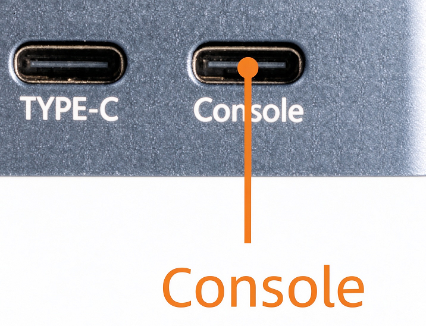
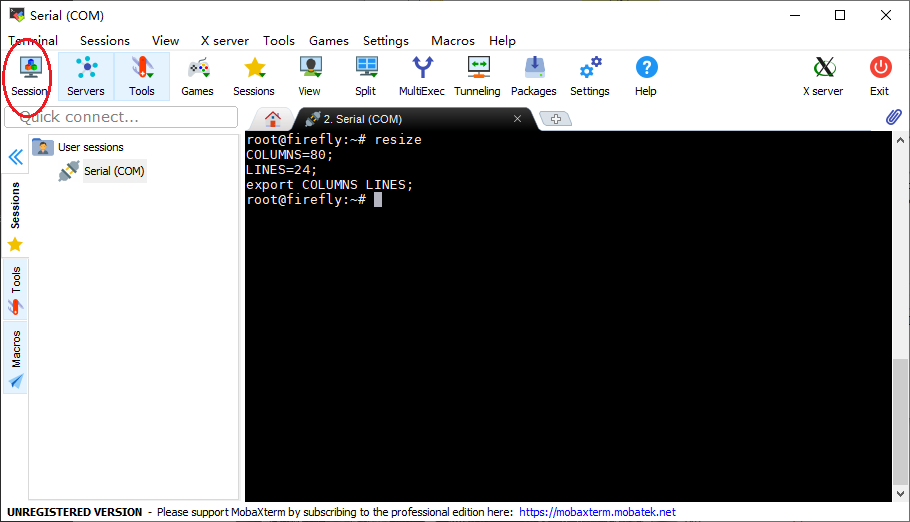
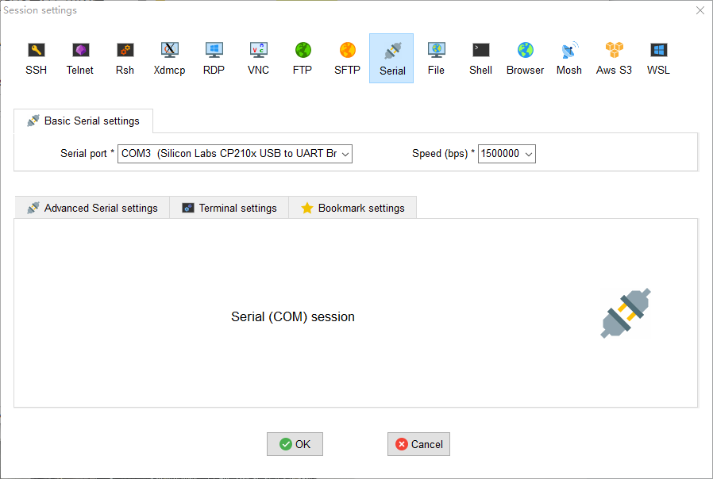

# Hardware Function Usage

## Debug Serial [step]

The AIBOX-Orin Nano has an onboard Type-C Console debug serial port. No external serial module is required: just connect the host to the PC with a Type-C cable for serial debugging.

## Login [step]

There are two ways to login to AIBOX-Orin Nano, one is via Console (Debug serial), the other is via HDMI.

There are two ways to login to AIBOX-Orin Nano, one is via HDMI, the other is via Console (Debug serial).

### HDMI Login
When logging in via the HDMI. The login account is `nvidia`, with the password also being `nvidia`.

### Console Login (Debug Serial)
Type-C Connects to the Console port. The login account is `nvidia`, with the password also being `nvidia`.<br>

* Baud rate: 115200
* Data bit: 8
* Stop bit: 1
* Parity check: None
* Flow control: None

<center>


</center>

#### Serial parameter configuration

The AIBOX-Orin Nano uses the following serial port parameters:

* Baud rate: 115200
* Data bit: 8
* Stop bit: 1
* Parity check: None
* Flow control: None
#### Using serial port debugging on Windows
#### Serial parameter configuration

AIBOX-Orin Nano uses the following serial port parameters:

* Baud rate: 115200
* Data bits: 8
* Stop bit: 1
* Parity: none
* Flow Control: None

#### Using serial port debugging on Windows

On Windows, putty or SecureCRT is generally used. Among them, we recommend using the free version of MobaXterm. This is a powerful terminal software, which is introduced here. The usage of other software is similar.

Go here [download MobaXterm](https://mobaxterm.mobatek.net/):

1. Select `session` as `Serial`.
2. Modify `Serial port` to the COM port found in Device Manager.
3. Set `Speed (bsp)` to `115200`.
4. Click the `OK` button.

<center>


</center>
<center>


</center>

#### Serial debugging on Linux

There are several options available on Linux:

* minicom
* picocom
* kermit

The following will introduce the use of minicom.

Install minicom:

```
sudo apt-get install minicom
```

After connecting the serial cable, see what the serial device file is. The following example is `/dev/ttyUSB0`:

```
$ ls /dev/ttyUSB*
/dev/ttyUSB0
```

Run:

```
$ sudo minicom
Welcome to minicom 2.7
OPTIONS: I18n
Compiled on Jan  1 2014, 17:13:19.
Port /dev/ttyUSB0, 15:57:00
Press CTRL-A Z for help on special keys
```

The above prompt `CTRL-A Z` is the escape key, press `Ctrl-a` and then `z` to bring up the menu:

```
   +-------------------------------------------------------------------+
                          Minicom Command Summary                      |
  |                                                                    |
  |              Commands can be called by CTRL-A <key>                |
  |                                                                    |
  |               Main Functions                  Other Functions      |
  |                                                                    |
  | Dialing directory..D  run script (Go)....G | Clear Screen.......C  |
  | Send files.........S  Receive files......R | cOnfigure Minicom..O  |
  | comm Parameters....P  Add linefeed.......A | Suspend minicom....J  |
  | Capture on/off.....L  Hangup.............H | eXit and reset.....X  |
  | send break.........F  initialize Modem...M | Quit with no reset.Q  |
  | Terminal settings..T  run Kermit.........K | Cursor key mode....I  |
  | lineWrap on/off....W  local Echo on/off..E | Help screen........Z  |
  | Paste file.........Y  Timestamp toggle...N | scroll Back........B  |
  | Add Carriage Ret...U                                               |
  |                                                                    |
  |             Select function or press Enter for none.               |
  +--------------------------------------------------------------------+
```

Press `O` according to the prompt to enter the setting interface, as follows:

```
           +-----[configuration]------+
           | Filenames and paths      |
           | File transfer protocols  |
           | Serial port setup        |
           | Modem and dialing        |
           | Screen and keyboard      |
           | Save setup as dfl        |
           | Save setup as..          |
           | Exit                     |
           +--------------------------+
```

Move the cursor to "Serial port setup", press enter to enter the serial port setup interface, then enter the letters indicated above, select the corresponding option, and set as follows:

```
   +-----------------------------------------------------------------------+
   | A -    Serial Device      : /dev/ttyUSB0                              |
   | B - Lockfile Location     : /var/lock                                 |
   | C -   Callin Program      :                                           |
   | D -  Callout Program      :                                           |
   | E -    Bps/Par/Bits       : 115200 8N1                                |
   | F - Hardware Flow Control : No                                        |
   | G - Software Flow Control : No                                        |
   |                                                                       |
   |    Change which setting?                                              |
   +-----------------------------------------------------------------------+
```

**Note:** `Hardware Flow Control` and `Software Flow Control` must be set to No, otherwise it may result in failure to input.

After the setup is complete, go back to the previous menu and select `Save setup as dfl` to save it as the default configuration, which will be used by default in the future.

## Watchdog [step]

The device names for the external watchdog is `/dev/wdt_crl`, the procedure is as follows:

```shell
# Write to different fields to enable the watchdog and set the time.
# The numbers 0, 1, 2, and 3 represent 0.64s, 2.56s, 10.24s, and 40.96s, respectively.
# The letter 'e' indicates enabling the watchdog, while the letter 'd' indicates disabling it.

# Enable and set the timer for 10.24 seconds. You need to write to it once every 10.24 seconds. You can also write different numbers at any time to change the timing.
echo e >/dev/wdt_crl #Enable
echo 2 >/dev/wdt_crl #Set the timeout to 10.24 seconds.
```

## RTC [step]

### Introduction

AIBOX-Orin Nano has an external RTC powered by a capacitor on the external motherboard, which ensures the RTC continues to run for a short period after power loss. In the kernel, it is represented as `rtc0`.
### Interface Usage

Linux provides three user-space interfaces for interacting with the RTC. The paths are:

*    SYSFS interface: /sys/class/rtc/rtc0/
*    PROCFS interface: /proc/driver/rtc
*    IOCTL interface: /dev/rtc0

Synchronize the current system time to the RTC.
```
hwclock -w
```

#### SYSFS interface
You can directly use `cat` and `echo` to operate the interfaces under /sys/class/rtc/rtc0/.

For example, to view the current RTC date and time:
```
# cat /sys/class/rtc/rtc0/date
2024-07-10
# cat /sys/class/rtc/rtc0/time
02:36:30

```

#### PROCFS interface

To print RTC-related information:
```
# cat /proc/driver/rtc
rtc_time        : 02:37:00
rtc_date        : 2024-07-10
alrm_time       : 00:00:00
alrm_date       : 1970-01-01
alarm_IRQ       : no
alrm_pending    : no
update IRQ enabled      : no
periodic IRQ enabled    : no
periodic IRQ frequency  : 1
max user IRQ frequency  : 64
24hr            : yes
```

#### IOCTL interface

You can use `ioctl` to control `/dev/rtc0`。

For detailed usage instructions, please refer to document `kernel-jammy-src/Documentation/admin-guide/rtc.rst` 。

# jtop install
```
sudo apt update
sudo apt install python3-pip
sudo pip3 install -U jetson-stats
```

## Important!Important!Important [step]
<font color=red>Do not use `sudo apt-get upgrade` and `sudo apt-get dist-upgrade` .</font>
<br>
<font color=red>Do not use `sudo apt upgrade` and `sudo apt dist-upgrade` .</font>


To prevent automatic upgraded : 
* Modify `/etc/apt/apt.conf.d/20auto-upgrades` (if this file doesn’t exist, please create it)

```
APT::Periodic::Update-Package-Lists "0";
APT::Periodic::Unattended-Upgrade "0";
```

* Disable and stop apt-daily timers

```
sudo systemctl disable apt-daily.timer
sudo systemctl disable apt-daily-upgrade.timer
sudo systemctl stop apt-daily.timer
sudo systemctl stop apt-daily-upgrade.timer
```

# nvpmodel 

||7W|15W|25W|MAXN_SUPER|
|----|----|----|----|----|
|Jetson Orin Nano 8GB|Mode ID 0|Mode ID 1|N/A|N/A|
|Jetson Orin Nano 8GB SUPER|N/A|Mode ID 0|Mode ID 1|Mode ID 2|

||MAXN_SUPER|MAXN|10W|15W|20W|40W|
|----|----|----|----|----|----|----|
|Jetson Orin NX 8GB|N/A|Mode ID 0|Mode ID 1|Mode ID 2|Mode ID 3|N/A|
|Jetson Orin NX 8GB SUPER|Mode ID 0|N/A|Mode ID 1|Mode ID 2|Mode ID 3|Mode ID 4|

||MAXN_SUPER|MAXN|10W|15W|25W|40W|
|----|----|----|----|----|----|----|
|Jetson Orin NX 16GB|N/A|Mode ID 0|Mode ID 1|Mode ID 2|Mode ID 3|N/A|
|Jetson Orin NX 16GB SUPER|Mode ID 0|N/A|Mode ID 1|Mode ID 2|Mode ID 3|Mode ID 4|

## Commands [step]
* get power mode: `sudo nvpmodel -q`
* set power mode: `sudo nvpmodel -m <x>`
    * `<x>` is the power `Mode ID` (for example, 0, 1, 2, 3 or 4).

## GUI [step]
<center>


</center>

* To switch the current power mode, click the NVIDIA icon to open a dropdown menu from the icon
* Click "Power mode" to open a submenu of power modes

# Browser
```
sudo apt update
sudo apt install chromium-browser
```

If the browser fails to open after installation, please follow the steps below: 

```
snap download snapd --revision=24724
sudo snap ack snapd_24724.assert
sudo snap install snapd_24724.snap
```


# HDMI Audio
`Settings` --> `Sound` --> `Output Device` --> `HDMI/ DisplayPort-Build-in Audio`

# Flash Images

<font color="red">**Notice:**</font>
* PC use X86 Ubuntu 22.04 or Ubuntu 20.04, do not use virtual machine.
* When flashing, AIBOX-Orin Nano will format the internal storage device, please back up important data first.
* Orin NX power supply need **12V/5A**
* Orin NX carrier board hardware at least **V1.2**

## Download fireflyFlash.tbz2 [step]
[Download](https://community.t-firefly.com/en/download/236)
`Firmware` --> `Jetson Linux`

## Unzip fireflyFlash.tbz2 [step]
```
mkdir fireflyFlash
tar xf fireflyFlash.tbz2 -C fireflyFlash
cd fireflyFlash
sudo ./l4t_flash_prerequisites.sh
```

## Put AIBOX-Orin Nano into Force Recovery Mode [step]
* Ensure that AIBOX-Orin Nano is powered off
* Connect AIBOX-Orin Nano and PC using TypeC
* Press and hold down AIBOX-Orin Nano Recovery-Key
* AIBOX-Orin Nano power on
* Release AIBOX-Orin Nano Recovery-Key
* Check AIBOX-Orin Nano Recovery Mode
    * use `lsusb` comand, AIBOX-Orin Nano is in Force Recovery Mode if you see the message: `Bus <bbb> Device <ddd>: ID 0955: <nnnn> Nvidia Corp.`
        * `<bbb>` any three-digit number
        * `<ddd>` any three-digit number
        * `<nnnn>` four-digit number
            * `7523` Jetson Orin Nano 8GB
            * `7423` Jetson Orin NX 8GB
            * `7323` Jetson Orin NX 16GB

## Flash [step]
Enter these commands in the directory of `fireflyFlash`: `./firefly_flash.sh -d aibox`

<font color=red>Notice: After burning, the device must be on the desktop for at least 5 minutes before it can be powered off.</font>