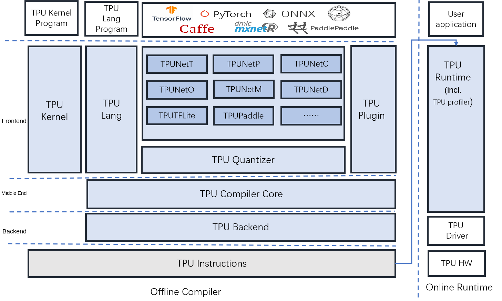
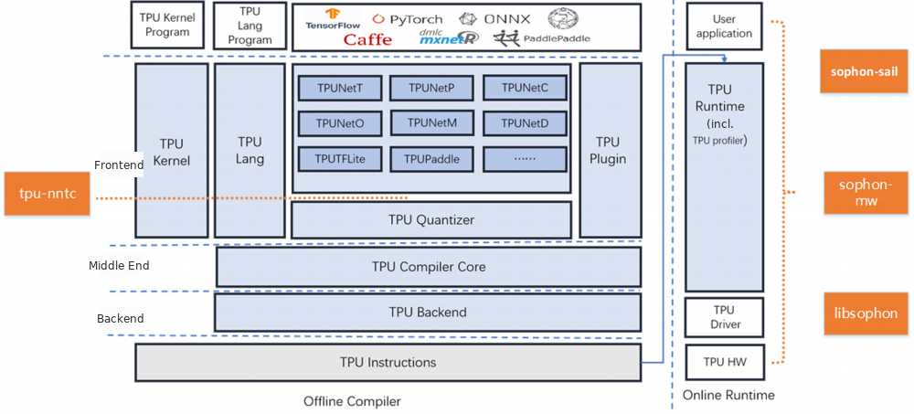
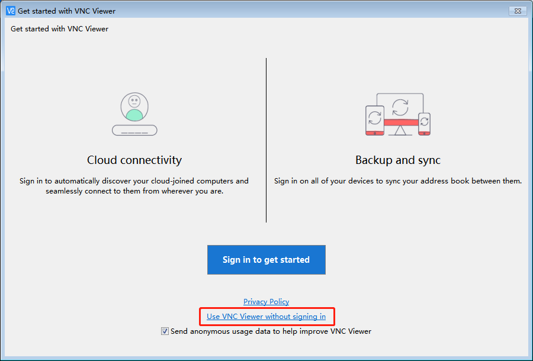
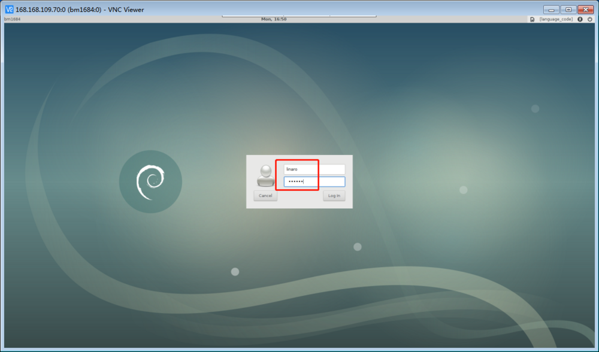
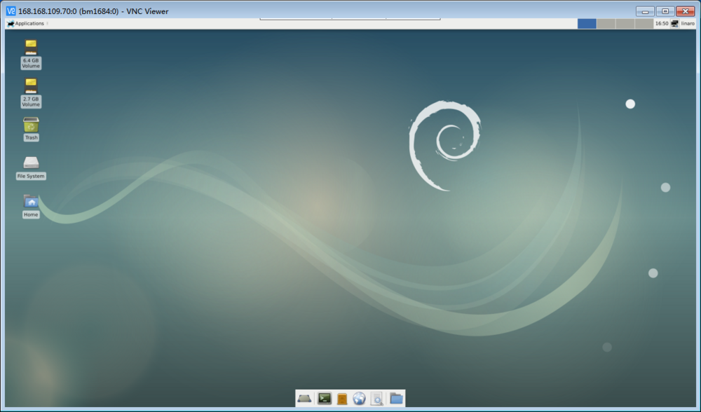
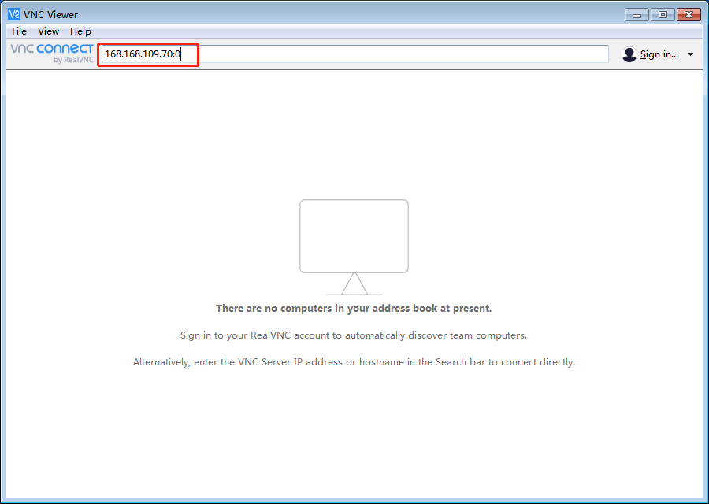
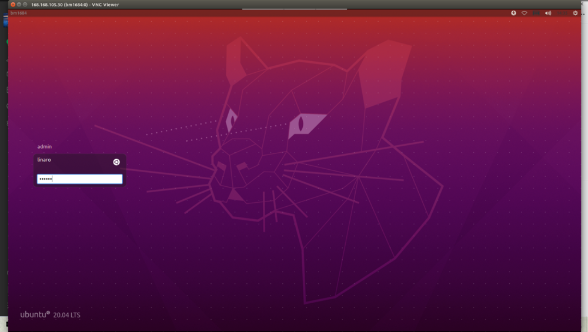
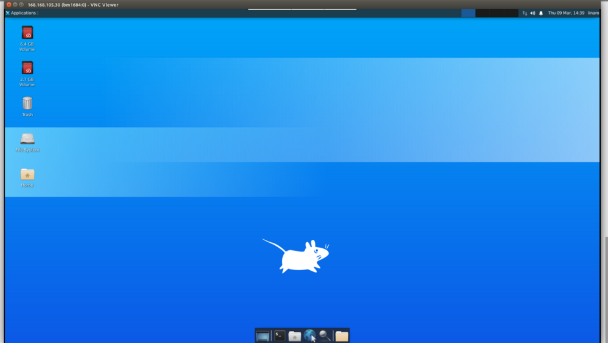

# Software Usage Guide

<Callout title="Note" type="info">This page collects the software usage content of EC-A1684JD4: Sophon SDK development, memory management, remote desktop, and Qt development. Different computers support different features; please refer to the SDK or firmware of your actual device.</Callout>


## Sophon SDK Development [step]

There are currently two sets of Sophon SDKs: Sophon SDK and SophonSDK3. Among them, Sophon SDK is the new version of the SDK, while SophonSDK3 is the old version.

The main differences between these two SDKs are as follows:


| Difference                      | Sophon SDK                                                                                                                                                                | SophonSDK3                                                                    | 
| --------------------------------- | --------------------------------------------------------------------------------------------------------------------------------------------------------------------------- |  --------------------------------- |
| Adaptor Chip                    | BM1684, BM1684X                                                                                                                                                           | BM1684, BM1684X                                                               | 
| Release Mode                    | Decouple each module and provide tar and deb packages respectively.                                                                                                       | Provides a unified tar development package that includes Compiler and Library | 
| Driver Installation             | Install the sophon-driver_x.y.z_amd64.deb package                                                                                                                         | Install using ‘install_driver_{target}.sh’                                  | 
| NNToolchain, Quantization-Tools | Provide tpu-nntc_vx.y.z- < hash >-< data > .tar.gz installation                                                                                                           | Included in SophonSDK3                                                        | 
| BMCV,BMRuntime, BMLib           | Provide sophon-libsophon_x.x.x_amd64.deb package, located at /opt/sophon/libsophon-current after installation                                                             | Included in SophonSDK3                                                        | 
| Multimedia Library              | Provide sophon-mw-x.x.x_amd64.deb package,located at /opt/sophon/sophon-ffmpeg-latest,/opt/sophon/sophon-opencv-latest,/opt/sophon/opencv-bmcpu-latest after installation | Included in SophonSDK3                                                        | 
| pipeline Routine                | Open source to github repository, sophon-pipeline                                                                                                                         | [https://github.com/sophon-ai-algo/sophon-inference](https://github.com/sophon-ai-algo/sophon-inference)                                                                              | 
| Algorithm Routine               | Open source to github repository (not released yet)                                                                                                                       |                                                                               | 

### SophonSDK3 [step]
SophonSDK is a deep learning SDK customized by Sophon Technology based on its self-developed AI chip. It covers model optimization and efficient runtime support required in the neural network inference stage. It provides easy-to-use and efficient development and deployment of deep learning applications. full-stack solution.

**Note: SophonSDK is used to develop applications directly on the PC, so users will not be involved in the development of the underlying hardware and operating system!**

#### SDK introduction [step]
##### SDK composition

SophonSDK consists of Compiler and Library:

- **Compiler** is responsible for offline compilation and optimization of the neural network model trained under the third-party deep learning framework, and generates the BModel required for the final runtime. Currently supports Caffe, Darknet, MXNet, ONNX, PyTorch, PaddlePaddle, TensorFlow, etc.

- **Library** provides BM-OpenCV, BM-FFmpeg, BMCV, TPURuntime, BMLib and other libraries to drive VPP, VPU, JPU, TPU and other hardware to complete video image encoding and decoding, image processing, tensor operations, models Inference and other operations for users to develop deep learning applications.

> Examples provides multiple examples in SoC and x86 environments for users to refer to in the development of deep learning applications. This part of the routine code is moved from the SDK to the open source github repository: [https://github.com/sophon-ai-algo/examples](https://github.com/sophon-ai-algo/examples)

<center>


</center>

##### SDK development kit

SophonSDK provides two files, the specific files are shown in the following table:

| File name | Description |
| :------- | :--------- |
| [sophonsdk_v3.0.0_20220716.zip](https://sophon-file.sophon.cn/sophon-prod-s3/drive/22/07/18/11/sophonsdk_v3.0.0_20220716.zip) | sophonsdk x86 platform development package that supports cmodel, pcie, soc and arm_pcie modes |
| [x86_sophonsdk3_ubuntu18.04_py37_dev_22.06_docker.zip](https://sophon-file.sophon.cn/sophon-prod-s3/drive/22/07/19/10/x86_sophonsdk3_ubuntu18.04_py37_dev_22.06_docker.zip) | sophonsdk v3 compile docker for development |

- **SophonSDK3 Development Kit**: `sophonsdk_v<x.y.z>.zip`, where x.y.z is the version number. SophonSDK will be mounted inside the Docker container in the form of directory mapping for users to use. The SDK is divided into Windows version and Linux version. For how to use the Windows version of the SDK, please refer to the user documentation under the SDK package.

- **Docker for x86 based Ubuntu development**: used to provide a unified Docker basic development image to avoid hidden problems caused by inconsistent environments, especially for beginners, it is strongly recommended to use Docker images as a development environment for model conversion and Algorithm migration works.

**Notice:**

**SophonSDK is a development kit that supports multiple platforms. In order to adapt to the needs of different hardware platforms and compilers, developers need to run a simple installation script after decompressing the SDK. This installation script will adjust and install the appropriate program version according to the user's current host environment, such as ABI (application Program Binary Interface) version. Therefore, it is not recommended to copy the decompressed folder to other machines for use. If there is a need for copying, please copy the original compressed package of the SDK, and then decompress and install it again.**
- **For example, the default ABI format under CentOS and Ubuntu is different and cannot be used universally. When the copied file is executed, it will report an error that the symbol cannot be found;**
- **When copying the decompressed files using an NTFS formatted mobile storage device, especially when copying files between Windows and Linux, it is very likely to cause file link or so file damage.**

##### SDK structure

The root directory after the SDK is decompressed: on the host, it is the path to store the files specified when decompressing the files; when in the docker container, if the container creation script under the SDK is not modified, the path defaults to `/workspace`.

The decompressed SDK structure is as follows:

```shell
SophonSDK3

├── bin                    # Related tools for each platform
│   ├── arm                # soc platform, corresponding to SE5/SM5 devices
│   ├── arm_pcie           # ARM instruction set CPU server host
│   ├── fib.bin            # 
│   ├── firmware           # MCU firmware in BM1684
│   ├── loongarch64        # The server host of the loongarch instruction set CPU
│   ├── mips64             # MIPS instruction set CPU server host
│   ├── ramboot_rootfs.itb # 
│   ├── spi_flash.bin      #
│   ├── sw64               # SW64 instruction set CPU server host
│   └── x86                # intel x86 host
├── bmlang                 # High-level programming interface for Sophon TPU
├── bmnet                  # Compiler tool executable or pip install whl package or file
│   ├── bmcompiler         # compiler
│   ├── bmnetc             # Caffe Compiler
│   ├── bmnetd             # Darknet Compiler
│   ├── bmnetm             # MXNet Compiler
│   ├── bmneto             # ONNX Compiler
│   ├── bmnetp             # Pytorch Compiler
│   ├── bmnett             # TensorFlow Compiler
│   ├── bmnetu             # int8 Umodel compiler
│   ├── bmpaddle           # PaddlePaddle Compiler 
│   ├── bmprofile          # Performance analysis tool
│   ├── bmtflite           # TFLite Compiler
│   ├── bmusercpu          # Use source files related to A53 arm cpu
│   ├── calibration        # Quantification tool ufw installation package
│   └── debugtools         # Debug tool source code
├── driver                 # PCIE card device driver source code
├── include                # Runtime library header file for secondary development, one folder for each module
├── lib                    # Runtime and third-party libraries for runtime and secondary development
├── release_version.txt    # SDK release version number
├── res                    # test image
├── scripts                # Common scripts: driver installation, software library installation, environment variable setting
├── docker_run_sophonsdk.sh # Docker startup script
└── test                   # Test script, users do not need to pay attention
```

##### SDK main modules

The main modules are as follows:

- **Codec library Multimedia**: Supports BM-OpenCV and BM-FFmpeg for Sophon device hardware acceleration, supports RTSP stream, GB28181 stream parsing, video and picture encoding and decoding.
- **Tensor operation and image processing library BMCV**: color space conversion, scale transformation, affine transformation, projection transformation, linear transformation, picture frame, JPEG encoding, BASE64 encoding, NMS, sorting, feature matching.
- **Device management BMLib**: basic interface: device handle management, memory management, data handling, API transmission and synchronization, A53 enable, etc.
- **Model conversion toolchain NNToolchain**: supports framework models such as Caffe, Tensorflow, Pytorch, MXNet, Darknet, Paddle Paddle, ONNX; provides BMRuntime for model inference; provides BMProfile tool for performance analysis.
- **Model quantization tools Quantization-Tools**: original model -> FP32 UModel -> INT8 UModel -> INT8 BModel; provides auto-calib automatic quantization tools.
- **Suanfeng AI Acceleration Library SAIL**: It supports the high-level interface of Python/C++, and is the encapsulation of low-level library interfaces such as BMRuntime, BMCV, and BMDecoder.
- **Custom operator advanced programming library BMLang**: C++-based advanced programming library for Sophon TPU, decoupled from hardware information, no need to understand hardware architecture, using tensor data (bmlang::Tensor) and computing operations ( bmlang::Operator) to write code, and finally use bmlang::compile or bmlang::compile_with_check to generate a BModel that can be run by the TPU; in addition, it also supports the use of arm cpu in BM168X to implement operators that are not yet supported by the TPU.
- **Algorithm Parallel Acceleration Programming Library OKKernel (TPUKernel)**: The underlying programming interface based on the underlying atomic operation interface of the Sophon chip, requires familiarity with the hardware architecture and instruction set.

##### Environment configuration

Due to space limitations, the configuration in the Ubuntu environment is mainly introduced here.

Docker needs to be installed and the development user account has docker permissions. For installing the Docker environment, please refer to "[Docker manual](https://docs.docker.com/engine/install)".

Download [sophonsdk](https://developer.sophon.ai/site/index/material/all/all.html) and [docker development image](https://developer.sophon.ai/site/index/material/11/all.html) and unzip:

```shell
unzip sophonsdk_v3.0.0_20220716.zip
unzip x86_sophonsdk3_ubuntu18.04_py37_dev_22.06_docker.zip
cd sophonsdk_v3.0.0_20220716
tar xzvf sophonsdk_v3.0.0.tar.gz
```

Load the docker image:

```shell
cd x86_sophonsdk3_ubuntu18.04_py37_dev_22.06_docker
docker load -i x86_sophonsdk3_ubuntu18.04_py37_dev_22.06.docker
```

Create a docker container and enter docker:

```shell
cd sophonsdk_v3.0.0
# If you do not perform the configuration operation about the docker command without root execution, you need to add sudo before the command
./docker_run_sophonsdk.sh
```

After execution, you can see that you have entered the docker's `workspace` directory:

```shell
root@t-firefly:/workspace#
```

Working in CModel mode:

```shell
cd /workspace/scripts/
./install_lib.sh nntc
# Set environment variables, note that this command is only valid for the current terminal, and re-entry needs to be executed again
source envsetup_cmodel.sh
```

Verify that the cross-compilation toolchain in the development environment is configured successfully:

```shell
which aarch64-linux-gnu-g++
# terminal output
# /data/release/toolchains/gcc/gcc-linaro-6.3.1-2017.05-x86_64_aarch64-linux-gnu/bin//aarch64-linux-gnu-g++
```

If the terminal outputs the path of aarch64 compilation, it means that the cross-compilation toolchain is correct and the development environment can be used normally.

##### Details

For more detailed information, please refer to: [https://developer.sophon.ai/site/index/document/all/all.html](https://developer.sophon.ai/site/index/document/all/all.html)

### Sophon SDK [step]
Sophon SDK is a customized deep learning SDK based on its self-developed AI chip, covering model optimization and efficient operation support required for the inference phase of neural networks, providing an easy-to-use and efficient full-stack solution for deep learning application development and deployment.

SophonSDK is compatible with both the 3rd generation BM1684 chip and the 4th generation BM1684X chip.

#### Components of Sophon SDK [step]
##### Basic Toolkit

The basic toolkit includes:

* Tpu-nntc is responsible for the offline compilation and optimization of the neural network model trained under the third-party deep learning framework to generate the final run-time BModel. Caffe, Darknet, MXNet, ONNX, PyTorch, PaddlePaddle, TensorFlow and so on are supported.
* Libsophon provides BMCV, BMRuntime, BMLib and other libraries, which are used to drive VPP, TPU and other hardware to complete image processing, tensor operation, model inference and other operations for users to develop deep learning applications.
* Sophon-mw encapsulates BM-OpenCV, BM-FFmpeg and other libraries, which are used to drive VPU, JPU and other hardware, and support the parsing of RTSP stream and GB28181 stream, video image codec acceleration, etc., for users to carry out deep learning application development.
* Sophon-sail provides advanced interfaces supporting Python/C++, which encapsulates the underlying library interfaces such as BMRuntime, BMCV, BMDecoder, BMLib, etc., for users to carry out deep learning application development.

##### Advanced Toolkit

The Advanced Toolkit includes:

* Tpu-mlir provides a complete tool chain for the TPU compiler project, which can transform pre-trained neural networks in different frameworks into binary BModel that can run efficiently on the Sophon TPU. Frameworks that are currently directly supported include tflite, onnx, and Caffe.
* Tpu-perf provides a complete set of toolkits for model performance and accuracy verification.
* Tpu-kernel is the underlying development interface to the chip, allowing both dedicated instructions to accelerate deep learning business logic and generic instructions to accelerate various custom algorithms.

<center>


</center>

#### SDK Directory Structure [step]
SophonSDK provides eleven folder modules, as shown in the following table:

| Folder Name     | Remarks                                                                                                                         |
| ----------------- | --------------------------------------------------------------------------------------------------------------------------------- |
| libsophon       | Libraries supporting hardware acceleration of sophon devices, such as image processing, tensor operation, model inference, etc. |
| sophon-mw       | Multimedia Library supporting hardware acceleration of sophon Devices                                                           |
| tpu-kernel      | Underlying development interface                                                                                                |
| tpu-nntc        | TPU compiler tool chain                                                                                                         |
| tpu-mlir        | TPU compiler tool chain                                                                                                         |
| tpu-perf        | Model performance and accuracy verification toolkit                                                                             |
| sophon-pipeline | A pipeline-based high-performance inference framework                                                                           |
| sophon-img      | SoC Mode Installation Kit                                                                                                       |
| sophon-demo     | Comprehensive routines for single models or scenarios                                                                           |
| sophon-sail     | Interface library that encapsulates the underlying interface into C++/Python API                                                |
| sophon-rpc      | Offload some computing tasks on PCIe card product to ARM CPU on the card                                                        |
   
#### Unzipped SDK Directory [step]
The structure of the unpacked SDK files is as follows.

Note: Some of the manuals below have Chinese file names (for example, `BMCV开发参考手册.pdf`). They are the original Chinese documents bundled with the SDK, so their file names are kept as-is.

```
SophonSDK

├── libsophon_<date>_<hash>
│   ├── BMCV_Technical_Reference_Manual.pdf
│   ├── BMCV开发参考手册.pdf
│   ├── BMLib_Technical_Reference_Manual.pdf
│   ├── BMLIB开发参考手册.pdf
│   ├── BMRuntime Technical Reference Manual.pdf
│   ├── BMRUNTIME开发参考手册.pdf
│   ├── libsophon_<x.y.z>_aarch64.tar.gz                           #Arm64 machine, libsophon installar for other LINUX systems
│   ├── libsophon_<x.y.z>_x86_64.tar.gz                            #X86x64 machine, libsophon installar for other LINUX systems
│   ├── libsophon_dockerfile
│   ├── libsophon.MD5
│   ├── LIBSOPHON_User_Guide.pdf
│   ├── LIBSOPHON使用手册.pdf
│   ├── release_version.txt
│   ├── sophon-driver_<x.y.z>_amd64.deb                            #x86_64 machine,PCIe card driver installation file corresponding to Debian/Ubuntu system
│   ├── sophon-driver_<x.y.z>_arm64.deb                            #arm64 machine,PCIe card driver installation file corresponding to Debian/Ubuntu system
│   ├── sophon-libsophon_<x.y.z>_amd64.deb                         #x86_64 machine,libsophon runtime environment installation file corresponding to Debian/Ubuntu system
│   ├── sophon-libsophon_<x.y.z>_arm64.deb                         #arm64 machine,libsophon runtime environment installation file corresponding to Debian/Ubuntu system
│   ├── sophon-libsophon-dev_<x.y.z>_amd64.deb                     #x86_64 machine,libsophon runtime environment installation file corresponding to Debian/Ubuntu system
│   └── sophon-libsophon-dev_<x.y.z>_arm64.deb                     #arm64 machine,libsophon runtime environment installation file corresponding to Debian/Ubuntu system
├── sophon-demo_<date>_<hash>
│   ├── release_version.txt
│   ├── sophon-demo.MD5
│   └── sophon-demo_v<x.y.z>_b909566_20221027.tar.gz               #Comprehensive routines for a single model or scenario
├── sophon-img_<date>_<hash>
│   ├── bsp-debs
│   ├── bsp_update.tgz
│   ├── libsophon_soc_<x.y.z>_aarch64.tar.gz                       #Files required for cross-compilation
│   ├── release_version.txt
│   ├── sdcard.tgz                                                 #SoC card brush package
│   ├── SOPHON_BSP_Technical_Reference_Manual.pdf
│   ├── SOPHON BSP开发参考手册.pdf
│   ├── sophon-img.MD5
│   ├── sophon-soc-libsophon_<x.y.z>_arm64.deb                     #Libsophon installation files corresponding to SoC platform
│   ├── sophon-soc-libsophon-dev_<x.y.z>_arm64.deb                 #Libsophon installation files corresponding to SoC platform
│   ├── system.tgz
│   └── tftp.tgz
├── sophon-mw_<date>_<hash>
│   ├── Multimedia FAQ.pdf
│   ├── Multimedia Technical Reference Manual.pdf
│   ├── Multimedia User Guide.pdf
│   ├── MULTIMEDIA使用手册.pdf
│   ├── MULTIMEDIA常见问题手册.pdf
│   ├── MULTIMEDIA开发参考手册.pdf
│   ├── release_version.txt
│   ├── sophon-mw_<x.y.z>_aarch64.tar.gz                          #Arm64 machine, sophon-mw installar for other LINUX systems
│   ├── sophon-mw_<x.y.z>_x86_64.tar.gz                           #Arm64 machine, sophon-mw installar for other LINUX systems
│   ├── sophon-mw.MD5
│   ├── sophon-mw-soc_<x.y.z>_aarch64.tar.gz
│   ├── sophon-mw-soc-sophon-ffmpeg_<x.y.z>_arm64.deb             #SoC platform, ffmpeg runtime environment installation files
│   ├── sophon-mw-soc-sophon-ffmpeg-dev_<x.y.z>_arm64.deb         #SoC platform, ffmpeg development environment installation files
│   ├── sophon-mw-soc-sophon-opencv_<x.y.z>_arm64.deb             #SoC platform, opencv runtime environment installation files
│   ├── sophon-mw-soc-sophon-opencv-dev_<x.y.z>_arm64.deb         #SoC platform, opencv development environment installation files
│   ├── sophon-mw-soc-sophon-sample_<x.y.z>_arm64.deb             #SoC platform, multimedia program sample file
│   ├── sophon-mw-sophon-ffmpeg_<x.y.z>_amd64.deb                 #X86x64 machine, installation files for ffmpeg runtime environment corresponding to Debian/Ubuntu system
│   ├── sophon-mw-sophon-ffmpeg_<x.y.z>_arm64.deb                 #arm64 machine, installation files for ffmpeg runtime environment corresponding to Debian/Ubuntu system
│   ├── sophon-mw-sophon-ffmpeg-dev_<x.y.z>_amd64.deb             #x86_64 machine, ffmpeg development environment installation file corresponding to Debian/Ubuntu system
│   ├── sophon-mw-sophon-ffmpeg-dev_<x.y.z>_arm64.deb             #arm64 machine, ffmpeg development environment installation file corresponding to Debian/Ubuntu system
│   ├── sophon-mw-sophon-opencv_<x.y.z>_amd64.deb                 #X86x64 machine, installation files for opencv runtime environment corresponding to Debian/Ubuntu system
│   ├── sophon-mw-sophon-opencv_<x.y.z>_arm64.deb                 #arm64 machine, installation files for opencv runtime environment corresponding to Debian/Ubuntu system
│   ├── sophon-mw-sophon-opencv-abi0_<x.y.z>_amd64.deb            #X86x64 machine, installation files for opencv runtime environment corresponding to CenterOS system
│   ├── sophon-mw-sophon-opencv-abi0_<x.y.z>_arm64.deb            #arm64 machine, opencv runtime environment installation file corresponding to CenterOS system
│   ├── sophon-mw-sophon-opencv-abi0-dev_<x.y.z>_amd64.deb        #x86x64 machine, opencv development environment installation file corresponding to CenterOS system
│   ├── sophon-mw-sophon-opencv-abi0-dev_<x.y.z>_arm64.deb        #arm64 machine, opencv development environment installation file corresponding to CenterOS system
│   ├── sophon-mw-sophon-opencv-dev_<x.y.z>_amd64.deb             #x86x64 machine, opencv development environment installation file corresponding to Debian/Ubuntu system
│   ├── sophon-mw-sophon-opencv-dev_<x.y.z>_arm64.deb             #arm64 machine, opencv development environment installation file corresponding to Debian/Ubuntu system
│   ├── sophon-mw-sophon-sample_<x.y.z>_amd64.deb                 #x86x64 machine, sample files for multimedia programs
│   └── sophon-mw-sophon-sample_<x.y.z>_arm64.deb                 #arm64 machine, sample files of multimedia programs
├── sophon-pipeline_<date>_<hash>
│   ├── release_version.txt
│   ├── sophon-pipeline.MD5
│   └── sophon-pipeline_v<x.y.z>_586366b_20221027.tar.gz          #High performance inference framework based on pipeline
├── sophon-rpc_<date>_<hash>
│   ├── release_version.txt
│   ├── sophon-rpc_<x.y.z>_amd64.deb                              #x86x64 machine, sophon-rpc installation file corresponding to Debian/Ubuntu system
│   ├── sophon-rpc_<x.y.z>_arm64.deb                              #arm64 machine, sophon-rpc installation file corresponding to Debian/Ubuntu system
│   ├── sophon-rpc_<x.y.z>.tar.gz                                 #Sophon-rpc installation packages corresponding to other systems
│   ├── sophon-rpc.MD5
│   └── sophon-rpc使用指南.pdf
├── sophon-sail_<date>_<hash>
│   ├── release_version.txt
│   ├── Sophon_Inference_zh.pdf
│   ├── sophon-sail_<x.y.z>.tar.gz                                #Advanced interface library encapsulating BMLib, BMDecoder, BMCV, BMRuntime
│   └── sophon-sail.MD5
├── Sophon SDK文件清单.docx
├── tpu-kernel_<date>_<hash>
│   ├── release_version.txt
│   ├── tpu-kernel-1684x_v<x.y.z>-0d0e513e-221027.tar.gz          #Custom operator development tool
│   └── tpu-kernel.MD5
├── tpu-mlir_<date>_<hash>
│   ├── release_version.txt
│   ├── tpu-mlir.MD5
│   └── tpu-mlir_v<x.y.z>-<hash>-<date>.tar.gz                    #Compiler tool chain
├── tpu-nntc_<date>_<hash>
│   ├── release_version.txt
│   ├── tpu-nntc.MD5
│   └── tpu-nntc_v<x.y.z>-<hash>-<date>.tar.gz                    #Model compilation quantization tool chain
└── tpu-perf_v<x.y.z>
    ├── md5sum.txt
    ├── tpu_perf-<x.y.z>-py3-none-manylinux2014_aarch64.whl
    ├── tpu_perf-<x.y.z>-py3-none-manylinux2014_x86_64.whl
    └── tpu-perf-<x.y.z>.tar.gz                                   #Tools for performance analysis and accuracy verification of the model

```

#### SDK Main Modules [step]
* **Hardware Driver and Runtime Library LIBSOPHON** : contains libraries such as BMCV, BMRuntime, BMLib, etc., which are used to drive hardware such as VPP, TPU, etc. toperform operations such as image processing, tensor operations, model inference, etc
* **Multimedia library SOPHON-MW** : supports BM-OpenCV and BM-FFmpeg for hardware accelerate of Sophon devices, parsing of RTSP streams, GB28181 streams, video and image encoding and decoding
* **Model Compilation Quantization Tool Chain TPU-NNTC** : supports model conversion of Caffe,Tensorflow,Pytorch,MXNet,Darknet, Paddle Paddle, ONNX and other framework models; supports model quantization: original model -> FP32 UModel -> INT8 UModel -> INT8 BModel, and also provides auto-cali automatic quantization tool.
* **Tensor Operation and Image Processing Library BMCV** : colour space conversion, scale transformation, affine transformation, projection transformation, linear transformation, frame, JPEG coding, BASE64 coding, NMS, sorting, feature matching
* **Equipment Management BMLib** : basic interfaces: management of device Handle, memory management, data handling, API sending and synchronisation, A53 enable, etc
* **SAIL, the Arithmetic AI acceleration library** : supports high-level interfaces to Python/C++ and is wrapper for underlying library interfaces such as BMRuntime,BMCV,BMDecoder
* **Custom Operator Advanced Programming Library BMLang**: A C++ based high-level programming library for Sophon TPUs, decoupled from hardware information, no knowledge of hardware architecture is required, code is written using tensor data (bmlang::Tensor) and computation operations (bm- lang::Operator), and finally bmlang::compile or bmlang::compile_with_check is used to generate a BModel that the TPU can run; it also supports the use of the arm cpu in BM168X to implement arithmetic that is not yet supported by the TPU.
* **Algorithm Parallel Accelerated Programming Library TPUKernel**: underlying programming interface based on the Sophon chip’s underlying atomic operations interface, requiring familiarity with hardware architecture and instruction set
* **Model Performance and Accuracy Verification Tool TPUPerf**: enables performance analysis and accuracy validation of models

#### Details [step]
* [Get SDK and Detailed Documentation](https://developer.sophgo.com/site/index/material/all/all.html)

## Memory Management [step]

A portion of the memory of the EC-A1684JD4 is allocated to NPU, VPP, and VPU devices. Therefore, the memory data obtained using commands such as `free -h` is inconsistent with the actual memory of the EC-A1684JD4.

If you need to view the detailed memory allocation settings, or if the default memory allocation conflicts with actual requirements and needs to be adjusted, you can refer to the following steps.

### 1. Install the Memory Allocation Tool

Obtain the memory allocation tool package from [Download Center](https://community.t-firefly.com/en/doc/download/177) and transfer it to the EC-A1684JD4. Run the following command to decompress the package:

```bash
tar -xvf memory_edit_v2.9.tar.xz
```

### 2. View Memory Allocation Settings

After decompressing the package, run the following command to view the memory allocation settings:

```bash
cd memory_edit
./memory_edit.sh -p
```

The following is an example of the memory allocation settings. The result displayed under `Info: get max memory size ...` is the maximum memory that can be configured for each device, and the result displayed under `Info: get now memory size ...` is the memory currently allocated for each device.

```bash
linaro@aibox-1684x:~/memory_edit$ ./memory_edit.sh -p
INFO: version: 2.9
Info: use dts file /home/linaro/memory_edit/output/bm1684x_se7_v1_mini.dts
Info: =======================================================================
Info: get ddr information ...
Info: ddr12_size 8589934592 Byte [8192 MiB]
Info: ddr3_size 4294967296 Byte [4096 MiB]
Info: ddr4_size 4294967296 Byte [4096 MiB]
Info: ddr_size 16384 MiB
Info: =======================================================================
Info: get max memory size ...
Info: max npu size: 0x1dbf00000 [7615 MiB]
Info: max vpu size: 0xc0000000 [3072 MiB]
Info: max vpp size: 0x100000000 [4096 MiB]
Info: =======================================================================
Info: get now memory size ...
Info: now npu size: 0xf6e00000 [3950 MiB]
Info: now vpu size: 0x80000000 [2048 MiB]
Info: now vpp size: 0xc0000000 [3072 MiB]
```

### 3. Modify Memory Allocation Settings

You can set the memory allocation by referring to the following commands. The three input parameters are decimal numbers of the sizes to be configured for NPU, VPU, and VPP in MiB; or hexadecimal values in Byte.

```bash
# decimal, in MiB
./memory_edit.sh -c -npu 2048 -vpu 2048 -vpp 2048
# hexadecimal, in bytes
./memory_edit.sh -c -npu 0x80000000 -vpu 0x80000000 -vpp 0x80000000
```

After executing one of the above commands, check whether there is an Error in the output, and whether the sizes of the three parts in the output similar to the following are the same as the sizes to be configured.

```bash
Info: output configuration results ...
Info: vpu mem area(ddr3): 0x8000000 [128 MiB] 0x20000000 -> 0x27ffffff
Info: ion npu mem area(ddr1): 0x80000000 [2048 MiB] 0x24100000 -> 0xa40fffff
Info: ion vpu mem area(ddr3): 0x80000000 [2048 MiB] 0x80000000 -> 0xffffffff
Info: ion vpp mem area(ddr4): 0x80000000 [2048 MiB] 0x80000000 -> 0xffffffff
Info: =======================================================================
Info: start check memory size ...
Info: check npu size: 0x80000000 [2048 MiB]
Info: check vpu size: 0x80000000 [2048 MiB]
Info: check vpp size: 0x80000000 [2048 MiB]
Info: check edit size ok
Info: en_emmcfile ok
```

If the check is correct, save the current work, replace the boot image in the boot partition with the modified `emmcboot.itb` file by referring to the following operations, and finally restart the machine for the changes to take effect.

```bash
sudo cp emmcboot.itb /boot
sync
sudo reboot
```

## Remote Desktop [step]

x11vnc is a tool that allows administrators to connect to the server's real X desktop directly through the VNC Viewer.

### Debian
EC-A1684JD4 has installed the xfce4 desktop and configured the x11vnc related environment by default. The user directly executes the following command to wait for the connection:

```shell
sudo x11vnc -display :0 -auth /var/lib/lightdm/.Xauthority &
```

Then you can use `$bm1684_ip:0` address to VNC remote connection on the PC.

The following is the specific operation process of VNC Viewer:

(1) The user first downloads [VNC Viewer](https://www.realvnc.com/en/connect/download/viewer/) from the official website, and selects the corresponding installation package according to the PC system to download and install.

(2) After the installation is complete, open VNC Viewer and skip login:

<center>


</center>

(3) Enter `$bm1684_ip:0` address of EC-A1684JD4:

<center>


</center>

(4) Enter the user and password, both `linaro`:

<center>


</center>

(5) Successfully entered the xfce4 desktop:

<center>


</center>

### Ubuntu
To use the X Desktop environment on Ubuntu system, you need to manually install it. Follow these steps, and during the installation process, select `lightdm` as the Display Manager:
```
sudo apt update
sudo apt install -y xserver-xorg-video-dummy x11vnc xfce4
sudo vim /etc/X11/xorg.conf
sudo reboot
```
Edit the Xorg configuration file:
```
Section "Device"
    Identifier  "Configured Video Device"
    Driver      "dummy"
    VideoRam 256000
EndSection

Section "Monitor"
    Identifier  "Configured Monitor"
    HorizSync 5.0 - 1000.0
    VertRefresh 5.0 - 200.0
    ModeLine "1920x1080" 148.50 1920 2448 2492 2640 1080 1084 1089 1125 +Hsync +Vsync
#    Modeline "1280x800" 24.15 1280 1312 1400 1432 800 819 822 841
EndSection

Section "Screen"
    Identifier  "Default Screen"
    Monitor     "Configured Monitor"
    Device      "Configured Video Device"
    DefaultDepth 24
    SubSection "Display"
    Depth 24
    Modes "1920x1080"
#    Modes "1280x800"
    EndSubSection
EndSection
```
Start the x11vnc service:

```shell
sudo x11vnc -display :0 -auth /var/lib/lightdm/.Xauthority &
```

You can now use a VNC client on your PC to remotely connect using the `$bm1684_ip:0` address.

To connect using VNC Viewer:

(1) Download and install [VNC Viewer](https://www.realvnc.com/en/connect/download/viewer/) on your PC, based on your system.

(2) Open VNC Viewer and skip the login step.

<center>


</center>

(3) Enter the `$bm1684_ip:0` address of your EC-A1684JD4:

<center>


</center>

(4) Click on the circular button next to the `linaro` username, select `xfce`, and enter the username and password (both are `linaro`):

<center>


</center>

(5) You will successfully enter the xfce4 desktop environment.

<center>


</center>

## Qt Development [step]

### How to Develop Qt Programs and Display Them via HDMI

The overall process is divided into two steps:  

1. Cross-compile Qt programs
2. Set up the Qt runtime environment and run the program

#### 1. Cross-compile

Taking a cross-compilation host with the system as `Ubuntu18.04` as an example, the steps are as follows:

##### 1.1 Obtain Resources

Clone this [git repository](https://github.com/sophon-ai-algo/sophon-qt) using git clone.

Create and name a file called `se-build-server.yml` with the following content:

```
version: "3.3"
services:
    se-build-server:
        image: huangzhenming/se-build-server:V1.0
        container_name: sophon_build 
        privileged: true 
        network_mode: host 
        restart: always 
        volumes:
            - /data/your_working_dir:/workspace 
            - /data/toolchains/gcc-linaro-6.3.1-2017.05-x86_64_aarch64-linux-gnu:/toolchains 
            - /etc/timezone:/etc/timezone:ro 
            - /etc/localtime:/etc/localtime:ro 
        command: ["/bin/ping", "localhost"] 
        user: linaro 
        working_dir: /workspace 
        environment: 
        - "PATH=$PATH:/toolchains/bin"
```    

 Download the necessary cross-compilation tools: [gcc-linaro-6.3.1-2017.05-x86_64_aarch64-linux-gnu](https://drive.google.com/drive/u/1/folders/1cC6hf_yKY8LsHSy1I8xbsR80fdVPSBaW)

Installation of the `docker` and `docker compose` tools varies from platform to platform, so please search for the relevant publicly available information on the Internet to install them, and we will not describe them here

Run docker (the runtime will automatically download the image from docker Hub, and the time required depends on the network speed, ensure a stable internet connection):
            
```
docker-compose -f se-build-server.yml  up -d
```  

After running, it will automatically create `/data/your_working_dir` and `/data/toolchains/` folders on your system, you can also modify the `yml` file to create folders in other paths.


Copy and extract the `git` package and the cross-compilation toolchain to the specified path:    
```
cp -r path/to/sophon-qt/qt-lib/qtbase-5.14.tgz /data/your_working_dir
cp -r path/to/sophon-qt/qt-example/SophUI/* /data/your_working_dir
cd /data/your_working_dir/ && tar xvf qtbase-5.14.tgz
cp -r path/to/gcc-linaro-6.3.1-2017.05-x86_64_aarch64-linux-gnu.7z /data/toolchains/
cd /data/toolchains/ && 7z x gcc-linaro-6.3.1-2017.05-x86_64_aarch64-linux-gnu.7z
```  

* Cross-compile (using the `SophUI` source code as an example):    


    * enter docker:     


    ```
    docker ps -a  # Get the docker image and container information. The image name should have `huangzhenming` in it.
    docker exec -it  container_id  /bin/bash # enter docker 
    ```  


    * Perform the compilation(In docker):


    ```
    cd  /workspace
    ./install/bin/qmake SophUI.pro -spec linux-aarch64-gnu-g++ CONFIG+=qtquickcompiler
    make
    ```  


After compilation, the `SophUI` executable is generated, which can be executed directly on the device.            

#### 2. Run the Qt program

By following the above steps, you can get the executable file `SophUI` , which can be copied to the 1684 device by means of `scp`.

Before running, you need to write a script to set the environment variables as follows:  

```
#!/bin/sh
export QTDIR=/usr/lib/aarch64-linux-gnu 
export QT_QPA_FONTDIR=$QTDIR/fonts 
export QT_QPA_PLATFORM_PLUGIN_PATH=$QTDIR/qt5/plugins/
export LD_LIBRARY_PATH=/system/lib:$LD_LIBRARY_PATH
export QT_QPA_PLATFORM=linuxfb:fb=/dev/fl2000-0 
export QWS_MOUSE_PROTO=/dev/input/event3
./SophUI 
```  
After that, give the script permission to run, and execute it with the HDMI monitor plugged in.

**Note that if the 1684 is running on a `Debian` system, you will need to import the Qt libraries and other files separately, otherwise you will get an error, which is not the case with Ubuntu systems**.

Import it from the PC via `scp` and execute it on the 1684 device:  

```
scp PC@IP:/path/to/qtbase-5.14/lib/* /usr/lib/aarch64-linux-gnu/ 
mkdir -p /usr/lib/aarch64-linux-gnu/qt5
scp  PC@IP:/path/to/qtbase-5.14/plugins/ /usr/lib/aarch64-linux-gnu/qt5/
```
If the Qt program also contains fonts, you also need to [download](https://drive.google.com/drive/u/1/folders/1cC6hf_yKY8LsHSy1I8xbsR80fdVPSBaW) the font files here, and then copy them to the `/usr/lib/aarch64-linux-gnu/font` directory on the 1684 device. For example: `/usr/lib/aarch64-linux-gnu/fonts/wqy-microhei.ttc`.

