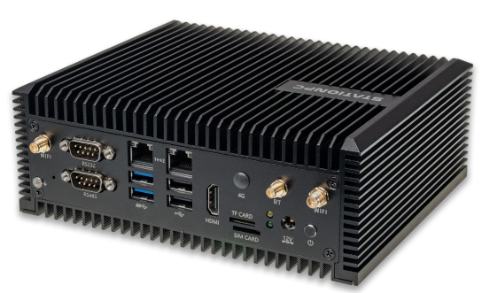
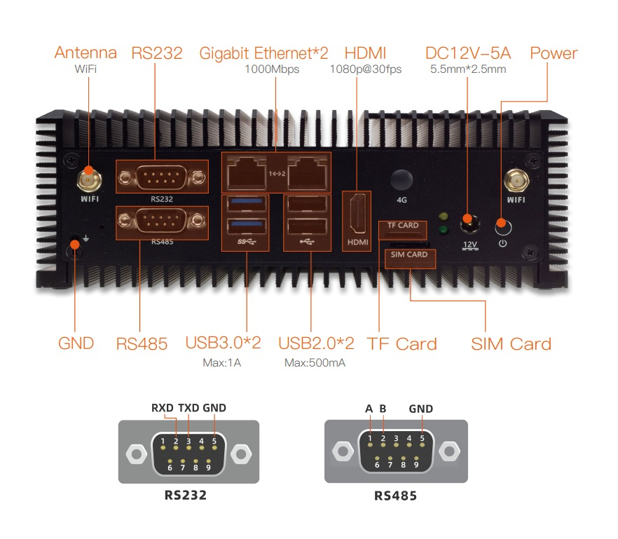

# Introduction

[Specification](https://download.t-firefly.com/Spec/Computers/EC-A1684XJD4%20FD_Specification_EN.pdf) | [Purchase](https://www.t-firefly.com/products/ec-a1684xjd4-fd-octa-core-32t-high-computing-power-ai-embedded-computer) | [Downloads](https://community.t-firefly.com/en/doc/download/208)

The EC-A1684XJD4 FD adopts the SOPHON AI computing processor BM1684X, with configurations of 16GB of large memory and 128GB eMMC storage. It features an industrial-grade all-metal casing, aluminum alloy heat dissipation, efficient cooling, fanless design, and zero noise. It operates stably, meeting the requirements of industrial applications. The board supports peak computing power of 32 TOPS (INT8), 16 TFLOPS (FP16/BF16), and 2 TFLOPS (FP32) high-precision computing. It supports 32-channel H.265/H.264 1080p@25fps video decoding. It is compatible with mainstream programming frameworks, offers a comprehensive toolchain, high ease of use, and minimal algorithm migration costs. It is suitable for various AI computing scenarios such as visual computing, edge computing, general-purpose computing services, intelligent transportation, unmanned supermarkets, drones, and more.

## Interface Description

**EC-A1684XJD4 FD** provides rich interfaces, as shown in the figure below:

## Resources and Support

* [Core board Core-1684XJD4 Wiki](https://community.t-firefly.com/en/docs/products/system-on-modules/Core-1684XJD4/started): including debug serial port, system firmware and other development materials
* [Technical Support Forum](https://forum.t-firefly.com/): a communication platform with more than 100,000 enterprise customers and users

### Contact

* Email: sales@t-firefly.com
* Mobile: (+86) 186 8811 7175
* Tel: 0760-89881218
* Address: Room 2101, Hongyu Building, No. 57 Zhongshan 4th Road, East District, Zhongshan City, Guangdong Province