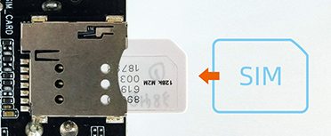
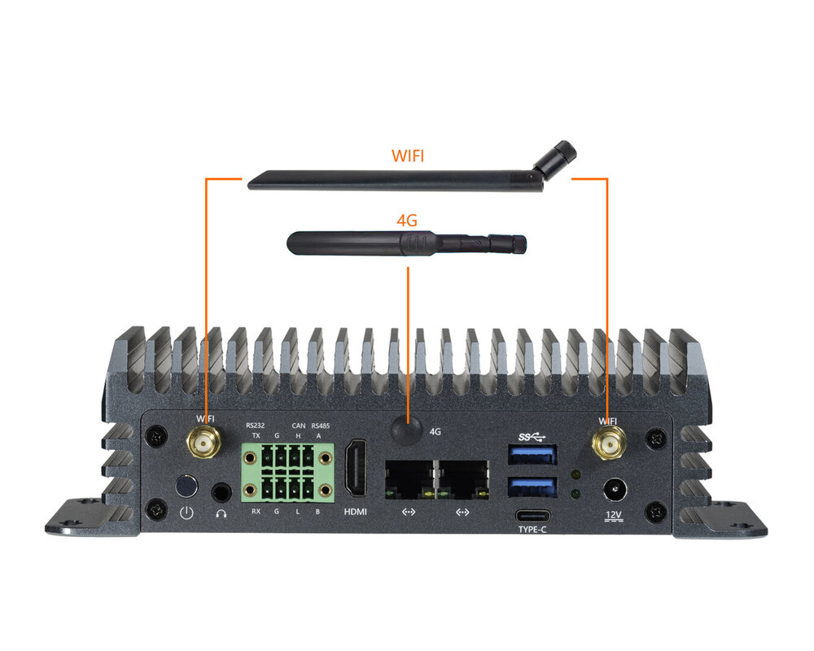
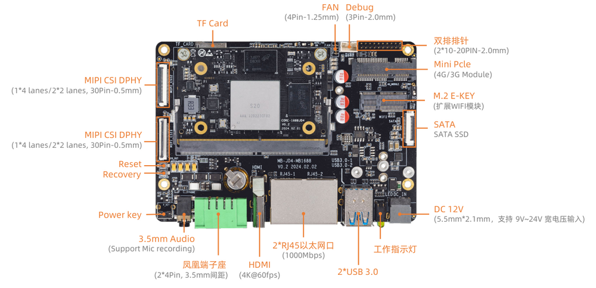

# Hardware Function Usage
## Debug Serial Port [step]

The EC-A1688JD4 has an on-board Type-C debug serial port. Simply connect the Type-C port of the machine to a USB port of the PC with a Type-C to USB data cable for direct debugging.

The serial port parameters are:

* Baud rate: 115200
* Data bits: 8
* Stop bits: 1
* Parity: none
* Flow control: none

The username and password for terminal login are both `linaro`.

## Display Interface [step]

The EC-A1688JD4 provides 1 HDMI output interface, supporting standard HDMI 2.0 output.

You can test the HDMI interface with the following commands:

```shell
insmod /mnt/system/ko/soph_drm.ko # Install display framework driver
systemctl stop SophonHDMI.service # Stop HDMI display interface
systemctl restart SophonHDMI.service  # Restore HDMI display interface
```

You can also test using `modetest`:

```shell
modetest -M cvitek -s 42@40:1920x1080-60@RG24
```

Where `42@40:1920x1080-60@RG24` should be modified according to the actual resolution of the connected monitor.

## UART [step]

The on-board RS232 serial port of EC-A1688JD4 corresponds to the device node `/dev/ttyS2` with a default baud rate of `115200`.

### Serial Loopback Test

After shorting the TXD and RXD pins of the serial port, run the following commands on the device:

```shell
stty -F /dev/ttyS2 115200
cat /dev/ttyS2 &
echo "firefly test" > /dev/ttyS2
```

If the terminal outputs `firefly test`, the serial transceiving works normally.


## Login and Network Configuration [step]

In addition to logging in through the Type-C debug serial port (see the Debug Serial Port section above), the EC-A1688JD4 provides 2 gigabit Ethernet ports and also supports remote login via Ethernet SSH.

### Ethernet SSH Login

By default, at the factory, port 0 (near the USB connector) of the EC-A1688JD4 is set to a dynamic IP, while port 1 (near the HDMI port) is set to a static IP `192.168.150.1` with a subnet mask of `255.255.255.0`. You can set the PC to `192.168.150.2/24` for the initial login.

The IP address of port 0 is assigned by a router and is generally unknown in advance, so it is best to choose port 1 for the initial login.

After the port LEDs blink normally, open a terminal and log in with `ssh`. The port number is `22`, and the username and password are both `linaro`:

```shell
ssh linaro@192.168.150.1
```

If the login fails, you can check whether the PC can `ping` the IP address of port 1 of the EC-A1688JD4. Note that the PC must have an IP address in the same subnet, because the PC's IP address may not be in the same subnet.

Here is how to add a same-subnet IP address on the PC (in administrator mode):

- Windows 10

  ```
  netsh int ipv4 add address "Ethernet" 192.168.150.101 255.255.255.0
  ```
  Here, `"Ethernet"` refers to the network interface, `192.168.150.101` is the IP address, and `255.255.255.0` is the subnet mask.

- Linux

  ```shell
  ifconfig enp4s0:1 192.168.150.89
  ```
  Here, `enp4s0` is the name of the PC's network card driver, which can be checked by executing the `ifconfig` command.

### Network IP Configuration (netplan)

In the Ubuntu system, `eth0` of the dual Ethernet ports obtains an IP address dynamically by default (i.e. DHCP), while `eth1` is fixed to `192.168.150.1`.

Network configuration is done through the `/etc/netplan/01-netcfg.yaml` file, which can be used to modify the original network configuration of the Ubuntu system.

```shell
linaro@sophon:~$ cat /etc/netplan/01-netcfg.yaml
network:
        version: 2
        renderer: networkd
        ethernets:
                eth0:
                        dhcp4: yes
                        addresses: []
                        optional: yes
                        dhcp-identifier: mac
                eth1:
                        dhcp4: no
                        addresses: [192.168.150.1/24]
                        optional: yes
```

If the user deletes this file, `eth1` will obtain an IP via DHCP just like `eth0`. If the user wants to set a static IP for `eth0` as well, just modify the `eth0` node in the `/etc/netplan/01-netcfg.yaml` file (referring to `eth1`), and restart for the changes to take effect.

## USB Interface [step]

The EC-A1688JD4 provides 2 USB 3.0 ports.

When a USB drive or other storage device is inserted, it will be recognized as a node like `/dev/sdb1`. The system does not support automatic mounting, so manual `mount` is required:

```shell
# Create mount directory
mkdir disk
# Mount
sudo mount /dev/sdb1 disk
# View files in the USB drive
ls disk
```

After writing data, please use `sync` or `umount` promptly. When shutting down, please use the `sudo poweroff` command instead of a forced power-off to avoid data loss.

## TF Card [step]

The EC-A1688JD4 provides a TF card slot. Mounting a TF card is similar to a USB drive:

```shell
# Create mount directory
mkdir media
# Mount
sudo mount /dev/mmcblk1p1 media
# View files in the TF card
ls media
```

The TF card can also be used for firmware upgrade. See [Firmware Upgrade](fw_upgrade.md).

## SIM Card [step]

The SIM card slot of the EC-A1688JD4 is used together with a 4G module to provide mobile network connectivity. **The 4G module is optional**, and the SIM card function is available only after the module has been installed inside the chassis. The SIM card insertion direction is shown in the figure below. Please power off the device before inserting or removing the SIM card.

<center>


</center>

## Antenna Connection [step]

The antenna connection of EC-A1688JD4 is shown below:

<center>


</center>


## NVMe SSD [step]

The EC-A1688JD4 provides an NVME interface (PCIE3.0 x 1). Generally, the mountable PCIE node is: `/dev/nvme0n1p1`.

```shell
# Create mount directory
mkdir nvme_dir
# Mount
sudo mount /dev/nvme0n1p1 nvme_dir
# View files in the PCIE SSD
ls nvme_dir
```


## Serial Port (RS232 / RS485) [step]

The EC-A1688JD4 has an RS485 interface, with the device name `/dev/ttyS4`, supporting half-duplex, and a default baud rate of `9600`.

There is also an RS232 interface, with the device name `/dev/ttyS2`, supporting full-duplex, and a default baud rate of `115200`.

For the interface location, please refer to the machine figure at the top of this page.

### RS485 Debugging Method

Users can use different USB-to-serial adapters on the host to send and receive data to the device's serial port. For example, the debugging steps for RS485 are as follows:

(1) Connect the hardware

Connect the A, B and GND pins of the RS485 port of the EC-A1688JD4 to the A, B and GND pins of the host serial port adapter (USB to 485 serial port module) respectively.

(2) Open the serial terminal on the host

Open kermit in the terminal and set the baud rate:

```
$ sudo kermit
C-Kermit> set line /dev/ttyUSB0
C-Kermit> set speed 9600
C-Kermit> set flow-control none
C-Kermit> connect
```

* `/dev/ttyUSB0` is the device file of the USB-to-serial adapter

(3) Send data

The device file of RS485 is `/dev/ttyS4`. Run the following commands on the device:

<Callout title="Note" type="warn">Before running the commands, you need to enable the RS485 sending function, because the device has a GPIO switch that toggles RS485 between the sending state and the receiving state.</Callout>

```
sudo -s
echo 1 > /sys/class/leds/RS485_H_SEND_L_RECV/brightness # 1 -> TX, 0 -> RX
stty -F /dev/ttyS4 9600 -echo
echo firefly RS485 test... > /dev/ttyS4
```

The serial terminal on the host will receive the string "firefly RS485 test..."

(4) Receive data

First run the following commands on the device:

```
sudo -s
cat /dev/ttyS4
```

Then enter the string "Firefly RS485 test..." in the serial terminal of the host, and the same string can be seen on the device side.

### RS232 Debugging Method

The testing method is similar to the RS485 steps; just pay attention to the device name and baud rate. The only difference is that RS232 **does not** require switching between the sending and receiving states.

## CAN [step]

### Introduction to CAN

CAN (Controller Area Network) bus is a serial communication network that effectively supports distributed control or real-time control. The CAN bus is a bus protocol widely used in automobiles, designed for communication between microcontrollers in automotive environments. For more information, please refer to the [CAN Application Report](https://www.ti.com/lit/an/sloa101b/sloa101b.pdf).

### Hardware Connection

The CAN interface location of the EC-A1688JD4 can be found in the machine figure at the top of this page. Since there is only one CAN, the first device created in the kernel is `can0` by default.

### CAN Communication Test

Use the candump and cansend tools to test sending and receiving messages:

```
# Close the can0 device on both the receiving and sending ends
ip link set can0 down
# Set the bitrate to 250Kbps on both the receiving and sending ends
ip link set can0 type can bitrate 250000
# Open the can0 device on both the receiving and sending ends
ip link set can0 up
# Run candump on the receiving end, blocking and waiting for messages
candump can0
# Run cansend on the sending end to send a message
cansend can0 123#1122334455667788
```

### FAQS

A summary of several problems encountered during debugging and their solutions:

#### The message is received a long time after sending, or is not received at all.

Check the CAN_H and CAN_L bus, and whether the DuPont wires are loose or reversed.

## Audio (Headphone) [step]

The EC-A1688JD4 supports the American standard headphone interface.

Playback Test:

```
$ aplay -D hw:CARD=cv186xdac,DEV=1 /usr/share/sounds/alsa/Front_Center.wav
```

Recording Test:

```
$ arecord -D hw:CARD=cv186xadc,DEV=0  -c 2 -r 48000  -f S16_LE test.wav # Record audio (mono)
$ aplay -D hw:CARD=cv186xdac,DEV=1  test.wav # Play the recorded audio
```

## ADC Usage [step]

The AIO-1688JD4 development board does not expose an external ADC, but the EC-A1688JD4's gold fingers expose multiple ADCs. By running ADC read and write commands in the console or writing ADC read and write programs in kernel mode or user mode, input and output operations on the ADC can be performed.

The user layer accesses the IIO interface to implement triggering, sampling, and other operations for a 5-channel, 12-bit ADC.

* Reference voltage is 1.5v ref
* The correspondence between ADC pins and sysfs files is as follows:
    * adc1 corresponds to sysfs file in_voltage1_raw
    * adc2 corresponds to sysfs file in_voltage2_raw
    * adc3 corresponds to sysfs file in_voltage3_raw
    * sar0 corresponds to sysfs file in_voltage4_raw
    * sar1 corresponds to sysfs file in_voltage5_raw
* Voltage value calculation formula: vol = val * 1500 / 4096, unit: mV

### Operation Example [step]
#### ADC Operation Command Example
1. Specify ADC channel 1~5, this example is for ADC1:
```
echo 1 > /sys/bus/iio/devices/iio:device0/in_voltage1_raw
```

2. Read the value of the specified ADC channel:
```
cat /sys/bus/iio/devices/iio:device0/in_voltage1_raw
```

#### User Mode ADC Read Operation Program Example
Refer to the following:
```
fd = open("/sys/bus/iio/devices/iio:device0/in_voltage1_raw", O_RDWR|O_NOCTTY|O_NDELAY);
if (fd < 0)
printf("open adc err!\n");
write(fd, "1", 1);
lseek(fd, -1, SEEK_CUR);
char buffer[512] = {0};
int len = 0;
unsigned int adc_value = 0;
len = read(fd, buffer, 5);
if (len != 0) {
printf("read buf: %s\n", buffer);
adc_value= atoi(buffer);
printf("adc value is %d\n", adc_value);
}
write(fd, "0", 1);
close(fd);
```

## CAMERA Usage [step]

The EC-A1688JD4 features 3 `MIPI CSI` interfaces (1*4 lanes / 2*2 lanes), with a single sensor supporting a maximum of 8K@15fps linear input or 12M@60fps HDR input.

### MIPI CSI [step]
Interface location as shown in the diagram




#### Command for Capturing Images

Taking the Firefly's [CAM-8MS1M](https://community.t-firefly.com/en/docs/products/accessories/CAM-8MS1M/started) camera as an example (connected to MIPI CSI0):
After entering the system, gain root privileges using `sudo -s`, and execute the following capture command.
```
insmod /mnt/system/ko/v4l2_xc7160.ko # Install driver
systemctl stop SophonHDMI.service # Stop the HDMI display interface
/opt/sophon/sophon-soc-libisp_1.0.0/bin/ispv4l2_ut 5 # Capture v4l2 stream
/opt/sophon/sophon-ffmpeg-latest/bin/ffmpeg -s 1920x1080 -pix_fmt yuyv422 -i v4l2_video0_7.yuv -hide_banner -loglevel error  -vf format=rgb24 -c:v rawvideo -f rawvideo -vframes 1 -  | sudo dd of=/dev/fb0 bs=1920x1080x3 # Assuming your connected HDMI screen has a resolution of 1920 x 1080
systemctl restart SophonHDMI.service  # Restore the HDMI display interface
```

Currently, the system only has MIPI CSI0 enabled by default. If MIPI CSI1/2 is needed, the SDK configuration and ko files need to be modified.

## DISPLAY usage [step]

The EC-A1688JD4 features an HDMI interface (supports 4K\@60fps) and a MIPS DSI interface (maximum output capability of 1440P (2560 \* 1440)@60fps,The interface location is shown in the figure.


<Callout title="Note" type="warn">`/mnt/system/ko/soph_drm.ko` is the driver for the entire display framework; module drivers such as HDMI and MIPI DSI are packaged within this driver.</Callout>

### HDMI [step]

After booting, the EC-A1688JD4 does not have a built-in desktop environment and only runs a display program:

```
insmod /mnt/system/ko/soph_drm.ko # Install the display framework driver
systemctl stop SophonHDMI.service # Stop the HDMI display interface
systemctl restart SophonHDMI.service  # Restart the HDMI display interface
```

### MIPI DSI [step]

Currently, the system can only have one display; when you connect HDMI, the MIPI DSI does not output by default.&#x20;
However, if you unplug the HDMI, the connected MIPI display module will show a test pattern in the form of color bars.

Currently adapted for Firefly's DM-M10R800 V2 display module.

## GPIO Usage [step]

The BM1688 chip includes 7 groups of GPIO controllers, each controlling 32 GPIOs, corresponding to the Linux device nodes as follows:

|    GPIO Controller   |      Linux Device Node      | GPIO Physical Number | GPIO Logical Number |
| :------------------: | :-------------------------: | :------------------: | :-----------------: |
|        #porta        | /sys/class/gpio/gpiochip464 |        0 to 31       |      464 to 495     |
|        #portb        | /sys/class/gpio/gpiochip432 |       32 to 63       |      432 to 463     |
|        #portc        | /sys/class/gpio/gpiochip400 |       64 to 95       |      400 to 431     |
|        #portd        | /sys/class/gpio/gpiochip368 |       96 to 127      |      368 to 399     |
|        #porte        | /sys/class/gpio/gpiochip336 |      128 to 159      |      336 to 367     |
|        #portf        | /sys/class/gpio/gpiochip304 |      160 to 191      |      304 to 335     |
| #portg(RTCSYS\_GPIO) | /sys/class/gpio/gpiochip272 |        0 to 31       |      272 to 303     |

Among them, AIO-1688JD4 supports the expansion of a set of GPIO interfaces (I2C extended GPIO):

| GPIO Controller |      Linux Device Node      | GPIO Physical Number | GPIO Logical Number |
| :-------------: | :-------------------------: | :------------------: | :-----------------: |
|      #portx     | /sys/class/gpio/gpiochip496 |        0 to 15       |      496 to 511     |

For example, to operate `porta` the `GPIO6`, the following is required:

1. Number conversion: the physical number is `6`, corresponding to the logical number `(464 + (6 - 0)) = 470`, here `0` represents the start of the GPIO physical number
2. Export this GPIO, run as root user:
   ```
   echo 470 >/sys/class/gpio/export
   ```
3. Operate GPIO, set to read input or output specified value:
   ```
   cd /sys/class/gpio/gpio470
   # Set to input mode
   echo in >direction
   cat value

   # Set to output mode
   echo out >direction
   # Output low level
   echo 0 >value
   # Output high level
   echo 1 >value
   ```

<Callout title="Note" type="warn">If the GPIO has already been requested by another driver, it cannot be successfully exported, and subsequent read and write operations cannot be performed.</Callout>

## LED Usage [step]

There are 2 LED lights on the AIO-1688JD4 development board (As shown in the figure):


| Color  | Position | Label     | Description  |
| ------ | :------: | --------- | ------------ |
| Yellow |    Up    | DIY\_LED  | User Control |
| Green  |   Down   | WORK\_LED | Power On     |

Example command to control the LED light status (requires root privileges):

```
# Yellow LED on
echo 1 >/sys/class/leds/DIY_LED/brightness
# Yellow LED off
echo 0 >/sys/class/leds/DIY_LED/brightness

# Green LED on
echo 1 >/sys/class/leds/WORK_LED/brightness
# Green LED off
echo 0 >/sys/class/leds/WORK_LED/brightness
```

## STORAGE Usage [step]

The AIO-1688JD4 development board has 1 PCIE3.0 x 1 interface, 1 SATA 3.0 interface, and a TF-Card interface.

Interface location as shown in the diagram


### Usage of PCIE [step]

The PCIE3.0 interface (which is shared with the SATA 3.0 interface, with the default system using the PCIE interface) supports NVME SSDs 2242/2260/2280 by default, and is named `nvme0n1` in the system.

### Usage of SATA [step]
If you want to switch to using the SATA3.0 interface, software configuration is required (bm1688_1688jd4.dtsi):

```
#if 0
&pcie0{
	reset-gpio = <&porte 3 GPIO_ACTIVE_HIGH>; 
	status = "okay";
};
&sata{
	status = "disabled";
};
#else
&pcie0{
	reset-gpio = <&porte 3 GPIO_ACTIVE_HIGH>; 
	status = "disabled";
};
&sata{
	status = "okay";
};
#endif
```

## RTC Usage [step]

The AIO-1688JD4 development board has an RTC (Real Time Clock) chip `TT8563RH`, which can be used to set the system clock.

### 1. View RTC Time

```
$ sudo hwclock
2024-05-09 10:53:15.268874+0800
```

### 2. View System Time

```
$ date
Tue May  9 10:57:03 CST 2024
```

### 3. Set System Time to RTC Time

```
$ sudo hwclock -s
```

### 4. Save Current System Time to RTC

```
$ sudo hwclock -w
```

## PWM Usage [step]

The AIO-1688JD4 development board only exposes one PWM (FAN) externally, but the EC-A1688JD4's gold fingers expose multiple PWMs. By running PMW read/write commands in the console or writing PWM read/write programs in kernel or user mode, you can perform input and output operations on the PWM.

* PWM operates at a fixed frequency clock of 100MHz, with a total of 20 channels, each of which can be controlled individually.
* The BM1688 has 5 PWM IPs (pwmchip0/ pwmchip4/ pwmchip8/ pwmchip12/ pwmchip16), each controlling 4 channels, allowing for a total of 20 channels.

In the Linux sysfs, the device nodes for pwm0~pwm3 are as follows:
```
/sys/class/pwm/pwmchip0/pwm0~3
```
In the Linux sysfs, the device nodes for pwm4~pwm7 are as follows:
```
/sys/class/pwm/pwmchip4/pwm0~3
```
Taking the fan's device tree configuration as an example:
```
&fan0 {
		compatible = "pwm-fan";
		#cooling-cells = <2>;
		pwms = <&pwm2 3 1000000 0>; 
		cooling-levels = <255 170 100 1>; // max 1
};
```
Here, `pwms = <&pwm2 3 1000000 0>;` indicates the use of the `PWM11` pin, as `pwm2` is the third group, and `3` indicates the fourth channel, leading to the conclusion: `3 x 4 = 12(0~11)`

And so on.
### Operation Example [step]
#### Example of PWM Operation Commands:

* Use the echo command on the control panel to configure the PWM number to be operated on, in this case PWM1:
```
echo 1 > /sys/class/pwm/pwmchip0/export
```
* Set the duration of one PWM cycle, in nanoseconds:
```
echo 1000000 >/sys/class/pwm/pwmchip0/pwm1/period
```
* Set the "ON" time within one cycle, in nanoseconds, i.e., duty cycle `=duty_cycle/period=50%`:
```
echo 500000 >/sys/class/pwm/pwmchip0/pwm1/duty_cycle
```
* Enable the PWM:
```
echo 1 >/sys/class/pwm/pwmchip0/pwm1/enable
```
#### Example of File IO Operation Program:

* Configure the PWM number to be operated on, taking PWM1 as an example:
```
fd = open("/sys/class/pwm/pwmchip0/export", O_WRONLY);
if(fd < 0)
{
dbmsg("open export error\n");
return -1;
}
ret = write(fd, "1", strlen("0"));
if(ret < 0)
{
dbmsg("Export pwm1 error\n");
return -1;
}
```

* Set the duration of one PWM cycle, in ns:

```
fd_period = open("/sys/class/pwm/pwmchip0/pwm1/period", O_RDWR);
ret = write(fd_period, "1000000", strlen("1000000"));
if(ret < 0)
{
dbmsg("Set period error\n");
return -1;
}
```

* Set the "ON" time within one cycle, in ns: (In this example, the duty cycle is 50%)

```
fd_duty = open("/sys/class/pwm/pwmchip0/pwm1/duty_cycle", O_RDWR);
ret = write(fd_duty, "500000", strlen("500000"));
if(ret < 0)
{
dbmsg("Set period error\n");
return -1;
}
```

* Enable PWM

```
fd_enable = open("/sys/class/pwm/pwmchip0/pwm1/enable", O_RDWR);
ret = write(fd_enable, "1", strlen("1"));
if(ret < 0)
{
dbmsg("enable pwm0 error\n");
return -1;
}
```

## NETWORK Usage [step]

EC-A1688JD4 has three types of networks:
* Cellular Network (4G/5G)
* Wireless Network (WIFI/BT)
* Gigabit Ethernet Port

EC-A1688JD4 has enabled these three networks by default, depending on user usage. The location of each interface is described in the interface description under Product Introduction.

### 1. Cellular Network

EC-A1688JD4 only has the 4G interface enabled (because the 5G network hardware conflicts with the USB3 port, requiring hardware modification to enable the 5G interface). If you make modifications and the hardware supports 5G, you can only choose one to use between the 4G and 5G interfaces.
Access steps:
* SIM card
* [EC20](https://community.t-firefly.com/en/docs/products/accessories/EC20/started) /RM500U-CN
* Power on the device

In the system, the module's network card name is `wwan0`.

### 2. Wireless Network
The wireless network interface of EC-A1688JD4 is a PCIE M.2 interface. Currently, the ko files that have been compiled and built into the system are:
```
$ ls /mnt/system/ko/3rd/
$ 8852be.ko  8852ce.ko  88x2ce.ko  hci_uart.ko  rtk_btusb.ko
```
These support relevant models of WIFI and Bluetooth. Other models' modules need to be compiled using the SDK.
After the driver is loaded, the default network card name is `wlan0`.

### 3. Gigabit Ethernet Port

The system uses `netplan` to manage configuration rules. The Ethernet port near the HDMI (eth1) has the IP address `192.168.150.1` for `ssh` login, with both the username and password as `linaro`. The Ethernet port near the USB3 socket (eth0) uses DHCP to obtain an IP address. If you want to modify the network card configuration rules, you can refer to the `/etc/netplan/` file on the device.

## Debugging and FAQs [step]

**What are the default username and password of the system?**

* Username: `linaro`
* Password: `linaro`
* Switch to superuser: `sudo -s`

**What should I do if the system fails to boot and keeps rebooting?**

It may be caused by insufficient power current. Please use a power supply with a voltage of 12V and a current of 5A or more.

**Checking memory:**

* System memory: `free -h`
* ION memory
    * NPU : `cat /sys/kernel/debug/ion/cvi_npu_heap_dump/summary`
    * VPP : `cat /sys/kernel/debug/ion/cvi_vpp_heap_dump/summary`
# HDMI Display Test

EC-A1688JD4 supports standard HDMI2.0 output.

You can test the HDMI interface with the following commands:

```shell
insmod /mnt/system/ko/soph_drm.ko # Install display framework driver
systemctl stop SophonHDMI.service # Stop HDMI display interface
systemctl restart SophonHDMI.service  # Restore HDMI display interface
```
You can also test using `modetest`:

```shell
modetest -M cvitek -s 42@40:1920x1080-60@RG24
```
Where `42@40:1920x1080-60@RG24` should be modified according to the actual resolution of the connected monitor.# Audio Interface Testing

EC-A1688JD4 supports the American standard headphone interface.

Playback Test:
```
$ aplay -D hw:CARD=cv186xdac,DEV=1 /usr/share/sounds/alsa/Front_Center.wav
```
Recording Test:
```
$ arecord -D hw:CARD=cv186xadc,DEV=0  -c 2 -r 48000  -f S16_LE test.wav # Record audio (stereo)
$ aplay -D hw:CARD=cv186xdac,DEV=1  test.wav # Play the recorded audio
```
