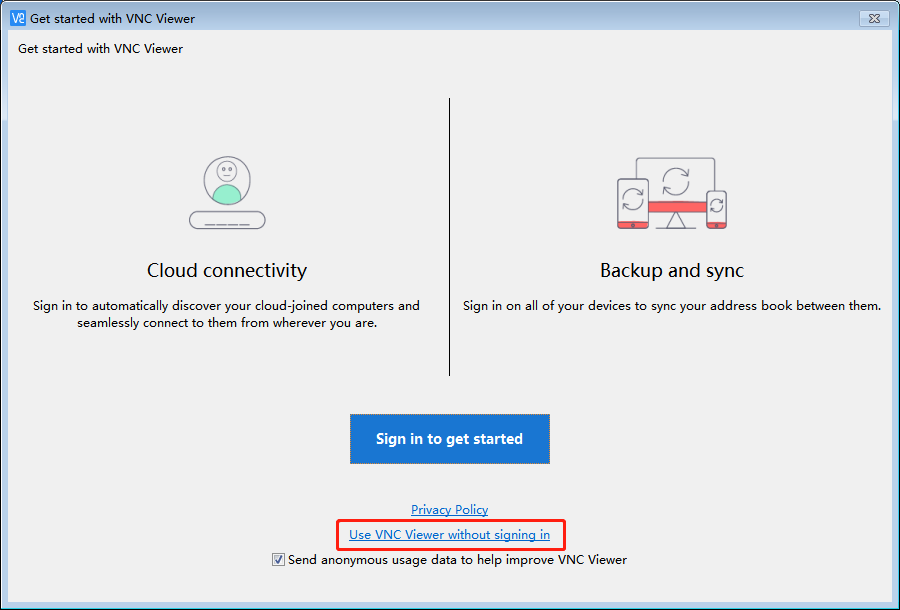
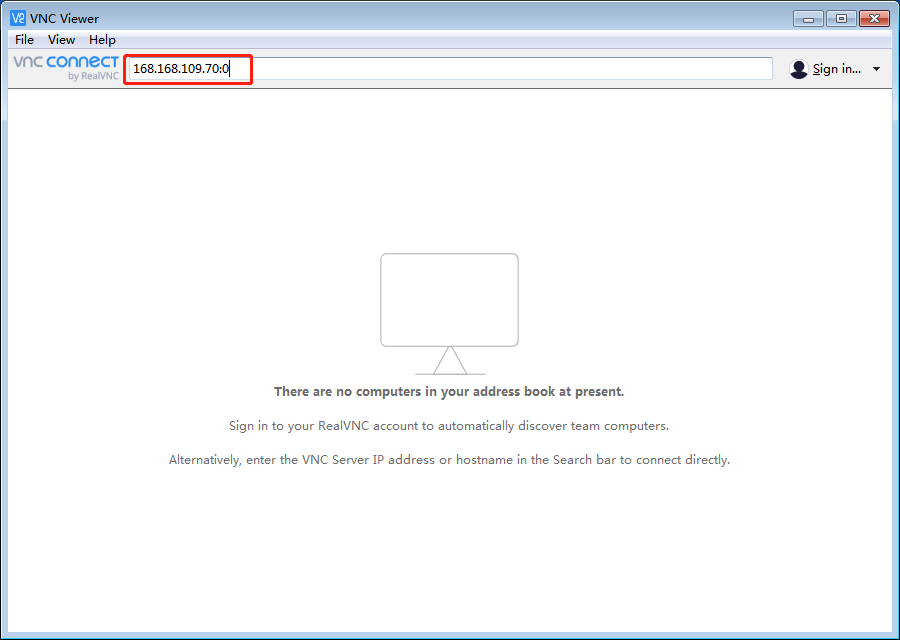
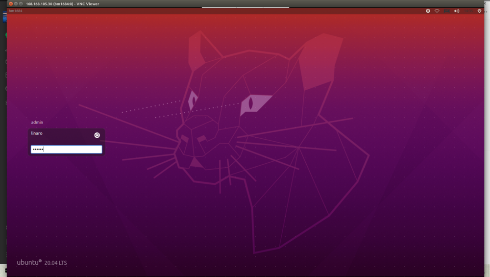
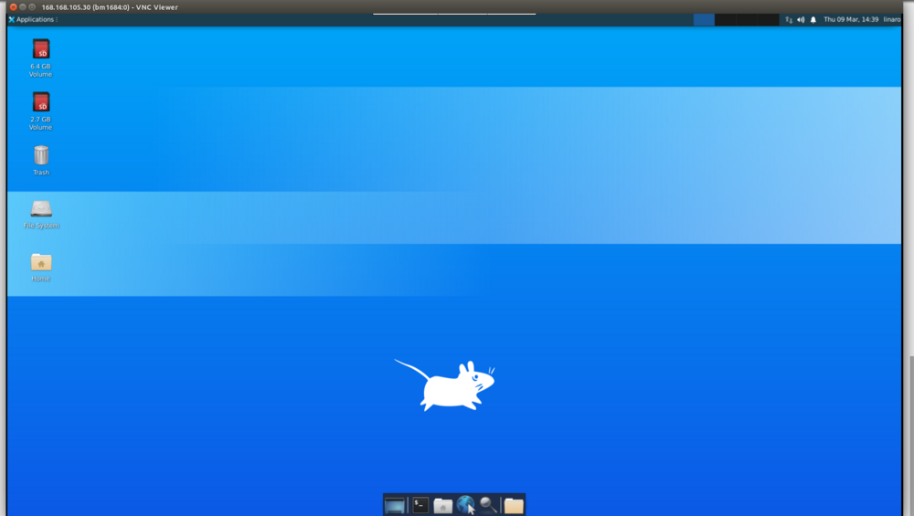

# Software Usage Guide

This section collects the software documents for EC-A186JD4. **Different computers support different features; the items below may not all be supported by the current model — please refer to the SDK or firmware of your actual device.**

<Callout title="Note" type="info">For the exact support, please refer to the SDK source code or firmware of your actual device.</Callout>


## Sophon SDK Development [step]


The SDK development of CV186AH relies on SOPHONSDK (one-stop SDK), which contains modules related to model conversion, model quantization, algorithm porting and so on. A series of materials including documents, videos, forums, open source repositories, etc. are provided to help users with algorithm porting and development work.

At present, the version of system firmware adapted to SOPHONSDK is v1.7, refer to the following link to get the SDK and other related development content:

### SDK Resources [step]

* [SDK Get](https://developer.sophon.ai/site/index/material/89/all.html)

* [SDK manual](https://doc.sophgo.com/bm1688_sdk-docs/v1.7/docs_latest_release/docs/BM1688_CV186AH_SophonSDK_doc/)

* [BSP Development Reference Manual](https://doc.sophgo.com/bm1688_sdk-docs/v1.7/docs_latest_release/docs/athena2-img/)


## Memory Management [step]

A portion of the memory of the EC-A186JD4 is allocated to NPU, VPP, and VPU devices. Therefore, the memory data obtained using commands such as `free -h` is inconsistent with the actual memory of the EC-A186JD4.

If you need to view the detailed memory allocation settings, or if the default memory allocation conflicts with actual requirements and needs to be adjusted, you can refer to the following steps.

### 1. Install the Memory Allocation Tool

Obtain the memory allocation tool package from [Download Center](https://community.t-firefly.com/en/doc/download/250) and transfer it to the EC-A186JD4. Run the following command to decompress the package:

```bash
tar -xvf memory_edit_v2.9.tar.xz
```

### 2. View Memory Allocation Settings

After decompressing the package, run the following command to view the memory allocation settings:

```bash
cd memory_edit
./memory_edit.sh -p
```

The following is an example of the memory allocation settings. The result displayed under `Info: get max memory size ...` is the maximum memory that can be configured for each device, and the result displayed under `Info: get now memory size ...` is the memory currently allocated for each device.

```bash
linaro@aibox-1688x:~/memory_edit$ ./memory_edit.sh -p
INFO: version: 2.9
Info: use dts file /home/linaro/memory_edit/output/bm1688x_se7_v1_mini.dts
Info: =======================================================================
Info: get ddr information ...
Info: ddr12_size 8589934592 Byte [8192 MiB]
Info: ddr3_size 4294967296 Byte [4096 MiB]
Info: ddr4_size 4294967296 Byte [4096 MiB]
Info: ddr_size 16384 MiB
Info: =======================================================================
Info: get max memory size ...
Info: max npu size: 0x1dbf00000 [7615 MiB]
Info: max vpu size: 0xc0000000 [3072 MiB]
Info: max vpp size: 0x100000000 [4096 MiB]
Info: =======================================================================
Info: get now memory size ...
Info: now npu size: 0xf6e00000 [3950 MiB]
Info: now vpu size: 0x80000000 [2048 MiB]
Info: now vpp size: 0xc0000000 [3072 MiB]
```

### 3. Modify Memory Allocation Settings

You can set the memory allocation by referring to the following commands. The three input parameters are decimal numbers of the sizes to be configured for NPU, VPU, and VPP in MiB; or hexadecimal values in Byte.

```bash
# decimal, in MiB
./memory_edit.sh -c -npu 2048 -vpu 2048 -vpp 2048
# hexadecimal, in Byte
./memory_edit.sh -c -npu 0x80000000 -vpu 0x80000000 -vpp 0x80000000
```

After executing one of the above commands, check whether there is an Error in the output, and whether the sizes of the three parts in the output similar to the following are the same as the sizes to be configured.

```bash
Info: output configuration results ...
Info: vpu mem area(ddr3): 0x8000000 [128 MiB] 0x20000000 -> 0x27ffffff
Info: ion npu mem area(ddr1): 0x80000000 [2048 MiB] 0x24100000 -> 0xa40fffff
Info: ion vpu mem area(ddr3): 0x80000000 [2048 MiB] 0x80000000 -> 0xffffffff
Info: ion vpp mem area(ddr4): 0x80000000 [2048 MiB] 0x80000000 -> 0xffffffff
Info: =======================================================================
Info: start check memory size ...
Info: check npu size: 0x80000000 [2048 MiB]
Info: check vpu size: 0x80000000 [2048 MiB]
Info: check vpp size: 0x80000000 [2048 MiB]
Info: check edit size ok
Info: en_emmcfile ok
```

If the check is correct, save the current work, replace the boot image in the boot partition with the modified `emmcboot.itb` file by referring to the following operations, and finally restart the machine for the changes to take effect.

```bash
sudo cp emmcboot.itb /boot
sync
sudo reboot
```

## Remote Desktop [step]

x11vnc is a tool that allows administrators to connect to the server's real X desktop directly via VNC Viewer.


### Ubuntu
The Ubuntu system requires the manual installation of the X desktop environment. During the installation process, select lightdm as the Display Manager:
```
sudo apt update
sudo apt install -y xserver-xorg-video-dummy x11vnc xfce4
sudo vim /etc/X11/xorg.conf
sudo reboot
```
The contents of /etc/X11/xorg.conf are:
```
Section "Device"
    Identifier  "Configured Video Device"
    Driver      "dummy"
    VideoRam 256000
EndSection

Section "Monitor"
    Identifier  "Configured Monitor"
    HorizSync 5.0 - 1000.0
    VertRefresh 5.0 - 200.0
    ModeLine "1920x1080" 148.50 1920 2448 2492 2640 1080 1084 1089 1125 +Hsync +Vsync
#    Modeline "1280x800" 24.15 1280 1312 1400 1432 800 819 822 841
EndSection

Section "Screen"
    Identifier  "Default Screen"
    Monitor     "Configured Monitor"
    Device      "Configured Video Device"
    DefaultDepth 24
    SubSection "Display"
    Depth 24
    Modes "1920x1080"
#    Modes "1280x800"
    EndSubSection
EndSection
```
After the installation is complete, start the x11vnc service:

```shell
sudo x11vnc -display :0 -auth /var/lib/lightdm/.Xauthority &
```

You can then use the `$bm1688_ip:0` address to VNC remote connect from a PC.

The following is the specific operation process for VNC Viewer:

(1) Users first download [VNC Viewer](https://www.realvnc.com/en/connect/download/viewer/) from the official website, selecting the appropriate installation package based on their PC system.

(2) After installation, open VNC Viewer and skip the login.

<center>


</center>

(3) Enter the `$bm1688_ip:0` address of EC-A186JD4:

<center>


</center>

(4) Click the circular button next to the linaro username, select xfce, and enter the username and password, both are `linaro`:

<center>


</center>

(5) Successfully enter the xfce4 desktop:

<center>


</center>


