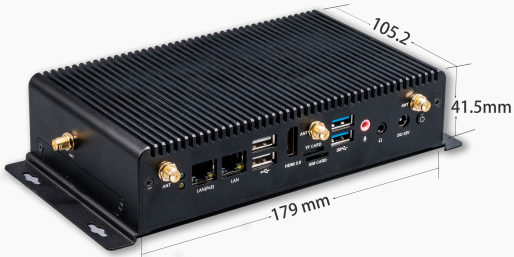
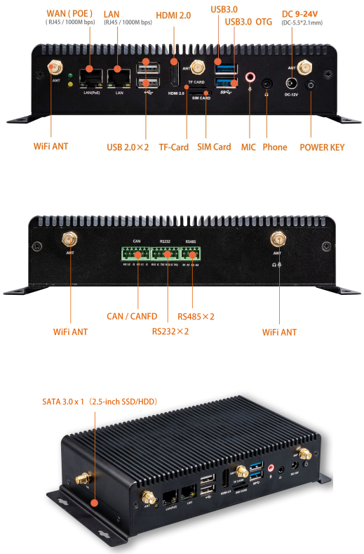
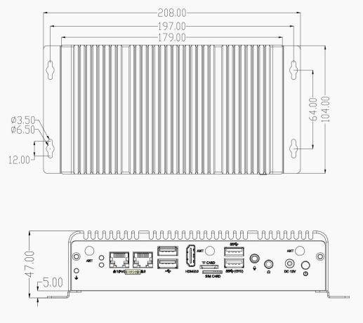

# Introduction

[Specification](https://download.t-firefly.com/Spec/Computers/EC-A3568J_Specification_EN.pdf) | [Purchase](https://www.t-firefly.com/products/ec-a3568j-quad-core-64-bit-ai-embedded-computer) | [Downloads](https://community.t-firefly.com/en/doc/download/108)

The EC-A3568J embedded computer is based on the high-performance open-source AIO-3568J platform, with an industrial-grade enclosure that is dustproof and anti-interference for long-term stable operation. It supports 4K hardware decoding and provides rich interfaces for easy connection to various industrial devices. It is equipped with an ARM Cortex-A55 architecture quad-core 64-bit high-performance processor with a frequency up to 2.0GHz, an ARM G52 2EE GPU, and an RKNN NPU AI accelerator (integrated in the SoC).

## Interface Description

The EC-A3568J provides rich interfaces, mainly including:

- WAN (POE) / LAN: Gigabit Ethernet (RJ45 1000Mbps) x2
- HDMI 2.0
- USB 3.0 OTG
- USB 2.0 x2
- TF Card slot
- SIM Card slot
- MIC / Phone 3.5mm audio jack
- DC 9-24V (5.5*2.1mm)
- Power Key
- WiFi ANT x2
- CAN / CANFD
- RS232 x2 / RS485 x2
- SATA 3.0 x1 (2.5-inch SSD/HDD)

The interfaces are shown in the figure below:

## Structure and Dimensions

## Resources and Support

- [Technical Forum](https://forum.t-firefly.com/): A communication platform with more than 100,000 enterprise customers and users

### Contact

- Email: sales@t-firefly.com
- Mobile: (+86) 186 8811 7175
- Landline: 0760-89881218
- Address: Room 2101, Hongyu Building, No. 57 Zhongshan 4th Road, East District, Zhongshan City, Guangdong Province
