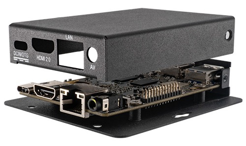
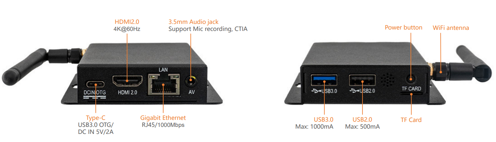
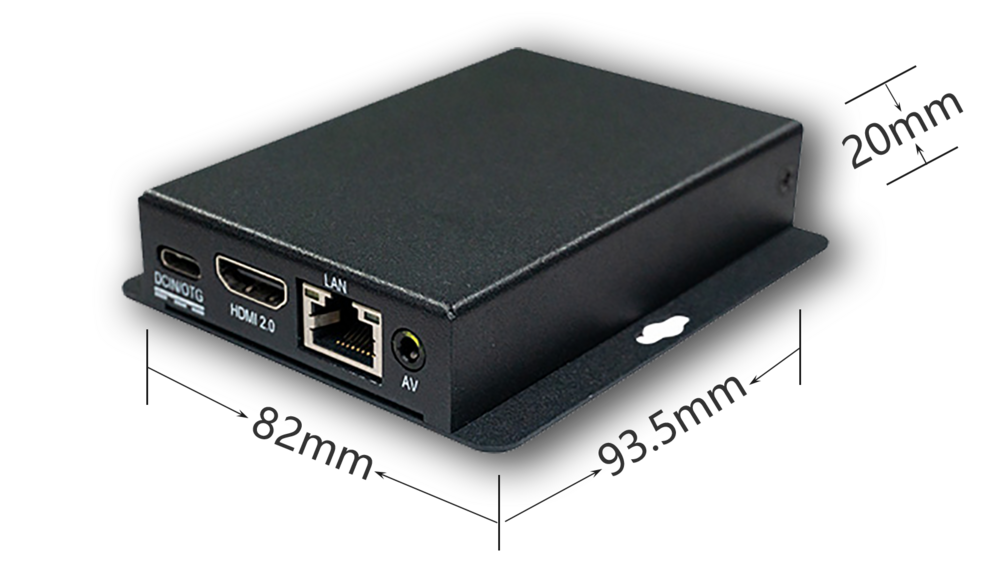

# Introduction

[Specification](https://download.t-firefly.com/Spec/Computers/EC-R3566PC_Specification_EN.pdf) | [Purchase](https://www.t-firefly.com/products/ec-r3566pc-quad-core-64-bit-embedded-computer) | [Downloads](https://community.t-firefly.com/en/doc/download/109)

The EC-R3566PC embedded computer is based on the high-performance open-source ROC-RK3566-PC platform, with an ultra-slim enclosure that is dustproof and anti-interference for long-term stable operation. It supports 4K hardware decoding and provides rich interfaces for easy connection to various industrial devices. It is equipped with an ARM Cortex-A55 architecture quad-core 64-bit high-performance processor with a frequency up to 1.8GHz, an ARM G52 2EE GPU, and an RKNN NPU AI accelerator (integrated in the SoC).

## Interface Description

The EC-R3566PC provides rich interfaces, mainly including:

- Type-C (USB3.0 OTG / DC IN 5V/2A)
- HDMI 2.0 (4K@60Hz)
- Gigabit Ethernet (RJ45 1000Mbps)
- AV 3.5mm audio jack (supports Mic recording, CTIA)
- USB 3.0 (Max 1000mA)
- USB 2.0 (Max 500mA)
- TF Card slot
- Power button
- WiFi antenna

The interfaces are shown in the figure below:

## Structure and Dimensions

## Resources and Support

- [[Technical Forum]](https://forum.t-firefly.com/): A communication platform with more than 100,000 enterprise customers and users

### Contact

- Email: sales@t-firefly.com
- Mobile: (+86) 186 8811 7175
- Landline: 0760-89881218
- Address: Room 2101, Hongyu Building, No. 57 Zhongshan 4th Road, East District, Zhongshan City, Guangdong Province
