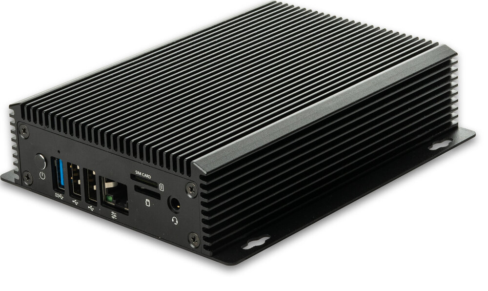
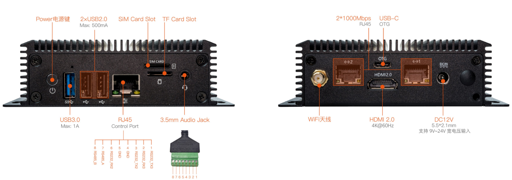
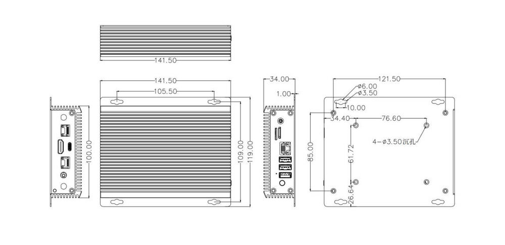

# Introduction

[Specification](https://download.t-firefly.com/Spec/Computers/EC-R3568PC_Specification_EN.pdf) | [Purchase](https://www.t-firefly.com/products/ec-r3568pcquad-core-64-bit-ai-embedded-computer) | [Downloads](https://community.t-firefly.com/en/doc/download/162)

The EC-R3568PC embedded computer is based on the high-performance open-source ROC-RK3568-PCSE platform, with an industrial-grade enclosure that is dustproof and anti-interference for long-term stable operation. It supports 4K hardware decoding and provides rich interfaces for easy connection to various industrial devices. It is equipped with an ARM Cortex-A55 architecture quad-core 64-bit high-performance processor with a frequency up to 2.0GHz, an ARM G52 2EE GPU, and an RKNN NPU AI accelerator (integrated in the SoC).

## Interface Description

The EC-R3568PC provides rich interfaces, mainly including:

- WiFi antenna
- 2×1000Mbps RJ45 Gigabit Ethernet
- USB-C (OTG)
- HDMI 2.0 (4K@60Hz)
- DC12V (5.5×2.1mm, supports 9V~24V wide voltage input)
- Power button
- USB3.0 (Max: 1A)
- 2×USB2.0 (Max: 500mA)
- RJ45 Control Port (RS232/RS485, 8-pin terminal)
- SIM card slot
- TF card slot
- 3.5mm Audio jack

The interfaces are shown in the figures below:

## Structure and Dimensions

## Resources and Support

- [Technical Forum](https://forum.t-firefly.com/): A communication platform with more than 100,000 enterprise customers and users

### Contact

- Email: sales@t-firefly.com
- Mobile: (+86) 186 8811 7175
- Landline: 0760-89881218
- Address: Room 2101, Hongyu Building, No. 57 Zhongshan 4th Road, East District, Zhongshan City, Guangdong Province
