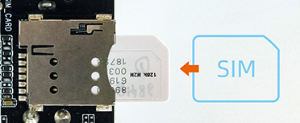

# Hardware Usage

## Debug Serial [step]

The EC-R3588SPC does not expose a debug serial port on the enclosure. You need to open the host to access the debug serial port on the carrier board and connect an external USB to TTL serial module for debugging.

For the connection and usage of the debug serial port, see: [Debug Serial](usb_to_ttl.md).

## SIM Card [step]

The SIM card slot of the EC-R3588SPC is used together with a 4G module to provide mobile network connectivity. **The 4G module is optional**, and the SIM card function is available only after the module has been installed inside the chassis. The SIM card insertion direction is shown in the figure below. Please power off the device before inserting or removing the SIM card.

- [ADB Usage](android_adb_use.md)
- [CAN](usage_can.md)
- [Display](usage_display.md)
- [Ethernet](usage_ethernet.md)
- [LED](usage_led.md)
- [Relay](usage_relay.md)
- [DIN](usage_din.md)
- [RTC](usage_rtc.md)
- [SATA](usage_sata.md)
- [UART](usage_uart.md)
- [Watchdog](usage_watchdog.md)
