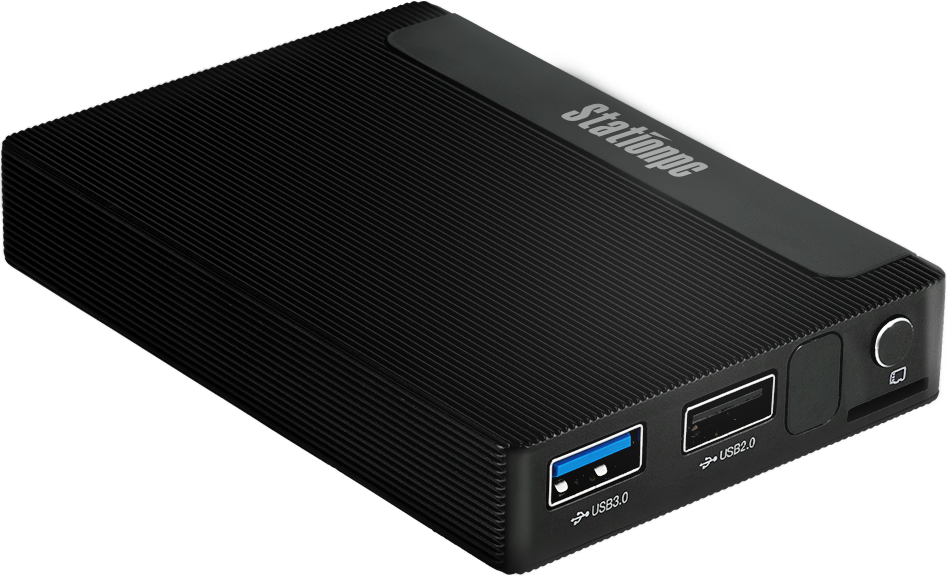
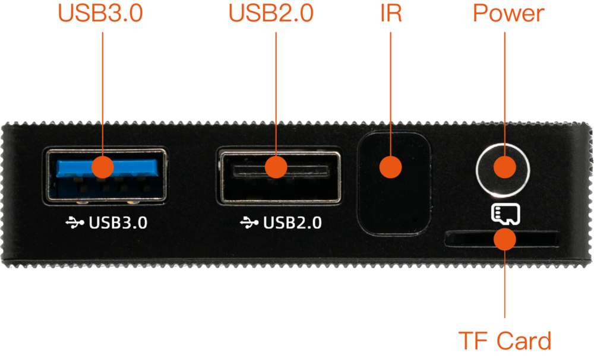
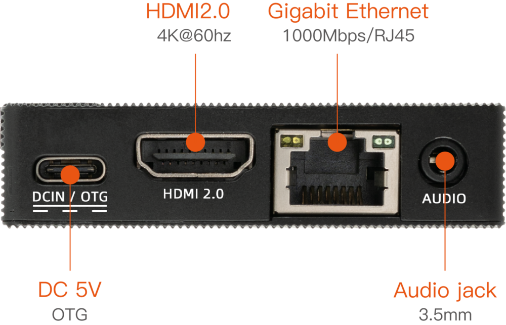
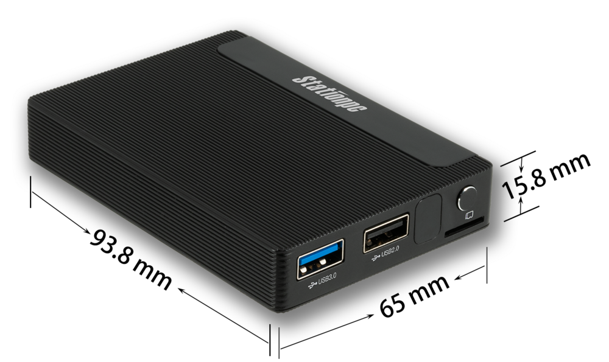

# Introduction

[Specification](（同中文版）) | [Purchase](https://www.t-firefly.com/products/station-m2-ce-fcc-rohs) | [Downloads](https://community.t-firefly.com/en/doc/download/215)

Station M2 Geek Mini PC is based on ROC-RK3566-PC with an ultra-slim, compact and portable design. It supports 8 GB of RAM and an M.2 slot for large-capacity SSD expansion, supports multiple operating systems, and comes with a mobile app for remote control, so you can enjoy the Mini PC wherever you are. It is equipped with an ARM Cortex-A55 architecture quad-core 64-bit high-performance processor with a frequency up to 1.8GHz, an ARM G52 2EE GPU, and an RKNN NPU AI accelerator (integrated in the SoC).

## Interface Description

ROC-RK3566-PC provides a wealth of interfaces, mainly including:

- 1 x USB3.0 (host)
- 1 x USB2.0 (host)
- 1 x HDMI
- 1 x MIPI DSI
- 1 x 1G Ethernet interface
- 1 x 2.4/5G WiFi
- 1 x 3.5mm Phone Jack
- 1 x Type-C (PD) power interface
- 1 x IR interface
- 1 x TF card slot
- 1 x Power key
- 1 x Reset key
- 1 x Recovery key
- 1 x Debug serial
- 1 x NOR flash
- 1 x MIPI CSI

The interface layout is shown below:

## Structure and Dimensions

## Resources and Support

- [[Technical Forum]](https://forum.t-firefly.com/): A communication platform with more than 100,000 enterprise customers and users

### Contact

- Email: sales@t-firefly.com
- Mobile: (+86) 186 8811 7175
- Landline: 0760-89881218
- Address: Room 2101, Hongyu Building, No. 57 Zhongshan 4th Road, East District, Zhongshan City, Guangdong Province
