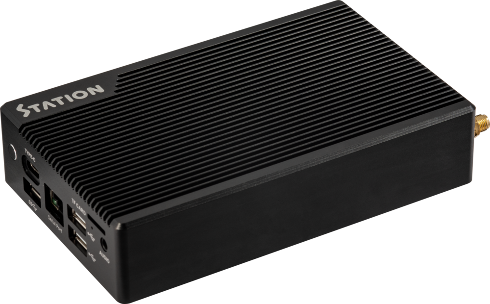
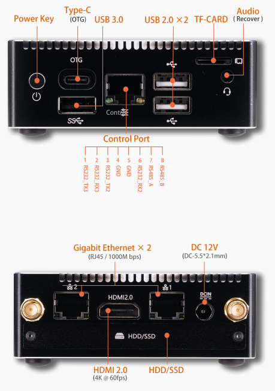
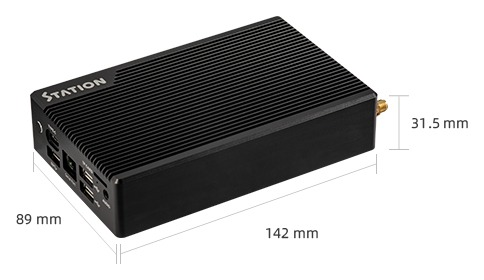

# Introduction

[Specification](（同中文版）) | [Purchase](https://www.t-firefly.com/products/station-p2-ce-fcc-rohs) | [Downloads](https://community.t-firefly.com/en/doc/download/217)

Station P2 Embedded Computer, based on the high-performance open-source ROC-RK3568-PC platform, supports 4K hardware decoding and provides rich interfaces for easy connection to various devices. It is equipped with an ARM Cortex-A55 architecture quad-core 64-bit high-performance processor with a frequency up to 2.0GHz, an ARM G52 2EE GPU, and an RKNN NPU AI accelerator (integrated in the SoC).

## Interface Description

The Station-P2 provides rich interfaces, mainly including:

- Power key
- Type-C port (OTG)
- USB 3.0 port
- USB 2.0 ports ×2
- TF card slot
- 3.5mm audio jack (Recovery)
- Control Port (RS232 / RS485)
- Gigabit Ethernet ×2 (RJ45, 1000M bps)
- HDMI 2.0 output (up to 4K@60fps)
- HDD/SSD
- DC 12V power port (DC-5.5×2.1mm)
- WiFi antenna ports ×2

The interfaces are shown in the figure below:

## Structure and Dimensions

## Resources and Support

- [Technical Forum](https://forum.t-firefly.com/): A communication platform with more than 100,000 enterprise customers and users

### Contact

- Email: sales@t-firefly.com
- Mobile: (+86) 186 8811 7175
- Landline: 0760-89881218
- Address: Room 2101, Hongyu Building, No. 57 Zhongshan 4th Road, East District, Zhongshan City, Guangdong Province
