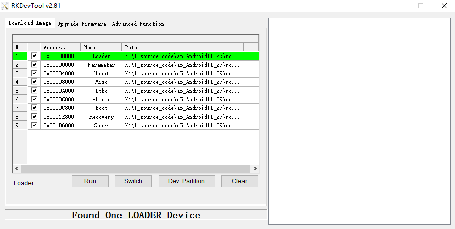
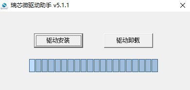
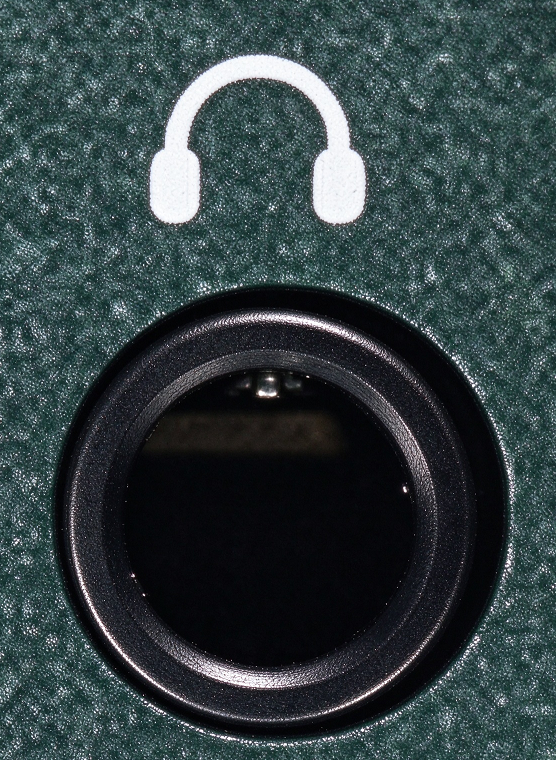
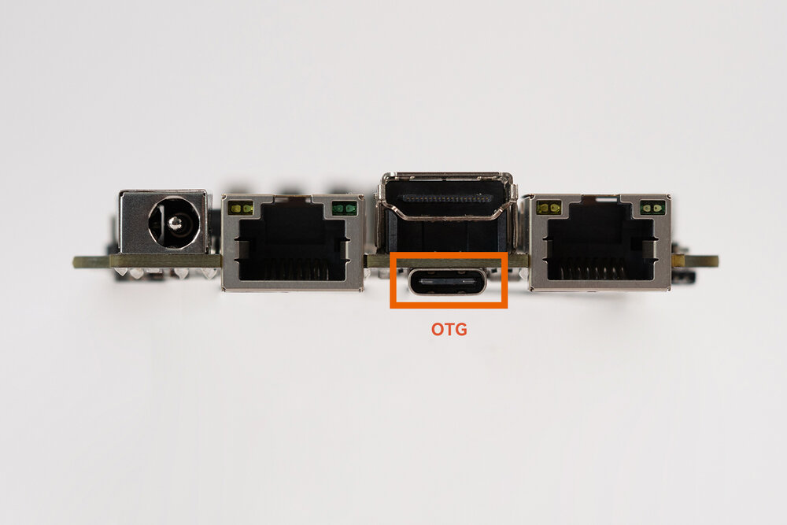
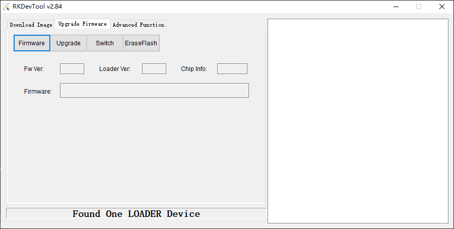
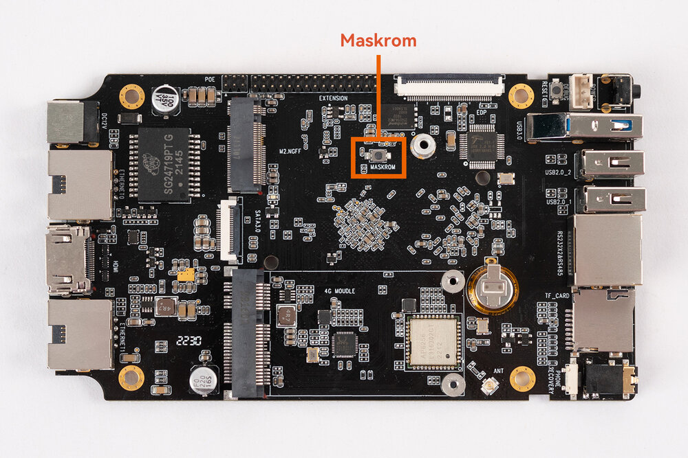
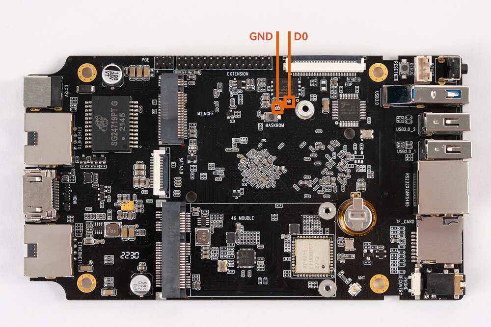
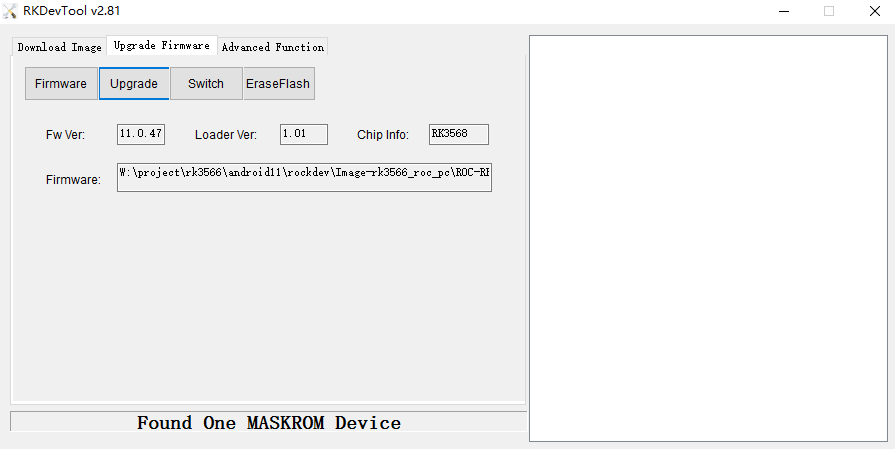
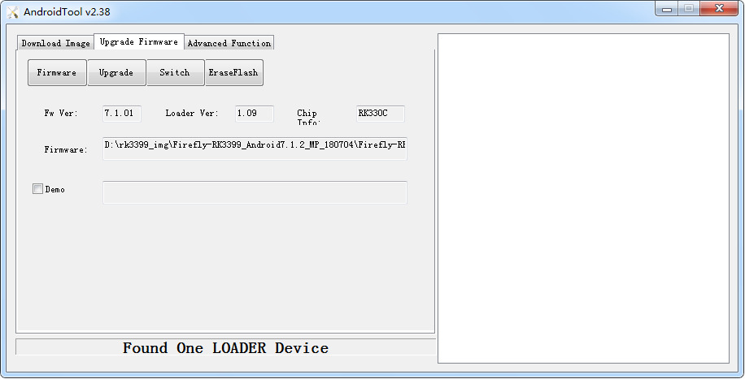

# USB Firmware Upgrade

## Introduction

This article describes how to upgrade the firmware file on the host to the flash memory of the development board through the Type-C data cable. When upgrading, you need to choose the appropriate upgrade mode according to the host operating system and firmware type.

## Preparatory Tools [step]

- ROC-RK3568-PC-SE development board
- [Firmware](https://community.t-firefly.com/en/doc/download/180)
- Host computer
- Type-C data cable

## Prepare Firmware [step]

The firmware can be obtained by compiling the SDK, or downloaded from [Resource Download](https://community.t-firefly.com/en/doc/download/180) as a public firmware (unified firmware). There are two types of firmware files:

- A single unified firmware

    The unified firmware is a single file packaged and merged by all files such as the partition table, bootloader, uboot, kernel, system and so on. The firmware officially released by Firefly adopts a unified firmware format. Upgrading the unified firmware will update the data and partition table of all partitions on the motherboard, and erase all data on the motherboard.

- Multiple partition images

    That is, files with independent functions, such as partition table, bootloader, and kernel, are generated during the development phase. The independent partition image can only update the specified partition, while keeping other partition data from being destroyed, it will be very convenient to debug during the development process.

> Through the unified firmware unpacking / packing tool, the unified firmware can be unpacked into multiple partition images, or multiple partition images can be merged into a unified firmware.

## Install the Upgrade Tool [step]
<CodeBlockTabs defaultValue="Windows">
  <CodeBlockTabsList>
    <CodeBlockTabsTrigger value="Windows">Windows</CodeBlockTabsTrigger>
    <CodeBlockTabsTrigger value="Linux">Linux</CodeBlockTabsTrigger>
  </CodeBlockTabsList>

  <CodeBlockTab value="Windows">
    ### Windows Operating System

    - Tool: Use tools in the firmware package or download here [Androidtool_xxx (version number)](https://community.t-firefly.com/en/doc/download/180)

    AndroidTool defaults to display in Chinese. We need to change it to English. Open `config.ini` with a text editor (like notepad). The starting lines are:

    ```ini
    #Language Selection: Selected=1(Chinese); Selected=2(English)
    [Language]
    Kinds=2
    Selected=1
    LangPath=Language\
    ```

    Change `Selected=1` to `Selected=2`, and save. From now on, AndroidTool will display in English. Now, run AndroidTool.exe: (Note: If using Windows 7/8, you’ll need to right click it, select to run it as Administrator)

    <Callout title="Note" type="warn">
      In order to avoid the burning problem caused by the download tool version, it is recommended to use the tool packaged inside the public firmware package for burning.
    </Callout>

    After decompressing the public firmware package, it is as follows:
    ```shell
    XXXX_Android11_HDMI_XXXX
    ├── XXXX_Android11_HDMI_XXXX.img
    ├── linux
    │   └── Linux_Upgrade_Tool_v1.59.zip
    └── windows
        ├── DriverAssitant_v5.1.1.zip
        └── RKDevTool_Release_v2.81.zip
    ```

    <center>

    
    </center>

    #### Install RK USB drive

    Download [Release_DriverAssistant.zip](https://community.t-firefly.com/en/doc/download/180), extract, and then run the DriverInstall.exe inside.
    In order for all devices to use the updated driver, first select `Driver uninstall`(`驱动卸载`) and then select `Driver install`(`驱动安装`).

    <center>

    
    </center>
  </CodeBlockTab>

  <CodeBlockTab value="Linux">
    ### Linux Operating System

    There is no need to install device driver under Linux.

    - Tool: Use tools in the firmware package or download here [upgrade_tool_xxx (version number)](https://community.t-firefly.com/en/doc/download/180)

    Install it into the system as follows for easy invocation:

    ```bash
    unzip Linux_Upgrade_Tool_xxxx.zip
    cd Linux_UpgradeTool_xxxx
    sudo mv upgrade_tool /usr/local/bin
    sudo chown root:root /usr/local/bin/upgrade_tool
    sudo chmod a+x /usr/local/bin/upgrade_tool
    ```
  </CodeBlockTab>
</CodeBlockTabs>

## Enter Upgrade mode [step]

There are two upgrade modes: Loader mode and MaskRom mode. Before flashing the firmware, we need to connect the device and make the board enter an upgradable mode.

<CodeBlockTabs defaultValue="loader">
  <CodeBlockTabsList>
    <CodeBlockTabsTrigger value="loader">loader</CodeBlockTabsTrigger>
    <CodeBlockTabsTrigger value="maskrom">maskrom</CodeBlockTabsTrigger>
  </CodeBlockTabsList>
  <CodeBlockTab value="loader">
    ### Loader mode

    #### Enter Loader mode by hardware [step]

    Connect the device and enter the Loader upgrade mode through the **RECOVERY** key as follows:

1. Disconnect the device from the power supply
2. Press and hold the earphone hole on ROC-RK3568-PC-SE with a pin tool
3. The device is plugged into the power supply and powered on

The earphone hole position is shown in the figure below:

<center>


</center>

Use a dual-male USB cable: one end connects to the host PC, and the other end connects to the USB OTG port on the ROC-RK3568-PC-SE board. The host side and the board side are shown below:

<center>


</center>

At this point, the device enters Recovery mode. Once the host detects the device, the upgrade tool displays as follows:

<center>


</center>

    #### Enter Loader mode by software [step]

    With the Type-C data cable connected, use the command in the serial debugging terminal or adb shell:

    ```shell
    reboot loader
    ```


    <Callout title="Note" type="info">
      Loader mode does not write to SPI/NOR Flash, so there is no need to switch the storage. Just follow the "Upgrade the firmware" section below.
    </Callout>
  </CodeBlockTab>

  <CodeBlockTab value="maskrom">
    ### MaskRom mode
`MaskRom` mode is the last line of defense against device being bricked. Forced entry `MaskRom` involved hardware operation, have certain risk, so only in the situation that device failed entering the `Loader` mode, you can try `MaskRom` mode.

<Callout title="Warning" type="error">

Please read carefully and operate carefully!

</Callout>

#### How to Enter MaskRom Mode [step]

The operation steps are as follows:

1. Disconnect all power supplies.
1. You need to open the enclosure (the box) of ROC-RK3568-PC-SE before operating.
1. Connect the device and host PC with Type-C data cable.
1. Hold down the `Maskrom` button.
1. Connect DC power.
1. Wait a few seconds, release the button.

<center>



</center>

When the board has NOR flash at the same time, if EMMC is empty and there are burned files in NOR flash, it is necessary to short circuit the D0 and GND test points near NOR flash to enter Maskrom mode.

<center>



</center>


#### Confirming MaskRom Mode [step]

At this point, the device should go into `MaskRom mode`.

<center>



</center>
    <a id="rk_upgrade_maskrom_nor_flash"></a>

    #### Upgrade the Firmware Using the Firefly Method [step]

    Flash the latest official firmware or the firmware compiled from the latest SDK. This method does not require storage switching. Flash the whole firmware directly in MaskRom mode. Whether the flashing succeeds or not, any data in the NOR Flash will be automatically erased after the device is powered off or restarted (it takes about 30 to 60 seconds). After erasing, the device automatically enters Loader mode, and then you can flash the whole firmware following the "Upgrade the firmware" section.

    The firmware can be downloaded from the [Download](https://community.t-firefly.com/en/doc/download/180) page.

  </CodeBlockTab>
</CodeBlockTabs>

## Upgrade the firmware [step]
<CodeBlockTabs defaultValue="Windows">
  <CodeBlockTabsList>
    <CodeBlockTabsTrigger value="Windows">Windows</CodeBlockTabsTrigger>
    <CodeBlockTabsTrigger value="Linux">Linux</CodeBlockTabsTrigger>
  </CodeBlockTabsList>

  <CodeBlockTab value="Windows">
    ### Windows Operating System

    #### Upgrade unified firmware - update.img

    The steps to update the unified firmware `update.img` are as follows:

    1. Switch to the "upgrade firmware" page.
    2. Press the "firmware" button to open the firmware file to be upgraded. The upgrade tool displays detailed firmware information.
    3. Press the "upgrade" button to start the upgrade.
    4. If the upgrade fails, you can try to erase the Flash by pressing the `EraseFlash` button first, and then upgrade.
    <center>

    
    </center>
  </CodeBlockTab>

  <CodeBlockTab value="Linux">

    ### Linux Operating System
    #### Upgrade unified firmware - update.img

    ```bash
    sudo upgrade_tool uf update.img
    ```

    <Callout title="Note" type="warn">
      If the upgrade fails, try erasing before upgrading.
    </Callout>

    ```bash
    # erase flash : Using the ef parameter requires the loader file or the corresponding update.img to be specified.
    # update.img :The ubuntu firmware you need to upgrade.
    sudo upgrade_tool ef update.img
    # upgrade again
    sudo upgrade_tool uf update.img
    ```

  </CodeBlockTab>
</CodeBlockTabs>