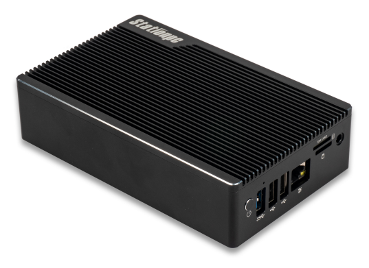
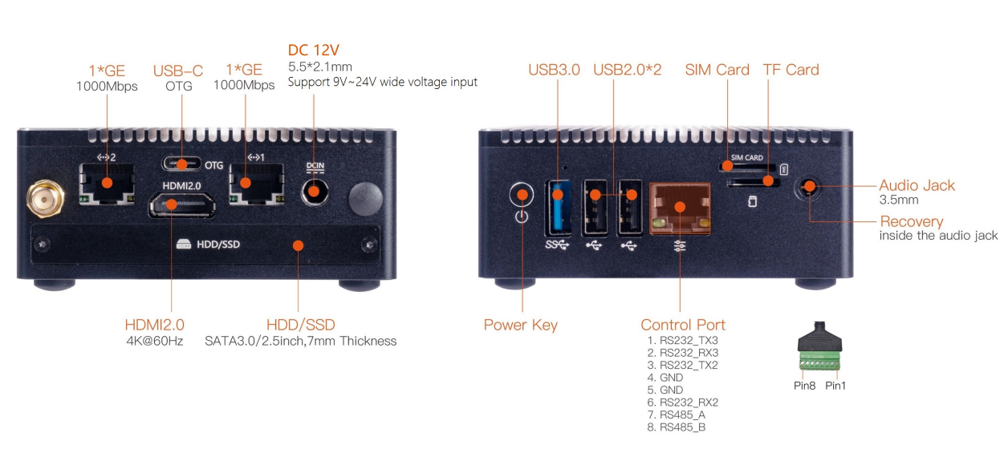
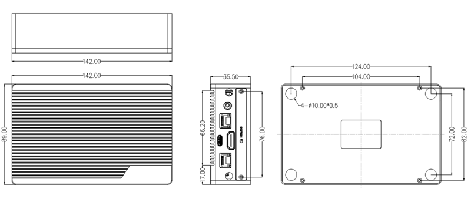

# Introduction

[Specification](（同中文版）) | [Purchase](https://www.firefly.store/products/roc-rk3568-pc-se-quad-core-64-bit-mini-computer) | [Downloads](https://community.t-firefly.com/en/doc/download/218)

Station P2S adopts the ROC-RK3568-PC-SE quad-core 64-bit Cortex-A55 processor with 22nm lithography process and a frequency up to 2.0GHz, integrating a dual-core GPU and a high-performance NPU (1TOPS); it supports up to 8G RAM, WiFi 6 and dual Gigabit Ethernet. With rich interface expansion and various video input/output interfaces, it is suitable for scenarios such as smart NVR, cloud terminal, IoT gateway, industrial control and edge computing.

## Interface Description

The Station P2S provides rich interfaces, mainly including:

- 2 x Gigabit Ethernet (RJ45 1000Mbps)
- USB-C (OTG)
- HDMI 2.0 (4K@60Hz)
- DC 12V (5.5*2.1mm, supports 9V~24V wide voltage input)
- HDD/SSD (SATA 3.0, 2.5-inch, 7mm thickness)
- Power Key
- USB 3.0
- USB 2.0 x2
- Control Port (8-pin: RS232 x3 / RS485 x1)
- SIM Card slot
- TF Card slot
- 3.5mm Audio Jack (Recovery inside the audio jack)

The interfaces are shown in the figure below:

## Structure and Dimensions

## Resources and Support

- [Technical Forum](https://forum.t-firefly.com/): A communication platform with more than 100,000 enterprise customers and users

### Contact

- Email: sales@t-firefly.com
- Mobile: (+86) 186 8811 7175
- Landline: 0760-89881218
- Address: Room 2101, Hongyu Building, No. 57 Zhongshan 4th Road, East District, Zhongshan City, Guangdong Province
