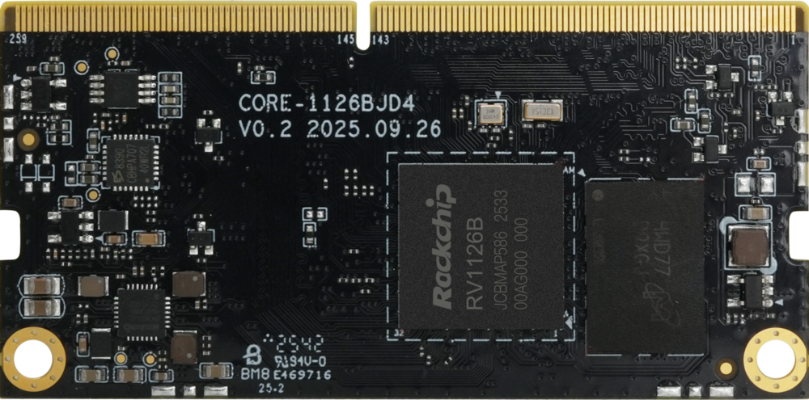
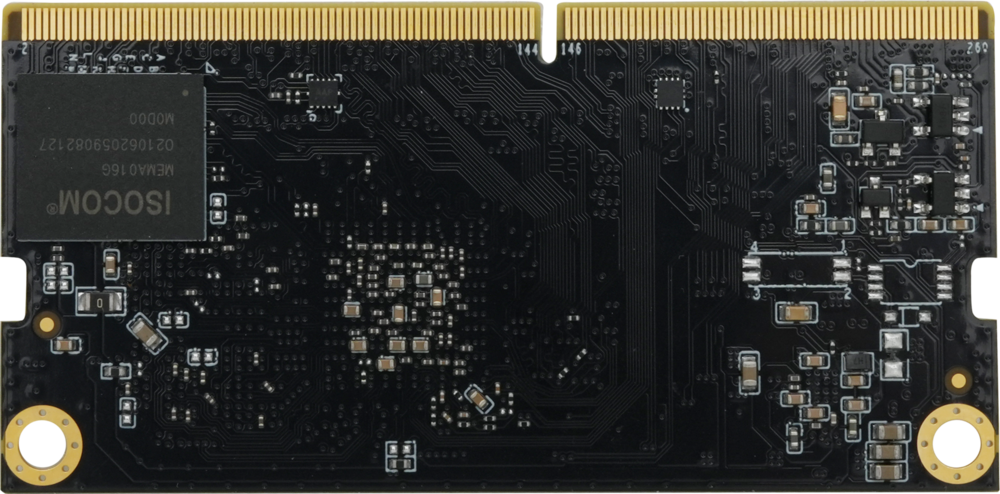
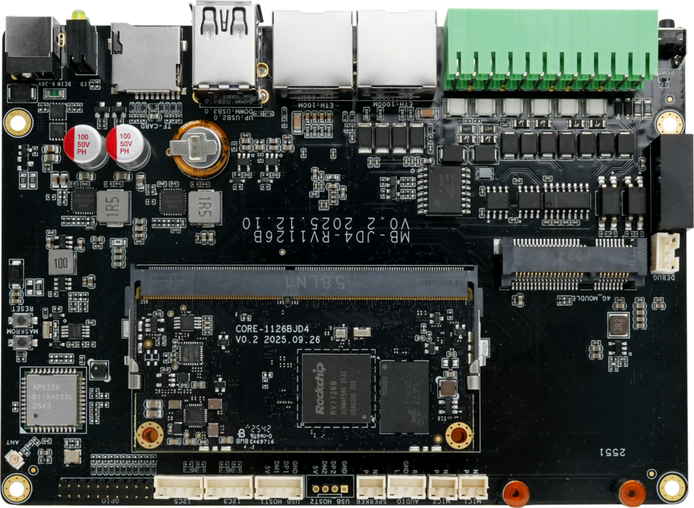
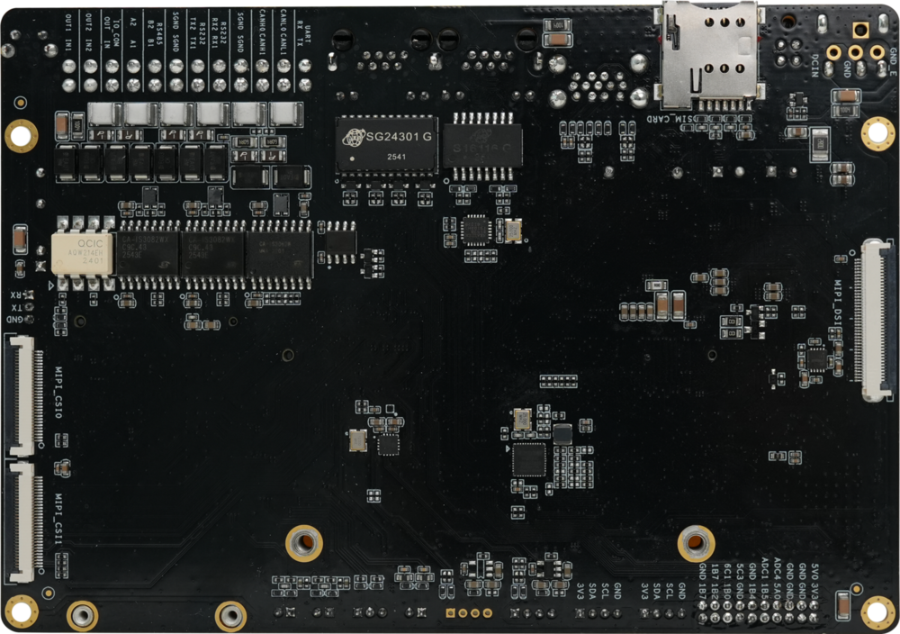
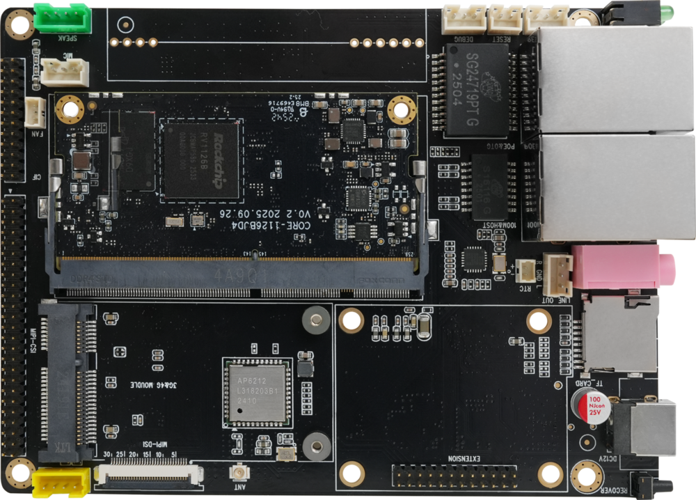
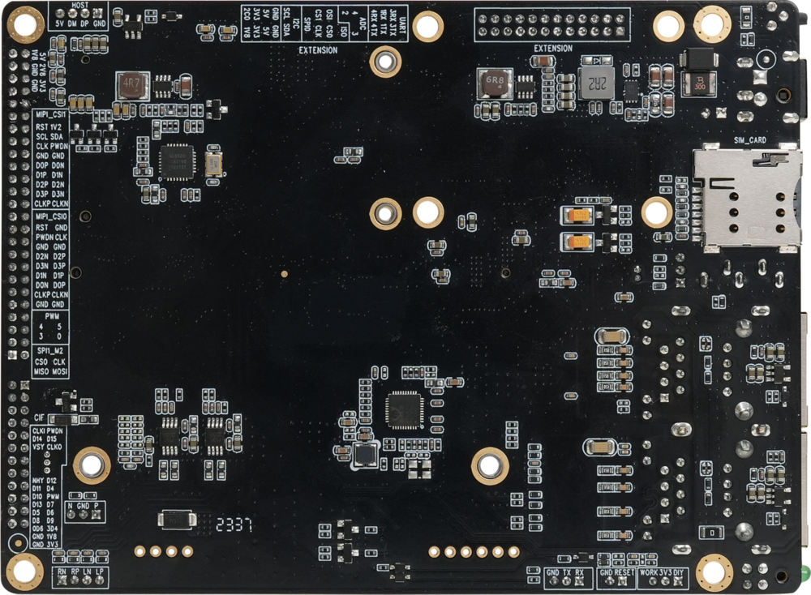
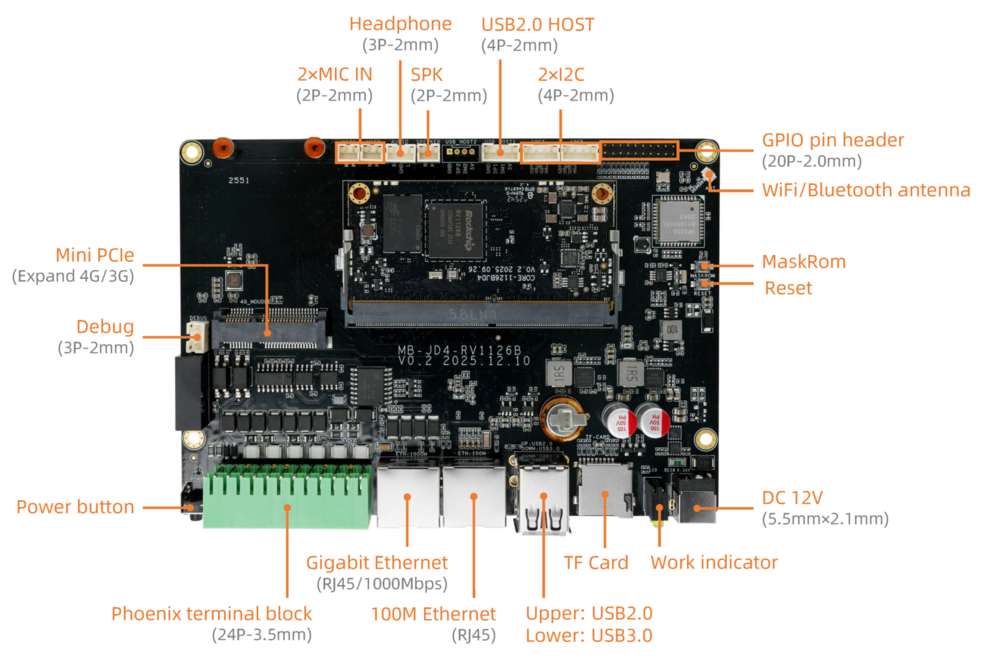
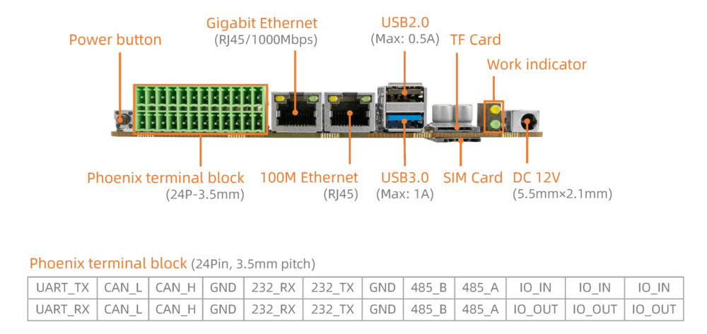
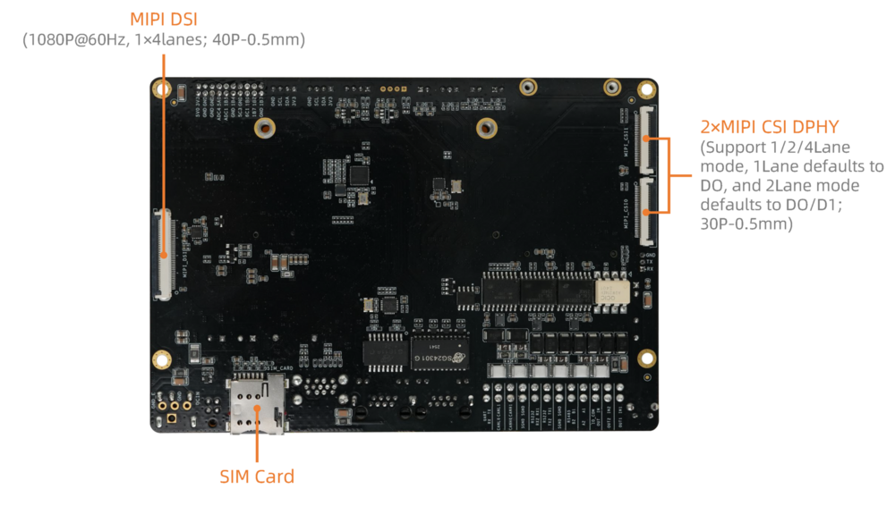

[Specification](https://download.t-firefly.com/Spec/Mainboards/AIO-1126BJD4_Specification_EN.pdf) | [Purchase](https://www.firefly.store/products/core-1126bjd4-ai-vision-system-on-module?_pos=3&_sid=0f56a6d0a&_ss=r) | [Downloads](https://community.t-firefly.com/en/doc/download/333)

# Introduction

The **CORE-1126BJD4** development board utilizes the Rockchip quad-core AI vision processor RV1126B, integrating a 3-tops NPU to support lightweight AI large models and deep learning frameworks. It features a built-in 12M ISP, an 8MP AI-ISP, and integrated accelerators for various algorithms. It supports 12M video encoding, 4K video decoding, and simultaneous input from up to three cameras. It uses a 260P gold-finger interface and is compact in size. It is widely applicable in industries such as face recognition, turnstile access control, smart security, and smart network cameras.

**CORE-1126BJD4** can be combined with different base plates to form different product shapes. It can be used to form the AIO-1126BJD4 kit and the AIO-1126BJD4V0 kit.

**CORE-1126BJD4** front：

**CORE-1126BJD4** back：

### AIO-1126BJD4

The AIO-1126BJD4 development board consists of the core board CORE-1126BJD4 and a new baseboard MB-JD4-RV1126B. This wiki describes the use of this board.

AIO-1126BJD4 front：

AIO-1126BJD4 back：

### AIO-1126BJD4V0

The AIO-1126BJD4V0 development board consists of the core board CORE-1126BJD4 and the old baseboard MB-JD4-RV11091126.

Click to jump to the Wikipedia tutorial for the AIO-1126BJD4V0 motherboard:[AIO-1126BJD4V0 Wikipedia](../../../Motherboard/AIO-1126BJD4%20V0/product_introduction/started.md)

AIO-1126BJD4V0 front：

AIO-1126BJD4V0 back：

 

## Interface Description

### Overall Machine Interface Definition

## Resources and Support

* [[Technical Forum]](https://forum.t-firefly.com/): A communication platform with more than 100,000 enterprise customers and users

### Contact

* Email: sales@t-firefly.com
* Mobile: (+86) 186 8811 7175
* Landline: 0760-89881218
* Address: Room 2101, Hongyu Building, No. 57 Zhongshan 4th Road, East District, Zhongshan City, Guangdong Province