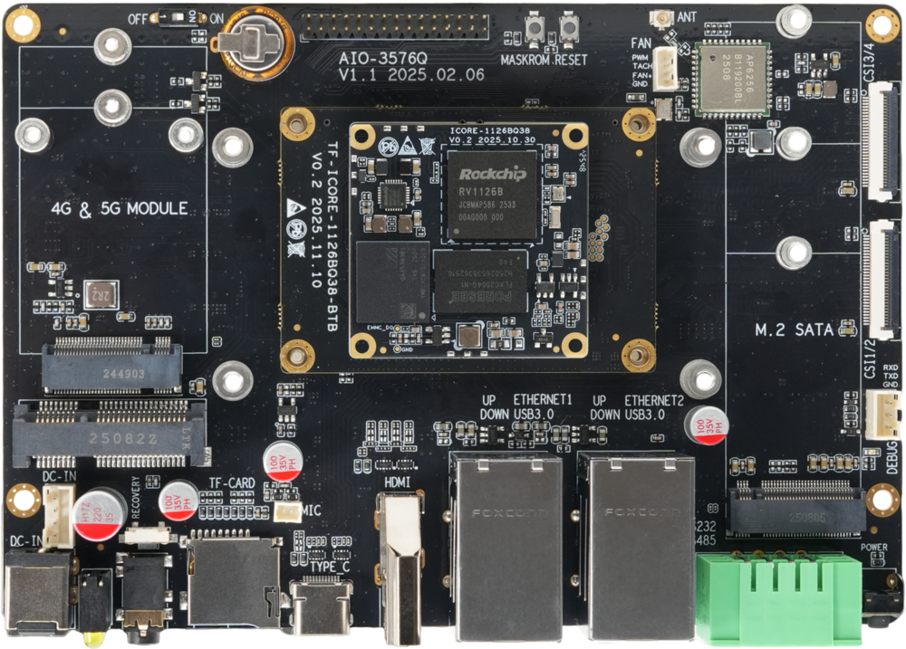
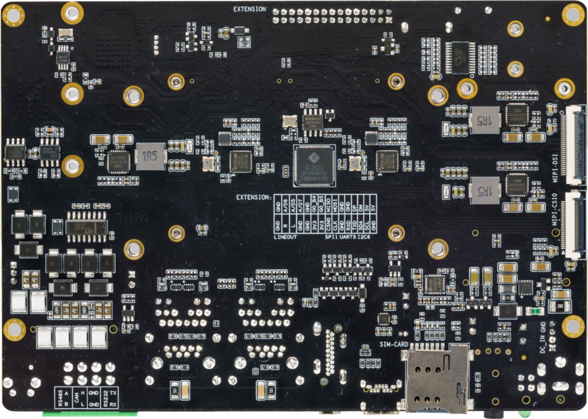
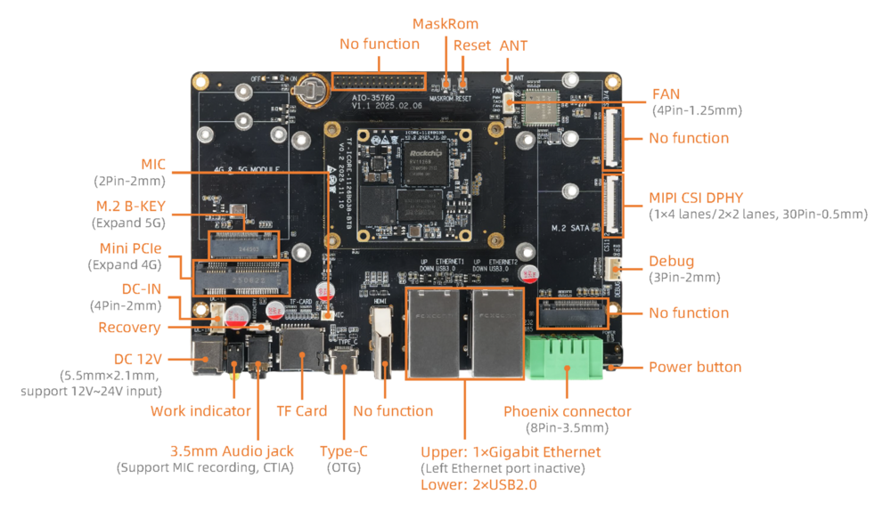
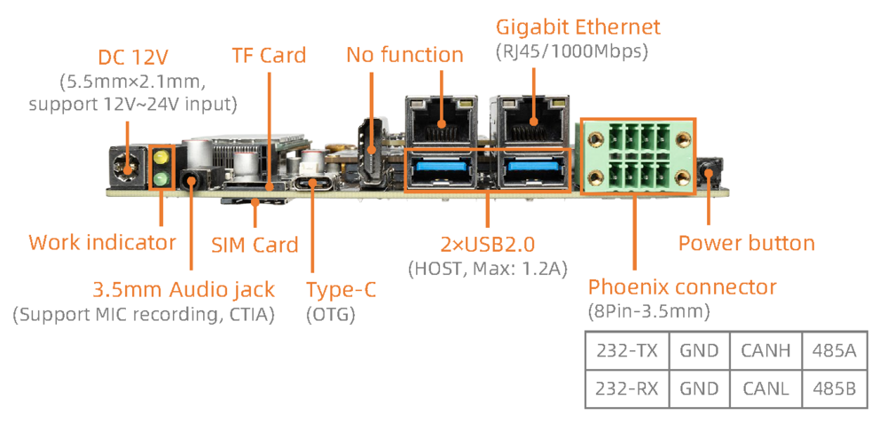
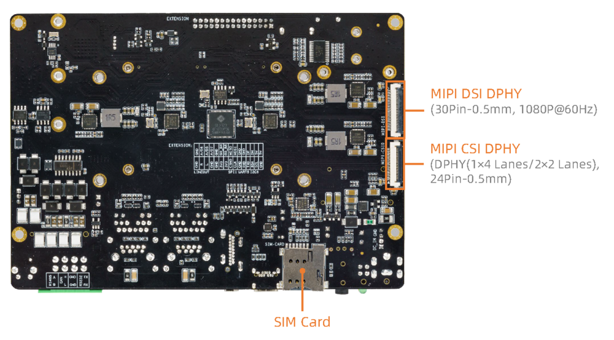

# Introduction

**AIO-1126BQ38** utilizes the Rockchip quad-core AI vision processor RV1126B, integrating a 3 TOPS NPU and supporting 2B multimodal large models and deep learning frameworks. It supports 12M video encoding and 4K video decoding. It features a built-in 12M ISP / 8MP AI-ISP with low power consumption. Hardware AI Remosaic provides ultra-high definition during the day and ultra-low light performance at night. It supports multi-camera AI dynamic stitching for smooth and seamless image merging, AI video 6-axis digital image stabilization, and multi-source fusion (RGB and infrared thermal imaging fusion, visible light and structured light/ToF fusion). It also includes built-in secure SM2/SM3/SM4 encryption algorithms. With a size of only 38mm × 38mm, it is widely applicable to industries such as facial recognition, access control gates, smart security, and smart network cameras.

**AIO-1126BQ38** front：

**AIO-1126BQ38** back：

 

## Interface Description

### Overall Machine Interface Definition

## Resources and Support

* [[Technical Forum]](https://forum.t-firefly.com/): A communication platform with more than 100,000 enterprise customers and users

### Contact

* Email: sales@t-firefly.com
* Mobile: (+86) 186 8811 7175
* Landline: 0760-89881218
* Address: Room 2101, Hongyu Building, No. 57 Zhongshan 4th Road, East District, Zhongshan City, Guangdong Province