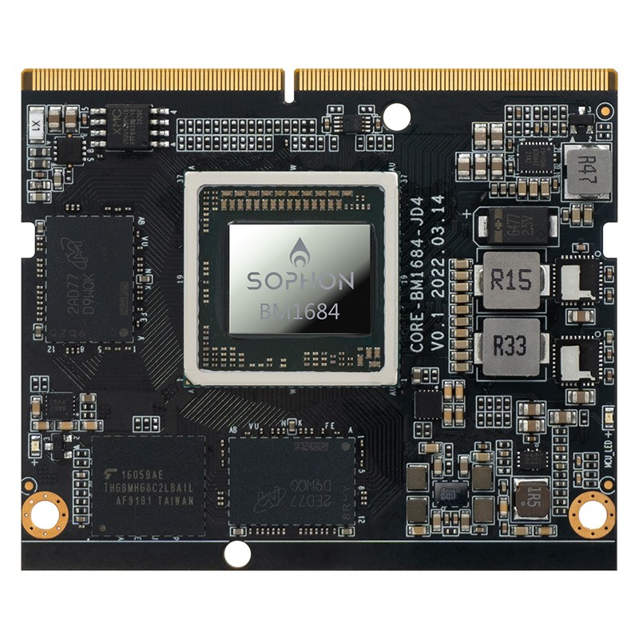
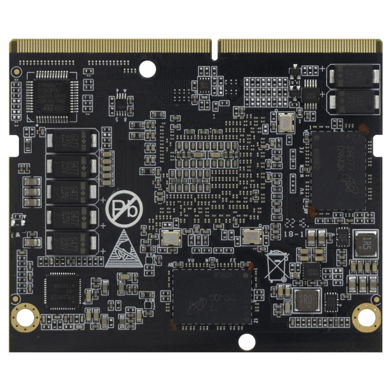
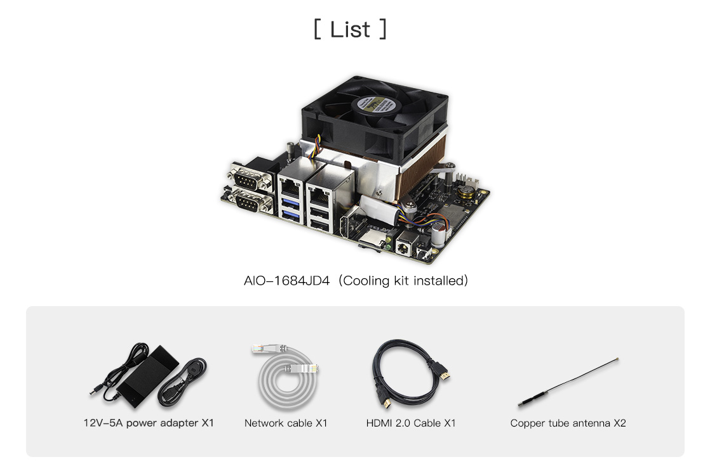
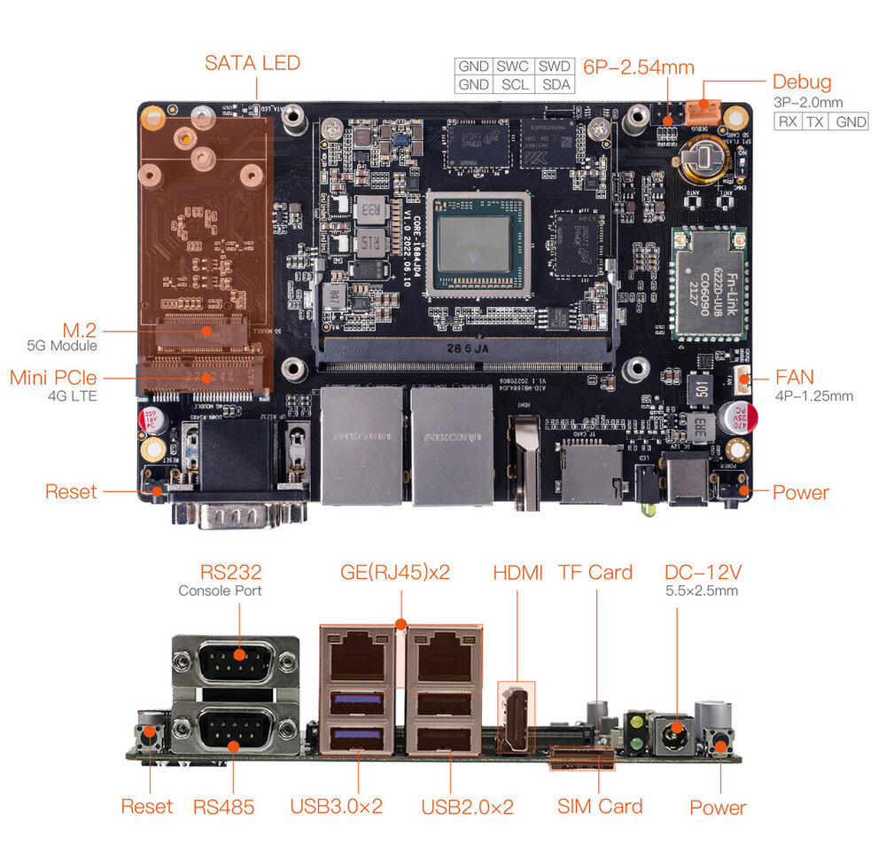
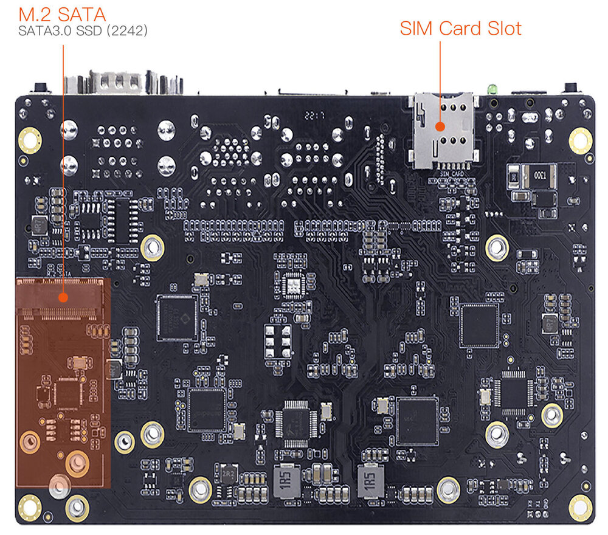

[Specification](https://download.t-firefly.com/%E4%BA%A7%E5%93%81%E8%A7%84%E6%A0%BC%E6%96%87%E6%A1%A3/%E8%A1%8C%E4%B8%9A%E4%B8%BB%E6%9D%BF/AIO-1684JD4%20-%20%208-Core%20High%20Computing%20Power%20AI%20Main%20Board.pdf) | [Purchase](https://www.firefly.store/products/aio-1684jd4-octa-core-high-computing-power-ai-mainboard) | [Download](https://community.t-firefly.com/en/doc/download/179)

# Introduction

Core-1684JD4 powered by SOPHON AI processor BM1684, this mainboard can be configured with 12GB RAM. INT8 computing power is up to 17.6TOPS. It supports mainstream frameworks and complete, easy-to-use toolchain, featuring low cost of algorithm migration. With various interfaces, it is easy to integrate into various edge embedded products. It can be applied to various AI scenarios, such as visual computing, edge computing, general computing power services, security surveillance, UAV etc.

**Front of Core-1684JD4:**

**Back of Core-1684JD4:**

## Accessories List

After receiving the development board, check whether the list of accessories is complete:
- A complete machine with a case, or a JD4-BM1684 core board and a bottom plate each and a cooling fan
- One 12V-5A power adapter

Optional accessories include:
- Firefly serial port module

In addition, during use, you may need the following accessories:
- display screen
     + Monitor or TV with HDMI port and HDMI cable
- network
     + 100M/1000M Ethernet cable, wired router
     + WiFi router
- upgrade firmware
     + TF card, above 4GB/Class 10
- debug
     + USB to Serial adapter

- Shipping list reference

## Interface Description

AIO-1684JD4 consists of Core-1684JD4 + MB-JD4-BM1684, AIO-1684JD4 onboard HDMI, mSATA, USB3.0, USB2.0, RS485, RS232 and other rich interfaces, which can be directly applied to AI edge computing in the product.

The interface layout is shown below:

## Resources and Support

* [[Technical Forum]](https://forum.t-firefly.com/): A communication platform with more than 100,000 enterprise customers and users

### Contact

* Email: sales@t-firefly.com
* Mobile: (+86) 186 8811 7175
* Landline: 0760-89881218
* Address: Room 2101, Hongyu Building, No. 57 Zhongshan 4th Road, East District, Zhongshan City, Guangdong Province