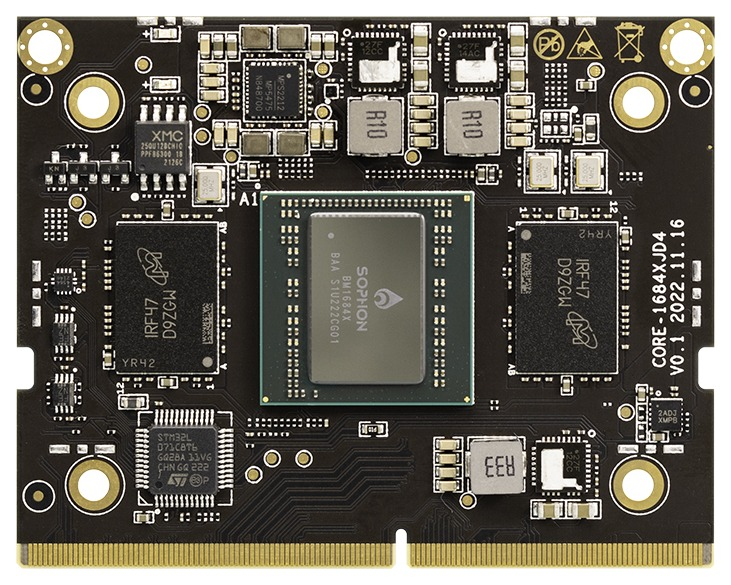
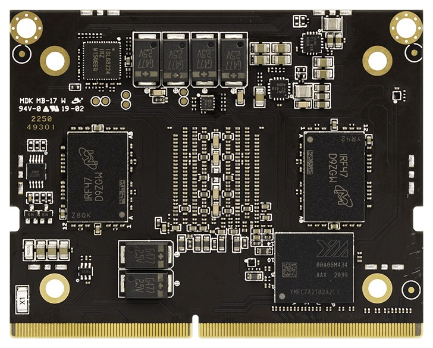
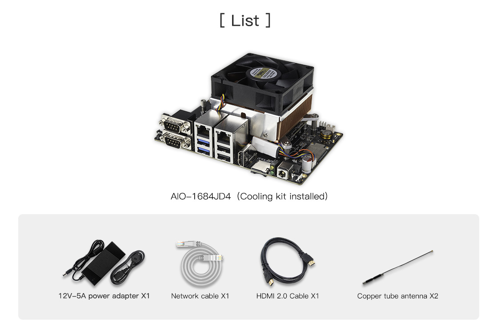
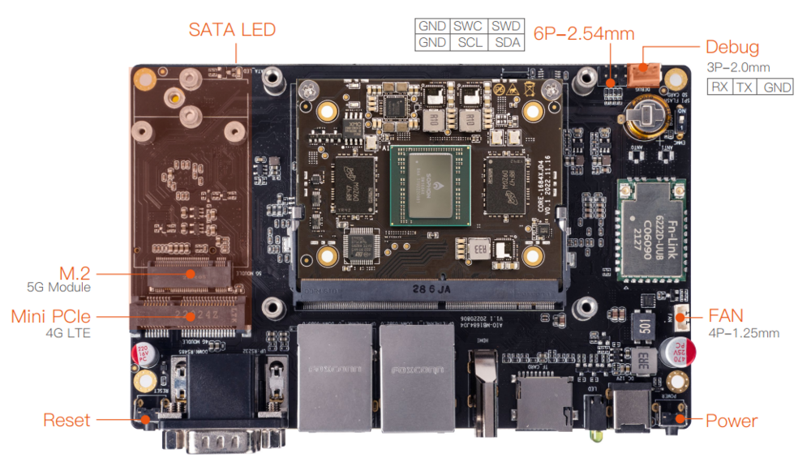
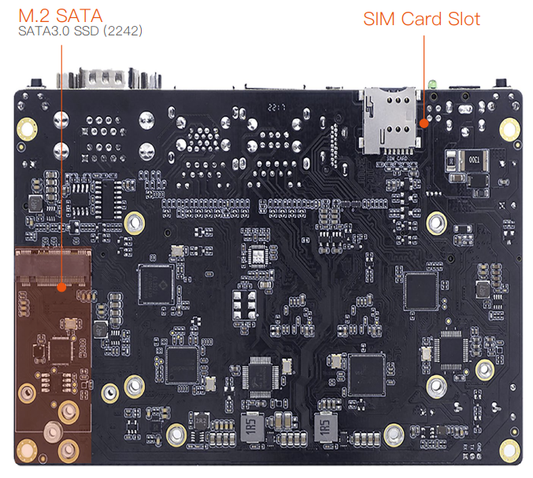
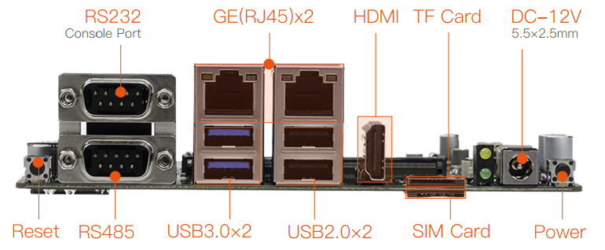

[Specification](https://download.t-firefly.com/%E4%BA%A7%E5%93%81%E8%A7%84%E6%A0%BC%E6%96%87%E6%A1%A3/%E8%A1%8C%E4%B8%9A%E4%B8%BB%E6%9D%BF/AIO-1684XJD4_Octa-Core%2032TOPS%20High%20Computing%20Power%20AI%20MainBoard.pdf) | [Purchase](https://www.firefly.store/products/aio-1684xjd4-octa-core-high-computing-power-ai-mainboard) | [Download](https://community.t-firefly.com/en/doc/download/207)

# Introduction

The Core-1684XJD4 Core Board utilizes the SOPHON AI Processing Unit BM1684X and is equipped with 16GB of RAM and 128GB eMMC storage. It supports a peak performance of 32TOPS (INT8), 16TFLOPS (FP16/BF16) performance, and 2TFLOPS (FP32) high precision performance. The board also has the capability to decode 32-channel H.265/H.264 1080p@25fps videos. It is compatible with major programming frameworks, offering a comprehensive and user-friendly toolchain. The platform caters to various AI computing scenarios including visual computing, edge computing, general-purpose computing services, intelligent transportation, unmanned stores, drones, and more.

**Front View of Core-1684XJD4 Core Board:**

**Back View of Core-1684XJD4 Core Board:**

## Accessory List

Upon receiving the development board, ensure all the accessories are included:
- If a cased unit, make sure it contains the integrated board, or if not, ensure you have the Core-1684XJD4 Core Board and MB-JD4-BM1684 Baseboard each along with a cooling fan.
- One 12V-5A power adapter.

Optionally purchased accessories include:
- Firefly serial port module.

Additionally, during usage, you might require the following:
- Display device:
    + Monitor or TV with an HDMI interface, along with an HDMI cable.
- Network:
    + 100M/1000M Ethernet cable, wired router.
    + WiFi router.
- Firmware upgrade:
    + TF card, 4GB or larger with a Class 10 rating.
- Debugging:
    + USB to serial adapter.

- Reference for the delivered components:

## Interface Description

The AIO-1684XJD4 Mainboard is comprised of the Core Board AIO-1684XJD4 + Baseboard MB-JD4-BM1684. It incorporates diverse interfaces such as HDMI, mSATA, USB3.0, USB2.0, RS485, RS232, making it suitable for direct deployment in AI edge computing products.

The interface layout is shown below:

## Resources and Support

* [[Technical Forum]](https://forum.t-firefly.com/): A communication platform with more than 100,000 enterprise customers and users

### Contact

* Email: sales@t-firefly.com
* Mobile: (+86) 186 8811 7175
* Landline: 0760-89881218
* Address: Room 2101, Hongyu Building, No. 57 Zhongshan 4th Road, East District, Zhongshan City, Guangdong Province