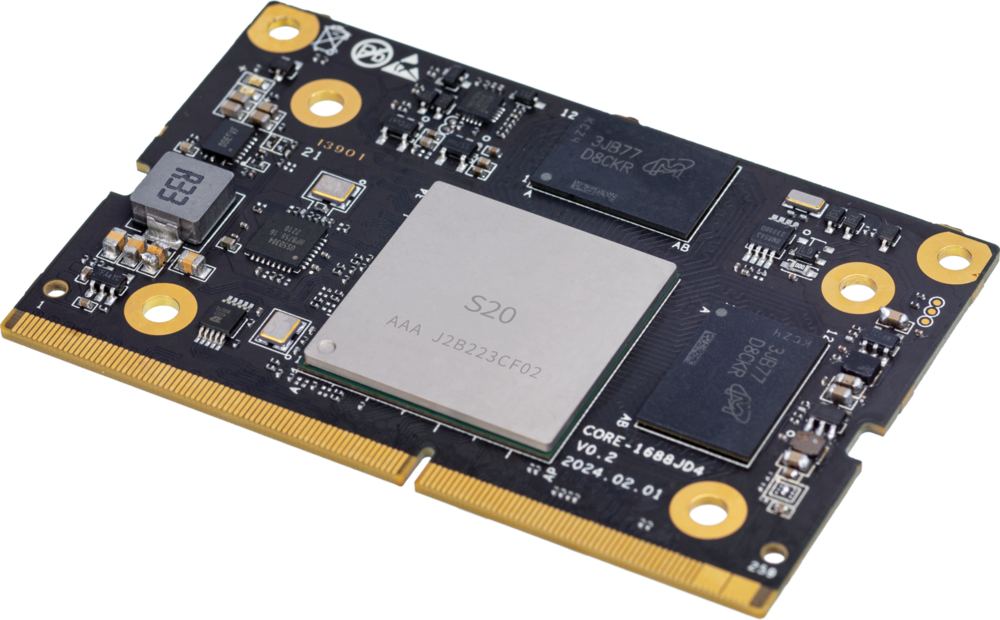
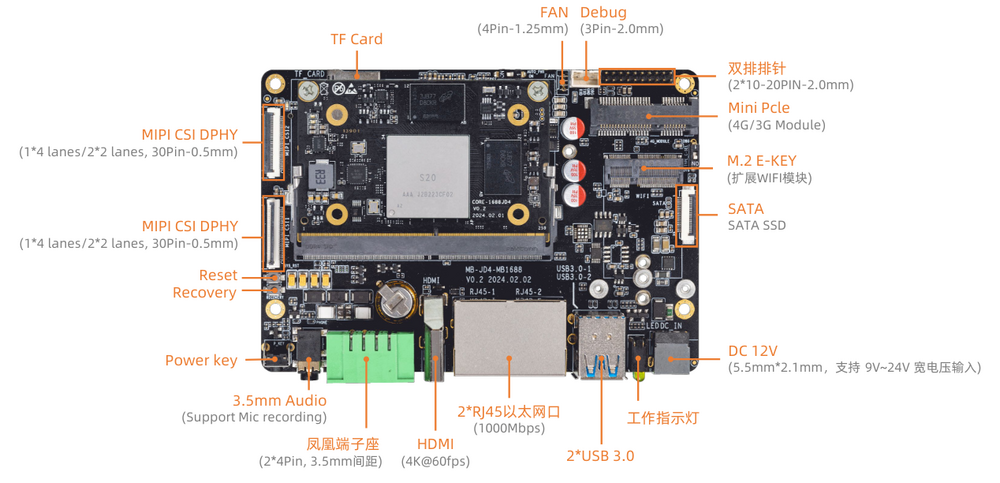

[Specification](https://download.t-firefly.com/%E4%BA%A7%E5%93%81%E8%A7%84%E6%A0%BC%E6%96%87%E6%A1%A3/%E6%A0%B8%E5%BF%83%E6%9D%BF/Core-1688JD4_16T%20Computing%20power%20AI%20Core%20board_Specifications.pdf) | [Purchase](https://www.firefly.store/products/core-1688jd4-core-board) | [Download](https://community.t-firefly.com/en/doc/download/251)

# Introduction

The Core-1688JD4 core board, equipped with the BM1688 intelligent computing chip, is designed for high-integration visual computing chips aimed at AI inference, computer vision, and more. It can be integrated into various products such as intelligent computing servers, edge computing boxes, industrial control computers, professional smart network cameras, and AIOT. It efficiently adapts to all AI algorithms on the market, enabling applications such as image classification, object detection, instance segmentation, semantic segmentation, behavior analysis, text recognition, natural language processing, speech recognition, speech synthesis, and search recommendations, empowering AI across various industries. It also integrates image processing hardware: supporting HDR wide dynamic range, 3D noise reduction, 3A, dehazing, and various image enhancement and computer vision algorithms like fisheye unfolding, image stitching, and stereo fusion, providing professional-level video image quality and hardware image algorithm acceleration.

**Front of Core-1688JD4 Core Board:**

## Accessory List
During use, you may need the following accessories:
- Display Device
     + Monitor or TV with HDMI interface and HDMI cable
- Network
     + 100M/1000M Ethernet cable, wired router
     + WiFi router
- Firmware Upgrade
     + TF card, 8GB/Class 10 or above
- Debugging
     + USB to serial adapter (Firefly UART serial module)
     + Type-C (can be used as Type-C serial)

## Interface Description

The AIO-1688JD4 motherboard consists of the core board Core-1688JD4 + baseboard MB-JD4-BM1688, featuring rich interfaces such as HDMI2.0, PCIE 3.0 x 1, USB3.0 x 2, RS485, RS232, CAN, CSI, and DSI, which can be directly applied to AI edge computing products.

## Resources and Support

* [[Technical Forum]](https://forum.t-firefly.com/): A communication platform with more than 100,000 enterprise customers and users

### Contact

* Email: sales@t-firefly.com
* Mobile: (+86) 186 8811 7175
* Landline: 0760-89881218
* Address: Room 2101, Hongyu Building, No. 57 Zhongshan 4th Road, East District, Zhongshan City, Guangdong Province