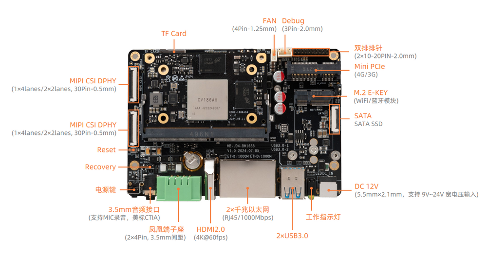

# STORAGE Usage

The AIO-186JD4 development board has 1 PCIE3.0 x 1 interface, 1 SATA 3.0 interface, and a TF-Card interface.

Interface location as shown in the diagram




## Usage of PCIE [step]

The PCIE3.0 interface (which is shared with the SATA 3.0 interface, with the default system using the PCIE interface) supports NVME SSDs 2242/2260/2280 by default, and is named `nvme0n1` in the system.

## Usage of SATA [step]
If you want to switch to using the SATA3.0 interface, software configuration is required (bm1688_1688jd4.dtsi):

```
#if 0
&pcie0{
	reset-gpio = <&porte 3 GPIO_ACTIVE_HIGH>; 
	status = "okay";
};
&sata{
	status = "disabled";
};
#else
&pcie0{
	reset-gpio = <&porte 3 GPIO_ACTIVE_HIGH>; 
	status = "disabled";
};
&sata{
	status = "okay";
};
#endif
```