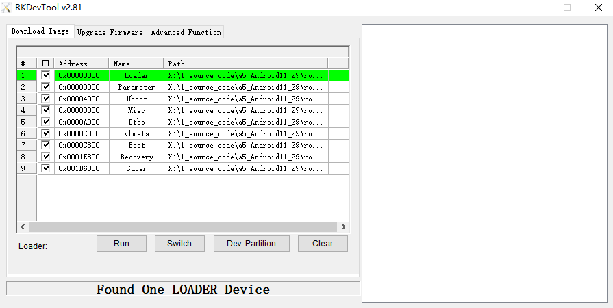
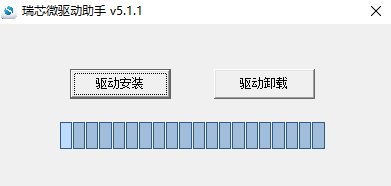
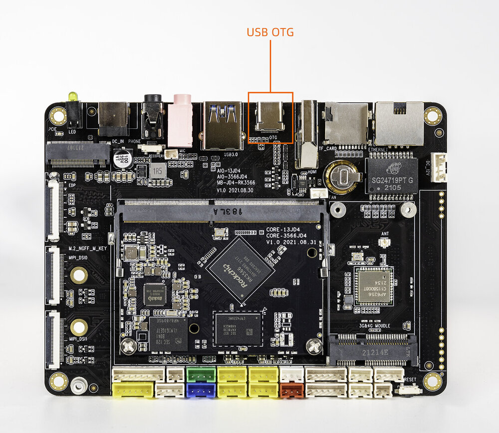
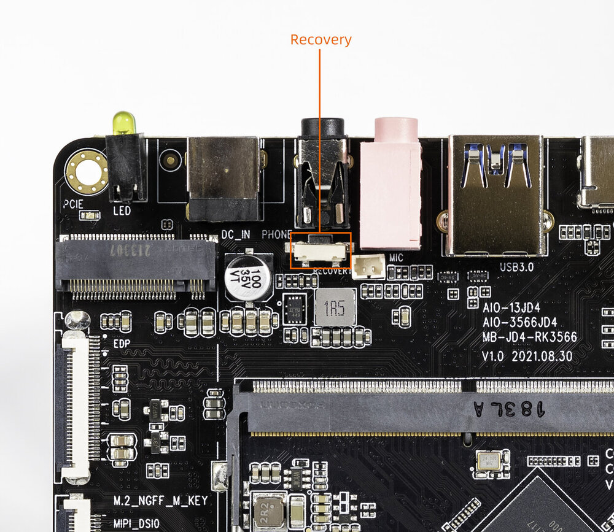
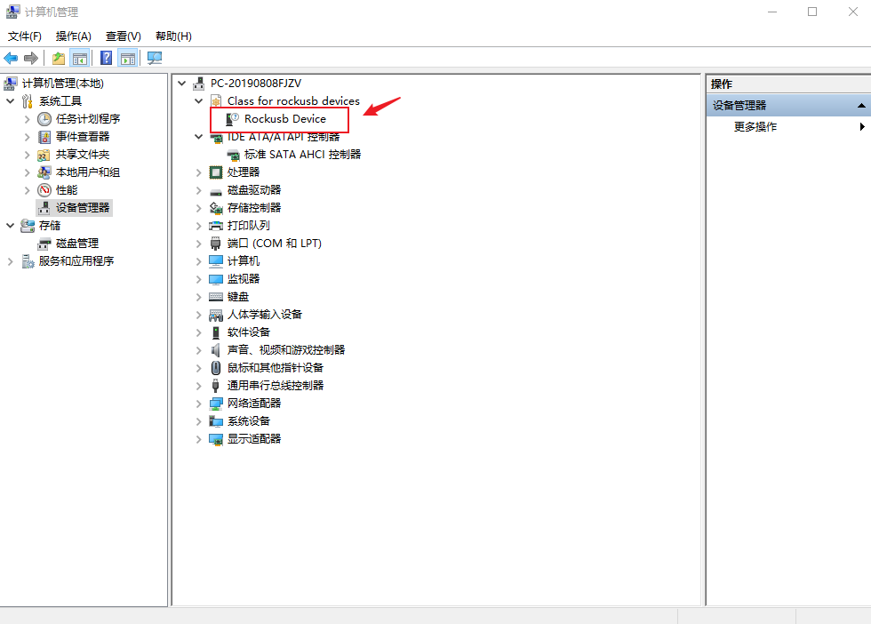
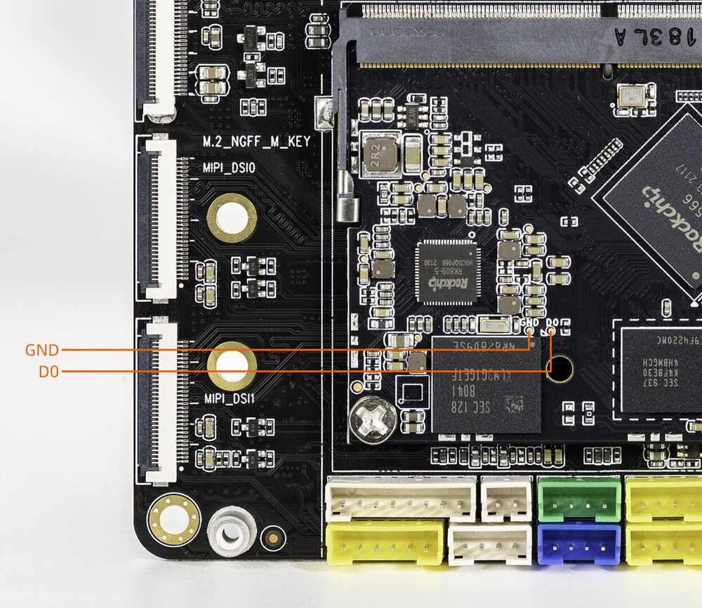
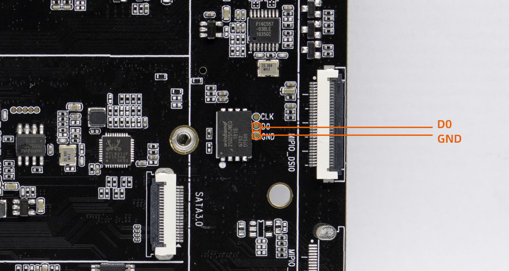
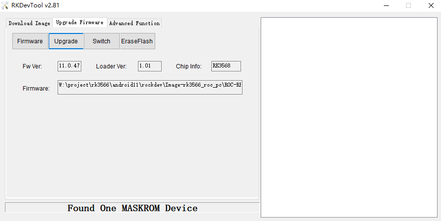
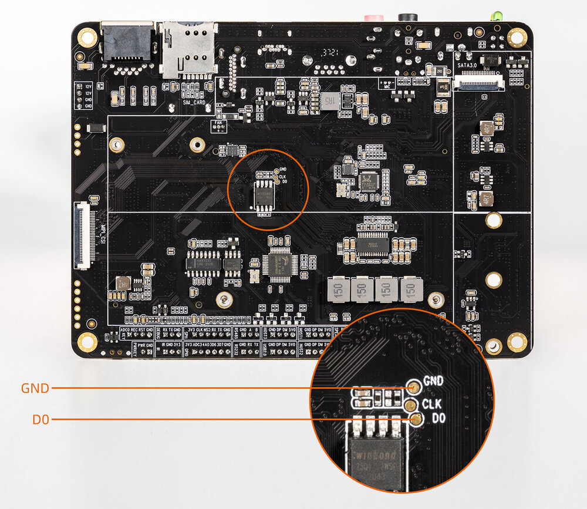
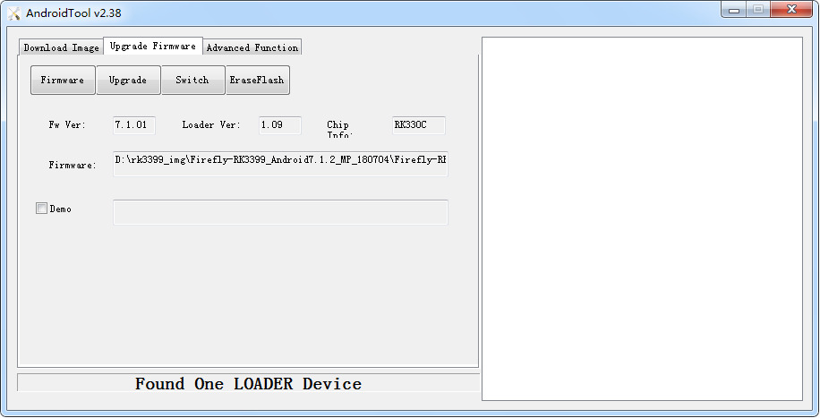

# USB Firmware Upgrade

## Introduction

This article describes how to upgrade the firmware file on the host to the flash memory of the development board through the Type-C data cable. When upgrading, you need to choose the appropriate upgrade mode according to the host operating system and firmware type.

## Preparatory Tools [step]

- AIO-3566JD4 development board
- [Firmware](https://community.t-firefly.com/en/doc/download/136)
- Host computer
- Type-C data cable

## Prepare Firmware [step]

The firmware can be obtained by compiling the SDK, or downloaded from [Resource Download](https://community.t-firefly.com/en/doc/download/136) as a public firmware (unified firmware). There are two types of firmware files:

- A single unified firmware

    The unified firmware is a single file packaged and merged by all files such as the partition table, bootloader, uboot, kernel, system and so on. The firmware officially released by Firefly adopts a unified firmware format. Upgrading the unified firmware will update the data and partition table of all partitions on the motherboard, and erase all data on the motherboard.

- Multiple partition images

    That is, files with independent functions, such as partition table, bootloader, and kernel, are generated during the development phase. The independent partition image can only update the specified partition, while keeping other partition data from being destroyed, it will be very convenient to debug during the development process.

> Through the unified firmware unpacking / packing tool, the unified firmware can be unpacked into multiple partition images, or multiple partition images can be merged into a unified firmware.

## Install the Upgrade Tool [step]
<CodeBlockTabs defaultValue="Windows">
  <CodeBlockTabsList>
    <CodeBlockTabsTrigger value="Windows">Windows</CodeBlockTabsTrigger>
    <CodeBlockTabsTrigger value="Linux">Linux</CodeBlockTabsTrigger>
  </CodeBlockTabsList>

  <CodeBlockTab value="Windows">
    ### Windows Operating System

    - Tool: Use tools in the firmware package or download here [Androidtool_xxx (version number)](https://community.t-firefly.com/en/doc/download/136)

    AndroidTool defaults to display in Chinese. We need to change it to English. Open `config.ini` with a text editor (like notepad). The starting lines are:

    ```ini
    #Language Selection: Selected=1(Chinese); Selected=2(English)
    [Language]
    Kinds=2
    Selected=1
    LangPath=Language\
    ```

    Change `Selected=1` to `Selected=2`, and save. From now on, AndroidTool will display in English. Now, run AndroidTool.exe: (Note: If using Windows 7/8, you’ll need to right click it, select to run it as Administrator)

    <Callout title="Note" type="warn">
      In order to avoid the burning problem caused by the download tool version, it is recommended to use the tool packaged inside the public firmware package for burning.
    </Callout>

    After decompressing the public firmware package, it is as follows:
    ```shell
    XXXX_Android11_HDMI_XXXX
    ├── XXXX_Android11_HDMI_XXXX.img
    ├── linux
    │   └── Linux_Upgrade_Tool_v1.59.zip
    └── windows
        ├── DriverAssitant_v5.1.1.zip
        └── RKDevTool_Release_v2.81.zip
    ```

    <center>

    
    </center>

    #### Install RK USB drive

    Download [Release_DriverAssistant.zip](https://community.t-firefly.com/en/doc/download/136), extract, and then run the DriverInstall.exe inside.
    In order for all devices to use the updated driver, first select `Driver uninstall`(`驱动卸载`) and then select `Driver install`(`驱动安装`).

    <center>

    
    </center>
  </CodeBlockTab>

  <CodeBlockTab value="Linux">
    ### Linux Operating System

    There is no need to install device driver under Linux.

    - Tool: Use tools in the firmware package or download here [upgrade_tool_xxx (version number)](https://community.t-firefly.com/en/doc/download/136)

    Install it into the system as follows for easy invocation:

    ```bash
    unzip Linux_Upgrade_Tool_xxxx.zip
    cd Linux_UpgradeTool_xxxx
    sudo mv upgrade_tool /usr/local/bin
    sudo chown root:root /usr/local/bin/upgrade_tool
    sudo chmod a+x /usr/local/bin/upgrade_tool
    ```
  </CodeBlockTab>
</CodeBlockTabs>

## Enter Upgrade mode [step]

There are two upgrade modes: Loader mode and MaskRom mode. Before flashing the firmware, we need to connect the device and make the board enter an upgradable mode.

<CodeBlockTabs defaultValue="loader">
  <CodeBlockTabsList>
    <CodeBlockTabsTrigger value="loader">loader</CodeBlockTabsTrigger>
    <CodeBlockTabsTrigger value="maskrom">maskrom</CodeBlockTabsTrigger>
  </CodeBlockTabsList>
  <CodeBlockTab value="loader">
    ### Loader mode

    #### Enter Loader mode by hardware [step]

    Connect the device and enter the Loader upgrade mode through the **RECOVERY** key as follows:

- Disconnect the power adapter first.
- Type-C data cable connects one end to the host and the other end to the development board.

<center>


</center>

- Press the `RECOVERY` button (on the phone jack side) on the device and hold.

<center>


</center>

- About two seconds later, release the `RECOVERY` button.

At this point, the device enters Loader mode.
    #### Enter Loader mode by software [step]

    With the Type-C data cable connected, use the command in the serial debugging terminal or adb shell:

    ```shell
    reboot loader
    ```

    #### Check the Loader mode [step]

    To determine whether the board has entered Loader mode, we can check it with the upgrade tool.

    **Windows Operating System**

    The AndroidTool displays the prompt `Found One LOADER Device` at the bottom:

    <center>

    
    </center>

    The host should prompt for new hardware and configure the driver. Open Device manager and you will see the new Device `Rockusb Device` appear as shown below. If not, you need to go back to the previous step and [reinstall the driver](03-upgrade_firmware.md#windows-operating-system).

    <center>

    
    </center>

    **Linux Operating System**

    After running upgrade_tool, you can see a `Loader` prompt in the list of connected devices:

    ```shell
    firefly@T-chip:~/severdir/down_firmware$ sudo upgrade_tool
    List of rockusb connected
    DevNo=1 Vid=0x2207,Pid=0x330c,LocationID=106    Loader
    Found 1 rockusb,Select input DevNo,Rescan press <R>,Quit press <Q>:q
    ```

    <Callout title="Note" type="info">
      Loader mode does not write to SPI/NOR Flash, so there is no need to switch the storage. Just follow the "Upgrade the firmware" section below.
    </Callout>
  </CodeBlockTab>

  <CodeBlockTab value="maskrom">
    ### MaskRom mode
`MaskRom` mode is the last line of defense against device being bricked. Forced entry `MaskRom` involved hardware operation, have certain risk, so only in the situation that device failed entering the `Loader` mode, you can try `MaskRom` mode.

<Callout title="Warning" type="error">

Please read carefully and operate carefully!

</Callout>

#### How to Enter MaskRom Mode [step]

The operation steps are as follows:

1. Disconnect all power supplies.
1. Connect the device and host PC with Type-C data cable.
1. Use a metal tweezer to short and hold the two test points as shown in the following figure on Core-3566JD4 (as shown in the figure below).
1. Connect the power.
1. Wait a few seconds, stop shorting.

**Test point location**

<center>



</center>

**Entering MaskRom Mode when a NOR Flash is present**

When the board has NOR flash at the same time, if EMMC is empty and there are burned files in NOR flash, it is necessary to short circuit the D0 and GND test points near NOR flash to enter Maskrom mode. The short-circuit points are shown below:

<center>



</center>


#### Confirming MaskRom Mode [step]

At this point, the device should go into `MaskRom mode`.

<center>



</center>
    <a id="rk_upgrade_maskrom_nor_flash"></a>

    #### Storage Selection in MaskRom Mode [step]

    When the AIO-3566JD4 is equipped with **both** NOR Flash (SPI Flash) and eMMC storage media, you need to confirm the target storage of the firmware before flashing in MaskRom mode. The default write targets of the two upgrade modes are as follows:

    | Upgrade Mode | Default Write Target | Storage Switching |
    | ---- | ---- | ---- |
    | Loader mode | eMMC | Not required. Just follow the "Upgrade the firmware" section. |
    | MaskRom mode | NOR Flash | Switch to eMMC before flashing a whole firmware |

    The onboard NOR Flash location is shown below:

    <center>

    
    </center>

    <Callout title="Note" type="warn">
      In MaskRom mode, the firmware is written to NOR Flash by default. Since NOR Flash is too small to load the system image, it is only suitable for small files such as `MiniLoaderAll.bin`; flashing a whole unified firmware directly will fail due to insufficient space. Before flashing a whole firmware, make sure to switch the storage to eMMC according to the methods below.
    </Callout>

<CodeBlockTabs defaultValue="firefly">
  <CodeBlockTabsList>
    <CodeBlockTabsTrigger value="firefly">Firefly method (recommended)</CodeBlockTabsTrigger>
    <CodeBlockTabsTrigger value="vendor">Vendor method</CodeBlockTabsTrigger>
  </CodeBlockTabsList>
  <CodeBlockTab value="firefly">
    Flash the latest official firmware or the firmware compiled from the latest SDK. No storage switching is required. Flash the whole firmware directly in MaskRom mode. Whether the flashing succeeds or not, when the device is powered off or restarted, the data in NOR Flash will be erased automatically (it takes about 30 to 60 seconds). After erasing, the device automatically enters Loader mode, and then you can flash the whole firmware following the "Upgrade the firmware" section.
  </CodeBlockTab>
  <CodeBlockTab value="vendor">
    Flash `MiniLoaderAll.bin` and switch the storage to eMMC. Use this method if you do not have the latest firmware (`MiniLoaderAll.bin` only needs to be prepared once):

    1. Prepare `MiniLoaderAll.bin`, which is generally stored in the `rockdev` directory of the SDK (`rockdev/Image-rk3566_firefly_aiojd4/MiniLoaderAll.bin` for the Android SDK, `rockdev/MiniLoaderAll.bin` for the Linux SDK). You can also download the file for the corresponding CPU model from the [official download link](https://www.t-firefly.com/share/index/index/id/4e86cc234c3b26e2b12084e383074ada.html).
    2. Switch to the `Advanced Function` page of the download tool, load and download `MiniLoaderAll.bin`.
    3. Click `List Storage` to read the storage list, select `SPINOR` and click `EraseAll` to make sure the NOR Flash is empty.
    4. Select `Emmc` in the storage list and click `Switch Storage` to switch the target storage of the firmware to eMMC.
    5. Click `EraseAll` to erase the eMMC.
    6. Switch to the `Upgrade Firmware` page, select the whole firmware and upgrade.

    After the steps above, the target storage of the firmware has been switched to eMMC, and you can flash the whole firmware following the "Upgrade the firmware" section as usual.
  </CodeBlockTab>
</CodeBlockTabs>

    #### What to do after a flashing failure [step]

    If the whole firmware is accidentally written into NOR Flash, the flashing will fail due to insufficient space. Handle it according to the current state of the device:

    | Current State | Solution |
    | ---- | ---- |
    | No power-off or reboot after the failure | Click `EraseFlash` of the download tool to erase the NOR Flash, then switch to eMMC and flash again following Method 2 above |
    | The device has been powered off or rebooted | Enter Loader mode through the Recovery key, click `Go maskrom` of AndroidTool to enter MaskRom mode again, then switch to eMMC and flash again following Method 2 above |
    | Clicking `Go maskrom` cannot enter MaskRom mode | Some old firmwares do not support returning to MaskRom mode from the bootloader in NOR Flash. In this case, re-enter Loader mode through the Recovery key, click `EraseFlash` to erase and reboot the board, then you can enter MaskRom mode |

    <Callout title="Tip" type="info">
      If a serial debugging terminal is connected, you can run `mtd erase nor0` in the U-Boot command line booted from NOR Flash (the serial log shows `Bootdev(atags): mtd 2`) to erase the NOR Flash and then `reboot`, or run `rbrom` to return to MaskRom mode, and then handle it according to the methods above.
    </Callout>

  </CodeBlockTab>
</CodeBlockTabs>

## Upgrade the firmware [step]
<CodeBlockTabs defaultValue="Windows">
  <CodeBlockTabsList>
    <CodeBlockTabsTrigger value="Windows">Windows</CodeBlockTabsTrigger>
    <CodeBlockTabsTrigger value="Linux">Linux</CodeBlockTabsTrigger>
  </CodeBlockTabsList>

  <CodeBlockTab value="Windows">
    ### Windows Operating System

    #### Upgrade unified firmware - update.img

    The steps to update the unified firmware `update.img` are as follows:

    1. Switch to the "upgrade firmware" page.
    2. Press the "firmware" button to open the firmware file to be upgraded. The upgrade tool displays detailed firmware information.
    3. Press the "upgrade" button to start the upgrade.
    4. If the upgrade fails, you can try to erase the Flash by pressing the `EraseFlash` button first, and then upgrade. For boards with onboard Nor Flash, please refer to [Storage Selection in MaskRom Mode](03-upgrade_firmware.md#rk_upgrade_maskrom_nor_flash).
    <center>

    
    </center>
  </CodeBlockTab>

  <CodeBlockTab value="Linux">

    ### Linux Operating System
    #### Upgrade unified firmware - update.img

    ```bash
    sudo upgrade_tool uf update.img
    ```

    <Callout title="Note" type="warn">
      If the upgrade fails, try erasing before upgrading.
    </Callout>

    ```bash
    # erase flash : Using the ef parameter requires the loader file or the corresponding update.img to be specified.
    # update.img :The ubuntu firmware you need to upgrade.
    sudo upgrade_tool ef update.img
    # upgrade again
    sudo upgrade_tool uf update.img
    ```

    If the upgrade fails because the firmware was written into Nor Flash, please refer to [Storage Selection in MaskRom Mode](03-upgrade_firmware.md#rk_upgrade_maskrom_nor_flash) to switch the upgrade storage.
  </CodeBlockTab>
</CodeBlockTabs>