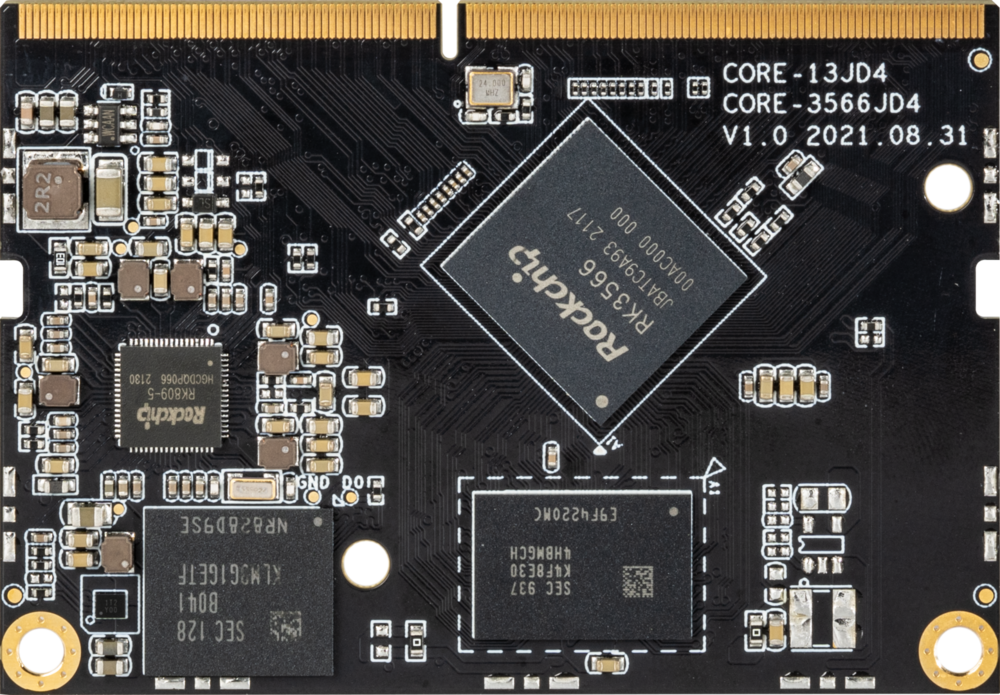
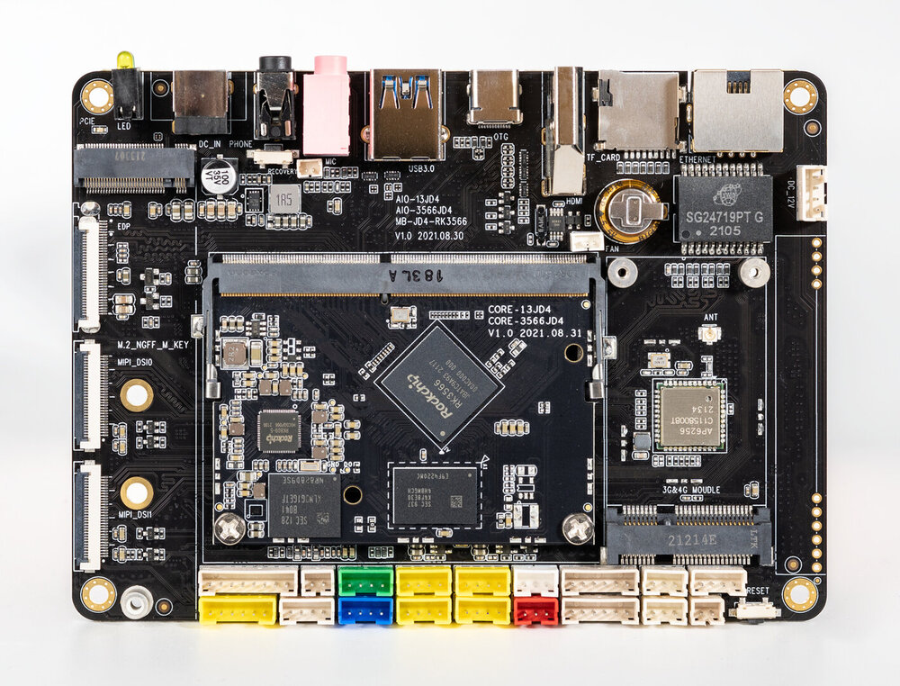
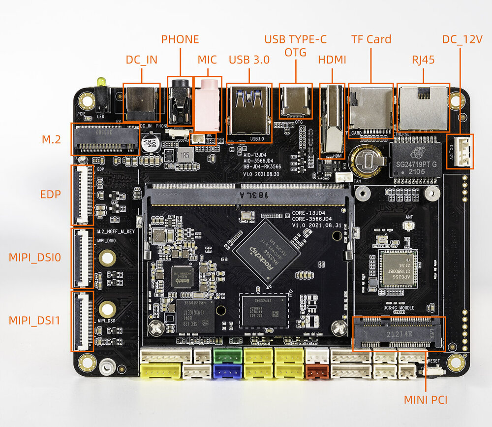
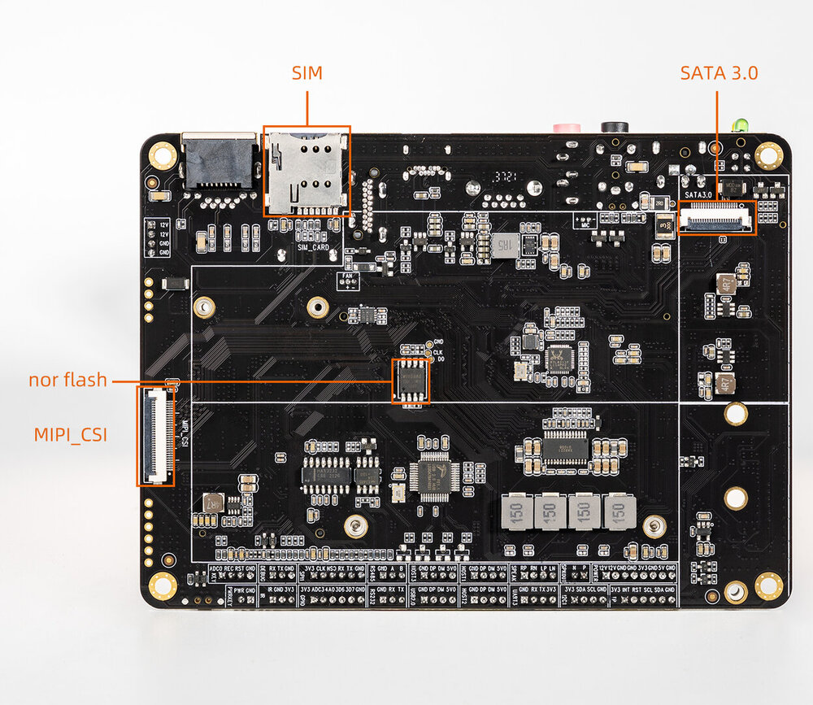

# Introduction

[Purchase](https://www.firefly.store/products/core-3566jd4-aio-3566jd4-quad-core-64-bit-ai-core-board) | [Downloads](https://community.t-firefly.com/en/doc/download/136)

Core-3566JD4 equipped with Rockchip quad-core processor RK3566 which is configured with dual-core GPU and high-performance NPU, supporting up to 8G RAM. It supports onboard M.2, WiFi 2.4G/5G and 4G mobile network. Providing various interfaces, the mainboard is suitable for scenarios such as smart NVR, cloud terminal, IoT gateway and industrial control.

The AIO-3566JD4 development board consists of the core board Core-3566JD4 + MB-JD4-RK3566. The AIO-3566JD4 has rich interfaces such as RGMII, PCIe 3.0, USB3.0, I2C, SPI, UART, GPIO and MIPI-DSI. It can be directly applied to various intelligent products to accelerate product implementation. For details, refer to the interface description below.

## Interface Description

The AIO-3566JD4 provides rich interfaces, including:

- 1 x DC 12V power connector
- 1 x RJ45 (RGMII, supporting Gigabit Ethernet)
- 1 x HDMI output
- 1 x USB3.0
- 1 x USB Type-C (OTG, for download/debug)
- 1 x TF Card
- 1 x M.2 (NGFF, M Key)
- 1 x Mini PCIe (4G module)
- 1 x SIM card slot
- 1 x SATA 3.0
- 1 x MIPI-CSI
- 2 x MIPI-DSI (MIPI_DSI0 and MIPI_DSI1)
- 1 x EDP
- 1 x PHONE (headphone output)
- 1 x MIC (microphone input)
- 1 x RS232 (terminal block)
- 1 x RS485 (terminal block)
- 2 x UART (terminal block, 3V3/TX/RX/GND)
- I2C, SPI, GPIO (led out through terminal blocks)

The board interfaces are shown below (front/back):

## Resources and Support

- [[Technical Forum]](https://forum.t-firefly.com/): A communication platform with more than 100,000 enterprise customers and users

### Contact

- Email: sales@t-firefly.com
- Mobile: (+86) 186 8811 7175
- Landline: 0760-89881218
- Address: Room 2101, Hongyu Building, No. 57 Zhongshan 4th Road, East District, Zhongshan City, Guangdong Province
