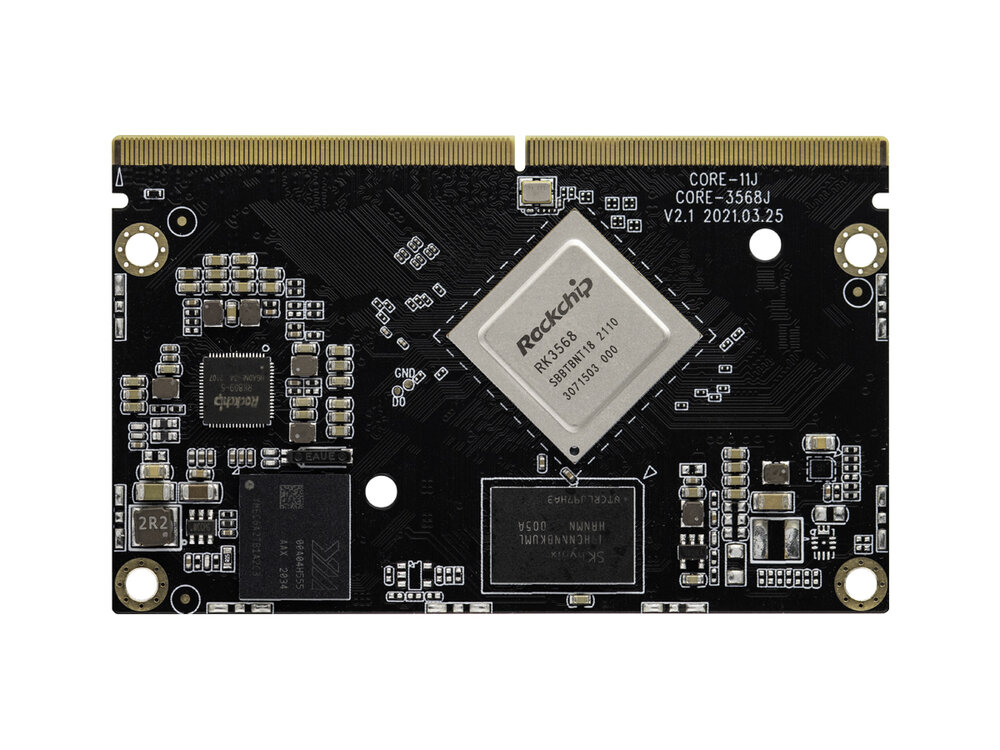
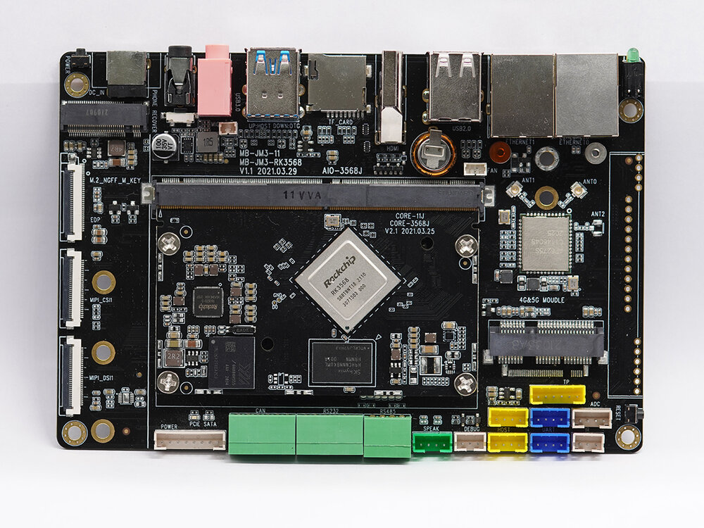
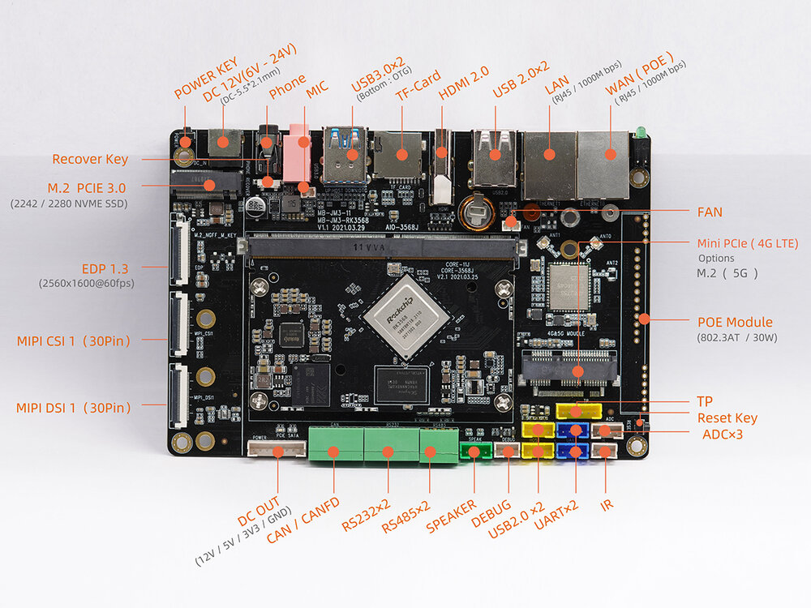
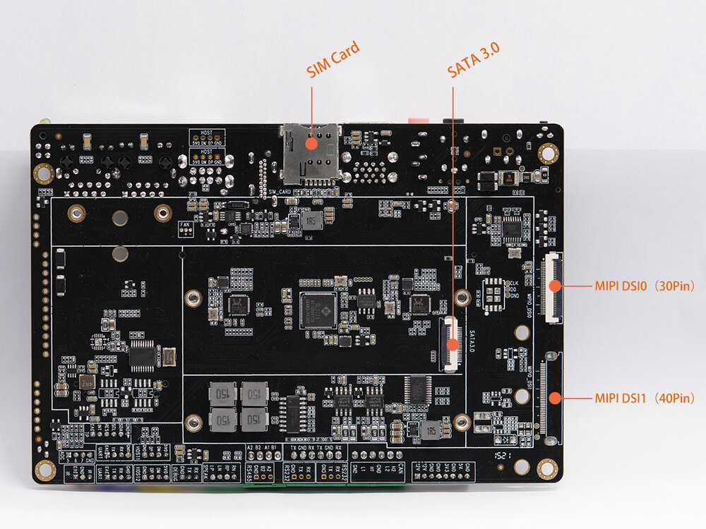

# Introduction

[Specification](https://download.t-firefly.com/%E4%BA%A7%E5%93%81%E8%A7%84%E6%A0%BC%E6%96%87%E6%A1%A3/%E6%A0%B8%E5%BF%83%E6%9D%BF/Core-3568J-%E5%9B%9B%E6%A0%B8%E9%AB%98%E6%80%A7%E8%83%BDAI%E6%A0%B8%E5%BF%83%E6%9D%BF-%E8%A7%84%E6%A0%BC%E4%B9%A6.pdf?v=1620639527) | [Purchase](https://www.firefly.store/products/core-3568j-ai-core-board-with-rockchip-64-bit-processor-rk3568) | [Downloads](https://community.t-firefly.com/en/doc/download/103)

[Core-3568J](https://www.firefly.store/products/core-3568j-ai-core-board-with-rockchip-64-bit-processor-rk3568) uses RK3568 quad-core 64-bit Cortex-A55 processor, with 22nm lithography process, has frequency up to 2.0GHz, with dual-core GPU and high-performance NPU, supporting up to 8G RAM. It supports WiFi 6, 5G/4G and other high-speed wireless network communications. Having different video input and output interfaces, it is suitable for scenarios such as smart NVR, cloud terminal, IoT gateway and industrial control

[AIO-3568J](https://www.firefly.store/products/aio-3568j-quad-core-high-performance-ai-mainboard-1) is a Quad-Core High-Performance AI Mainboard, composed of core board Core-3568J + motherboard MB-JM3-RK3568, equipped with interfaces such as RGMII, PCIE3.0, USB3.0, I2C, SPI, UART, GPIO, MIPI-DSI, it can be directly used in various intelligent products to facilitate the completion of products

## Interface Description

AIO-3568J provides a wealth of interfaces, mainly including:

- Power interface
- 1 x USB3.0 (host/device)
- 1 x USB3.0 (host)
- 4 x USB2.0 (port x2, socket x2)
- HDMI
- MIPI screen interface
- EDP screen interface
- TP touch interface
- Ethernet
- WiFi antenna
- Bluetooth antenna
- MIC interface
- Audio input (line-in)
- 3.5mm Phone Jack
- 12V power interface
- IR interface
- TF card slot
- SIM card slot
- SATA interface
- Speaker interface
- Power key
- Reset key
- Recovery key
- Debug serial
- Industrial serial port (RS485, RS232, TTL)
- MIPI camera interface
- MINI-PCIE (optional M.2 NGFF 5G slot)
- M.2 PCIE 3.0 interface
- CAN/CANFD

The interface layout is shown below (front/back):

## Resources and Support

- [Technical Forum](https://forum.t-firefly.com/): A communication platform with more than 100,000 enterprise customers and users

### Contact

- Email: sales@t-firefly.com
- Mobile: (+86) 186 8811 7175
- Landline: 0760-89881218
- Address: Room 2101, Hongyu Building, No. 57 Zhongshan 4th Road, East District, Zhongshan City, Guangdong Province
