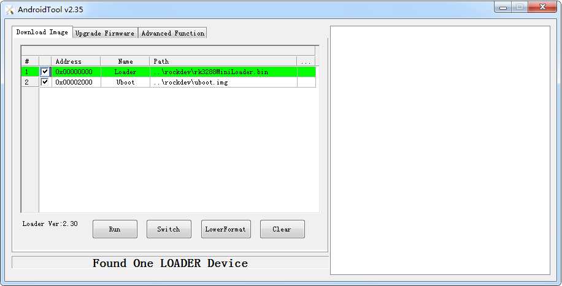

# U-Boot User Guide

## Introduction

RK U-Boot based on the open source U-Boot development, work mode has a Boot loading mode and download mode. Boot load mode is the normal working mode of u-boot, embedded product release, u-boot is working in this mode, mainly used for Boot to load the memory of the kernel into memory, start the operating system; Download mode is mainly used to download the firmware to flash memory, and press the Recovery button to enter the download mode after startup time. This article briefly explains the use of u-boot. Please refer to the development document [Uboot Development](https://download.t-firefly.com/product/Board/RK356X/Document/Developer/Rockchip_Developer_Guide_UBoot_Nextdev_CN.pdf).

## Compile [step]

The compiling steps of U-Boot are similar to kernel compiling. Before compiling, you need to write the configuration to `.config`, run the command:

- Android:

```bash
make rk3568_defconfig
```

- Linux:

```bash
make firefly_rk3568
```

If you need to modify the relative option, you can run:

```bash
make menuconfig
```

Run below command to compile:

```bash
make ARCHV=aarch64
```

After compiling successfully, there will be a new file created at the following path:

```text
u-boot/uboot.img
u-boot/trust.img
u-boot/rk356x_spl_loader_v1.05.108.bin
```

## Flash Image [step]

Open the upgrade tool, connect the board with the USB OTG cable, press the Recovery key when the power is on, and make the development board enter the U-Boot download mode. Select the compiled Loader file in the upgrade tool and click execute, as shown below:

<center>



</center>

## Verify that the new Loader is correctly upgraded [step]

If you flash the loader successfully, there will be some information output from the debug UART as the following log shows:

```log
Android 11.0, Build 2021.2, v2
```

If the time shows the same as your compile time, it means you flash the loader successfully.

## Enter u-boot command line mode [step]

When the system starts, long press `ctrl+c` through the debugging serial port to enter the U-Boot command mode
```shell
=> <INTERRUPT>
=> <INTERRUPT>
=>
=> help
?       - alias for 'help'
android_print_hdr- print android image header
base    - print or set address offset
bdinfo  - print Board Info structure
bidram_dump- Dump bidram layout
boot    - boot default, i.e., run 'bootcmd'
boot_android- Execute the Android Bootloader flow.
boot_fit- Boot FIT Image from memory or boot/recovery partition
bootavb - Execute the Android avb a/b boot flow.
bootd   - boot default, i.e., run 'bootcmd'
bootefi - Boots an EFI payload from memory
booti   - boot arm64 Linux Image image from memory
bootm   - boot application image from memory
bootp   - boot image via network using BOOTP/TFTP protocol
bootrkp - Boot Linux Image from rockchip image type
bootz   - boot Linux zImage image from memory
cmp     - memory compare
```

## The secondary Loader [step]

RK3568 uses a secondary Loader. The generated image is:

```text
u-boot/uboot.img
u-boot/rk356x_spl_loader_v1.05.108.bin
```

Where `V1.05.108` is the release version, Rockchip defines the version of the U-Boot loader. Where `1.05.108` is defined according to the storage version and must not be modified by the customer. `uboot.img` contains the U-Boot firmware.