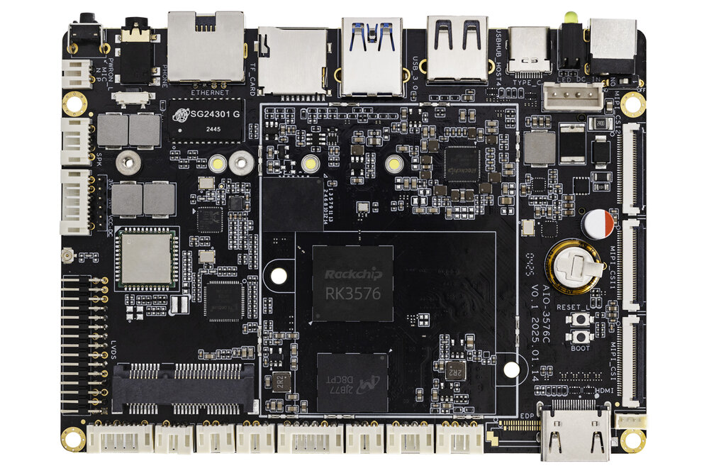
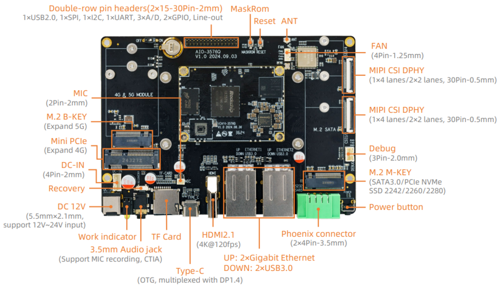

# Introduction

[Specification](https://download.t-firefly.com/%E4%BA%A7%E5%93%81%E8%A7%84%E6%A0%BC%E6%96%87%E6%A1%A3/%E8%A1%8C%E4%B8%9A%E4%B8%BB%E6%9D%BF/AIO-3576C_Large-model%20Industrial%20Mainboard_Product%20Introduction.pdf) | [Purchase](https://www.firefly.store/collections/standard-mainboard/products/aio-3576c-6t-aiot-industrial-motherboard-4k120fps-edge-computing-large-model-ruixin-micro-rk3576) | [Downloads](https://community.t-firefly.com/en/doc/download/320)

**AIO-3576C** Powered by the Rockchip RK3576, an octa-core 64-bit AIOT processor, iCore-3576Q features an advanced lithography process to deliver high performance while maintaining low power consumption. It is equipped with an ARM Mali G52 MC3 GPU and a 6 TOPS NPU. This core board supports the private deployment of ultra-large-scale parameter models under the Transformer architecture, custom operator development, and Docker container management technology. With support for 4K@120fps decoding/4K@60fps encoding, it boasts a display capability with 4Kresolution at a high frame rate of 120 fps. With an external watchdog, it provides industrial-grade stability. The backplane reference design is available for deep customization.

## Interface Description

**AIO-3576C V1.0** interfaces include:

* 1 x HDMI2.1 (Up to 4K120Hz)
* 1 x USB3.0 OTG (Type-C)
* 1 x USB3.0
* 2 x USB2.0 (One Of Them On 4P-1.25mm)
* 1 x MIPI-DSI
* 1 x MIPI-D/CPHY-CSI
* 2 x MIPI-DPHY-CSI
* 1 x TF Card
* 1 x M.2 (SATA3.1 / NVME)
* 1 x WIFI
* 1 x Bluetooth
* 1 x FAN
* 1 x RJ45 (up to 1Gbps)
* 1 × 3.5mm Headphone Jack
* 1 × Mic Input (2P-1.25mm)
* 1 × SPEAKER (4P-1.25mm)
* 1 x DEBUG TTL
* 1 x RS485
* 1 x RS232
* 1 x CAN
* 1 x Mini PCIe (4G Module)
* 1 x eDP 40Pin/30Pin (Multiplexing with HDMI, not supported by default)

The details are shown below:

## Special Notice
MIPI-DSI and LVDS cannot be used at the same time.

eDP and HDMI multiplexing, default HDMI, if you need eDP support, you can contact the official consultation.

## Resources and Support

* [[Technical Forum]](https://forum.t-firefly.com/): A communication platform with more than 100,000 enterprise customers and users

### Contact

* Email: sales@t-firefly.com
* Mobile: (+86) 186 8811 7175
* Landline: 0760-89881218
* Address: Room 2101, Hongyu Building, No. 57 Zhongshan 4th Road, East District, Zhongshan City, Guangdong Province