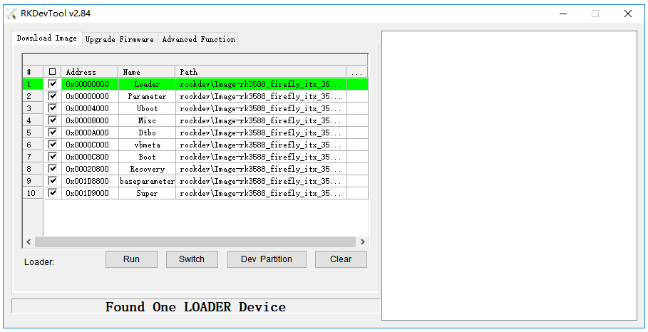
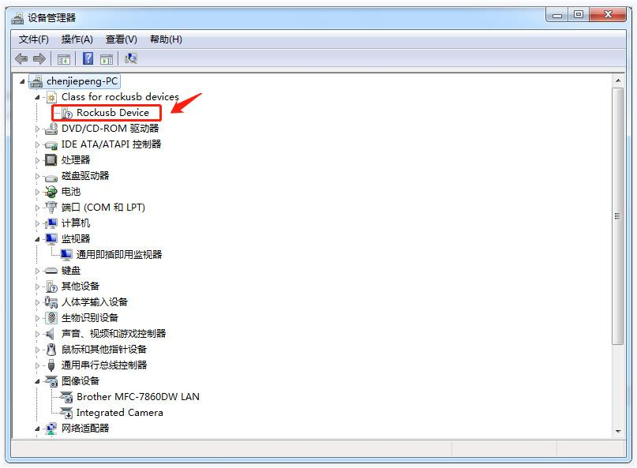
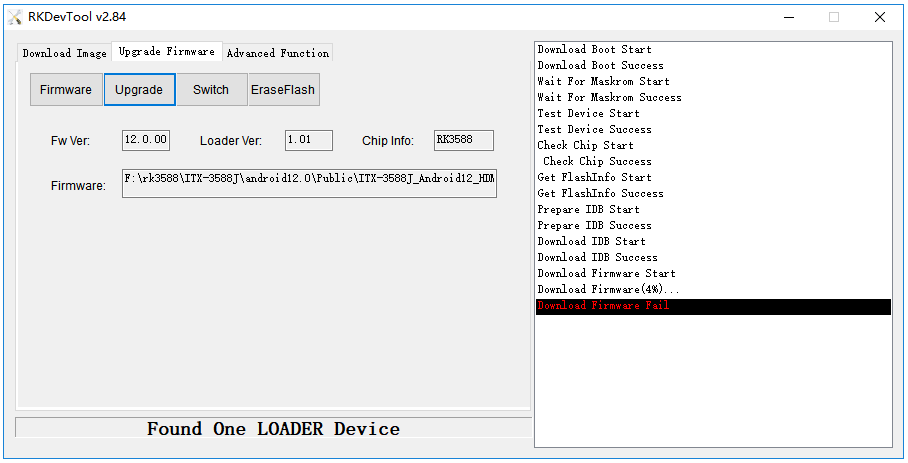
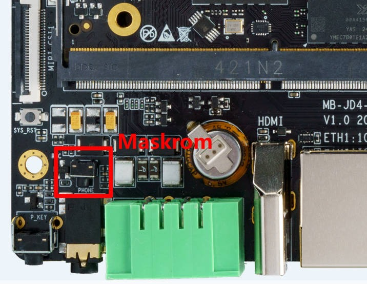
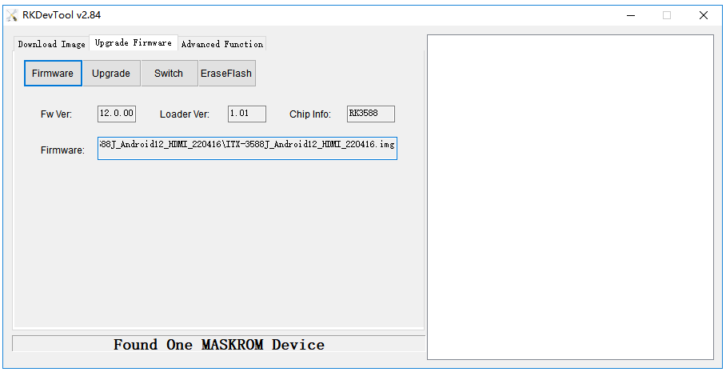

# FAQ

<Accordions>

<Accordion title="Q: What boot modes does the device have?" type="single" id="rk_upgrade_faq_boot_mode">

**A:** The AIO-3576JD4 has three boot modes:

* Normal mode
* Loader mode
* MaskRom mode

**Normal mode**

Normal mode is the normal boot process. Each component loads in turn and the system starts normally.

**Loader mode**

In Loader mode, the bootloader enters the upgrade state and waits for commands from the host computer, which is used for firmware upgrade and so on. 
**MaskRom mode**

MaskRom mode is used for system repair when the bootloader is damaged.

Under normal circumstances, it is not necessary to enter `MaskRom mode`. Only when the bootloader verification fails (the IDB block cannot be read, or the bootloader is damaged), the BootRom code will enter `MaskRom mode`. At this time, the BootRom code waits for the host to transfer the bootloader code through the USB interface, then loads and runs it.

</Accordion>

<Accordion title="Q: How to tell which upgrade mode the device is currently in?" type="single" id="rk_upgrade_faq_check_upgrade_mode">

**A:** To determine which upgrade mode the board is currently in, we can check it with the upgrade tool.

<CodeBlockTabs defaultValue="Windows">
  <CodeBlockTabsList>
    <CodeBlockTabsTrigger value="Windows">Windows</CodeBlockTabsTrigger>
    <CodeBlockTabsTrigger value="Linux">Linux</CodeBlockTabsTrigger>
  </CodeBlockTabsList>

  <CodeBlockTab value="Windows">
    **Windows Operating System**

    The AndroidTool displays the prompt `Found One LOADER Device` at the bottom:

    <center>

    
    </center>

    If the "Enter Loader mode" operation has been performed, but the upgrade tool still does not show LOADER, check whether the Windows host prompts that new hardware is found and the driver is configured. Open the Device Manager and a new device `Rockusb Device` will appear, as shown below. If not, you can go back to the previous step to [install the driver](upgrade_firmware.md#install-the-upgrade-tool).

    <center>

    
    </center>

    If the burning tool prompts `Found One MASKROM Device`, it means that the device is currently in MaskRom mode.
  </CodeBlockTab>

  <CodeBlockTab value="Linux">
    **Linux Operating System**

    After running upgrade_tool, you can see a `Loader` prompt in the list of connected devices:

    ```shell
    firefly@T-chip:~/severdir/down_firmware$ sudo upgrade_tool
    List of rockusb connected
    DevNo=1 Vid=0x2207,Pid=0x330c,LocationID=106    Loader
    Found 1 rockusb,Select input DevNo,Rescan press <R>,Quit press <Q>:q
    ```

    If `MaskRom` is shown in the list, it means that the device is currently in MaskRom mode.
  </CodeBlockTab>
</CodeBlockTabs>

For how to make the device enter the upgradable mode, please refer to [Enter Upgrade mode](upgrade_firmware.md).

</Accordion>

<Accordion title="Q: How to flash partitions?" type="single" id="rk_upgrade_faq_flash_partition">

**A:** The following content is intended for advanced users who need to flash partitions (boot/kernel/rootfs, etc.) separately. If you only need a full firmware upgrade, please refer to [Upgrade the firmware via USB cable](upgrade_firmware.md).

<CodeBlockTabs defaultValue="Windows">
  <CodeBlockTabsList>
    <CodeBlockTabsTrigger value="Windows">Windows</CodeBlockTabsTrigger>
    <CodeBlockTabsTrigger value="Linux">Linux</CodeBlockTabsTrigger>
  </CodeBlockTabsList>

  <CodeBlockTab value="Windows">
    **Windows Operating System**

    **Flash partition images**

    The steps to flash the partition images are as follows:

    1. Switch to the `Download Image` page.
    2. Check the partitions to be burned, and multiple selections are allowed.
    3. In Loader mode, click the `Dev Partition` button to view the device partition table.
    4. Verify the partition addresses. If they are inconsistent with the addresses in the `parameter` file, manually change the `Address` field to the device address; otherwise the wrong partition will be flashed.
    5. Make sure the path of the image file is correct. If necessary, click the blank table cell on the right side of the path to select it again.
    6. Click the `Run` button to start the upgrade, and the device will restart automatically after the upgrade.

    <center>

    
    </center>
  </CodeBlockTab>

  <CodeBlockTab value="Linux">
    **Linux Operating System**

    **Flash partition images**

    ```shell
    sudo upgrade_tool di -b /path/to/boot.img
    sudo upgrade_tool di -r /path/to/recovery.img
    sudo upgrade_tool di -m /path/to/misc.img
    sudo upgrade_tool di -u /path/to/uboot.img
    sudo upgrade_tool di -dtbo /path/to/dtbo.img
    sudo upgrade_tool di -p paramater   #flash parameter
    sudo upgrade_tool ul bootloader.bin #flash bootloader
    ```

    If the upgrade fails due to flash problems, you can try low-level formatting and erasing the emmc:

    ```shell
    sudo upgrade_tool lf update.img # low-level formatting
    sudo upgrade_tool ef update.img # erase
    ```

    Flash dynamic partitions with fastboot:

    ```shell
    adb reboot fastboot # enter bootloader
    sudo fastboot flash vendor vendor.img
    sudo fastboot flash system system.img
    sudo fastboot reboot # After the flashing is successful, restart
    ```
  </CodeBlockTab>
</CodeBlockTabs>

</Accordion>

<Accordion title="Q: What to do if an exception occurs during flashing?" type="single" id="rk_upgrade_faq_flash_exception">

**A:**

**Analysis of flashing failure**

If Download Boot Fail occurs during the flashing process, or an error occurs during the flashing process, as shown in the figure below, it is usually caused by a poor connection of the USB cable, an inferior cable, or the insufficient drive capability of the USB port of the computer. Please replace the USB cable or the USB port of the computer to troubleshoot.

<center>


</center>

**Device not recognized / new device prompt**

If the "Enter Loader mode" operation has been performed, but the burning tool still does not show LOADER, it is usually because the host has not recognized the device or the driver is not installed properly. The handling method has been described in the section "How to tell which upgrade mode the device is currently in?" above (including the screenshots of the new device `Rockusb Device` and the driver installation), and will not be repeated here.

</Accordion>

</Accordions>
<Accordions>

<Accordion title="Q: How to enter MaskRom mode?" type="single" id="rk_upgrade_faq_enter_maskrom">

**A:** 
`MaskRom` mode is the last line of defense when the device is bricked. Forcibly entering `MaskRom` involves hardware operations and carries certain risks. Therefore, only try `MaskRom` mode when the device cannot enter `Loader` mode. The principle of entering `MaskRom` is to manually short-circuit the data pins of the EMMC to ground. The system will consider the EMMC data to be in error and clear the EMMC data.

**Please read carefully and operate carefully!**

The operation steps are as follows:

1. Disconnect the device from the power supply
2. Press and hold the MaskRom key on Core-3576JD4 (shown in the picture below)
3. Plug in the power supply, keep holding the key for about 3 seconds and then release it

<center>


</center>


If the product comes with the case, you can press the MaskRom key through the headphone jack with a thin stick.


At this point, the device should go into `MaskRom mode`.

<center>


</center>

</Accordion>

</Accordions>