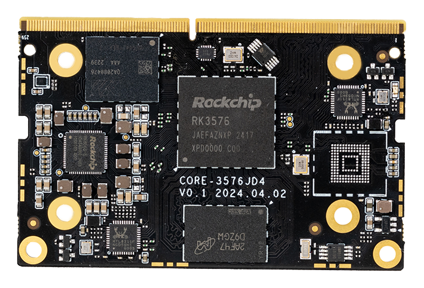
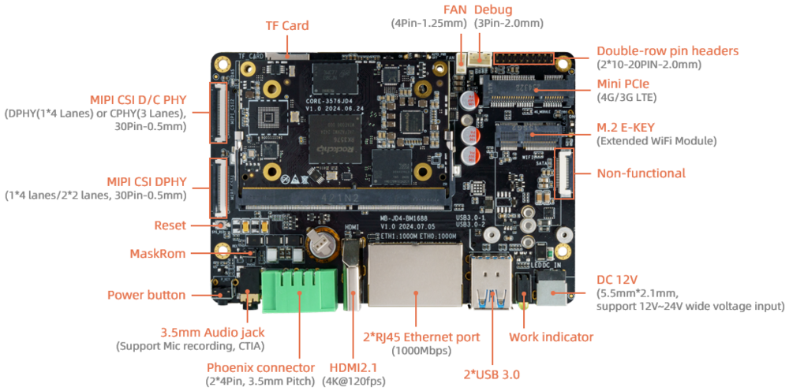
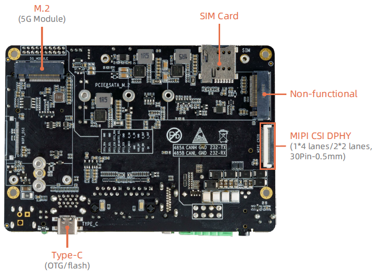
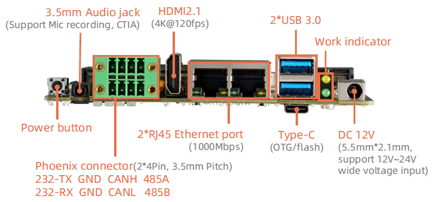

# Introduction

[Specification](https://download.t-firefly.com/%E4%BA%A7%E5%93%81%E8%A7%84%E6%A0%BC%E6%96%87%E6%A1%A3/%E6%A0%B8%E5%BF%83%E6%9D%BF/Core-3576JD4_Low-power%20Large-model%20Core%20Board_Product%20Introduction.pdf) | [Purchase](https://www.firefly.store/products/core-3576jd4-low-power-large-model-aiot-core-board) | [Downloads](https://community.t-firefly.com/en/doc/download/255)

**Core-3576JD4** Powered by the Rockchip RK3576, an octa-core 64-bit AIOT processor, Core-3576JD4 features an advanced lithography process to deliver high performance while maintaining low power consumption. It is equipped with an ARM Mali G52 MC3 GPU and a 6 TOPS NPU. This core board supports the private deployment of ultra-large-scale parameter models under the Transformer architecture, custom operator development, and Docker container management technology. With support for 4K@120fps decoding/4K@60fps encoding, it boasts a display capability with 4Kresolution at a high frame rate of 120 fps. With an external watchdog, it provides industrial-grade stability. The backplane reference design is available for deep customization.

## Interface Description

**AIO-3576JD4 V1.0** interfaces include:

* 1 x HDMI2.1 (Up to 4K@120Hz)
* 1 x USB Type-C (For download/debug)
* 2 x USB3.0
* 2 x MIPI-DPHY-CSI (CSI0 muxed with CSI1, can not be used at same time)
* 1 x TF Card
* 1 x Mini PCIe (4G module)
* 1 x PCIe M.2 (5G module)
* 1 x SIM Card Slot
* 1 x WIFI (External module)
* 1 x Bluetooth (External module)
* 1 x FAN
* 1 x Headphone （Supports microphone recording, US standard）
* 1 x CAN  (Phoenix connector)
* 1 x RS232 (Phoenix connector)
* 1 x RS485 (Phoenix connector)
* 1 x Line-Out (Through pin header)
* 1 x Line-In (Through pin header)
* 1 x USB2.0 (Through pin header)
* 1 x SPI  (Through pin header)
* 2 x I2C  (Through pin header)

* 1 x MIPI-D/CPHY-CSI
* 2 x RJ45 (Support 1Gbps ethernet)

As shown in the figure below:

## Special Notice
Mini PCIe (4G Module) and PCIe M.2 (5G Module) used same USB bus, so they can not be used at same time.

Default 4G module, you need to change some resistors to use 5G module.

## Resources and Support

* [[Technical Forum]](https://forum.t-firefly.com/): A communication platform with more than 100,000 enterprise customers and users

### Contact

* Email: sales@t-firefly.com
* Mobile: (+86) 186 8811 7175
* Landline: 0760-89881218
* Address: Room 2101, Hongyu Building, No. 57 Zhongshan 4th Road, East District, Zhongshan City, Guangdong Province