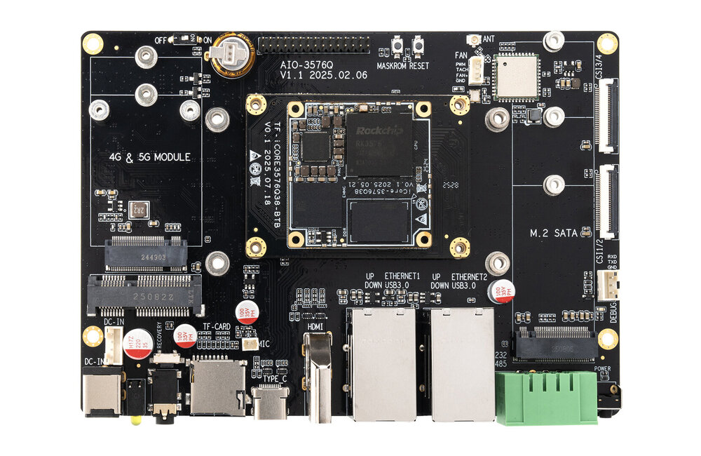
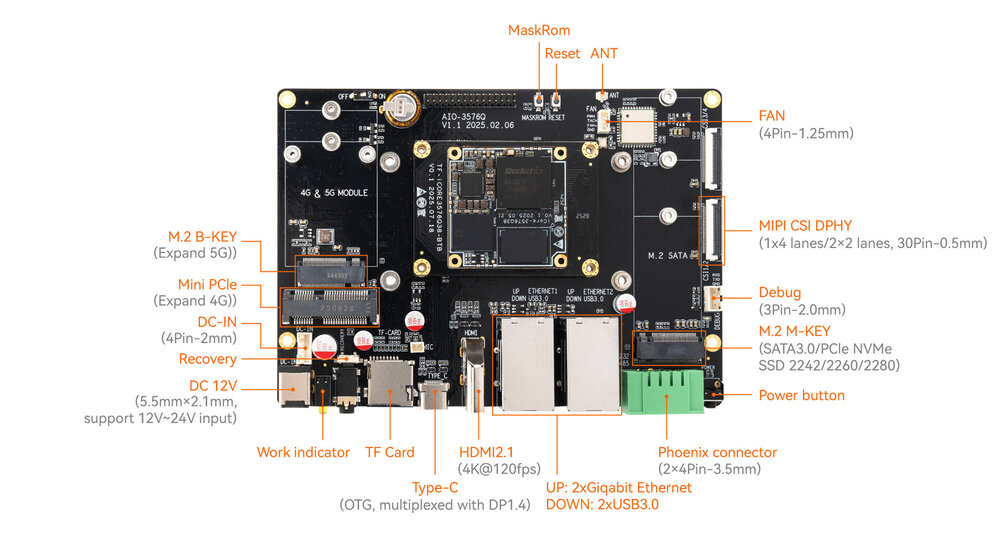
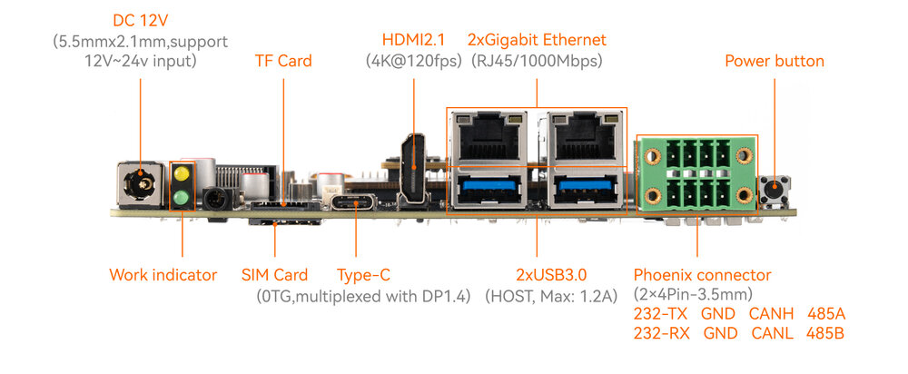
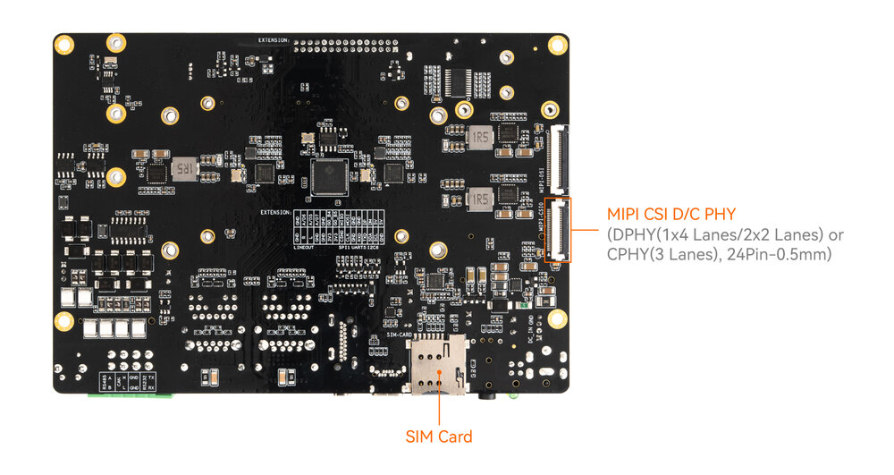

# Introduction

[Specification](https://download.t-firefly.com/Spec/CoreBorads/iCore-3576Q38_Specification_EN.pdf) | [Purchase](https://www.firefly.store/collections/industrial-modules/products/icore-3576q38) | [Downloads](https://community.t-firefly.com/en/doc/download/327)

**AIO-3576Q38** Powered by the Rockchip RK3576, an octa-core 64-bit AIOT processor, iCore-3576Q features an advanced lithography process to deliver high performance while maintaining low power consumption. It is equipped with an ARM Mali G52 MC3 GPU and a 6 TOPS NPU. This core board supports the private deployment of ultra-large-scale parameter models under the Transformer architecture, custom operator development, and Docker container management technology. With support for 4K@120fps decoding/4K@60fps encoding, it boasts a display capability with 4Kresolution at a high frame rate of 120 fps. With an external watchdog, it provides industrial-grade stability. The backplane reference design is available for deep customization.

## Interface Description

**AIO-3576Q38 V1.0** interfaces include:

* 1 x HDMI2.1（Up to 4K120Hz）
* 1 x USB3.0 OTG(Type-C)
* 2 x USB3.0
* 1 x MIPI-D/CPHY-CSI
* 1 x MIPI-DPHY-CSI
* 1 x TF Card
* 1 x M.2(SATA3.1)
* 1 x WIFI
* 1 x Bluetooth
* 1 x FAN
* 2 x RJ45（up to 1Gbps）
* 1 x RS485
* 1 x RS232
* 1 x CAN
* 1 x Mini PCIe (4G Module)
* 1 x PCIe M.2 (5G Module)

The details are shown below:

## Special Notice
Mini PCIe (4G Module) and PCIe M.2 (5G Module) used same USB bus, so they can not be used at same time.

Unavailable function:
* 1 x MIPI-DSI
* 1 x MIPI-DPHY-CSI (CSI3/4)
* 1 × 3.5mm Headphone Jack
* 1 × Mic Input（2P-1.25mm）
* 1 x Bluetooth (SAI2)
* Extension Pins

## Resources and Support

* [[Technical Forum]](https://forum.t-firefly.com/): A communication platform with more than 100,000 enterprise customers and users

### Contact

* Email: sales@t-firefly.com
* Mobile: (+86) 186 8811 7175
* Landline: 0760-89881218
* Address: Room 2101, Hongyu Building, No. 57 Zhongshan 4th Road, East District, Zhongshan City, Guangdong Province