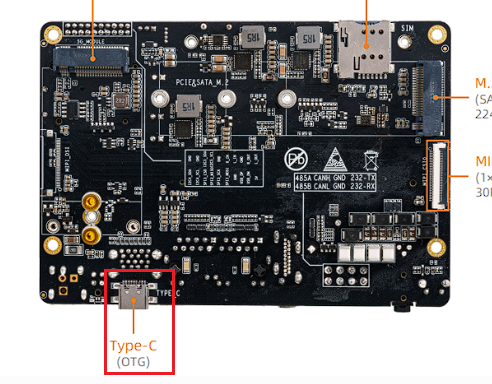
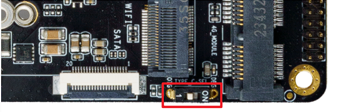
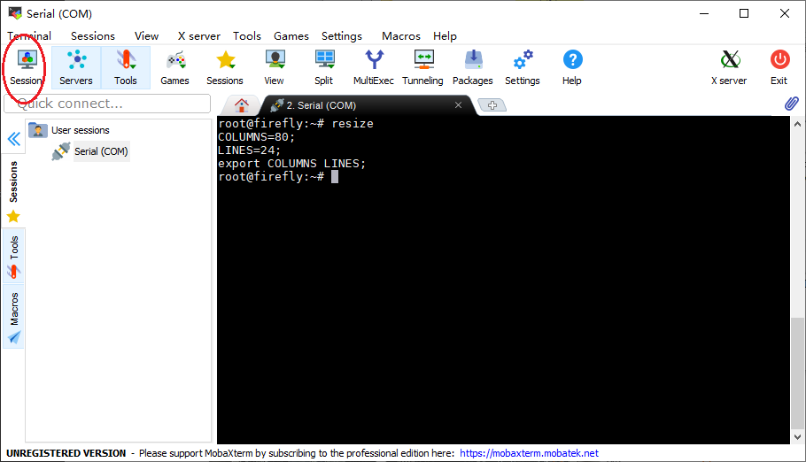
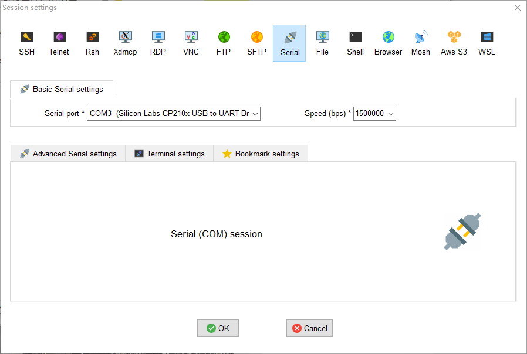

# Serial Debug

## Hardware Connection [step]

Connect the device "Typec" and the computer. AIO-3588JD4 Typec has two functions (serial port/OTG upgrade) controlled by the dip switch. Please turn the dip switch to "DBG" when debugging.


<center>


</center>
<center>


</center>


## Serial Parameters [step]

* Baud rate: 115200
* Data bit: 8
* Stop bit: 1
* Parity check: none
* Flow control: none

## Using Serial Debug [step]

<CodeBlockTabs defaultValue="Windows">
  <CodeBlockTabsList>
    <CodeBlockTabsTrigger value="Windows">Windows</CodeBlockTabsTrigger>
    <CodeBlockTabsTrigger value="Ubuntu">Ubuntu</CodeBlockTabsTrigger>
  </CodeBlockTabsList>

  <CodeBlockTab value="Windows">
    ### Using Serial Debug on Windows

    On Windows, putty or SecureCRT is generally used. Among them, we recommend using the free version of MobaXterm. This is a powerful terminal software, which is introduced here. The usage of other software is similar.

    Go here [download MobaXterm](https://mobaxterm.mobatek.net/):

    1. Select `session` as `Serial`.
    2. Modify `Serial port` to the COM port found in Device Manager.
    3. Set `Speed (bsp)` to `115200`.
    4. Click the `OK` button.

    <center>

    
    </center>
    <center>

    
    </center>
  </CodeBlockTab>

  <CodeBlockTab value="Ubuntu">
    ### Serial Debug on Ubuntu

    There are several options available on Ubuntu:

    * minicom
    * picocom
    * kermit

    The following will introduce the use of minicom.

    Install minicom:

    ```
    sudo apt-get install minicom
    ```

    After connecting the serial cable, check the serial device file:

    <Callout title="Note" type="info">
      The debug serial port of this device is exported through the Type-C interface, so the device file under Ubuntu is `/dev/ttyACM0`; if an ordinary USB-to-serial adapter is used, the device file will be `/dev/ttyUSBx`.
    </Callout>

    ```
    $ ls /dev/ttyACM*
    /dev/ttyACM0
    ```

    Run:

    ```
    $ sudo minicom
    Welcome to minicom 2.7
    OPTIONS: I18n
    Compiled on Jan  1 2014, 17:13:19.
    Port /dev/ttyACM0, 15:57:00
    Press CTRL-A Z for help on special keys
    ```

    The above prompt `CTRL-A Z` is the escape key, press `Ctrl-a` and then `z` to bring up the menu:

    ```
       +-------------------------------------------------------------------+
                              Minicom Command Summary                      |
      |                                                                    |
      |              Commands can be called by CTRL-A <key>                |
      |                                                                    |
      |               Main Functions                  Other Functions      |
      |                                                                    |
      | Dialing directory..D  run script (Go)....G | Clear Screen.......C  |
      | Send files.........S  Receive files......R | cOnfigure Minicom..O  |
      | comm Parameters....P  Add linefeed.......A | Suspend minicom....J  |
      | Capture on/off.....L  Hangup.............H | eXit and reset.....X  |
      | send break.........F  initialize Modem...M | Quit with no reset.Q  |
      | Terminal settings..T  run Kermit.........K | Cursor key mode....I  |
      | lineWrap on/off....W  local Echo on/off..E | Help screen........Z  |
      | Paste file.........Y  Timestamp toggle..N  | scroll Back........B  |
      | Add Carriage Ret...U                                               |
      |                                                                    |
      |             Select function or press Enter for none.               |
      +--------------------------------------------------------------------+
    ```

    Press `O` according to the prompt to enter the setting interface, as follows:

    ```
           +-----[configuration]------+
           | Filenames and paths      |
           | File transfer protocols  |
           | Serial port setup        |
           | Modem and dialing        |
           | Screen and keyboard      |
           | Save setup as dfl        |
           | Save setup as..          |
           | Exit                     |
           +--------------------------+
    ```

    Move the cursor to "Serial port setup", press enter to enter the serial port setup interface, then enter the letters indicated above, select the corresponding option, and set as follows:

    ```
       +-----------------------------------------------------------------------+
       | A -    Serial Device      : /dev/ttyACM0                              |
       | B - Lockfile Location     : /var/lock                                 |
       | C -   Callin Program      :                                           |
       | D -  Callout Program      :                                           |
       | E -    Bps/Par/Bits       : 115200 8N1                                |
       | F - Hardware Flow Control : No                                        |
       | G - Software Flow Control : No                                        |
       |                                                                       |
       |    Change which setting?                                              |
       +-----------------------------------------------------------------------+
    ```

    <Callout title="Note" type="warn">
      `Hardware Flow Control` and `Software Flow Control` must be set to No, otherwise it may result in failure to input.
    </Callout>

    After the setup is complete, go back to the previous menu and select `Save setup as dfl` to save it as the default configuration, which will be used by default in the future.
  </CodeBlockTab>
</CodeBlockTabs>