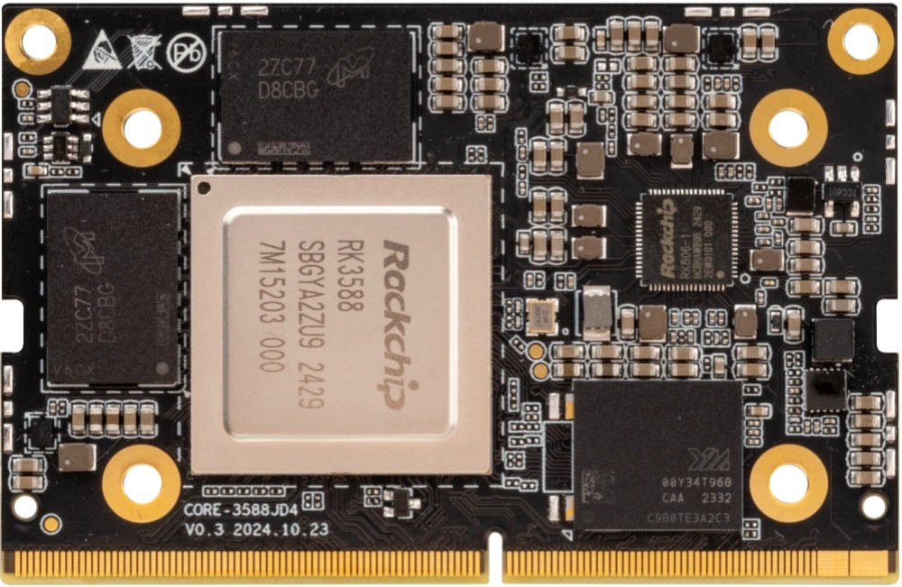
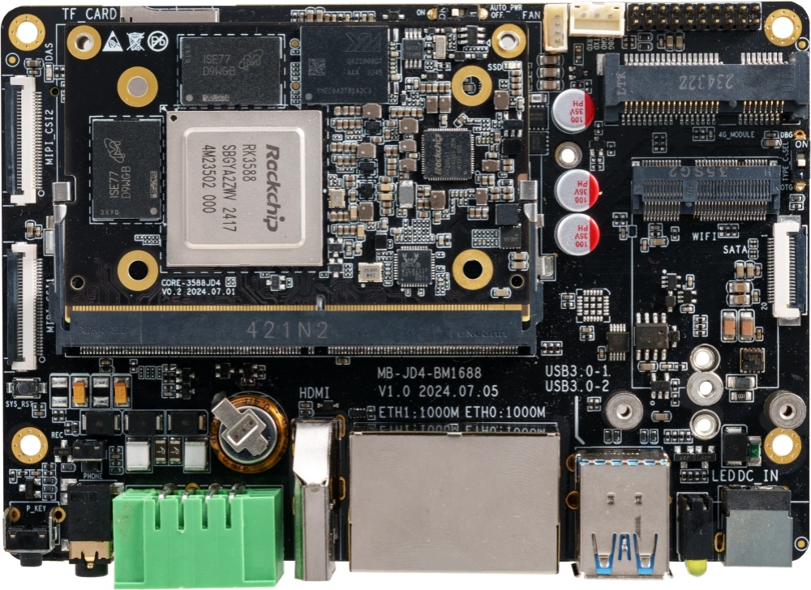
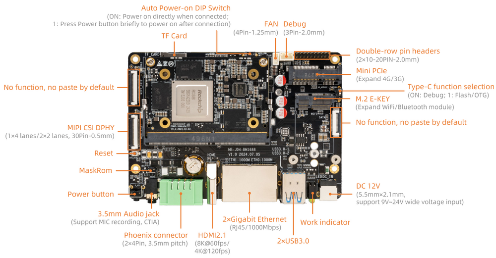
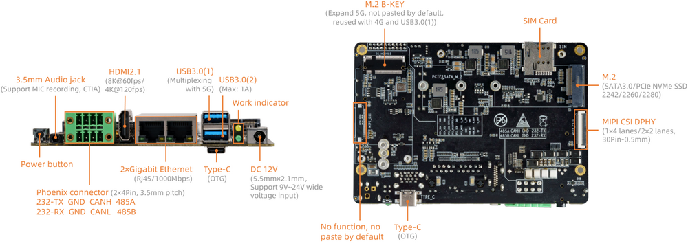

# Introduction

[Specification](https://download.t-firefly.com/%E4%BA%A7%E5%93%81%E8%A7%84%E6%A0%BC%E6%96%87%E6%A1%A3/%E6%A0%B8%E5%BF%83%E6%9D%BF/Core-3588JD4_AI%20Large-model%20Core%20board_Product%20Introduction.pdf) | [Downloads](https://community.t-firefly.com/en/doc/download/290)

Based on Rockchip new generation of flagship AIOT chip -- RK3588, the
Core-3588JD4 features an 8nm LP process and an 8-core (Cortex-A76x4+
Cortex-A55x4) 64-bit CPU with up to 2.4 GHz.

Integrated ARM Mali-G610 MP4 quad-core GPU, built-in AI accelerator NPU,
can provide 6Tops computing power, support the mains, support up to 32 GB of memory, support WiFi 6,5G/4G and other
high-speed wireless network communication, support 8K video codec and
multiple formats of video input and output, support multiple operating
systems can be applied to ARM PC, edge computing, cloud server,
intelligent NVR and other fields.
 

The AIO-3588JD4 development board consists of the core board **Core-3588JD4** + **MB-JD4-RK3588**. AIO-3588JD4
has rich interfaces such as RGMII, CAN, Mini PCIe, USB3.0, HDMI, 
RS485/232, and MIPI-CSI, provide multiple power supply
modes. It can be directly applied to various intelligent products to
accelerate product implementation. For details, refer to ["interface
definition"](../interface_definition.md).

## Interface Description

**AIO-3588JD4 V1.0** provides rich interfaces, including:

* 1 x HDMI2.1 (Up to 8K@60Hz)
* 1 x USB Type-C (For download/debug)
* 2 x USB3.0
* 2 x MIPI-DPHY-CSI (CSI0 muxed with CSI1, can not be used at same time)
* 1 x TF Card
* 1 x Mini PCIe (4G module)
* 1 x PCIe M.2 (5G module)
* 1 x SIM Card Slot
* 1 x WIFI (External module)
* 1 x Bluetooth (External module)
* 1 x FAN
* 1 x Headphone （Supports microphone recording, US standard）
* 1 x CAN  (Phoenix connector)
* 1 x RS232 (Phoenix connector)
* 1 x RS485 (Phoenix connector)
* 1 x Line-Out (Through pin header)
* 1 x Line-In (Through pin header)
* 1 x USB2.0 (Through pin header)
* 1 x SPI  (Through pin header)
* 2 x I2C  (Through pin header)

* 2 x RJ45 (Support 1Gbps ethernet)
* 1 x M2.SATA3.0 or M2.PCIe2.0 (SATA3.0 is supported by default.)

The details are shown below：

## Resources and Support

* [[Technical Forum]](https://forum.t-firefly.com/): A communication platform with more than 100,000 enterprise customers and users

### Contact

* Email: sales@t-firefly.com
* Mobile: (+86) 186 8811 7175
* Landline: 0760-89881218
* Address: Room 2101, Hongyu Building, No. 57 Zhongshan 4th Road, East District, Zhongshan City, Guangdong Province