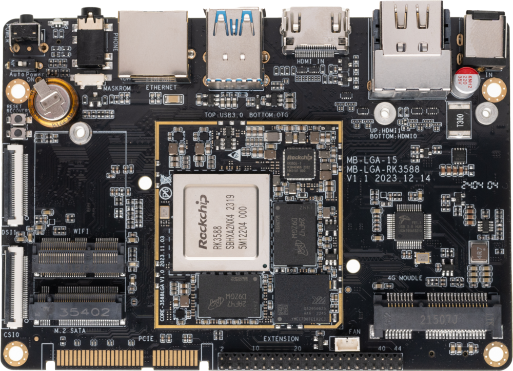
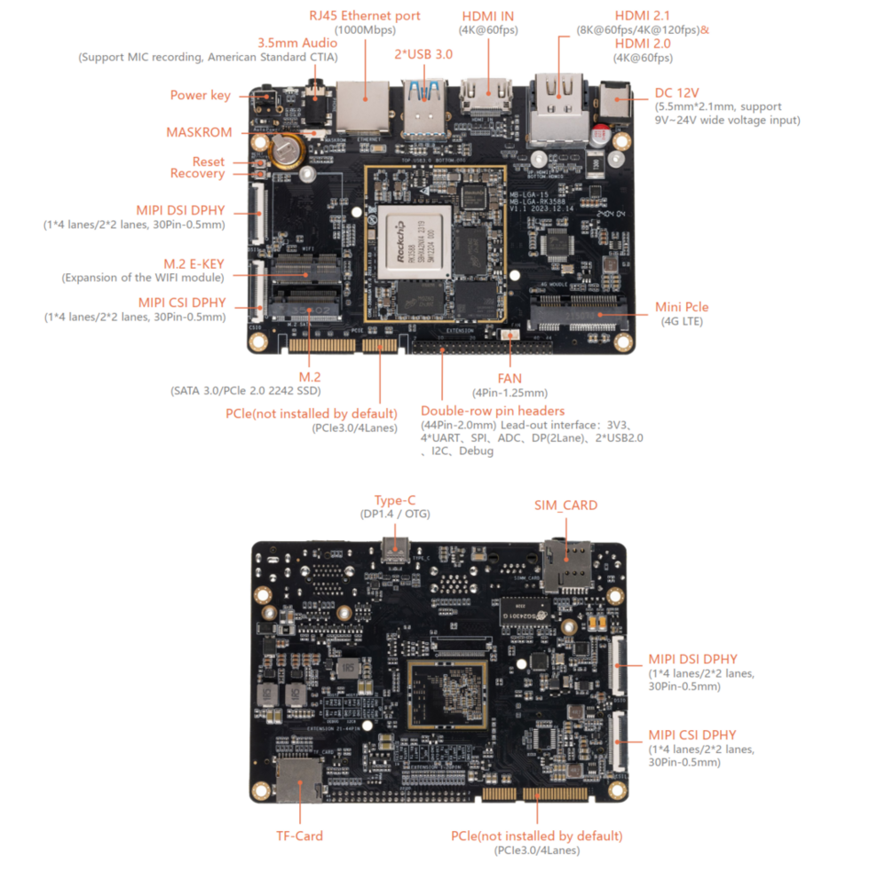

[Specification](https://download.t-firefly.com/%E4%BA%A7%E5%93%81%E8%A7%84%E6%A0%BC%E6%96%87%E6%A1%A3/%E6%A0%B8%E5%BF%83%E6%9D%BF/Core-3588L_8K%20artificial%20intelligence%20core%20board_Specification.pdf?v=1702604713) | [Purchase](https://www.firefly.store/products/core-3588l-ai-core-board-powered-by-rockchip-rk3588-lga-package) | [Downloads](https://community.t-firefly.com/en/doc/download/161)

# Introduction

Based on Rockchip new generation of flagship AIOT chip -- RK3588, the features an 8nm LP process and an 8-core (Cortex-A76x4+
Cortex-A55x4) 64-bit CPU with up to 2.4 GHz.

Integrated ARM Mali-G610MP4 quad-core GPU, built-in AI accelerator NPU,
can provide 6Tops computing power, support the mains, support up to 32 GB of memory, support WiFi 6,5G/4G and other
high-speed wireless network communication, support 8K video codec and
multiple formats of video input and output, support multiple operating
systems can be applied to ARM PC, edge computing, cloud server,
intelligent NVR and other fields.

## Interface Description

**AIO-3588L V1.0** provides rich interfaces, including：

* 1 x HDMI2.1 (Max output support 8K@60Hz)
* 1 x HDMI2.0
* 1 x HDMIIN2.0 (Max input support 4K@60Hz)
* 1 x Display Port1.4 (Max output support 8K@30Hz)
* 1 x USB3.0 OTG(Type-C)
* 2 x MIPI-DSI
* 2 x MIPI-CSI
* 1 x M.2 SATA3.0 或 M.2 PCIe2.0
* 1 x PCIe3.0x4
* 1 x TF Card
* 1 x 4G LTE
* 1 x SIM 卡槽
* 2 x USB3.0
* 2 x USB2.0 (Lead out from 44Pin)
* 1 x PCIe2.0 (M.2 E-KEY for WiFi6/BT5.0)
* 1 x FAN
* 1 x RJ45 (Suport 1Gbps)
* 1 × 3.5mm headphone jack

## The details are shown below：

## Resources and Support

* [[Technical Forum]](https://forum.t-firefly.com/): A communication platform with more than 100,000 enterprise customers and users

### Contact

* Email: sales@t-firefly.com
* Mobile: (+86) 186 8811 7175
* Landline: 0760-89881218
* Address: Room 2101, Hongyu Building, No. 57 Zhongshan 4th Road, East District, Zhongshan City, Guangdong Province