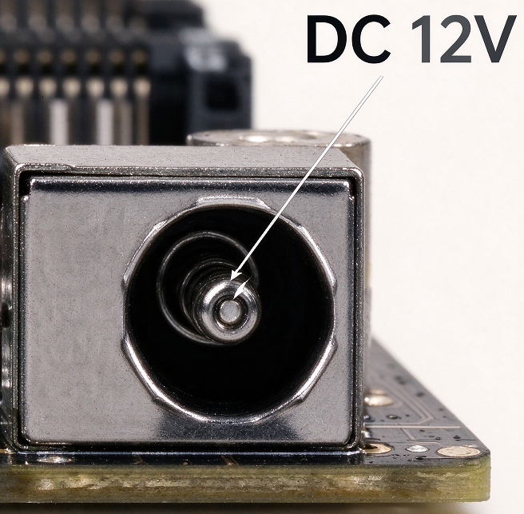
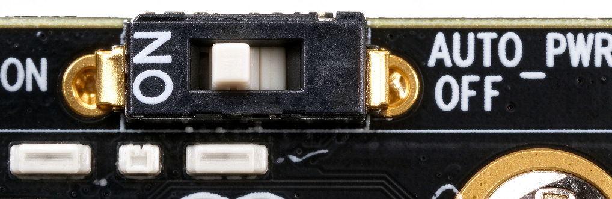
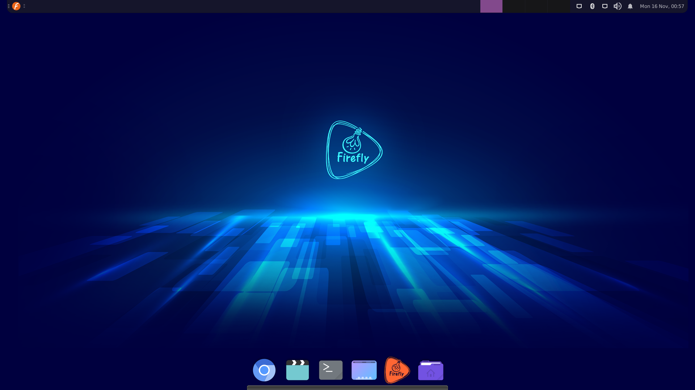
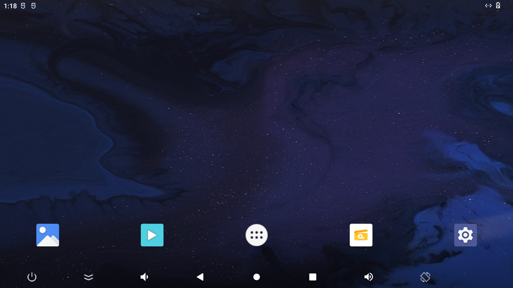
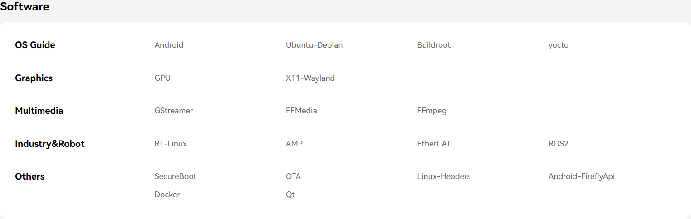
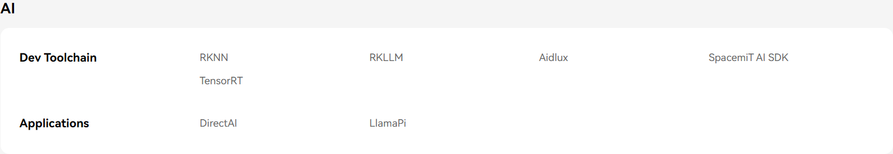

# Quick Start

## Power On [step]

The image below shows the power connector of iCore-3588Q. Connect the power adapter to this connector (use the power adapter bundled with the product):

<center></center>

<Callout title="Cannot power on?" type="warn">If the device has an auto_pwr DIP switch, it must be set to the ON side to power on. If the device fails to power on, check this switch first. The switch position in the image below is correct:</Callout>

<center></center>

iCore-3588Q boots up as soon as it is connected to power. During boot, the following logo is displayed:

<Callout title="Note" type="info">NVIDIA-based products show the NVIDIA logo; some platforms may have no boot logo — refer to your actual device.</Callout>

<center></center>

## System Login [step]

<CodeBlockTabs defaultValue="linux">
<CodeBlockTabsList>
<CodeBlockTabsTrigger value="linux">Linux</CodeBlockTabsTrigger>
<CodeBlockTabsTrigger value="android">Android</CodeBlockTabsTrigger>
</CodeBlockTabsList>
<CodeBlockTab value="linux">

The image below shows the Linux desktop (XFCE) of a 3588-series product as an example. For other platforms or other display frameworks, refer to your actual display:

<center></center>

### 1. Account and Password

| Platform | Account | Password |
| --- | --- | --- |
| Rockchip | `firefly` | `firefly` |
| Sophgo | `linaro` | `linaro` |
| Qualcomm | `firefly` | `firefly` |
| NVIDIA | `nvidia` | `nvidia` |
| SpacemiT | `firefly` | `firefly` |

root passwords are not set by default on these firmwares: run `sudo passwd root` after login to set one. If a firmware has set a root password, it is the same as the normal user password of that platform.

### 2. Log in to the System via Any of the Following Methods

<CodeBlockTabs defaultValue="login-rockchip">
  <CodeBlockTabsList>
    <CodeBlockTabsTrigger value="login-rockchip">Rockchip</CodeBlockTabsTrigger>
    <CodeBlockTabsTrigger value="login-sophgo">Sophgo</CodeBlockTabsTrigger>
    <CodeBlockTabsTrigger value="login-qcom">Qualcomm</CodeBlockTabsTrigger>
    <CodeBlockTabsTrigger value="login-nvidia">NVIDIA</CodeBlockTabsTrigger>
    <CodeBlockTabsTrigger value="login-spacemit">SpacemiT</CodeBlockTabsTrigger>
  </CodeBlockTabsList>

  <CodeBlockTab value="login-rockchip">

    - **HDMI monitor + mouse and keyboard**: log in to the desktop and open a terminal for development
    - **Debug serial port**: available on all products, log in to the command line directly
    - **ADB**: available on some products (mostly via the Type-C port); see the product specification
    - For the exact locations of these debug interfaces, see the debug / adb chapters under "Hardware Usage" in the product documentation
    - A few headless products (such as the 3576Q38 and 1126BQ38 series) must be accessed through the debug serial port or ADB

    **SSH Remote Login (Optional)**: SSH is a common way to log in over the network. The device uses a dynamic IP by default, so first log in via one of the methods above, configure a static IP for the device, and then connect with SSH:

    ```bash
    ssh firefly@<device static IP>
    ```

  </CodeBlockTab>

  <CodeBlockTab value="login-sophgo">

    Sophgo-platform products can be accessed over the network or via the debug serial port:

    - **Network login**: see the Ethernet chapter under "Hardware Usage" in the product documentation
    - **Debug serial port**: see the debug serial port chapter under "Hardware Usage" in the product documentation

  </CodeBlockTab>

  <CodeBlockTab value="login-qcom">

    - **HDMI monitor + mouse and keyboard**: log in to the desktop and open a terminal for development
    - **Debug serial port**: available on all products, log in to the command line directly
    - **ADB**: available on some products (mostly via the Type-C port); see the product specification
    - For the exact locations of these debug interfaces, see the debug / adb chapters under "Hardware Usage" in the product documentation

    **SSH Remote Login (Optional)**: SSH is a common way to log in over the network. The device uses a dynamic IP by default, so first log in via one of the methods above, configure a static IP for the device, and then connect with SSH:

    ```bash
    ssh firefly@<device static IP>
    ```

  </CodeBlockTab>

  <CodeBlockTab value="login-nvidia">

    - **HDMI monitor + mouse and keyboard**: log in to the desktop and open a terminal for development
    - **Debug serial port**: available on all products, log in to the command line directly
    - For the exact locations of these debug interfaces, see the debug chapters under "Hardware Usage" in the product documentation

    **SSH Remote Login (Optional)**: SSH is a common way to log in over the network. The device uses a dynamic IP by default, so first log in via one of the methods above, configure a static IP for the device, and then connect with SSH:

    ```bash
    ssh nvidia@<device static IP>
    ```

  </CodeBlockTab>

  <CodeBlockTab value="login-spacemit">

    - **HDMI monitor + mouse and keyboard**: log in to the desktop and open a terminal for development
    - **Debug serial port**: available on all products, log in to the command line directly
    - **ADB**: available on some products (mostly via the Type-C port); see the product specification
    - For the exact locations of these debug interfaces, see the debug / adb chapters under "Hardware Usage" in the product documentation

    **SSH Remote Login (Optional)**: SSH is a common way to log in over the network. The device uses a dynamic IP by default, so first log in via one of the methods above, configure a static IP for the device, and then connect with SSH:

    ```bash
    ssh firefly@<device static IP>
    ```

  </CodeBlockTab>
</CodeBlockTabs>

### 3. Getting Started with Application Development

For an introduction to Linux application development, see the community documentation [Ubuntu/Debian Development Guide](https://community.t-firefly.com/en/docs/software/os-guide/Ubuntu-Debian/ubuntu-login).

<Callout title="Do not run a full system upgrade" type="warn">Do not run `sudo apt-get upgrade`, `sudo apt full-upgrade`, or `sudo do-release-upgrade`. These are embedded products with highly customized kernels and operating systems; running upgrade is very likely to break system dependencies and cause system malfunctions.</Callout>

</CodeBlockTab>
<CodeBlockTab value="android">

<Callout title="Note" type="warn">Products based on the SpacemiT (K3), NVIDIA, or Sophgo platforms do not provide an Android system. This section applies only to products that ship with an Android system.</Callout>

The image below shows the Android 12 desktop of a 3588-series product as an example. For other platforms, refer to your actual display:

<center></center>

### 1. Basic Operation

**Right-click** works as the **Back** key

### 2. Terminal Debugging

Most Android products support ADB, which allows terminal debugging; the debug serial port can also be used to log in

### 3. Debug Interface Locations

See the debug / adb chapters under "Hardware Usage" in the product documentation

### 4. Android System Customization and FireflyAPI Development

The following applies to Rockchip products only:

- [Android System Customization Guide](https://community.t-firefly.com/en/docs/software/os-guide/Android/customization-overview)
- [FireflyAPI Integration Guide](https://community.t-firefly.com/en/docs/software/other/Android-FireflyApi/firefly-api-overview)

</CodeBlockTab>
</CodeBlockTabs>

## Application Development Collection [step]

### Application Software Development Collection

The application software development collection is shown below; click the link underneath to open it:

<center></center>

<center>[Application Software Development Collection](https://community.t-firefly.com/en/docs#software-os-guide)</center>

### AI Development Collection

The AI development collection is shown below:

<center></center>

<center>[AI Development Collection](https://community.t-firefly.com/en/docs#ai)</center>

<Callout title="Special note: LlamaPi" type="info">LlamaPi (pronounced “llama-pie”) is a large model deployment and management tool developed by the Firefly AI team, and it only supports Linux systems. Designed for edge devices with LLM inference capability, it helps users deploy and manage open-source large models locally and provides inference capabilities for third-party applications through an OpenAI-compatible API, enabling rapid local AI model deployment.</Callout>

## System and BSP Development [step]

For system and BSP development (source code, building, firmware flashing), see the development guide chapters in the product Wiki (under "Software Development").