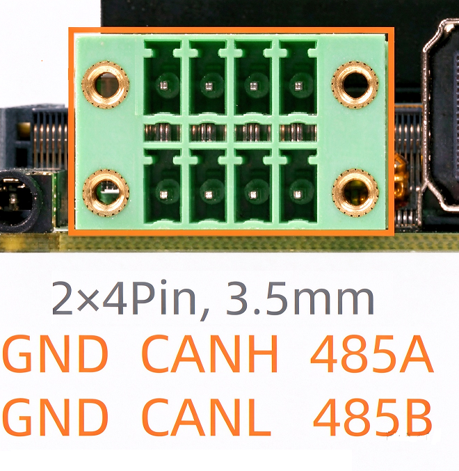

# CAN

CAN (Controller Area Network) bus is a serial communication network that effectively supports distributed control or real-time control. The CAN bus is a bus protocol widely used in automobiles, designed for communication between microcontrollers in automotive environments. For more information, please refer to the [CAN Application Report](https://www.ti.com/lit/an/sloa101b/sloa101b.pdf).

The CAN interface (Phoenix terminal block) of AIO-Orin NX is shown below:

<center>



</center>

Since there is only one CAN, the first device created in the kernel is `can0` by default.

## CAN Communication Test [step]

Use the candump and cansend tools to test sending and receiving messages:

```
# Close the can0 device on both the receiving and sending ends
ip link set can0 down
# Set the bitrate to 250Kbps
ip link set can0 type can bitrate 250000
# Open the can0 device
ip link set can0 up
# Run candump on the receiving end, blocking and waiting for messages
candump can0
# Run cansend on the sending end to send a message
cansend can0 123#1122334455667788
```

## FAQS

### The message is received a long time after sending, or is not received.

Check whether the CAN_H and CAN_L bus DuPont wires are loose or reversed.