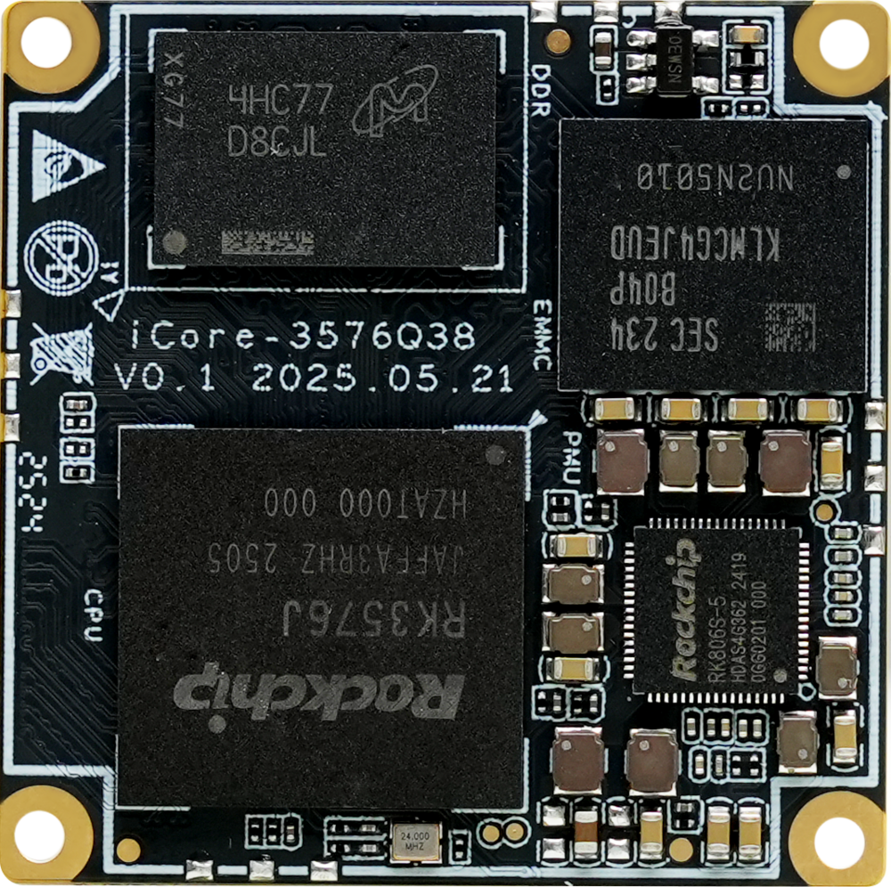
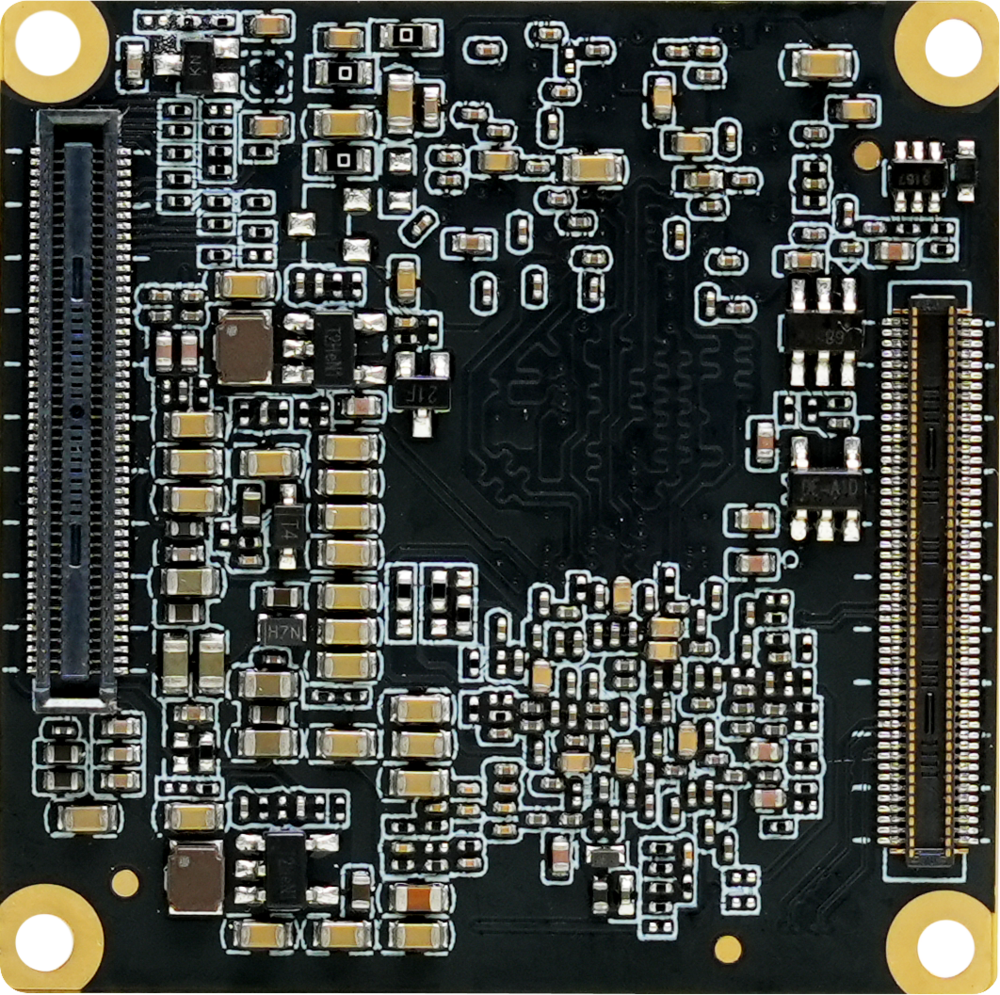
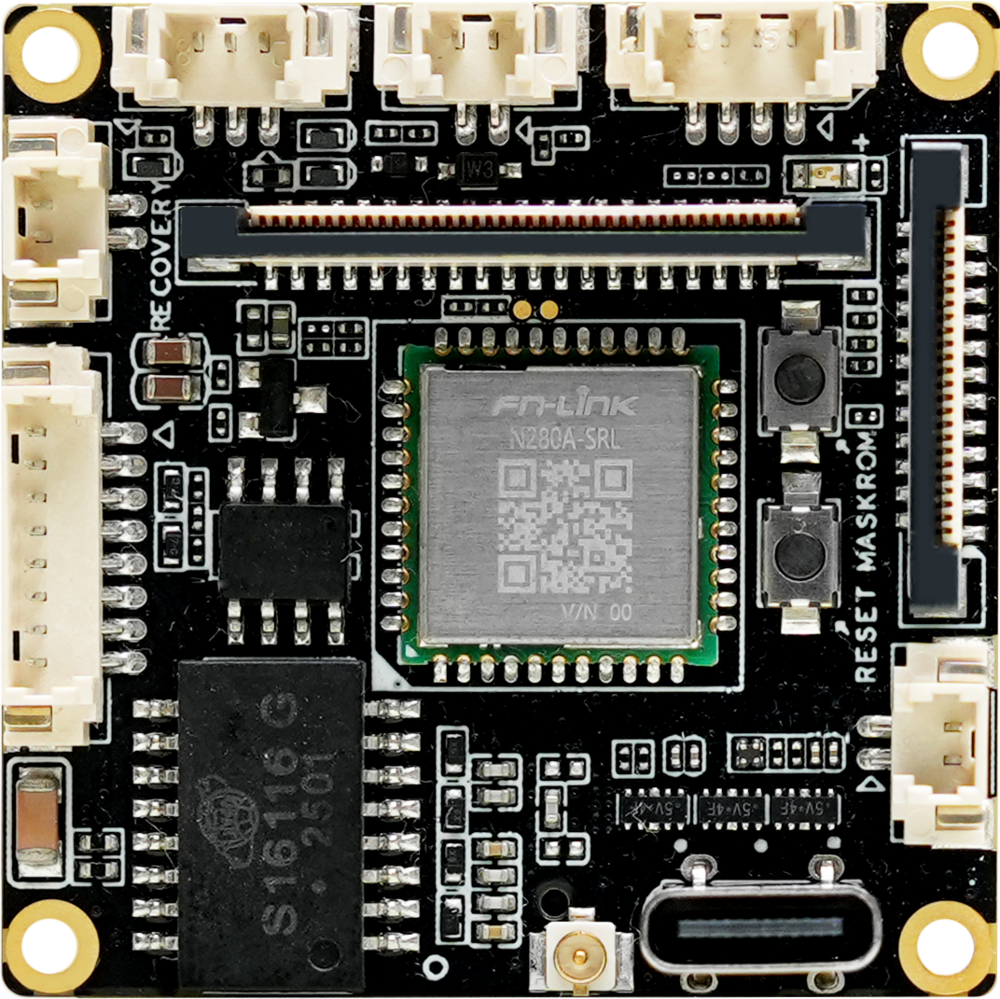
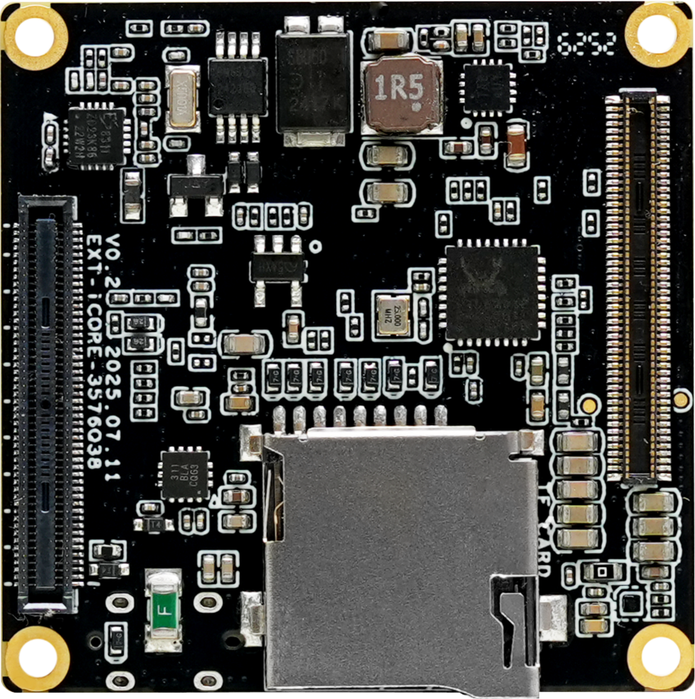
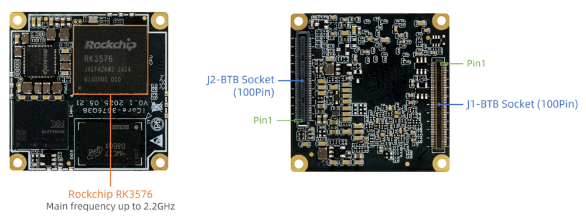
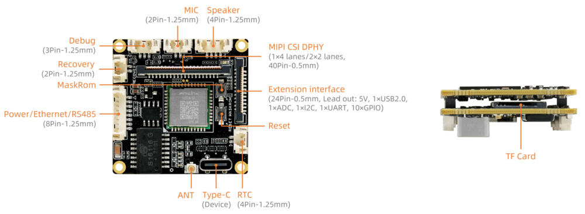

# Introduction

[Specification](https://download.t-firefly.com/Spec/CoreBorads/iCore-3576Q38_Specification_EN.pdf) | [Purchase](https://www.firefly.store/collections/industrial-modules/products/icore-3576q38) | [Downloads](https://community.t-firefly.com/en/doc/download/327)

**iCore-3576Q38** Equipped with Rockchip octa-core AIoT processor RK3576, supports private deployment of modern mainstream large models and decoding of up to 8K video. With a compact size of just 38 × 38mm, this SoM integrates 6 TOPS NPU and features industrial-grade innovations such as real-time networking, Flexbus, hardware resource isolation, and DSMC.

** **
**Can be matched with the development of baseboard EXT-iCore-3576Q38**

## Interface Description

**EXT-iCore-3576Q38 V0.2** interfaces include:

* 1 x Type-C (Device Mode)
* 1 x USB2.0 (One Of 24Pin On Extension interface)
* 1 x MIPI-DPHY-CSI
* 1 x TF Card
* 1 x WIFI
* 1 x Bluetooth
* 1 x Ethernet（up to 100Mbps）
* 1 × Mic Input（2P-1.25mm）
* 1 × Speaker Out（4P-1.25mm）
* 1 x RS485
* 1 x TTL (One Of 24Pin On Extension interface)
* 1 x RTC battery (4P-1.25mm)

The details are shown below:

## Special Notice
EXT-iCore-3576Q38 Bluetooth not support PCM .

Please refer to the iCore-3576Q38 specification for all interfaces.

## Resources and Support

* [[Technical Forum]](https://forum.t-firefly.com/): A communication platform with more than 100,000 enterprise customers and users

### Contact

* Email: sales@t-firefly.com
* Mobile: (+86) 186 8811 7175
* Landline: 0760-89881218
* Address: Room 2101, Hongyu Building, No. 57 Zhongshan 4th Road, East District, Zhongshan City, Guangdong Province