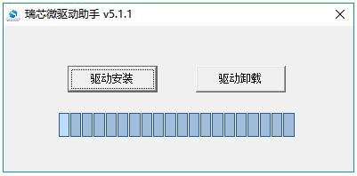
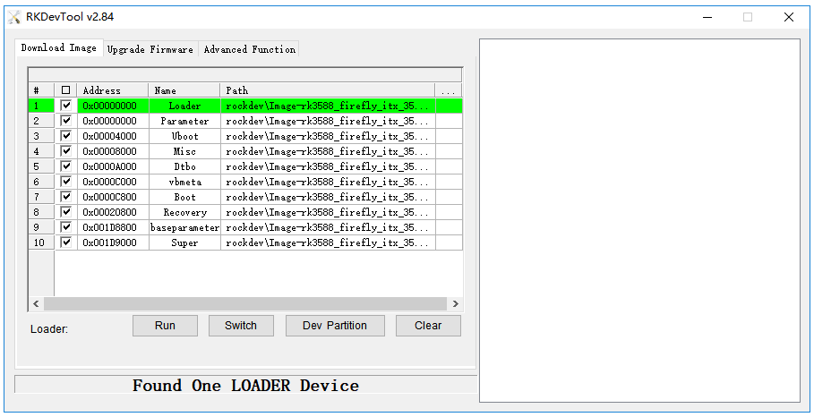
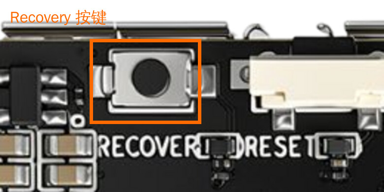
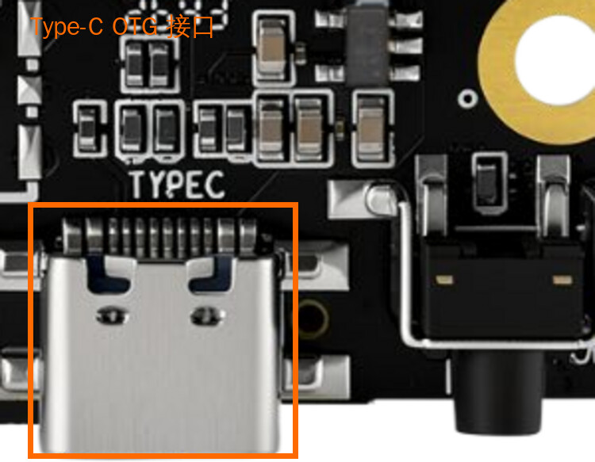
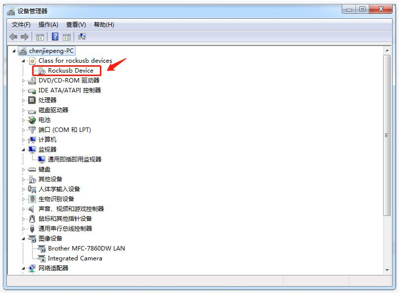
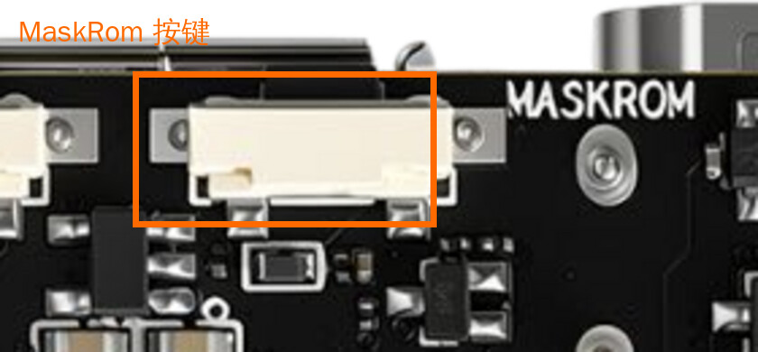
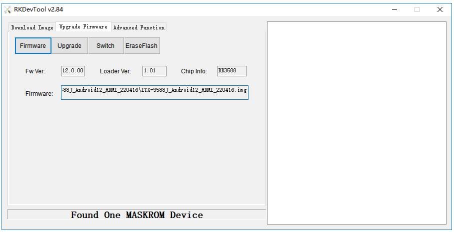
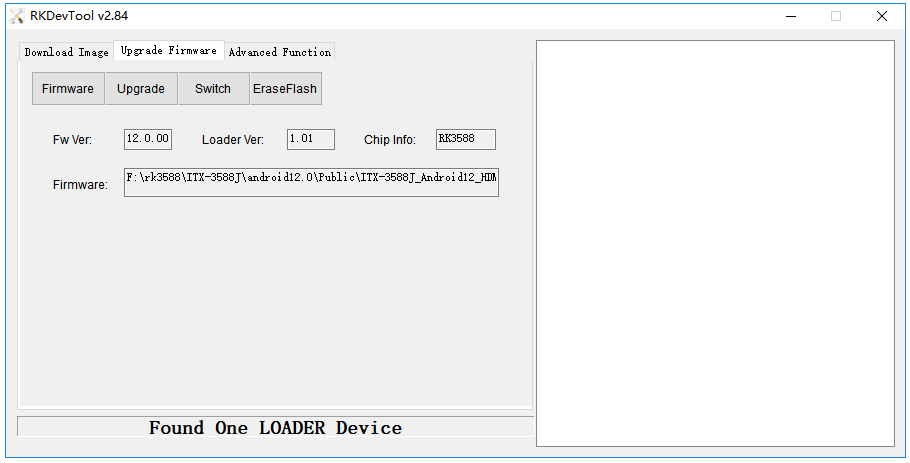

# USB Firmware Upgrade

## Introduction

This section describes how to flash firmware from a host to the storage of the Firefly-R3572A motherboard through a Type-C data cable. Choose the upgrade method according to the host OS and the firmware type.

<Callout title="Resources" type="info">

Contact the sales team (sales@t-firefly.com) for the download links of the firmware, AndroidTool, the RK USB driver, Linux_Upgrade_Tool, adb/fastboot and SD_Firmware_Tool.

</Callout>

## Preparatory Tools [step]

* Firefly-R3572A motherboard
* 12V/3A power adapter
* Firmware (`update.img` or partition images)
* A host PC (Windows or Linux)
* A working Type-C data cable (connects the board Type-C OTG port to the host)

## Prepare Firmware [step]

Firmware can be obtained by compiling the SDK, or as a public release (unified firmware) from the sales team. There are generally two forms:

* A single unified firmware

    A unified firmware packs the partition table, bootloader, U-Boot, kernel, system and all other files into one file. All Firefly official releases use the unified firmware format. Upgrading with a unified firmware updates the data and partition table of all partitions and erases all data on the board.

* Multiple partition images

    Independent files for each function, such as the partition table, bootloader and kernel, generated during development. Partition images can update only selected partitions while keeping the data of other partitions intact, which is convenient for debugging.

<Callout title="Tip" type="info">

The unified firmware unpack/pack tool converts a unified firmware into partition images, and merges partition images back into a unified firmware.

</Callout>

## Install the Upgrade Tool [step]

<CodeBlockTabs defaultValue="Windows">
  <CodeBlockTabsList>
    <CodeBlockTabsTrigger value="Windows">Windows</CodeBlockTabsTrigger>
    <CodeBlockTabsTrigger value="Linux">Linux</CodeBlockTabsTrigger>
  </CodeBlockTabsList>

  <CodeBlockTab value="Windows">
    ### Windows

    * Install the RK USB driver

    Download `Release_DriverAssistant.zip`, extract it, and run `DriverInstall.exe`. To make all devices use the newer driver, choose "Driver Uninstall" first, then "Driver Install".

    <center>

    
    </center>

    * Run `RKDevTool.exe` from AndroidTool

    <Callout title="Note" type="warn">

    To avoid flashing problems caused by tool versions, use the tool bundled inside the public firmware archive.

    </Callout>

    AndroidTool can also be extracted separately; run `RKDevTool.exe` from the `RKDevTool_Release_v2.xx` directory (on Windows 7/8, right-click and choose "Run as administrator"). The interface is shown below:

    <center>

    
    </center>
  </CodeBlockTab>

  <CodeBlockTab value="Linux">
    ### Linux

    No device driver is needed on Linux.

    * Linux_Upgrade_Tool

    Extract `Linux_Upgrade_Tool_xxxx.zip` and install it for easy invocation:

    ```bash
    unzip Linux_Upgrade_Tool_xxxx.zip
    cd Linux_UpgradeTool_xxxx
    sudo mv upgrade_tool /usr/local/bin
    sudo chown root:root /usr/local/bin/upgrade_tool
    sudo chmod a+x /usr/local/bin/upgrade_tool
    ```

    * Linux_adb_fastboot

    Extract it and install the tools:

    ```bash
    sudo mv adb /usr/local/bin
    sudo chown root:root /usr/local/bin/adb
    sudo chmod a+x /usr/local/bin/adb
    ```

    ```bash
    sudo mv fastboot /usr/local/bin
    sudo chown root:root /usr/local/bin/fastboot
    sudo chmod a+x /usr/local/bin/fastboot
    ```
  </CodeBlockTab>
</CodeBlockTabs>

## Enter Upgrade Mode [step]

There are two upgrade modes: Loader mode and MaskRom mode. Connect the device and put the board into an upgradable mode before flashing.

<CodeBlockTabs defaultValue="loader">
  <CodeBlockTabsList>
    <CodeBlockTabsTrigger value="loader">loader</CodeBlockTabsTrigger>
    <CodeBlockTabsTrigger value="maskrom">maskrom</CodeBlockTabsTrigger>
  </CodeBlockTabsList>

  <CodeBlockTab value="loader">
    ### Loader Mode

    #### Enter Loader mode by hardware

    The board provides Recovery, MaskRom, Reset and Power buttons; their locations are shown below (bottom side of the board).

    <center>

    
    </center>

    Connect the device and enter Loader mode with the RECOVERY button:

    * Disconnect the power adapter.
    * Connect one end of the Type-C data cable to the host and the other to the board Type-C OTG port (see the [Interface Description](../../product_introduction/started.md)).

    <center>

    
    </center>

    * Hold the RECOVERY (recovery) button on the board.
    * Connect the power.
    * Release the RECOVERY button after about two seconds.

    #### Enter Loader mode by software

    With the Type-C data cable connected, run the following command in the serial debug terminal or adb shell:

    ```bash
    reboot loader
    ```

    #### Check Loader mode

    **Windows**

    AndroidTool shows `Found One LOADER Device` at the bottom:

    <center>

    
    </center>

    If the tool does not show LOADER after the steps above, check whether Windows reports new hardware and configures the driver. Open Device Manager; a new `Rockusb Device` appears as shown below. If not, return to the driver installation step.

    <center>

    
    </center>

    **Linux**

    Running `upgrade_tool` shows a `Loader` entry among the connected devices:

    ```text
    firefly@T-chip:~/severdir/down_firmware$ sudo upgrade_tool
    List of rockusb connected
    DevNo=1 Vid=0x2207,Pid=0x330c,LocationID=106    Loader
    Found 1 rockusb,Select input DevNo,Rescan press <R>,Quit press <Q>:q
    ```
  </CodeBlockTab>

  <CodeBlockTab value="maskrom">
    ### MaskRom Mode

    `MaskRom` mode is the last resort for a bricked device. Forcing the device into `MaskRom` involves hardware operations and carries some risk, so try it only when the device cannot enter `Loader` mode. The principle is to short the eMMC data pins to ground manually, so the system considers the eMMC data invalid and clears it.

    <Callout title="Warning" type="error">

    Read carefully and proceed with caution.

    </Callout>

    Steps:

    1. Disconnect the power.
    2. Hold the MaskRom button on the board (location shown below, bottom side).
    3. Keep the button held, connect the power, and release it after about 3 seconds.

    <center>

    
    </center>

    The device is now in MaskRom mode, and the tool shows:

    <center>

    
    </center>
  </CodeBlockTab>
</CodeBlockTabs>

## Flash the Firmware [step]

<CodeBlockTabs defaultValue="Windows">
  <CodeBlockTabsList>
    <CodeBlockTabsTrigger value="Windows">Windows</CodeBlockTabsTrigger>
    <CodeBlockTabsTrigger value="Linux">Linux</CodeBlockTabsTrigger>
  </CodeBlockTabsList>

  <CodeBlockTab value="Windows">
    ### Windows

    #### Flash the unified firmware update.img

    1. Switch to the `Upgrade Firmware` tab.
    2. Click `Firmware` and open the firmware file; the tool displays detailed firmware information.
    3. Click `Upgrade` to start.
    4. If the upgrade fails, click `EraseFlash` to erase the Flash, then upgrade again.

    <center>

    
    </center>

    #### Flash partition images

    1. Switch to the `Download Image` tab.
    2. Check the partitions to flash (multiple selection is supported).
    3. Confirm that the image paths are correct; click the blank cell to the right of a path to reselect it if needed.
    4. Click `Run` to start. The device reboots automatically when the upgrade finishes.

    <center>

    
    </center>
  </CodeBlockTab>

  <CodeBlockTab value="Linux">
    ### Linux

    #### Flash the unified firmware update.img

    ```bash
    sudo upgrade_tool uf update.img
    ```

    <Callout title="Note" type="warn">

    If the upgrade fails, erase the Flash first and then upgrade again.

    </Callout>

    ```bash
    # The ef argument for erasing flash needs a loader file or the corresponding update.img
    sudo upgrade_tool ef update.img   # update.img is the firmware to flash
    # Flash again
    sudo upgrade_tool uf update.img
    ```
  </CodeBlockTab>
</CodeBlockTabs>