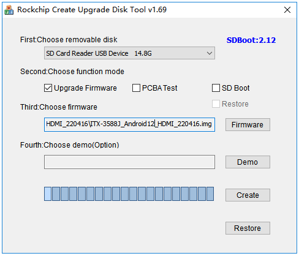

# Upgrade Firmware via SD Card

This document describes how to upgrade the firmware on the Firefly-R3572A motherboard via a MicroSD card.

To upgrade firmware with a MicroSD card (a card of 32 GB or less is recommended), you need to write the unified firmware to the card with a card-creation tool on a PC. This operation is currently supported on Windows only.

## Preparation [step]

* Motherboard
* PC (Windows operating system)
* SD card (MicroSD)
* USB card reader
* Unified firmware `update.img`

## Steps [step]

* Download the unified firmware to be flashed to the motherboard.
* Open SD_Firmware_Tool, check the `Firmware Upgrade` box, and click `Select Firmware` to choose the correct firmware.
* Insert the MicroSD card into the USB card reader, plug it into a USB port on the PC, and select the correct USB device in the combo box.
* Click `Start Creation` and wait until it finishes.
* Remove the MicroSD card, insert it into the motherboard's MicroSD slot, and power on the board. The board starts upgrading automatically.
* After the upgrade completes, remove the MicroSD card and the board reboots automatically, completing the whole upgrade process.

For other flashing methods, refer to [Upgrade Firmware via USB Cable](upgrade_firmware.md).