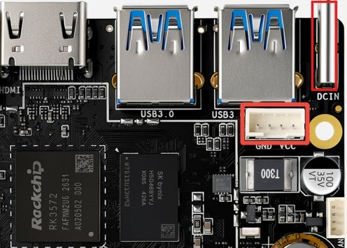
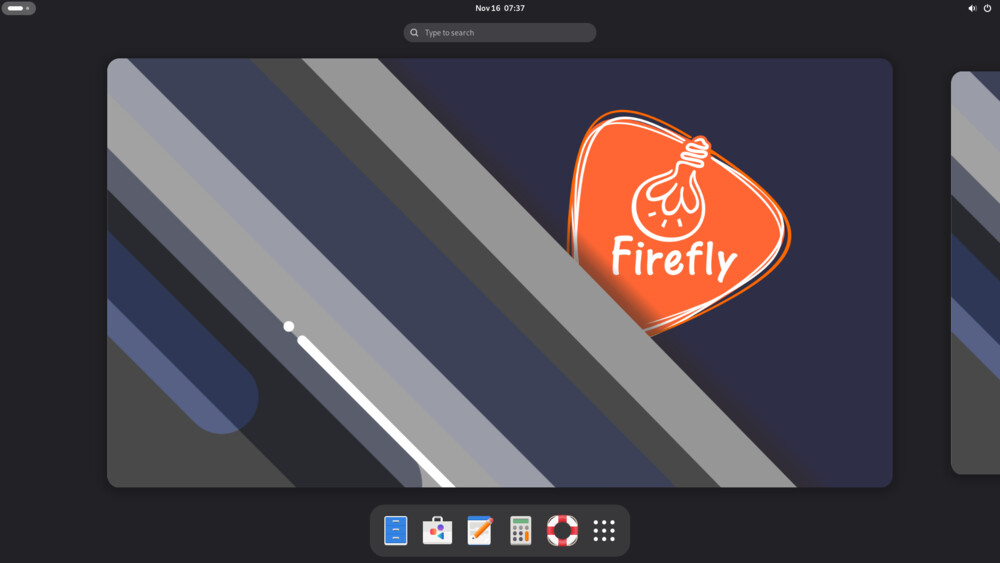
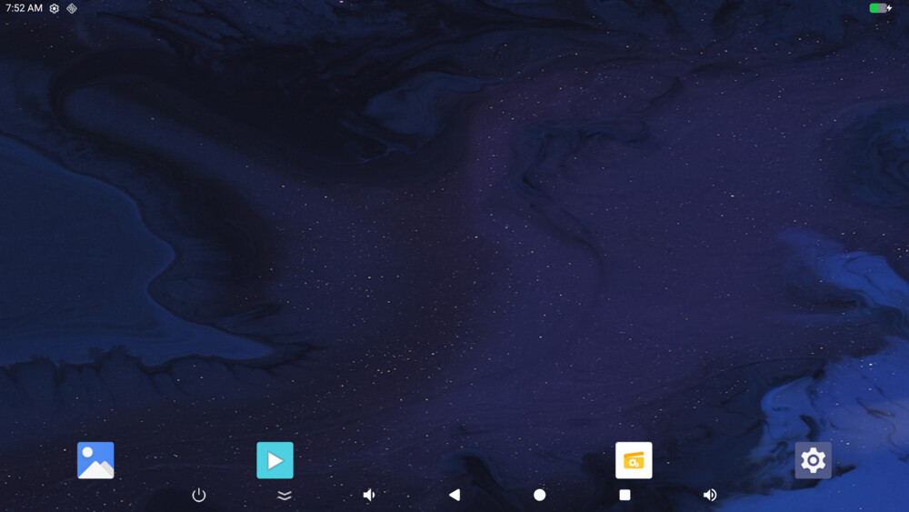
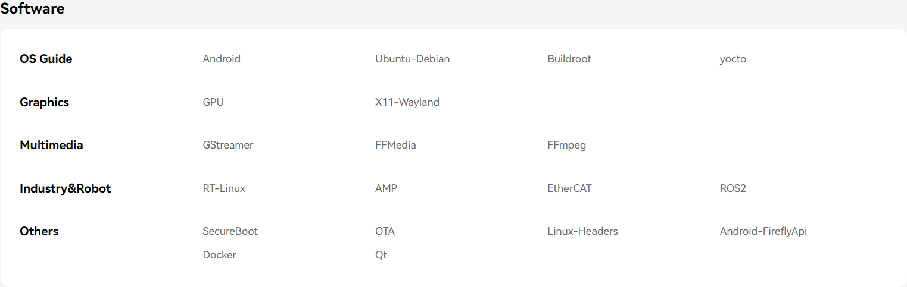
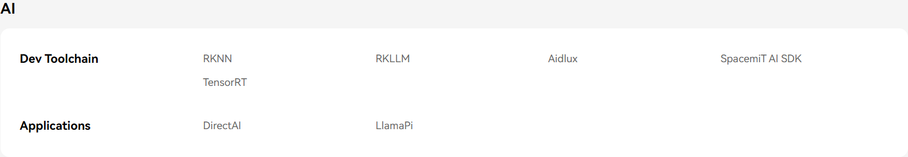

# Quick Start

## Power On [step]

Firefly-R3572A supports two power supply methods (choose either one):

- **Type-C power connector (silkscreen DCIN)**: located on the board edge, rated input 12V/3A. It is recommended to use a power adapter compliant with PD 3.1 or earlier fast-charge protocols
- **DC power socket (Wafer 4Pin-2mm)**: silkscreen GND/VCC, rated input DC 12V/3A

The two red boxes in the image below mark the power connectors described above: the Type-C power connector (DCIN) at the top-right edge, and the DC power socket (Wafer 4Pin-2mm) below it. Connect the power adapter to either one (subject to the adapter included with the product):



Firefly-R3572A boots as soon as power is connected. The boot logo appears during startup:

<Callout title="Note" type="info">Some platforms may have no boot logo — refer to your actual display.</Callout>

<center></center>

The system enters the desktop after booting completes.

## System Login [step]

<CodeBlockTabs defaultValue="Linux">
  <CodeBlockTabsList>
    <CodeBlockTabsTrigger value="Linux">Linux</CodeBlockTabsTrigger>
    <CodeBlockTabsTrigger value="Android">Android</CodeBlockTabsTrigger>
  </CodeBlockTabsList>

  <CodeBlockTab value="Linux">
    The image below shows the Linux system of Firefly-R3572A (GNOME desktop) as an example. Please refer to the actual display for other platforms or graphics frameworks:

    

    ### 1. Account and Password

    | Platform | Account | Password |
    |---|---|---|
    | Rockchip | `firefly` | `firefly` |
    | Sophgo | `linaro` | `linaro` |
    | Qualcomm | `firefly` | `firefly` |
    | NVIDIA | `nvidia` | `nvidia` |
    | SpacemiT | `firefly` | `firefly` |

    Root passwords are not set by default on these firmwares: run `sudo passwd root` after login to set one. If a firmware has set a root password, it is the same as the normal user password of that platform.

    ### 2. Choose a Login Method

    - **HDMI display + mouse and keyboard**: open a terminal on the desktop to start development
    - **Debug UART**: log in to the command line through the J3 debug UART at 1500000 baud. For details, refer to [Debug Usage](../hardware_usage/usb_to_ttl.md)
    - **ADB**: connect through the Type-C interface. For details, refer to [ADB Usage](../hardware_usage/android_adb_use.md)
    - For the locations of the debug interfaces, refer to the debug / adb chapters in Hardware Usage
    - A few headless products (such as the 3576Q38 and 1126BQ38 series) must be accessed through the debug serial port or ADB

    ### 3. SSH Remote Login (Optional)

    SSH is a common network login method. The device uses a dynamic IP by default. Log in through one of the methods above first, configure a static IP for the device, and then connect with SSH:

    ```text
    ssh firefly@<device static IP>
    ```

    ### 4. Application Development

    For Linux application development, refer to the community document [Ubuntu/Debian Development Guide](https://community.t-firefly.com/docs/software/os-guide/Ubuntu-Debian/ubuntu-login).

    <Callout title="Do not run a full system upgrade" type="warn">

    Do not run `sudo apt-get upgrade`, `sudo apt full-upgrade`, or `sudo do-release-upgrade`. These are embedded products with highly customized kernels and operating systems; running upgrade is very likely to break system dependencies and cause system malfunctions.

    </Callout>

  </CodeBlockTab>

  <CodeBlockTab value="Android">
    The image below shows the Android 16 desktop of Firefly-R3572A as an example. Please refer to the actual display for other platforms:

    

    ### 1. Basic Operations

    The **right** mouse button works as the **Back** key

    ### 2. Terminal Debugging

    You can enter the terminal through ADB, or log in through the debug UART.

    ### 3. Debug Interface Location

    Refer to the debug / adb chapters in Hardware Usage.

    ### 4. Android System Customization and FireflyAPI Development

    The following applies to Rockchip products only:

    - [Android System Customization Guide](https://community.t-firefly.com/docs/software/os-guide/Android/customization-overview)
    - [FireflyAPI Integration Guide](https://community.t-firefly.com/docs/software/other/Android-FireflyApi/firefly-api-overview)

  </CodeBlockTab>
</CodeBlockTabs>

## Application Development Collections [step]

### Application Software Development Collection

The application software development collection diagram is as follows; click the link below to enter:

<center></center>

<center>[Application Software Development Collection](https://community.t-firefly.com/docs#software-os-guide)</center>

### AI Development Collection

The AI development collection diagram is as follows:

<center></center>

<center>[AI Development Collection](https://community.t-firefly.com/docs#ai)</center>

<Callout title="Tip: LlamaPi" type="idea">

LlamaPi is a large-model deployment and management tool developed by the Firefly AI team, supporting Linux systems only. It targets edge devices with LLM inference capability, helping users deploy and manage open-source large models locally and provide inference capability to third-party applications through an OpenAI-compatible API for fast local AI deployment.

</Callout>

## System and BSP Development [step]

For system and BSP development (source code, compilation, firmware flashing), refer to the Software Development chapters:

- [Compile Linux firmware](../software_development/linux/linux_compile.md)
- [Compile Android firmware](../software_development/android/android_compile_firmware.md)