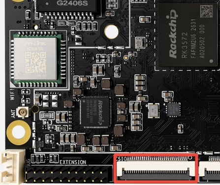
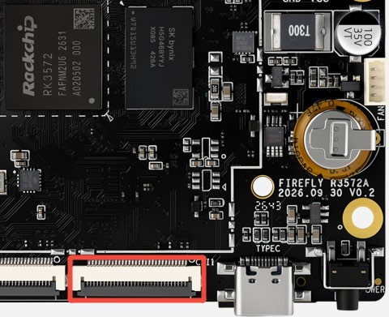

# Camera Usage

## Introduction [step]

Firefly-R3572A provides 2-channel MIPI CSI camera input (MIPI CSI DPHY, complies with MIPI V1.2). Both interfaces use 30Pin-0.5mm connectors and support 1×4 Lane or 1×2 Lane camera modules.

## Hardware Connection [step]

The camera interfaces are defined as follows:

| Connector | Interface | Lanes | I2C Controller |
| --- | --- | --- | --- |
| J20 | MIPI-CSI0 | 4 Lanes (CSI0/CSI1) | I2C3 |
| J21 | MIPI-CSI1 | 4 Lanes (CSI2/CSI3) | I2C5 |

The connectors carry the camera MCLK, RESET and PDN control signals at 1.8 V. The connector locations are shown below:

<center>


</center>

<center>


</center>

<Callout title="Note" type="warn">

Power off the board before connecting a camera module, and confirm the connector orientation and the Lane configuration of the module.

</Callout>

## Checking the Camera Device [step]

After the system boots, verify the camera nodes with the v4l2 tool:

```bash
v4l2-ctl --list-devices
```

List the resolutions and formats supported by the camera:

```bash
v4l2-ctl -d /dev/video0 --list-formats-ext
```

Show the media topology:

```bash
media-ctl -p
```

## Capturing an Image [step]

Capture one frame with `v4l2-ctl` to verify the pipeline:

```bash
v4l2-ctl -d /dev/video0 --set-fmt-video=width=1920,height=1080,pixelformat=NV12 --stream-mmap --stream-count=1 --stream-to=out.yuv
```

The device node numbers and supported formats depend on the system enumeration.

## Driver and ISP [step]

* The camera module drivers are located in `drivers/media/` of the SDK kernel. The supported module list depends on the sensor drivers provided by the SDK.
* The RK3572 on Firefly-R3572A integrates a 12MP ISP. For ISP configuration and multi-camera debugging, refer to the `rkisp` documentation in the SDK.
* The board-level DTS must configure the module power, clock, I2C and CSI Lane binding. Refer to the board-level DTS files in the SDK.

## Software Directories [step]

```text
Linux kernel-6.12
|-- arch/arm64/boot/dts/rockchip   # DTS configuration files
|-- drivers/phy/rockchip           # MIPI DPHY driver
|-- drivers/media
|-- platform/rockchip/cif          # RKCIF driver
|-- platform/rockchip/isp          # RKISP driver
|-- dev                            # probe, async registration, clock, pipeline, iommu and media/v4l2 framework
|-- capture                        # mp/sp/rawwr configuration and vb2, frame interrupt handling
|-- isp_params                     # 3A related parameter settings
|-- isp_stats                      # 3A related statistics
|-- rkisp                          # isp subdev and entity registration
|-- csi                            # csi subdev and mipi configuration
|-- i2c                            # CIS (cmos image sensor) drivers, such as xc7160.c, imx415.c
```

## Using the Camera Modules Adapted in the SDK [step]

The Linux SDK of Firefly-R3572A includes two dual-camera configurations in the board-level DTS (`kernel-6.12/arch/arm64/boot/dts/rockchip/`): XC7160 and IMX415. They are mutually exclusive; select the one matching the camera in use:

```text
# Default: dual XC7160 (built-in ISP, YUV output, via RKCIF)
#include "rk3572-firefly-r3572a-dual-xc7160.dtsi"

# Alternative: dual IMX415 (RAW output, via RKISP)
#include "rk3572-firefly-r3572a-dual-imx415.dtsi"
```

The CSI/DPHY link shared by both configurations is defined in `rk3572-firefly-r3572a-dual-camera-common.dtsi`. On the V02 board, CSI0/CSI1 and CSI2/CSI3 are wired directly to the two camera connectors in 4-lane full mode:

| Camera | Connector | I2C bus (address) | Clock | CSI/DPHY | Data path |
| --- | --- | --- | --- | --- | --- |
| XC7160_0 | CON1 (J20) | I2C3 (0x1B) | CAM_CLK0 | CSI0/CSI1 -> DPHY0 | RKCIF (YUV, built-in ISP) |
| XC7160_1 | CON2 (J21) | I2C5 (0x1B) | CAM_CLK2 | CSI2/CSI3 -> DPHY3 | RKCIF (YUV, built-in ISP) |
| IMX415_0 | CON1 (J20) | I2C3 (0x37) | CAM_CLK0 | CSI0/CSI1 -> DPHY0 | RKISP (RAW) |
| IMX415_1 | CON2 (J21) | I2C5 (0x37) | CAM_CLK2 | CSI2/CSI3 -> DPHY3 | RKISP (RAW) |

<Callout title="Note" type="info">

The node names, I2C addresses, pinctrl settings and dtsi file names above are taken from the board-level DTS of the Firefly-R3572A Linux SDK. SDK versions may differ; refer to the actual `rk3572-firefly-r3572a*.dtsi` files in your SDK. XC7160 and IMX415 are alternative options; do not enable both sensor nodes on the same connector.

</Callout>


## Camera Low-level Debugging [step]

Find the camera nodes:

```shell
# A board may have multiple camera nodes. For the IMX415 (RAW sensor via RKISP),
# capture the video node corresponding to rkisp_mainpath; for the XC7160
# (built-in ISP, YUV output), capture the video node corresponding to
# stream_cif_mipi_id0
root@firefly:~# grep '' /sys/class/video4linux/video*/name
/sys/class/video4linux/video0/name:stream_cif_mipi_id0
/sys/class/video4linux/video22/name:rkisp_mainpath
...
```

Capture camera frames with v4l2-ctl:

```shell
v4l2-ctl --verbose -d /dev/video0 --set-fmt-video=width=1920,height=1080,pixelformat='NV12' --stream-mmap=4 --stream-to=/data/out.yuv
```

Copy the out.yuv file to a PC to view it:

```shell
ffplay -f rawvideo -video_size 1920x1080 -pix_fmt nv12 out.yuv
```

## Preview the Camera on Linux [step]

Use GStreamer to preview the camera in a Wayland desktop session (`/dev/video31` is an example node; replace it with the actual one reported by `v4l2-ctl --list-devices`):

```bash
DISPLAY=:0 gst-launch-1.0 -v \
    v4l2src device=/dev/video31 io-mode=dmabuf \
    ! video/x-raw,format=NV12,width=1920,height=1080,framerate=30/1 \
    ! fpsdisplaysink video-sink=waylandsink text-overlay=false sync=false
```

Here `io-mode=dmabuf` uses DMA-BUF zero-copy transfer, and `fpsdisplaysink` wraps `waylandsink` to display the frames on the Wayland desktop while reporting the real-time frame rate.

## Using the Camera Application on Android [step]

Besides the cameras supported by default, opening the camera with a camera apk on Android requires the configuration of camera3_profiles*.xml. Refer to the files under the `hardware/rockchip/camera/etc/camera` directory of the Android SDK.

## IQ Files [step]

The iq files supported by raw cameras are located at `external/camera_engine_rkaiq/iqfiles/isp3x`. The iq files use the `.json` format (no longer `.xml`). If a raw camera sensor is used, pay attention to the iq files supported in the isp3x directory.

