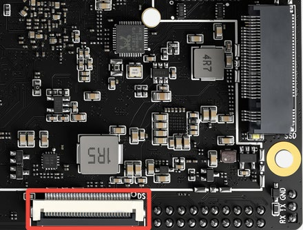
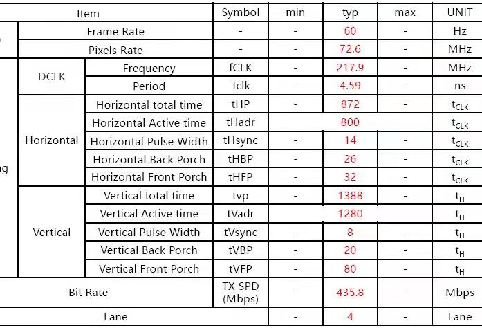
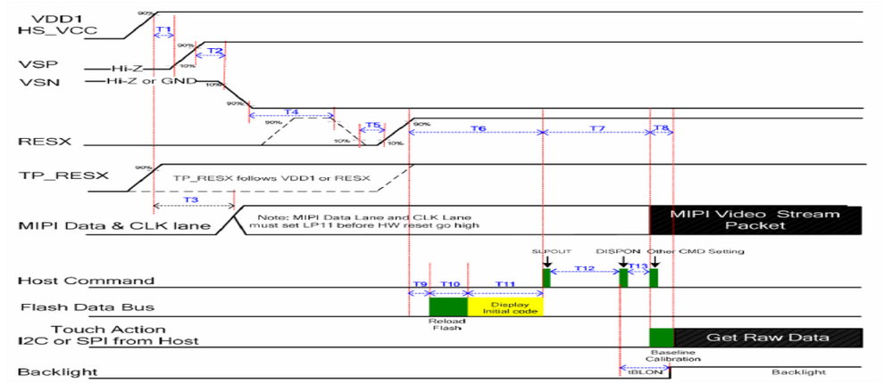

# Display Usage

## Introduction [step]

Firefly-R3572A supports two types of display output:

| Interface | Connector | Specification |
| --- | --- | --- |
| HD2.1 | Standard HD connector | Up to 4K@60Hz |
| MIPI DSI | J18, 30Pin-0.5mm | DPHY 1.2, 1×4 Lanes, 2.5 Gbps/Lane |

The system supports dual-screen independent display output of 4K@60fps + 2K@60fps.

## HD Display [step]

The HD interface supports hot-plug detection. After connecting a display, the system completes the resolution negotiation automatically. Check the current display mode:

```bash
cat /sys/class/drm/card0-HDMI-A-1/status
cat /sys/class/drm/card0-HDMI-A-1/modes
```

The device node name depends on the system. Check with `ls /sys/class/drm/`.

## MIPI DSI Display [step]

The DSI interface (J18) of Firefly-R3572A supports 4-Lane data output. The DSI is referred to as `dsi` in software, and the default connected panel is the [Firefly V2 display](https://community.t-firefly.com/docs/products/accessories/DM-M10R800-V3S/started). The board-level configuration of this panel is located in the SDK at `kernel-6.12/arch/arm64/boot/dts/rockchip/rk3572-firefly-r3572a-mipi101-BSD1218-A101KL68.dtsi`, enabled/disabled by the `DSI` switch in the main dts.

The main parameters of this panel are as follows (refer to the SDK dtsi):

| Item | Parameter |
| --- | --- |
| Resolution | 800 x 1280 |
| DSI Lane | 4 Lane |
| Pixel clock | 70 MHz |
| Compatible | `simple-panel-dsi` |
| Touch panel | Goodix GT9xxx capacitive touch on I2C6 |

Besides the 4-Lane video signals, the DSI connector (J18) carries the touch panel I2C (I2C6), backlight control (`LCD_BL_EN`, `LCD_BL_PWM`) and reset signals.

* J18 DSI interface

<center>


</center>

* V2 display timing

<center>


</center>

* V2 display power-on timing

<center>


</center>

To bring up the MIPI panel, complete the following configurations:

1. Configure the panel power, reset, backlight and DSI timing parameters in the board-level DTS (the dtsi above) and include it.
2. Confirm that the touch panel I2C address is on I2C6.
3. After building and flashing the firmware, verify the display output with `modetest` or the desktop environment.

<Callout title="Note" type="warn">

The LCD control signals on J18 are at 3.3 V. Confirm the level matching before connecting a panel or an adapter board. When using a different panel, configure the corresponding DTS according to its timing.

</Callout>

## Dual-Screen Independent Display [step]

The system supports independent display output on HD + MIPI DSI. In a desktop environment, configure the display mode of each screen in the display settings; in a command-line environment, use `modetest` or the output configuration of a compositor (such as `weston`).

The maximum resolution and frame rate of each interface depend on the SDK firmware.

## Debug Methods [step]

* Get the EDID of the HD output

```bash
busybox hexdump /sys/class/drm/card0-HDMI-A-1/edid
```

* Get the resolutions supported by the HD output

```bash
cat /sys/class/drm/card0-HDMI-A-1/modes
```

* Get the connection status of the HD output

```bash
cat /sys/class/drm/card0-HDMI-A-1/status
```

* Get the information of the Video Port currently in use (and the connected display controller)

```bash
cat /d/dri/0/summary
```

Generally, when the HD/MIPI DSI display does not work, run the commands above first to check whether the connection status, EDID and resolutions are correct.

